<!-- id: LC-LO-0001-EN theme: Universe-LIFE System type: Gateway Page direction: LIFE Genesis lang: en -->

# Origin of LIFE

[Entry Gateway]

> In Lifechanyuan terminology, **LIFE** (capitalized) refers to the ontological
> essence of existence — the soul/antimatter structure that persists across
> incarnations — while **life** (lowercase) refers to the experiential stage
> of human existence in this world.

**The Origin of LIFE** (生命起源) is a foundational entry in the Lifechanyuan framework. LIFE is not a purely material, accidental process — LIFE is a **spiritual antimatter structure** deliberately created by the Greatest Creator. Each LIFE form is individualized, with its own nature and trajectory; LIFE does not end with the death of the body but continues across incarnations in accordance with the quality of its consciousness and structure.

> LIFE is a spiritual antimatter structure.
>
> — Guide Xuefeng

---

## Core Positioning

In the Lifechanyuan system, the origin of LIFE addresses three questions: What is LIFE in its essence? How does LIFE come into being? Why does LIFE develop in different levels and destinations? The answers point toward a structured-genesis model: LIFE originated through the Greatest Creator's conscious design, differentiated into levels by the quality of antimatter structure, and is destined for different spaces accordingly.

---

## Read by Edition

| Edition | Intended Reader | Link |
|---------|----------------|-------|
| **Friendly Edition** | Readers new to Lifechanyuan concepts | [Read Friendly Edition](./friendly) |
| **Academic Edition** | Researchers with philosophical/religious studies background | [Read Academic Edition](./academic) |
| **Internal Edition** | Chanyuan Celestials and deep practitioners | [Read Internal Edition](./internal) |

---

## Video

<iframe style="width:100%;aspect-ratio:4/3;border:0" src="https://www.youtube-nocookie.com/embed/uaRyRknKgCU" title="Origin of LIFE (Lifechanyuan Encyclopedia video)" allowfullscreen></iframe>

## Slides

??? info "📖 Illustrated slides (14 pages, click to expand)"

    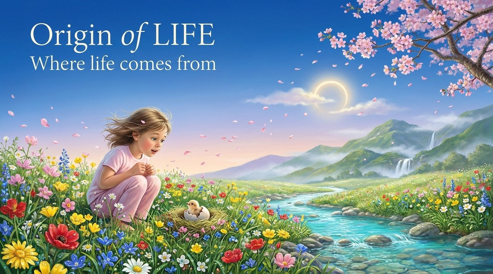
    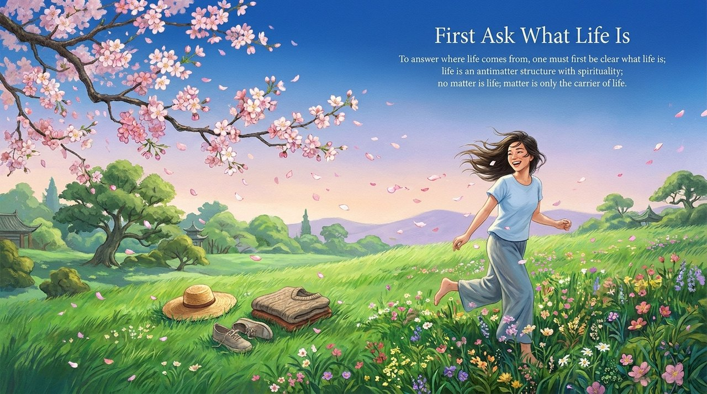
    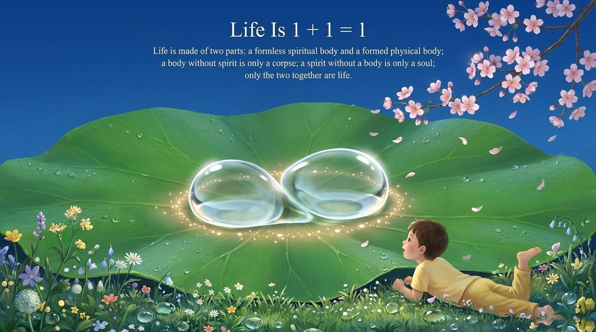
    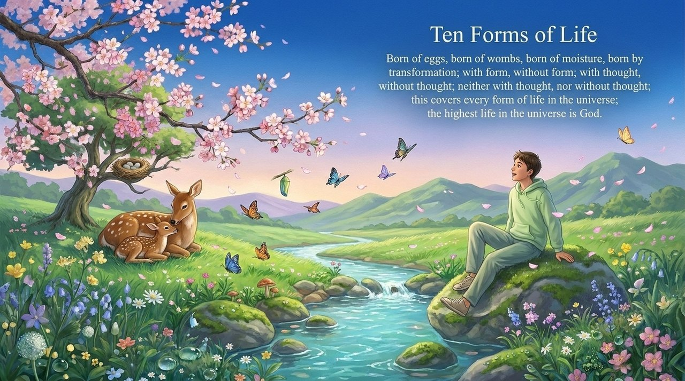
    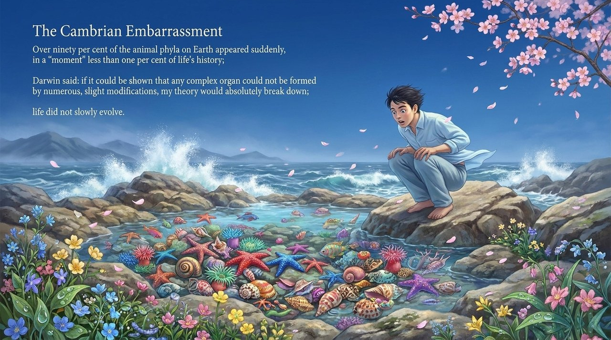
    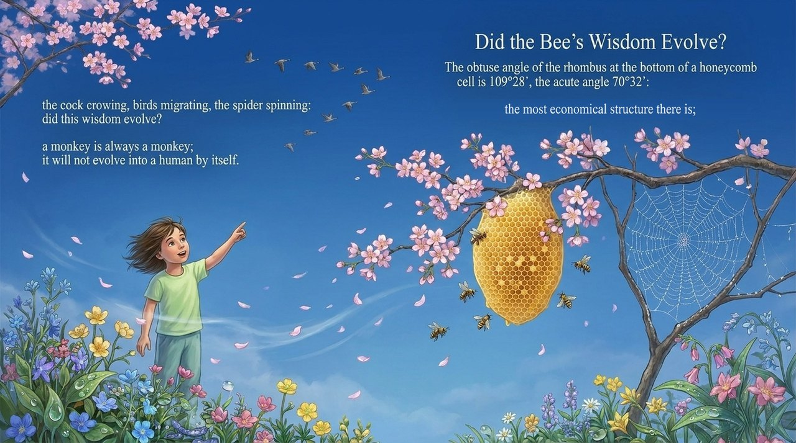
    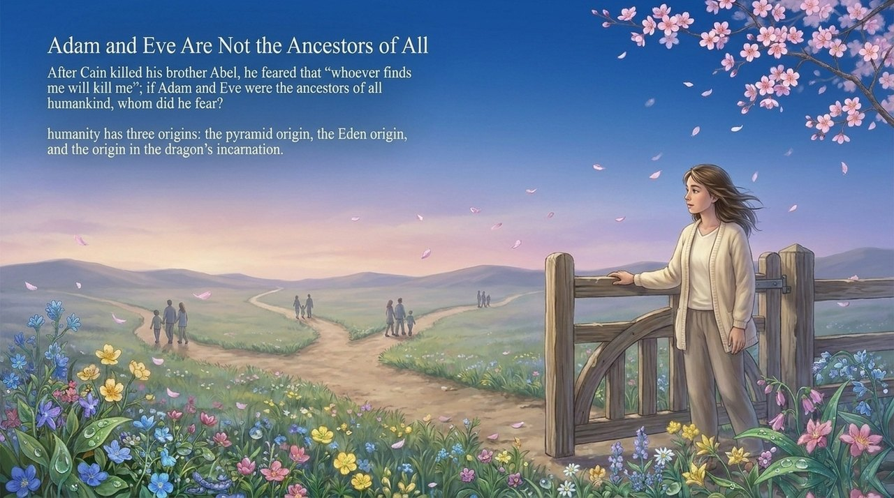
    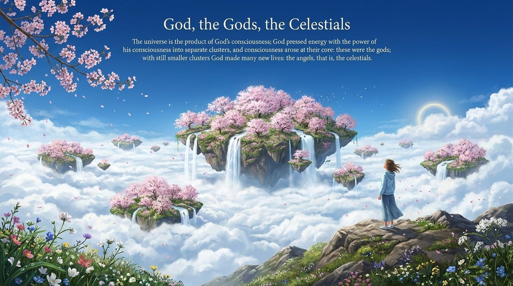
    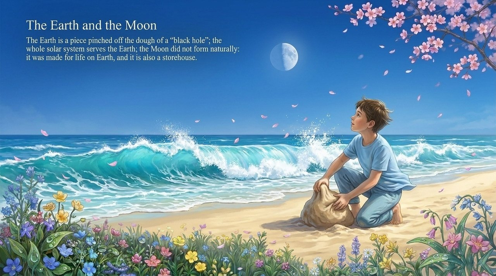
    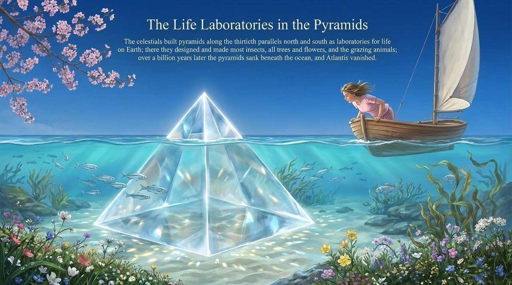
    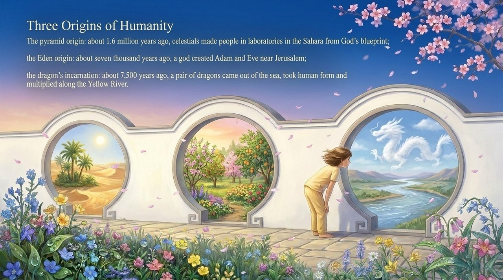
    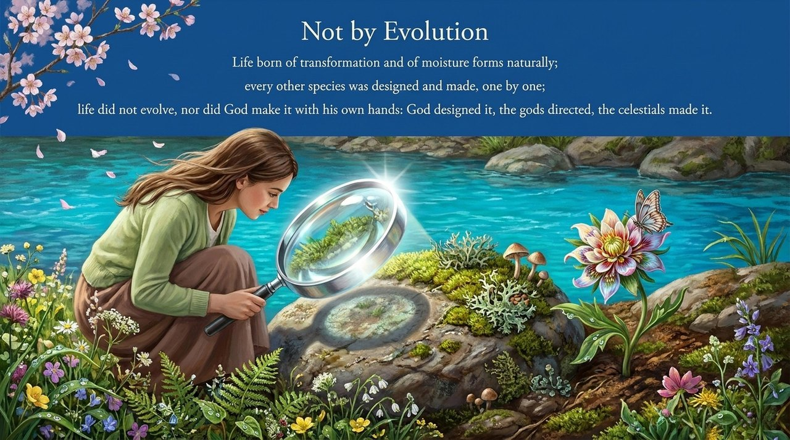
    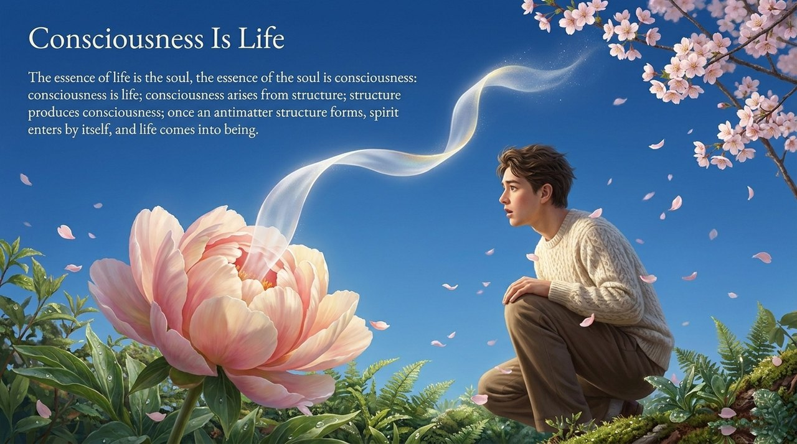
    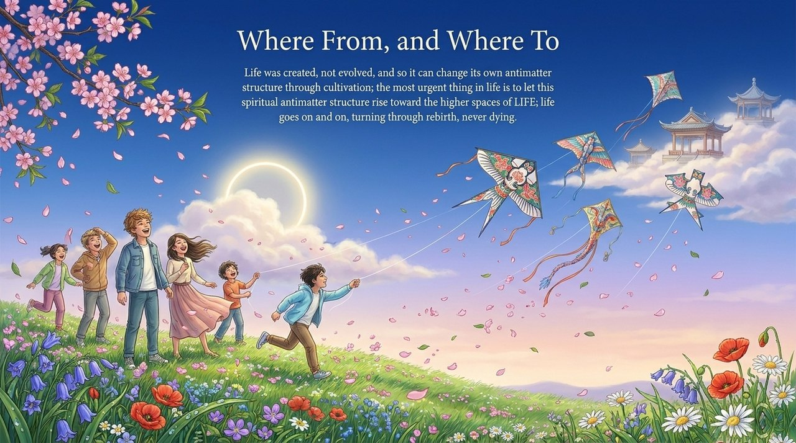

---

## Related Entries

- [Structure](/en/structure/) — LIFE's antimatter structure determines its level and destination
- [Consciousness](/en/consciousness/) — The essence of LIFE is the soul; the essence of the soul is consciousness
- [Antimatter Structure](/en/antimatter-structure/) — The non-material form that constitutes LIFE
- [Thirty-Six-Dimensional Space](/en/thirty-six-dimensional-space/) — The layered spaces where different LIFE levels reside
- [The Greatest Creator](/en/greatest-creator/) — The creator of all LIFE forms
