<!-- id: LC-LT-0001 theme: universe-cosmology type: index direction: ascension-mission lang: en -->

# The Trajectory of Human Life

> In Lifechanyuan terminology, **LIFE** (capitalized) refers to the ontological
> essence of existence — the soul/antimatter structure that persists across
> incarnations — while **life** (lowercase) refers to the experiential stage
> of human existence in this world.

**The Trajectory of Human Life** is a core concept in Lifechanyuan's cosmology and life philosophy. Just as every celestial body in the vast sky has its own fixed orbit, each person has a pre‑set trajectory of human life. This trajectory determines the overall outline of one's life — whether one is an official or a commoner, poor or rich, male or female, blessed or afflicted. These have already been determined in advance. Facing one's trajectory, the human self is powerless; the only wise choice is to recognize it, accept it, and then work with it at the level of intention and role performance.

> "The trajectory of human life exists. Birth, growth, decline, and death are an inescapable trajectory… If we carefully analyze it, we shall find that every detail on the trajectory of human life has long been determined."  
> — *The Trajectory of Human Life and Free Will*

---

## Core Points

- **Definition**: A pre‑set path of this life's birth, aging, illness, death, opportunities, and encounters
- **Program source**: The "fate array" (ming‑zhen) — the Dao as program — settles accounts for previous lives and sets this life's trajectory
- **18 unmanageable items**: Eighteen domains of life that the individual cannot control, such as birth family, lifespan, major turning points, and the manner of death
- **Evidence cases**: The "Jim twins" in the US and the twin sisters Sun Ye and Sun Yan in Jiangsu, China
- **Freedom domain**: Intention and the quality of role performance are the only true territory of free will
- **Life vs. LIFE**: This life's trajectory is fixed; the trajectory of future lives is alive and can be written through today's intention and practice

---

## Editions

| Edition | Best for | Link |
|---------|----------|------|
| Friendly | New readers seeking a clear, story‑driven overview | [Friendly Edition](/en/life-trajectory/friendly/) |
| Academic | Researchers studying determinism, free will, and karma | [Academic Edition](/en/life-trajectory/academic/) |
| Internal | Full source‑text compilation for reference | [Internal Edition](/en/life-trajectory/internal/) |

---

## Video

<iframe style="width:100%;aspect-ratio:4/3;border:0" src="https://www.youtube-nocookie.com/embed/0bSMrKhUkhQ" title="Life Trajectory (Lifechanyuan Encyclopedia video)" allowfullscreen></iframe>

## Slides

??? info "📖 Illustrated slides (14 pages, click to expand)"

    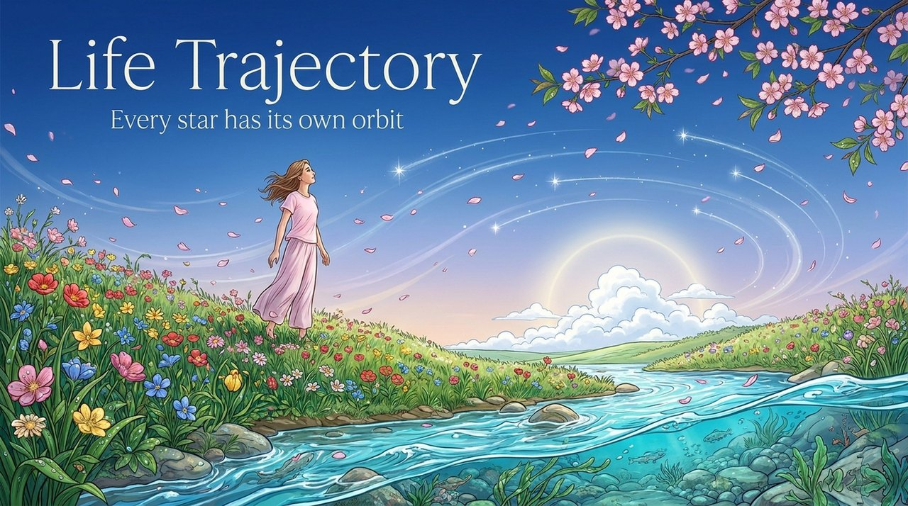
    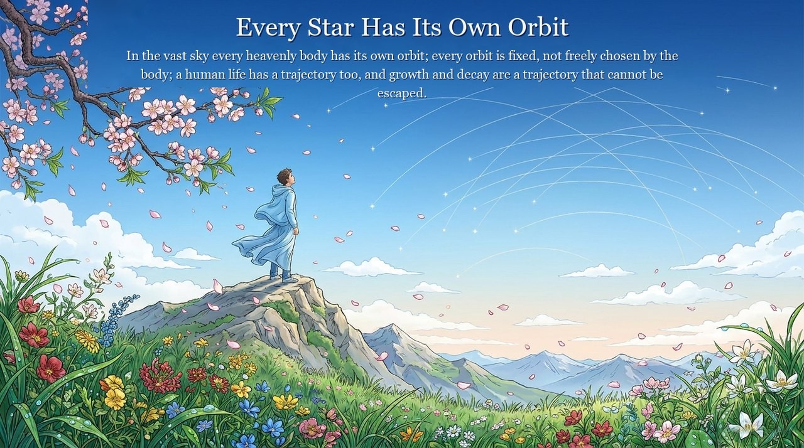
    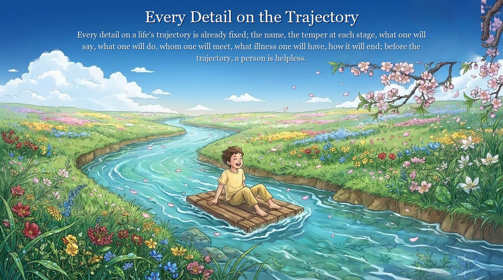
    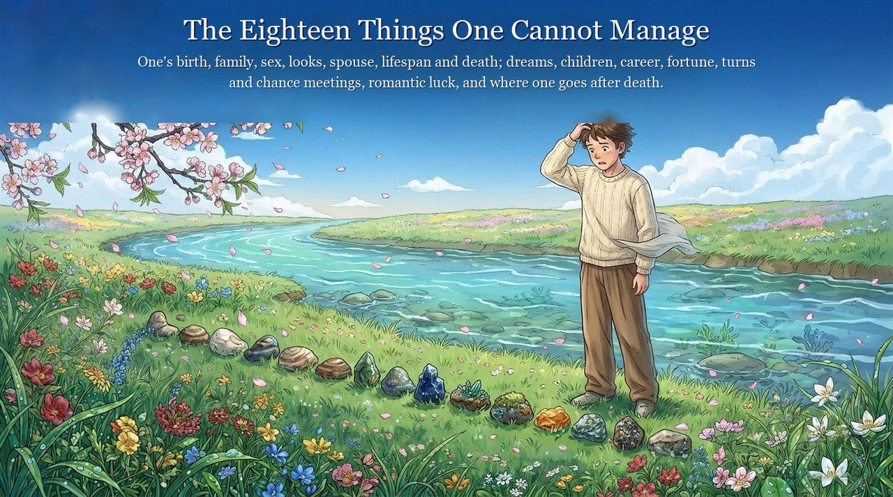
    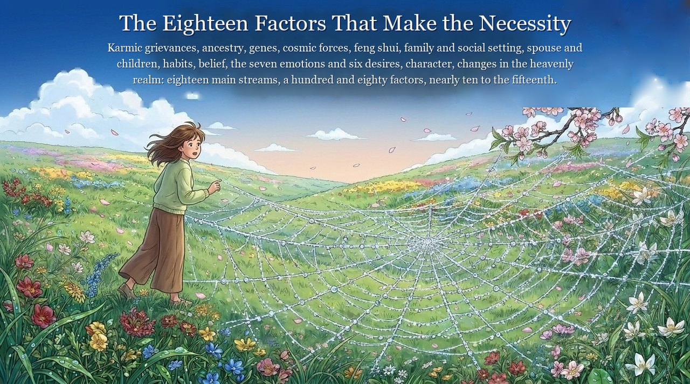
    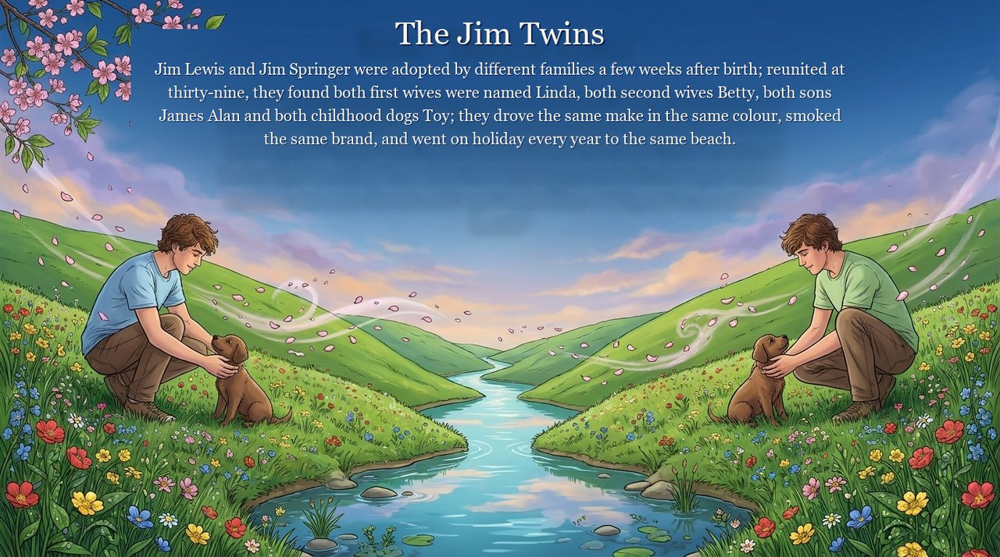
    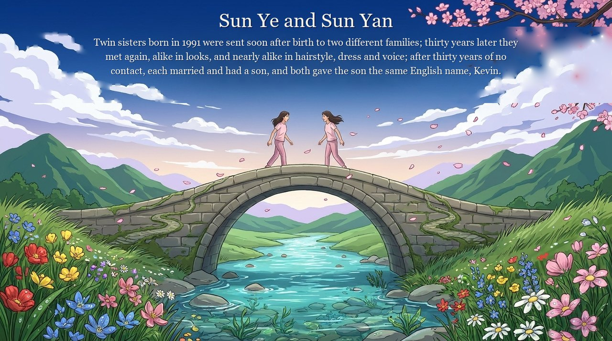
    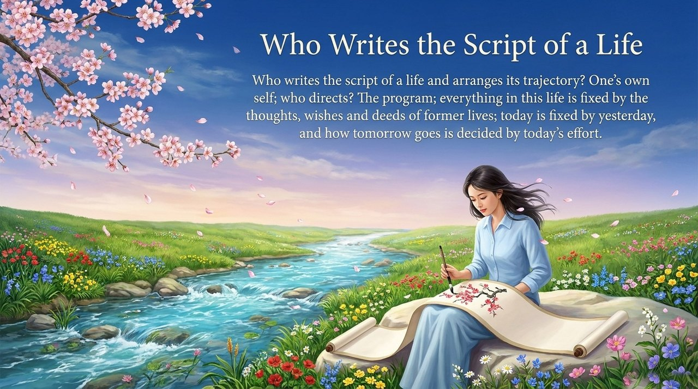
    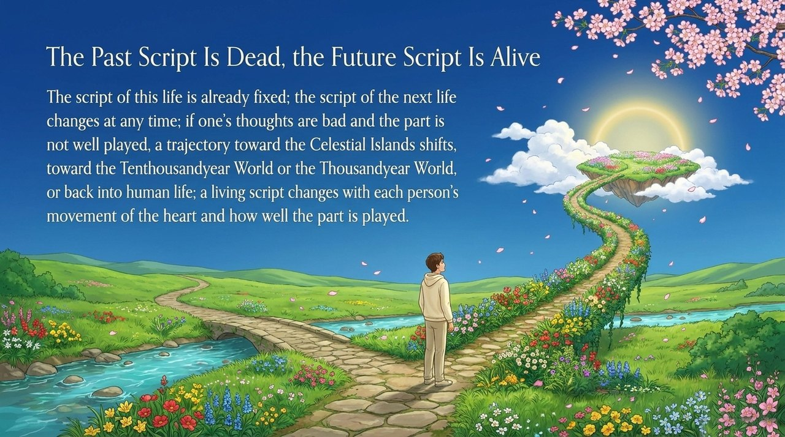
    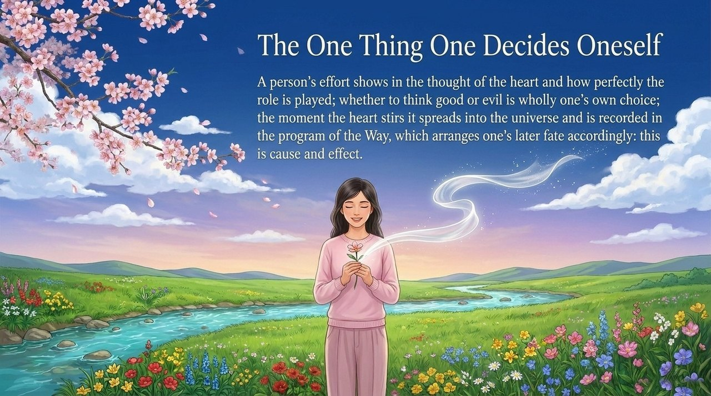
    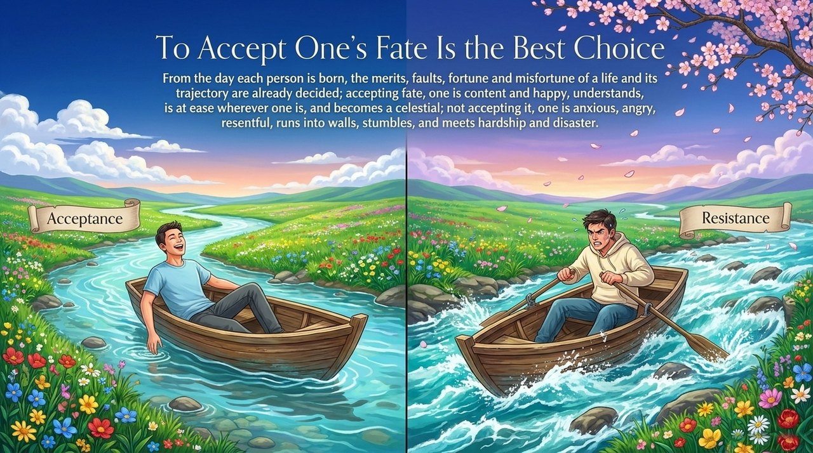
    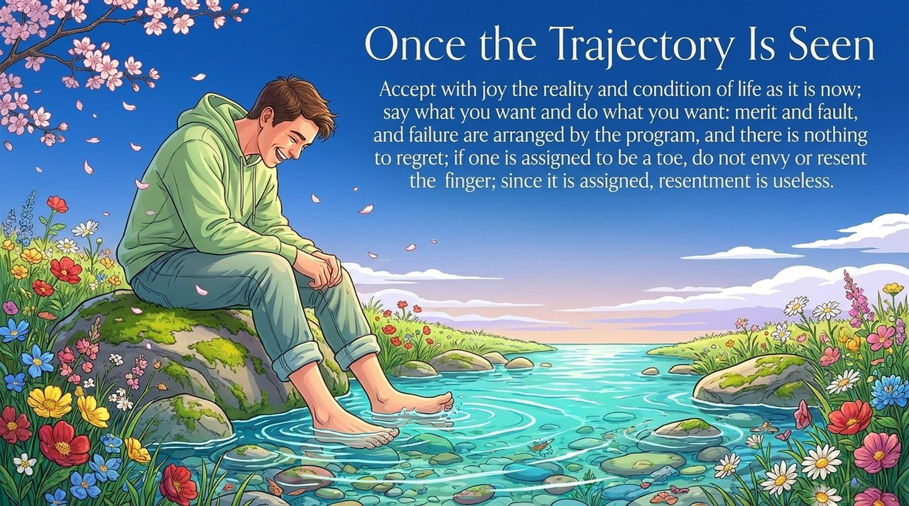
    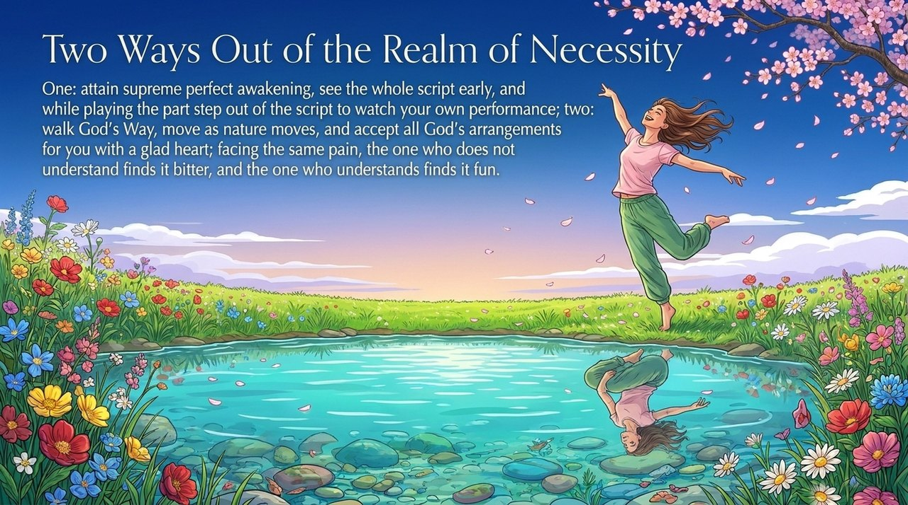
    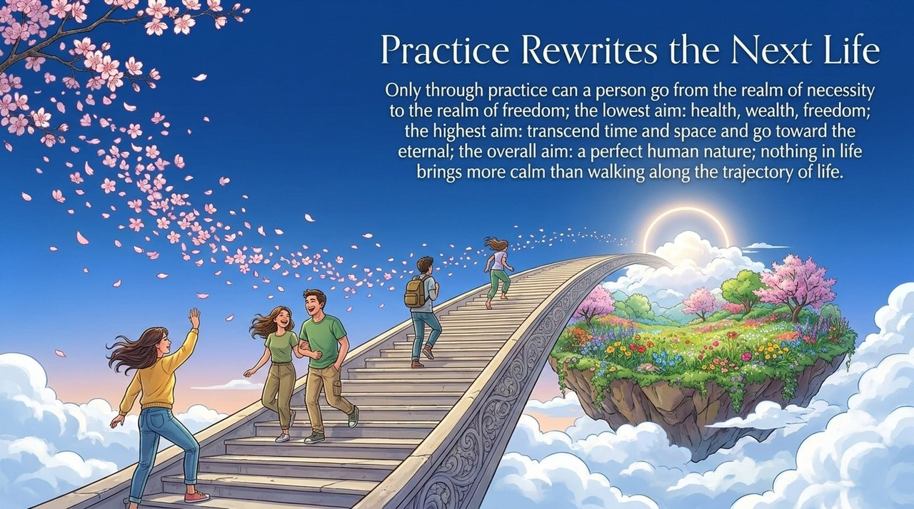

---

## Related Entries

- [The Script of Human Life](/en/life-script/)
- [The Cosmic Script](/en/cosmic-script/)
- [Everything Is Destined](/en/everything-is-destined/)
- [Free Will](/en/free-will/)