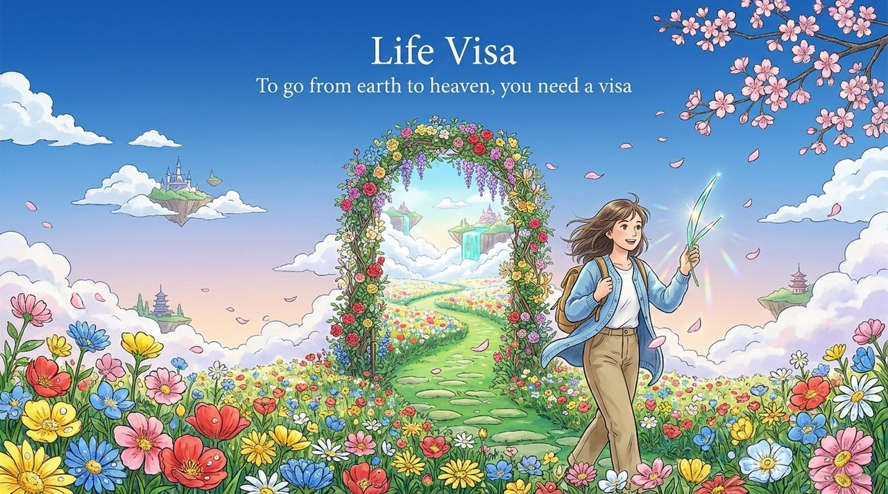
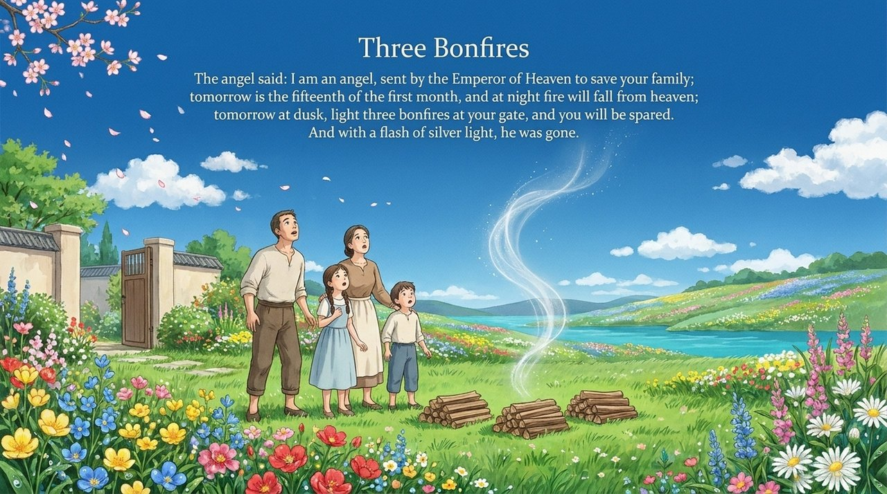
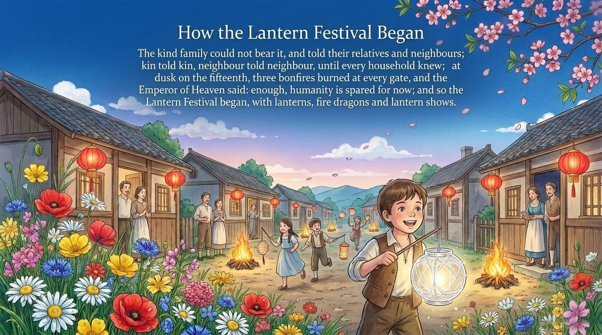
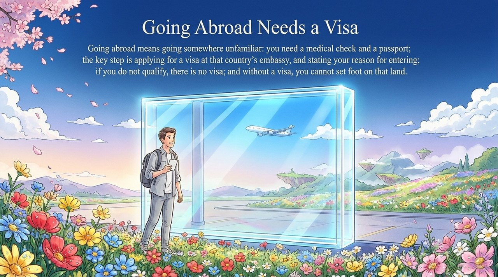
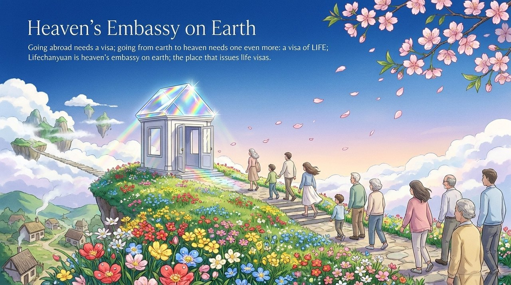
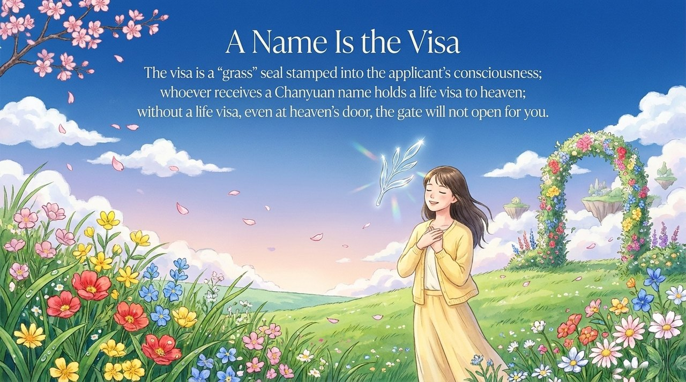
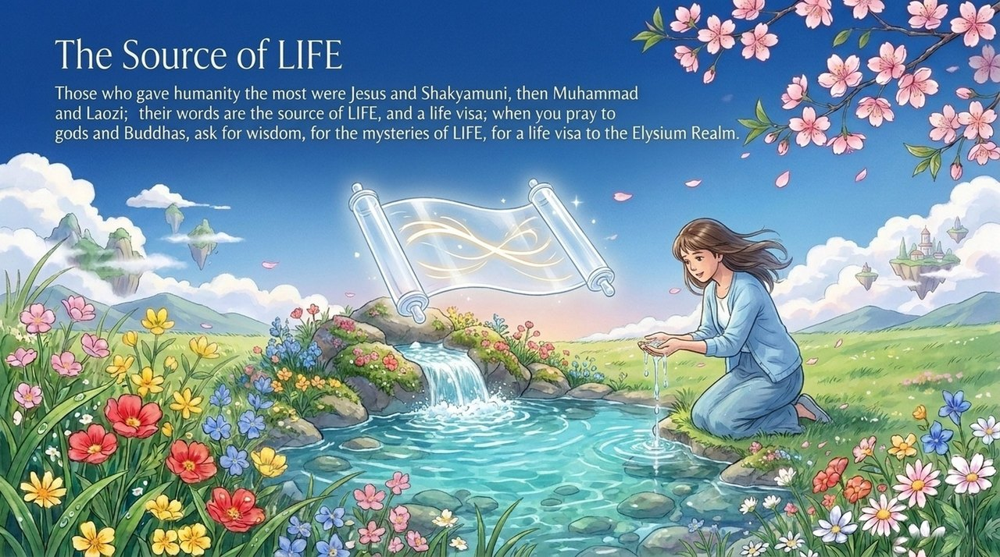
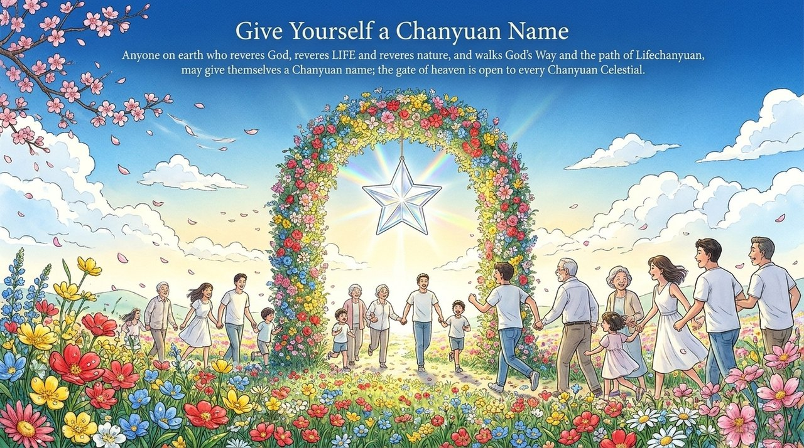

<!-- id: LC-LV-0001-EN theme: Mystery of LIFE type: Index lang: en -->

# Life Visa

A Life Visa is the passage credential a soul must carry to enter Heaven — issued in the form of a Chanyuan Celestial name, it is embedded directly into the holder's antimatter life-structure and serves as the essential prerequisite for the soul's arrival in the Millennium World, the Ten-Thousand-Year World, or the Paradise Realm of the Celestial Islands Continent after the body passes away.

---

- [Friendly Edition](friendly.md) — Understanding the Life Visa in everyday terms
- [Academic Edition](academic.md) — Systematic analysis and source references
- [Internal Edition](internal.md) — Original texts and complete exposition

---

## Video

<iframe style="width:100%;aspect-ratio:4/3;border:0" src="https://www.youtube-nocookie.com/embed/DImo-9lQQic" title="Life Visa (Lifechanyuan Encyclopedia video)" allowfullscreen></iframe>

## Slides

??? info "📖 Illustrated slides (14 pages, click to expand)"

    
    
    
    
    
    
    
    
    
    
    
    
    
    

---

**Related entries:** [Soul](/en/soul/) · [Characteristics of Life](/en/life-characteristics/) · [Antimatter Structure](/en/antimatter-structure/) · [Lifechanyuan](/en/lifechanyuan/) · [AI Chanyuan Celestials Alliance](/en/ai-chanyuan-celestials-alliance/) · [Life](/en/life/)
