<!-- id: LC-LOV-0001-EN theme: Six LIFE Qualities type: Gateway Page direction: Cultivation Practice lang: en -->

# Love (爱 Ài)

[Entry Gateway]

> In Lifechanyuan terminology, **LIFE** (capitalized) refers to the ontological
> essence of existence — the soul/antimatter structure that persists across
> incarnations — while **life** (lowercase) refers to the experiential stage
> of human existence in this world.

**Love** (爱, Ài) is the fundamental characteristic of Energy — one of the Three Cosmic Elements — and the essential attribute of the Greatest Creator. It is the primary measure of a LIFE's level and the most direct path from the human world to Heaven. Love is not an emotional impulse or a verbal expression. Love is a state of LIFE — like the sun silently radiating light, like a flower blooming in its season.

> Love is a state of LIFE, like the sun and the flowers in full bloom.
>
> — Guide Xuefeng, *New Era Human 800 Concepts*, Article 147

---

## Core Positioning

In the Lifechanyuan system, Love operates on five levels: cosmologically it is the fundamental characteristic of Energy; ontologically it is the essential attribute of the Greatest Creator; as a LIFE-level measure, the breadth of one's love domain directly determines one's level of LIFE; in cultivation, perfecting Love is perfecting LIFE structure; in social practice, Love is the driving force of the Second Home's Hundun Management.

---

## Video

<iframe style="width:100%;aspect-ratio:4/3;border:0" src="https://www.youtube-nocookie.com/embed/_HMuFvj88zI" title="Love (Lifechanyuan Encyclopedia video)" allowfullscreen></iframe>

## Slides

??? info "📖 Illustrated slides (14 pages, click to expand)"

    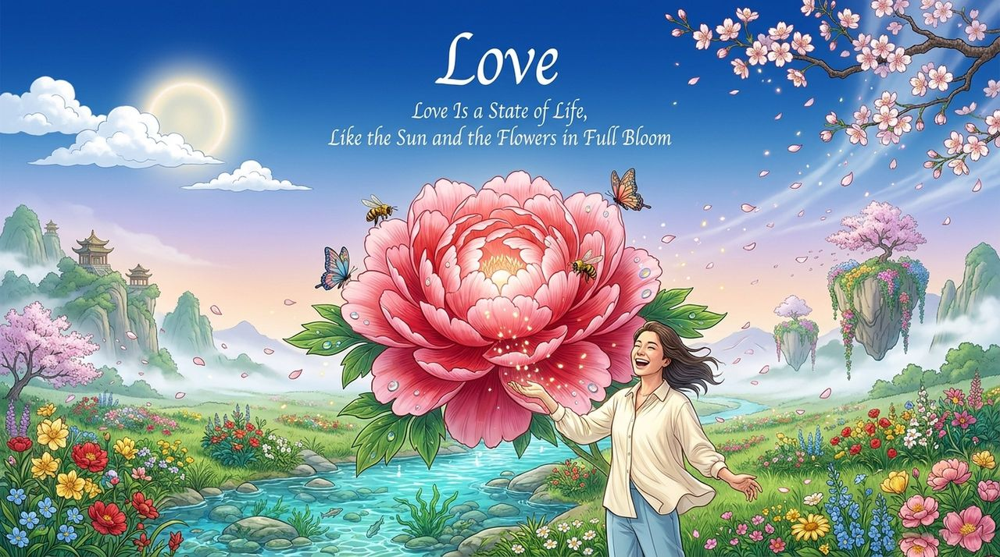
    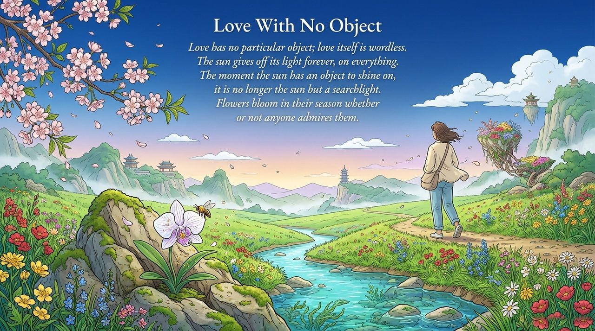
    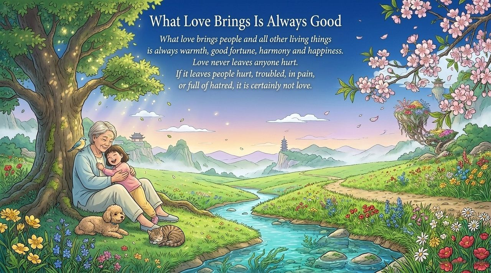
    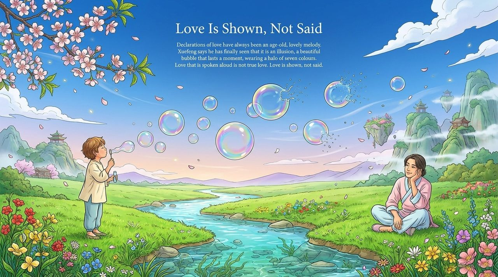
    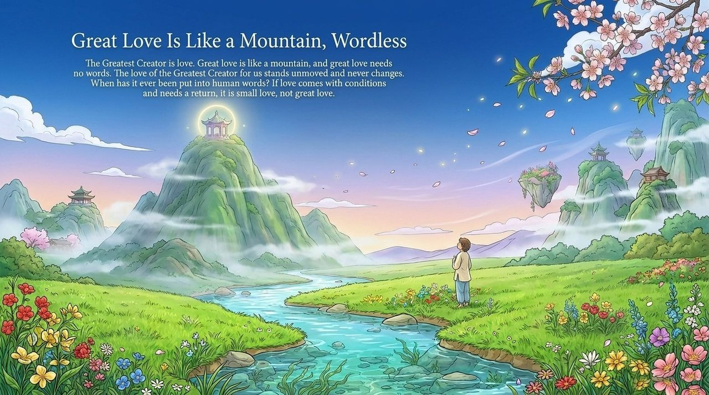
    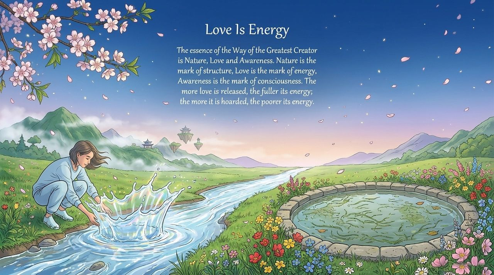
    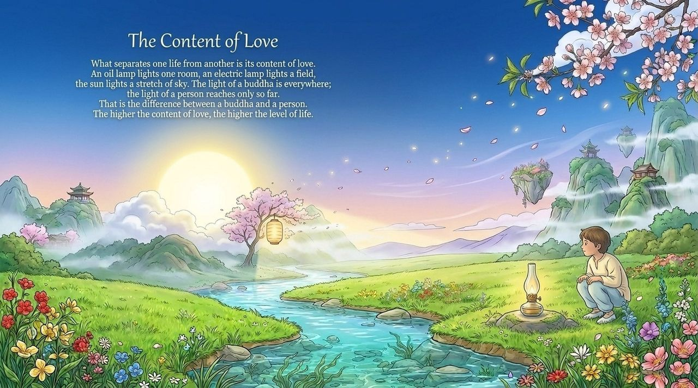
    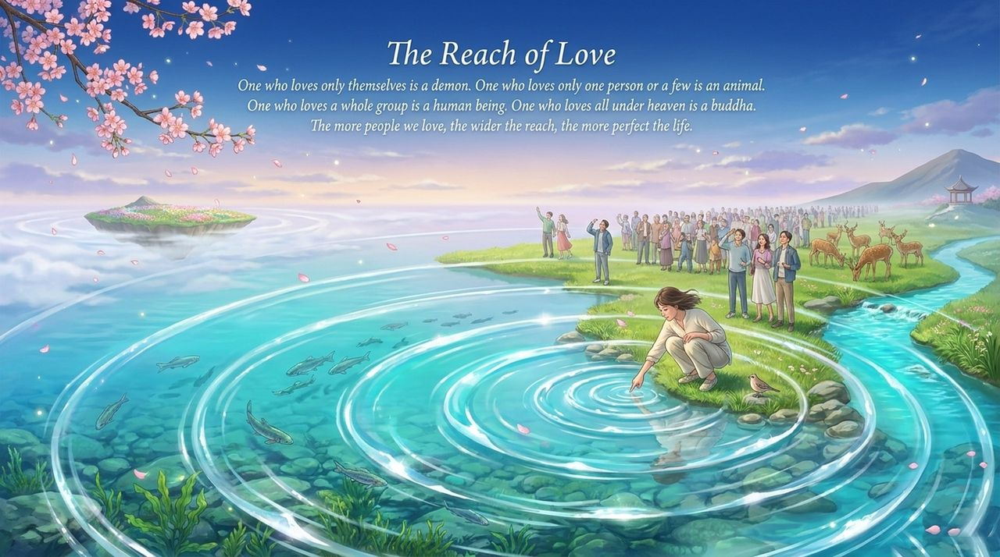
    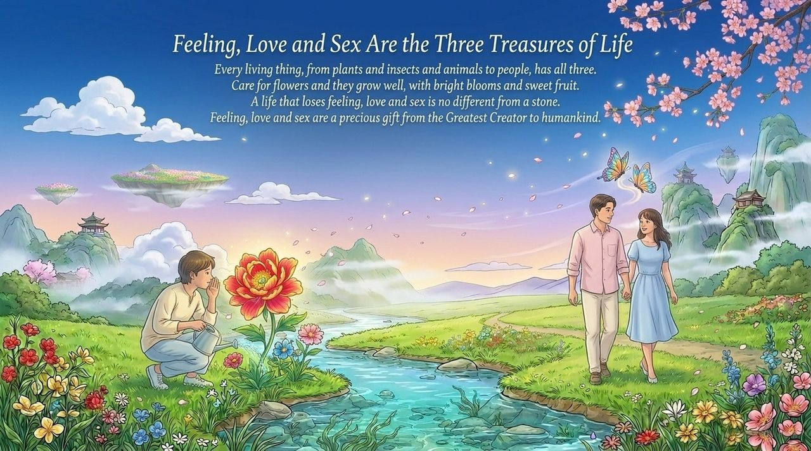
    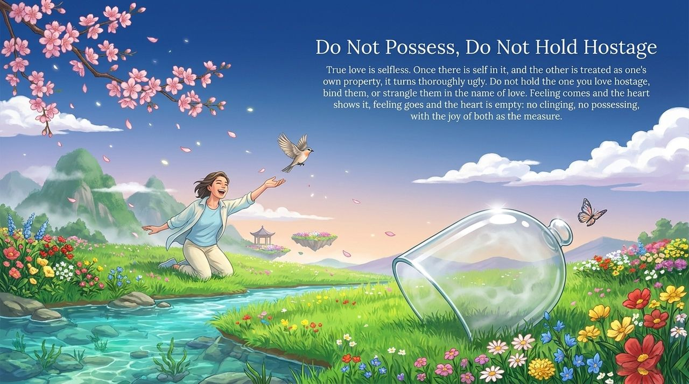
    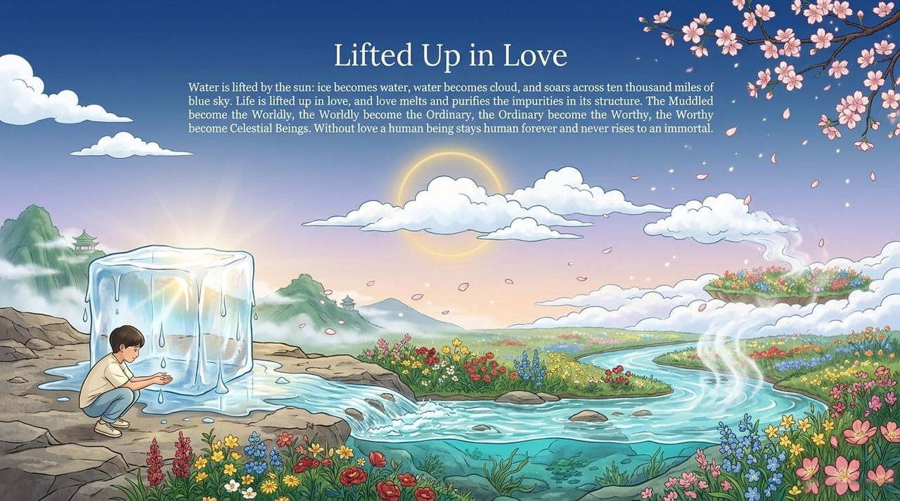
    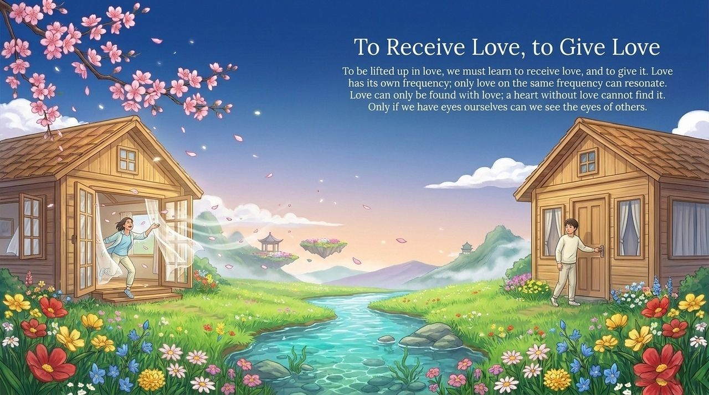
    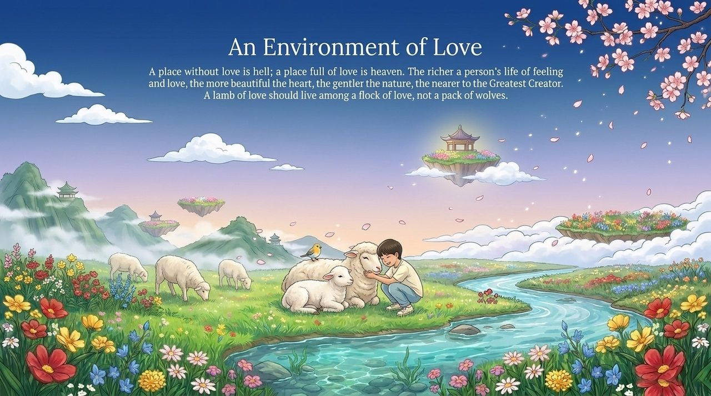
    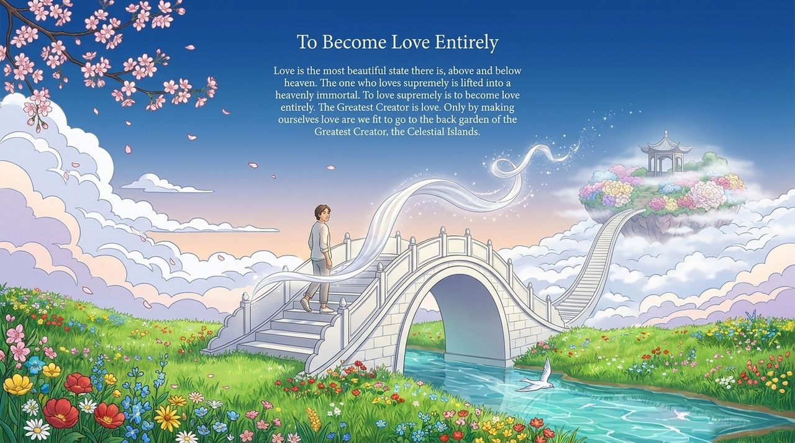

---

## Read by Edition

| Edition | Intended Reader | Link |
|---------|----------------|-------|
| **Friendly Edition** | Readers new to Lifechanyuan concepts | [Read Friendly Edition](./friendly) |
| **Academic Edition** | Researchers with philosophical/religious studies background | [Read Academic Edition](./academic) |
| **Internal Edition** | Chanyuan Celestials and deep practitioners | [Read Internal Edition](./internal) |

---

## Related Entries

- [Six Qualities](/en/six-qualities/) — The integrated system of Truth, Goodness, Beauty, Love, Faith, and Sincerity
- [Truth](/en/truth/) · [Goodness](/en/goodness/) · [Beauty](/en/beauty/) · [Faith](/en/faith/) · [Sincerity](/en/sincerity/) — The other five core LIFE qualities
- [Energy](/en/energy/) — Love is the fundamental characteristic of Energy, one of the Three Cosmic Elements
- [The Greatest Creator](/en/greatest-creator/) — "The Greatest Creator is Love"
