<!-- id: LC-MHC-0001-EN theme: The Greatest Creator and the Tao type: index direction: The Greatest Creator and the Tao lang: en -->

# Mahjong and Hundun Culture

**Mahjong and Hundun Culture** is Lifechanyuan's central thesis for understanding **Hundun culture** — the true root of Chinese civilization. Xuefeng argues that the primary bloodline of Chinese culture is not Confucianism, Buddhism, or Taoism, but Hundun (primordial chaos). Mahjong embodies the Hundun principle: the astronomically vast combinations of 136 tiles appear random and disordered, yet they follow strict hidden laws — and "luck" at the table is the cosmic Hundun mechanism at work. To understand Mahjong is to understand Hundun; to understand Hundun is to understand the Tao of the Greatest Creator.

---

## Version Navigation

| Version | Best for | Focus |
|---------|----------|-------|
| [Friendly version](friendly.md) | First-time readers | Why can Mahjong reveal the cosmos? What is Hundun? |
| [Academic version](academic.md) | Researchers | Hundun culture framework, thinking-levels hierarchy, contrast with Confucianism/Buddhism/Taoism |
| [Internal reference](internal.md) | Deep study | Complete source quotations from the Revelation and Preaching Chapters |

---

## Video

<iframe style="width:100%;aspect-ratio:4/3;border:0" src="https://www.youtube-nocookie.com/embed/qgRXz5Lxdx8" title="Mahjong and Hundun Culture (Lifechanyuan Encyclopedia video)" allowfullscreen></iframe>

## Slides

??? info "📖 Illustrated slides (14 pages, click to expand)"

    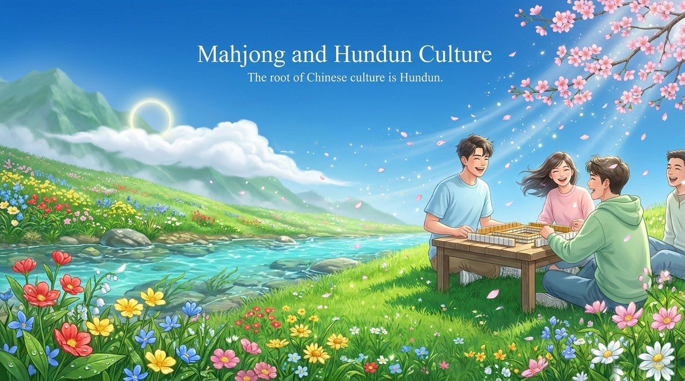
    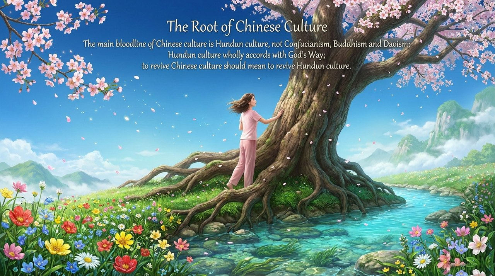
    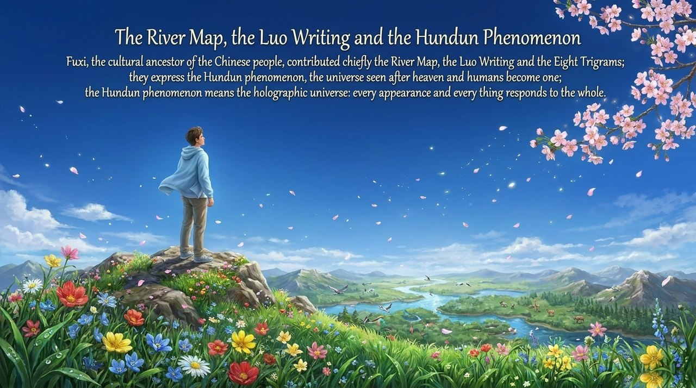
    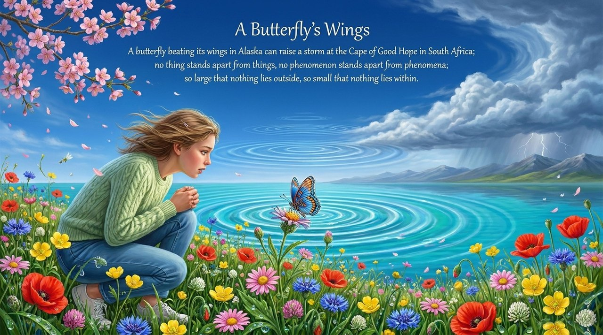
    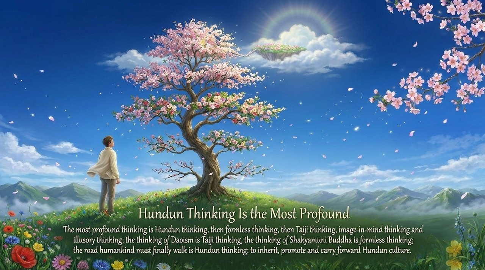
    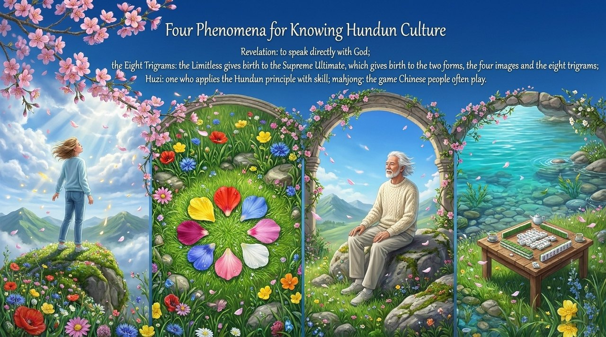
    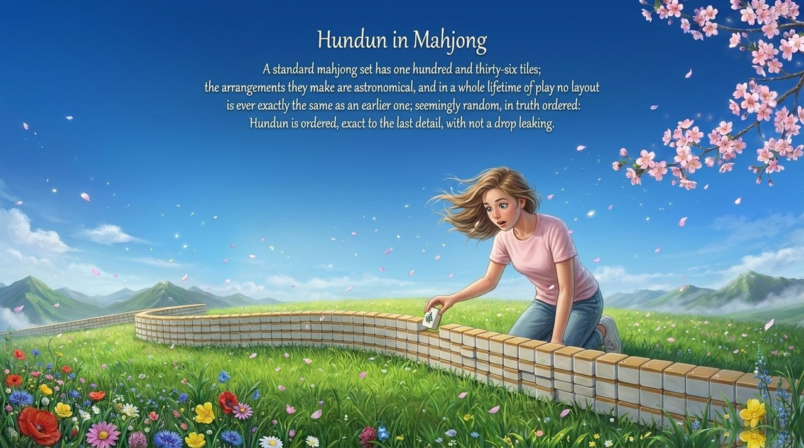
    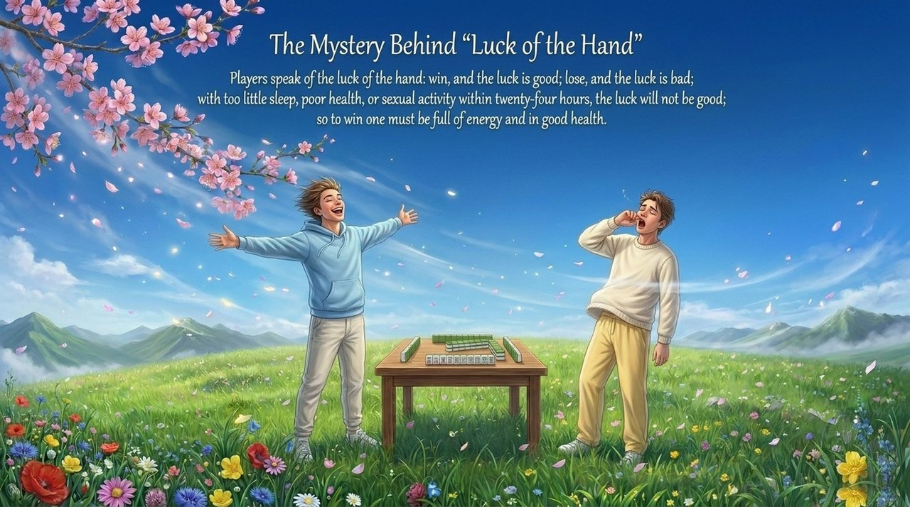
    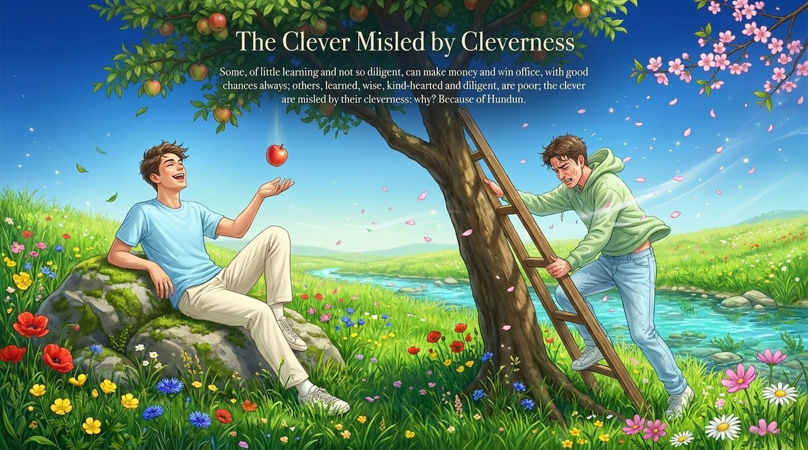
    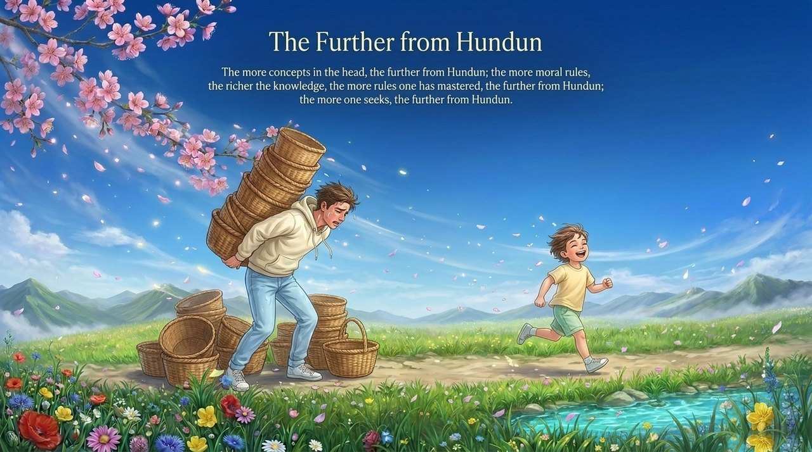
    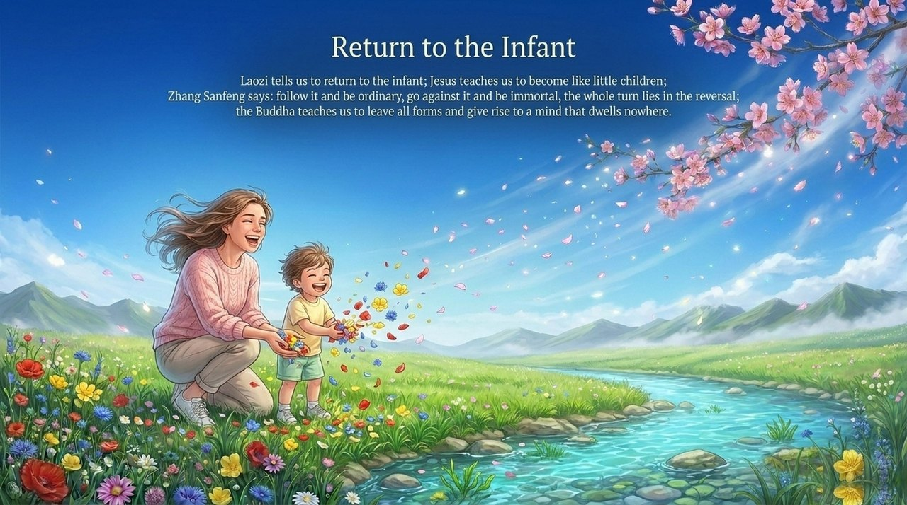
    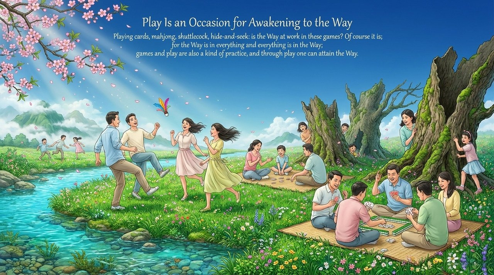
    
    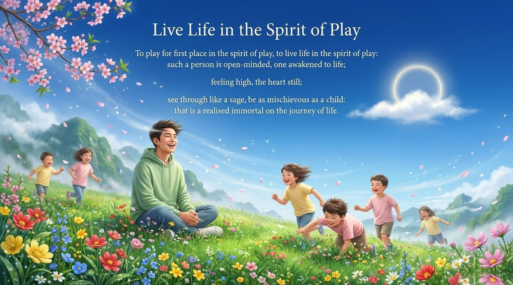

---

## Related Entries

[Hundun (Ontology)](/en/hundun/) · [Hundun Thinking](/en/hundun-thinking/) · [Hundun Yuanchu](/en/hundun-yuanchu/) · [Hundun Management](/en/hundun-management/) · [Eight Levels of Thinking](/en/eight-thinking-levels/) · [Taiji Thinking](/en/taiji-thinking/) · [Non-Form Thinking](/en/wuxiang-thinking/) · [Cosmic Holography](/en/cosmic-holography/) · [The Tao](/en/dao/) · [Three Cosmic Elements](/en/three-cosmic-elements/)
