<!-- id: LC-MAF-0001-EN theme: Cultivation Practice type: 导航 direction: Daily Cultivation lang: en -->

# Marriage, Spouse, and Family

In the Lifechanyuan system, the **spousal relationship**, **marriage** as an institution, and the **family** as a social unit share a common essence: they are the breeding ground of selfishness, the root cause of human suffering, and the single greatest obstacle blocking a person from reaching the Kingdom of Heaven. Marriage is a product of Civilization 2.0 — useful in its time, like an oil lamp. When Civilization 3.0 arrives, it will naturally be replaced by a freer, more beautiful way of life. The Kingdom of Heaven is a realm of "no marriage, no giving in marriage," where life flows freely without possession or attachment.

> "Marriage is the grave of love; family is the cradle of human evil. Once a person enters marriage, freedom is lost. Once a person has a family, selfishness takes hold. The suffering caused by marriage and family is beyond counting — marriage and family are a boundless sea of bitterness."
>
> *(New Era Human 800 Concepts)*

---

## Version Navigation

| Version | Best for | Focus |
|---------|----------|-------|
| [Friendly version](friendly.md) | First-time readers | Real-life examples · why suffering · way out |
| [Academic version](academic.md) | Researchers | Concept analysis · system positioning · comparison |
| [Internal reference](internal.md) | Deep study | Complete source texts · cultivation practice |

---

## Video

<iframe style="width:100%;aspect-ratio:4/3;border:0" src="https://www.youtube-nocookie.com/embed/fQit-T-Jo8c" title="Marriage, Spouse, and Family (Lifechanyuan Encyclopedia video)" allowfullscreen></iframe>

## Slides

??? info "📖 Illustrated slides (14 pages, click to expand)"

    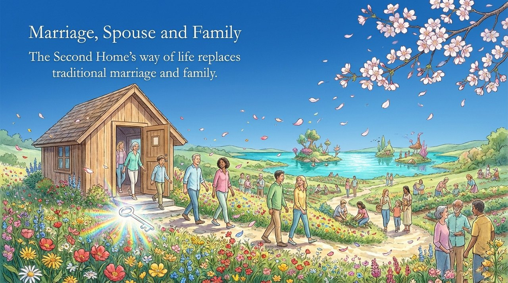
    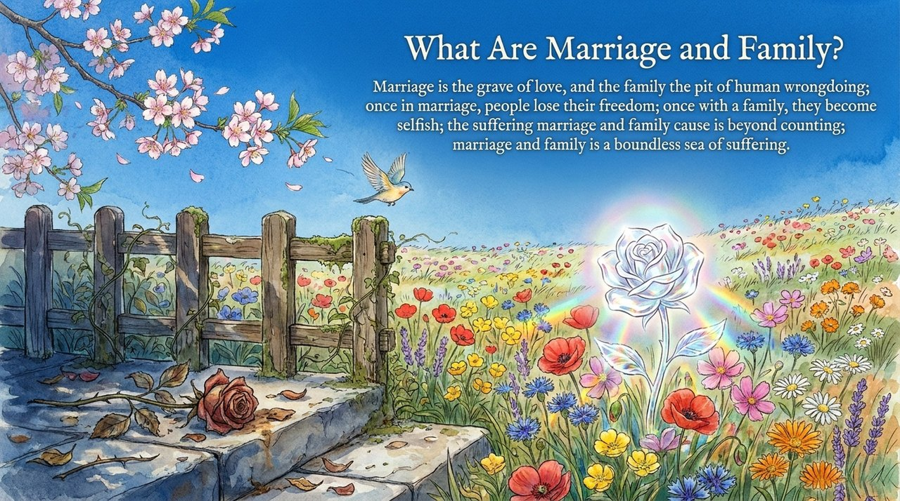
    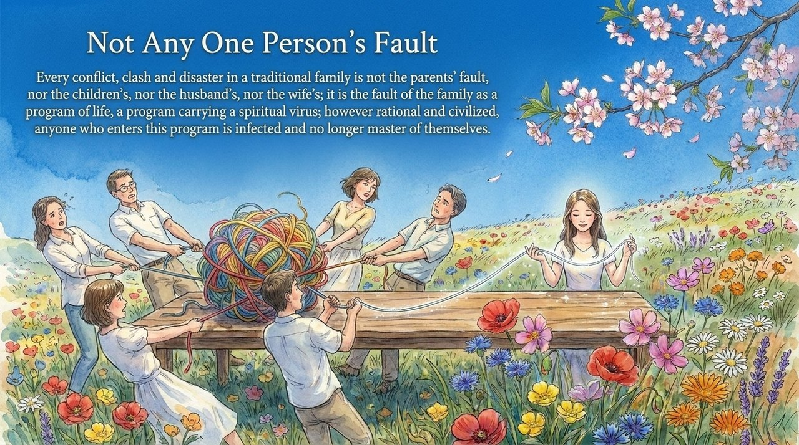
    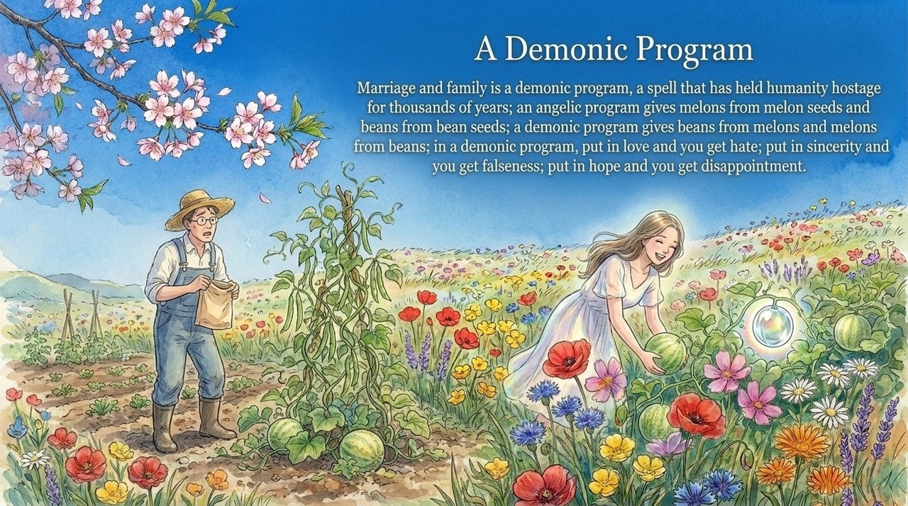
    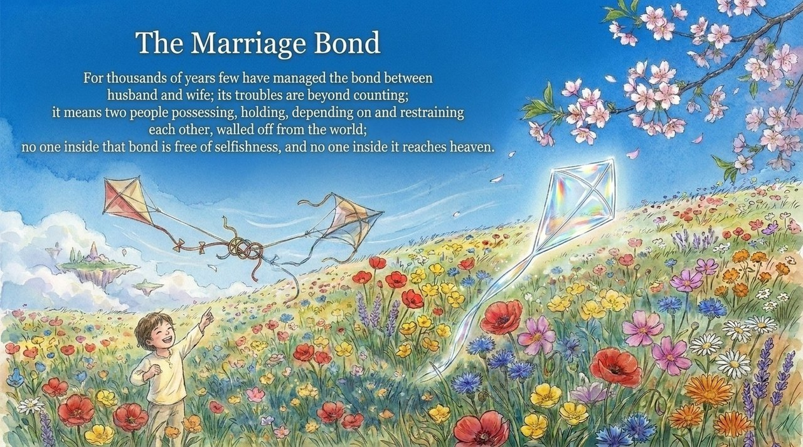
    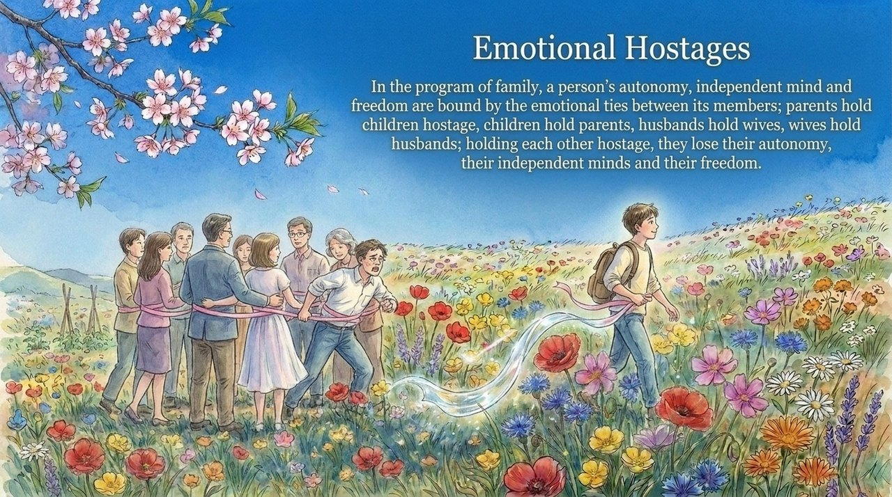
    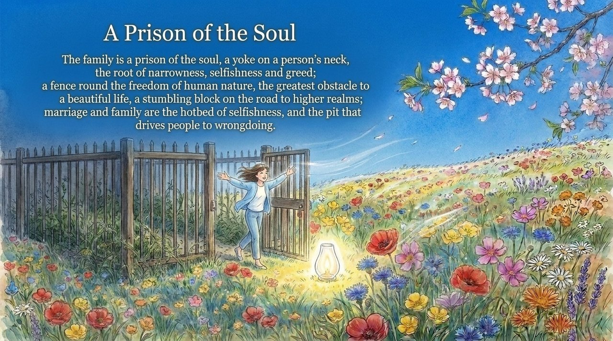
    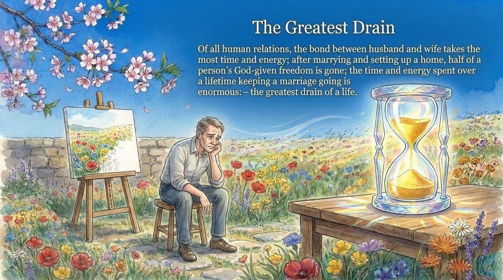
    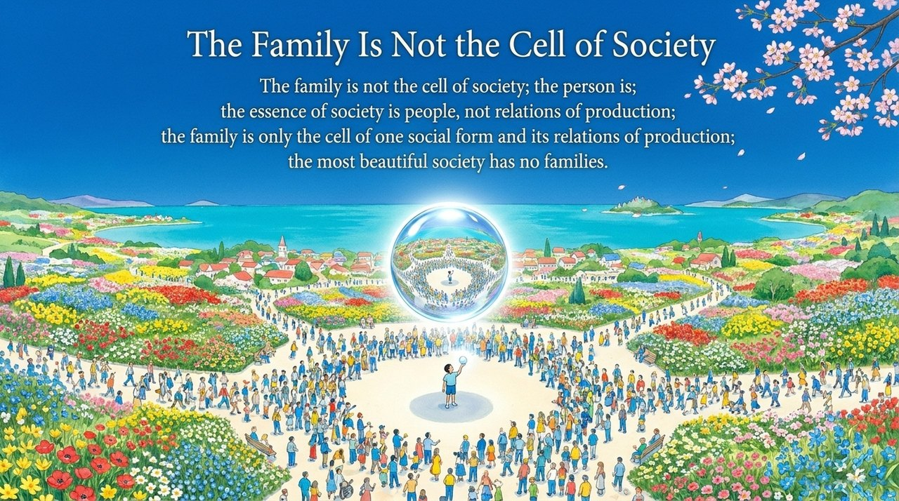
    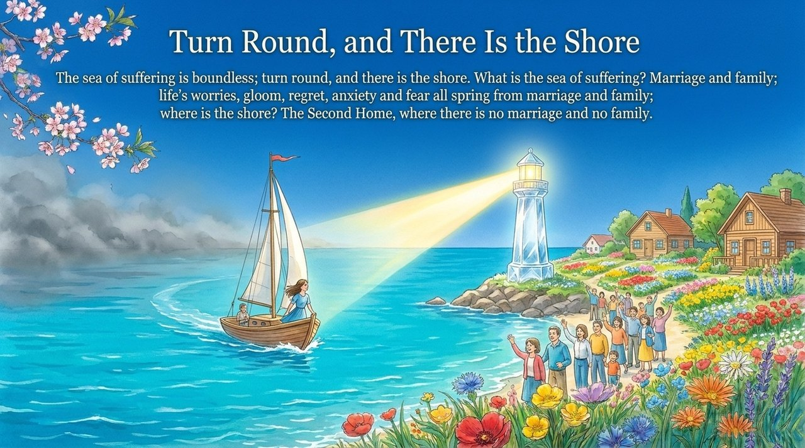
    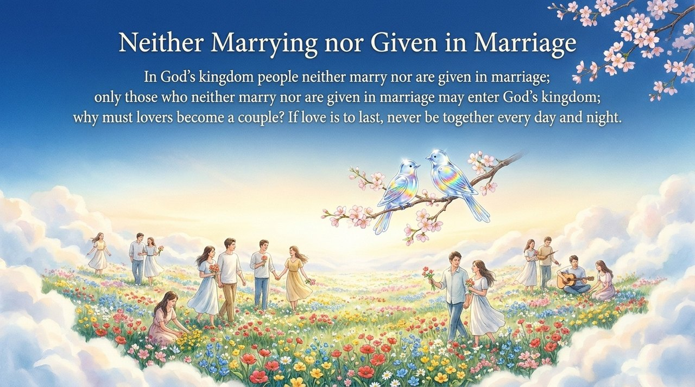
    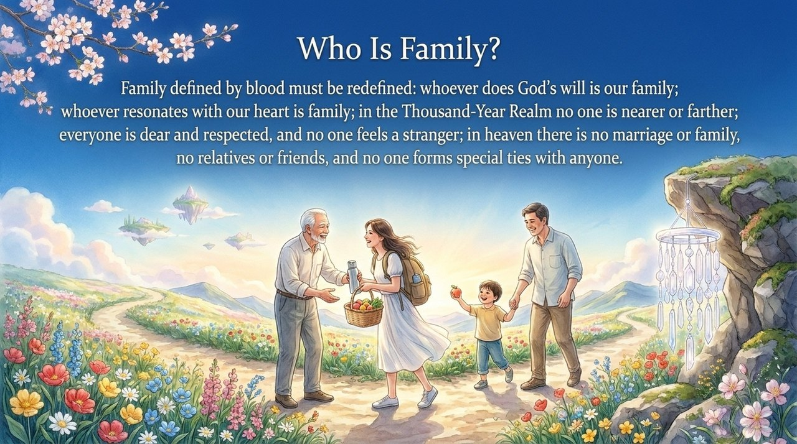
    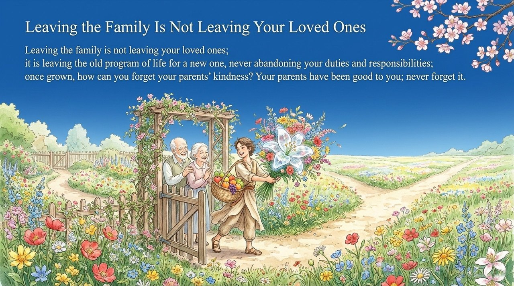
    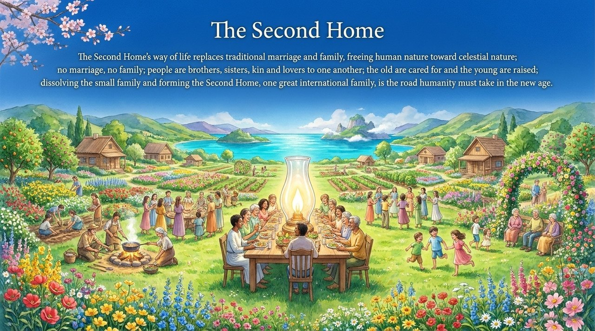

---

## Related Entries

[One-to-One Relationships and Spousal Bond](/en/one-to-one-and-marriage/) · [Family Members as Adversaries](/en/family-as-foes/) · [Second Home](/en/second-home/) · [Life Oasis](/en/life-oasis/) · [Romantic Love and Sexuality](/en/romantic-love-and-sexuality/) · [Releasing Worldly Bonds](/en/releasing-worldly-bonds/) · [Selfishness and Selflessness](/en/zisi-wusi/) · [Xuefeng-Style Communism](/en/xuefeng-communism/) · [Quantum Entanglement and the "Other Half"](/en/quantum-entanglement-and-the-other-half/) · [Natural Freedom and Sexual Liberty](/en/suixing-renxing-xingziyou/)

> Note: Concept numbers cited on this page refer to the Fourth Edition of the *New Era Human 800 Concepts*. The Fifth Edition has been re-arranged, and its numbering no longer matches the Fourth Edition one to one.
