<!-- id: LC-MBS-0001-EN theme: Cultivation Practice type: 导航 direction: Cultivation Practice lang: en -->

# Masculine Beauty in Strength

Masculine beauty in strength is a core principle in the Lifechanyuan system regarding male virtue and aesthetics. True masculine strength (*yang gang*) is not aggression or domination — it is an inner power expressed through courage, steadiness, and a spirit of adventure, rooted in deep appreciation for feminine softness.

> "Males find beauty in strength, females find beauty in softness. A male who is overly soft is ugly; a female who is overly rigid is ugly."
>
> *(New Era Human 800 Concepts)*

---

## Video

<iframe style="width:100%;aspect-ratio:4/3;border:0" src="https://www.youtube-nocookie.com/embed/M5xZb7aJ9O0" title="Masculine Beauty in Strength (Lifechanyuan Encyclopedia video)" allowfullscreen></iframe>

## Slides

??? info "📖 Illustrated slides (14 pages, click to expand)"

    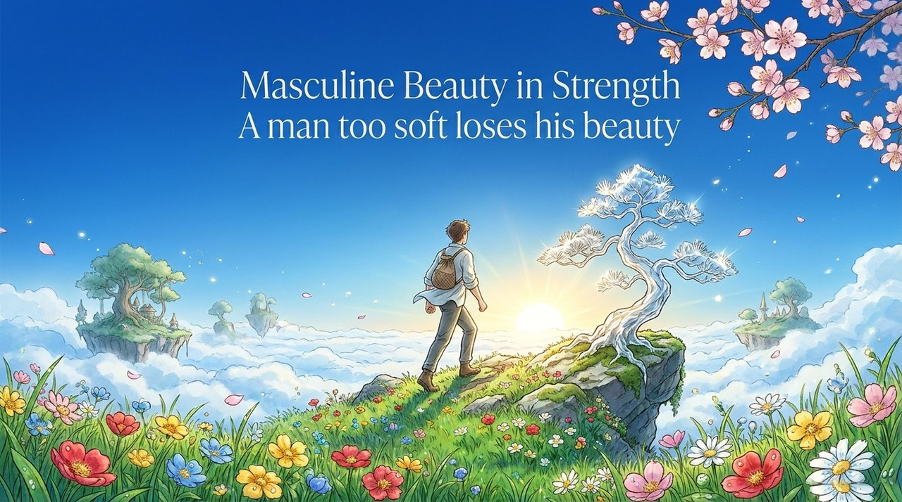
    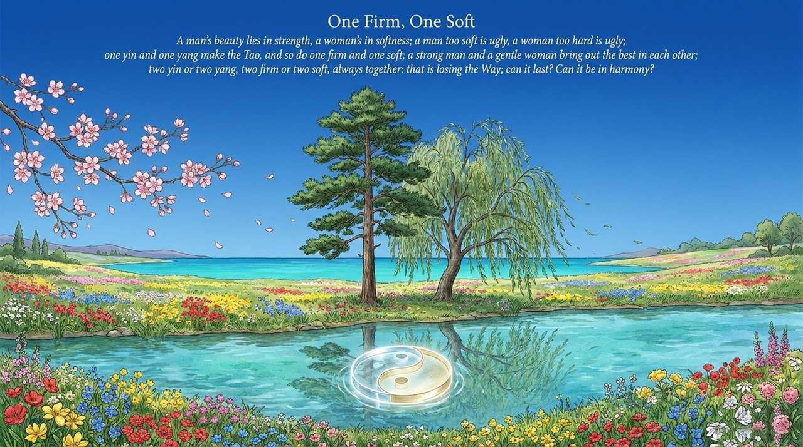
    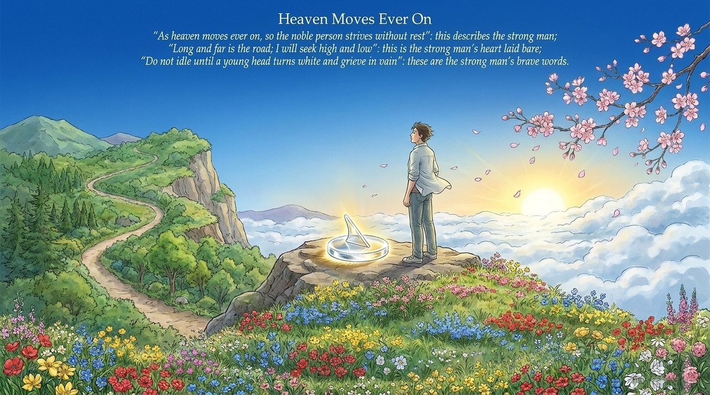
    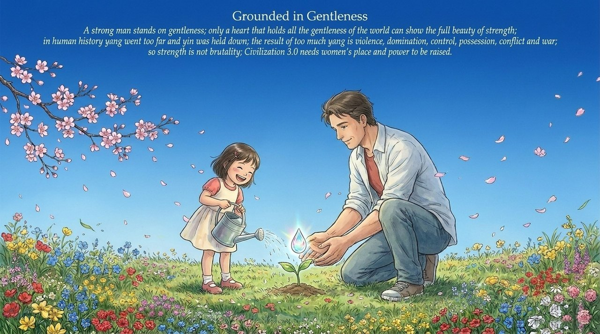
    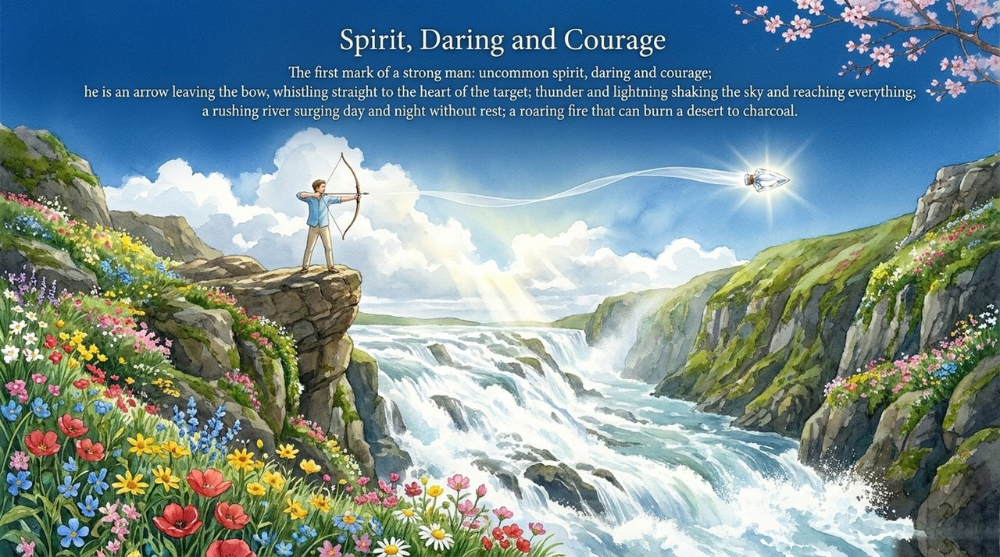
    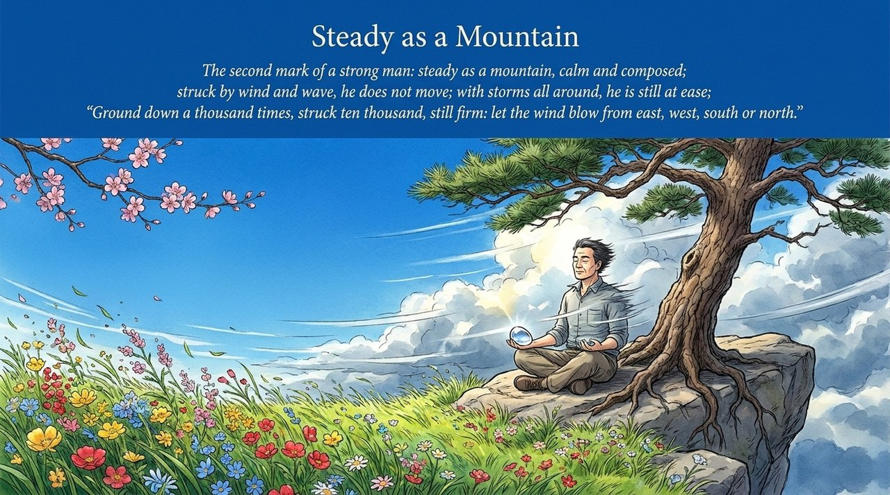
    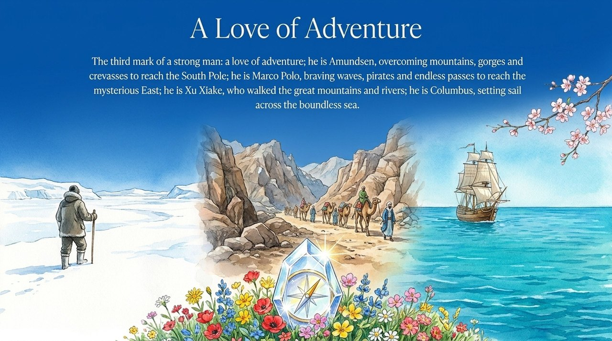
    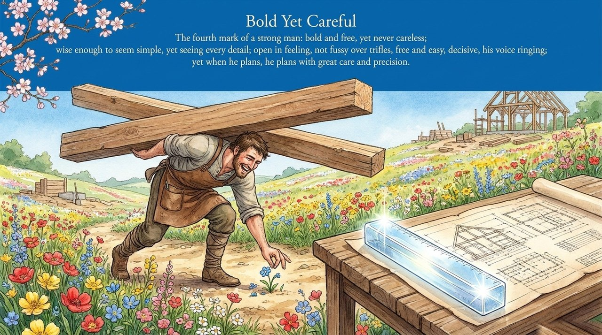
    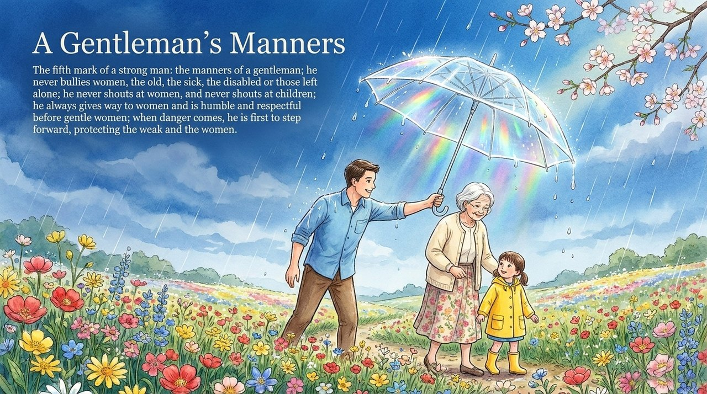
    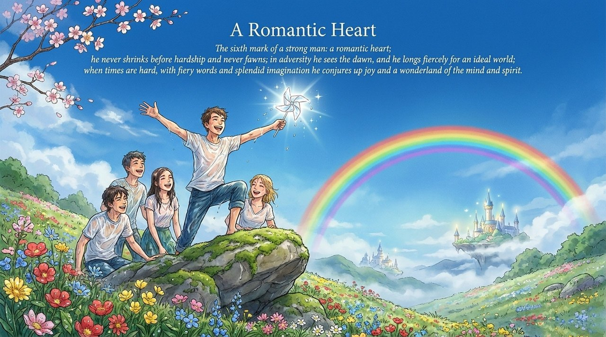
    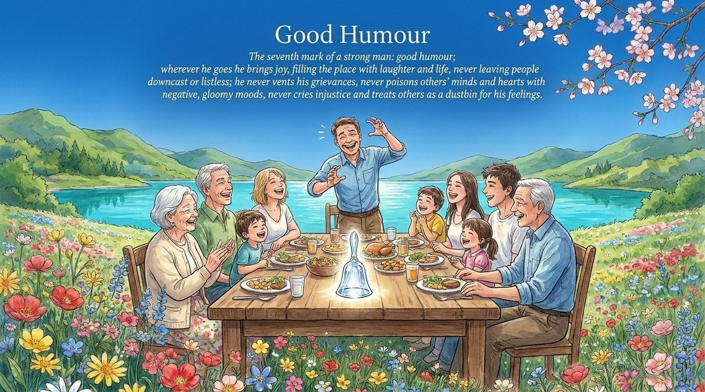
    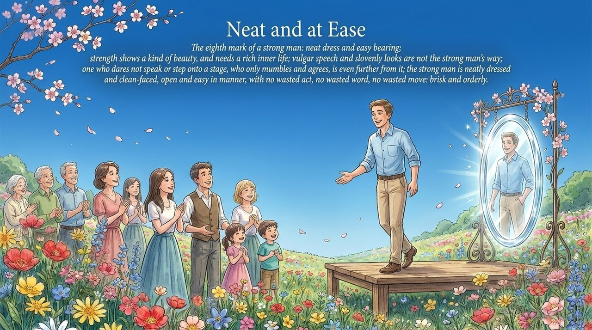
    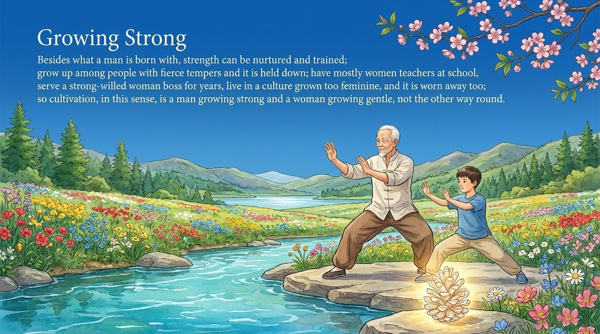
    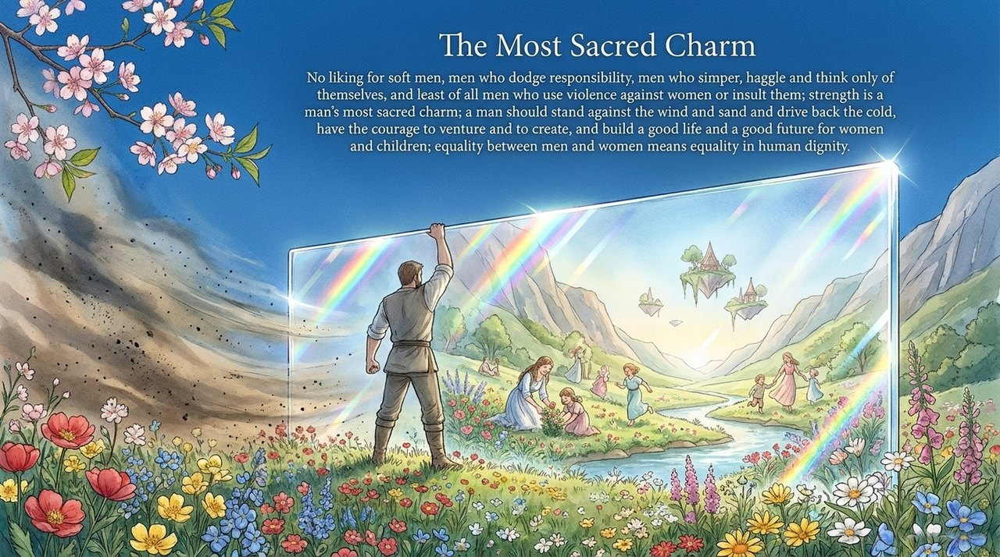

---

## Versions

| Version | Best for | Focus |
|---------|----------|-------|
| [Friendly version](friendly.md) | First-time readers | Everyday experience · what true strength looks like |
| [Academic version](academic.md) | Researchers | Conceptual analysis · comparison with other frameworks |
| [Internal reference](internal.md) | Deep study | Complete original texts · cultivation practice |

---

## Related Entries

[Feminine Beauty in Softness](/en/feminine-beauty-in-softness/) · [Celestial Bearing](/en/xianfengdaogu/) · [Standard of Perfect Human Nature](/en/perfect-human-nature/) · [Cultivation of Character](/en/jiaoyang-xiuyang-hanyang/) · [Natural Nature · Inborn Nature · Habitual Nature](/en/tianxing-bingxing-xixing/) · [Rising Above the Mundane](/en/chaofantuosu/) · [A Spiritual Life](/en/spiritual-life/) · [Truth, Goodness, Beauty, Love, Faith, and Sincerity](/en/six-qualities/)

> Note: Concept numbers cited on this page refer to the Fourth Edition of the *New Era Human 800 Concepts*. The Fifth Edition has been re-arranged, and its numbering no longer matches the Fourth Edition one to one.
