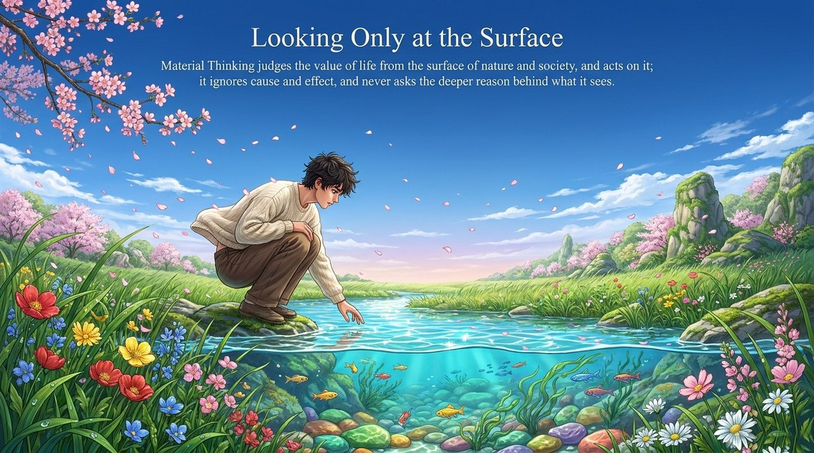
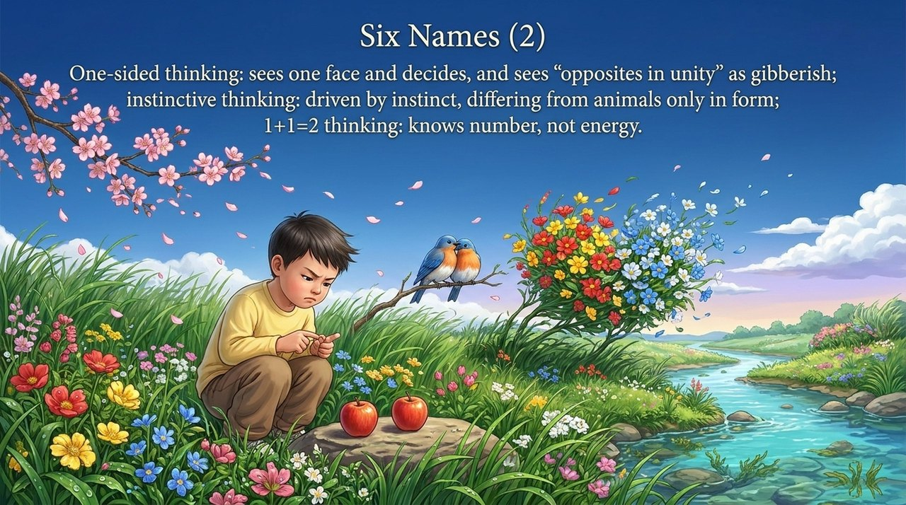
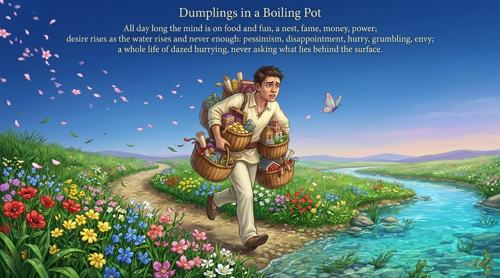
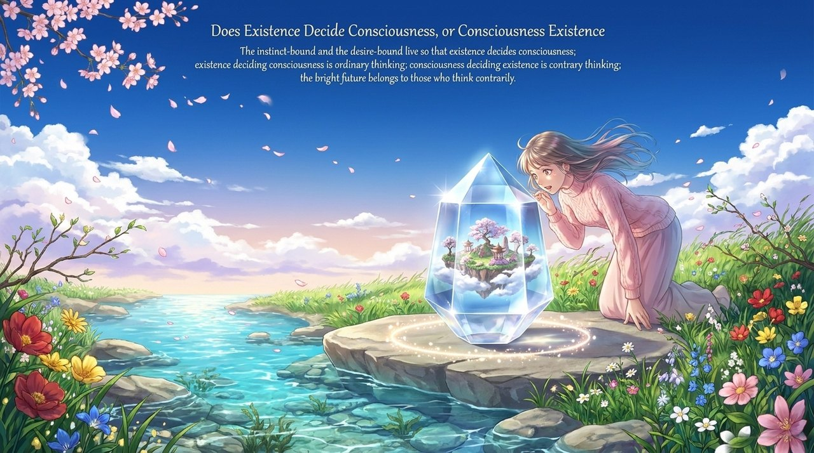
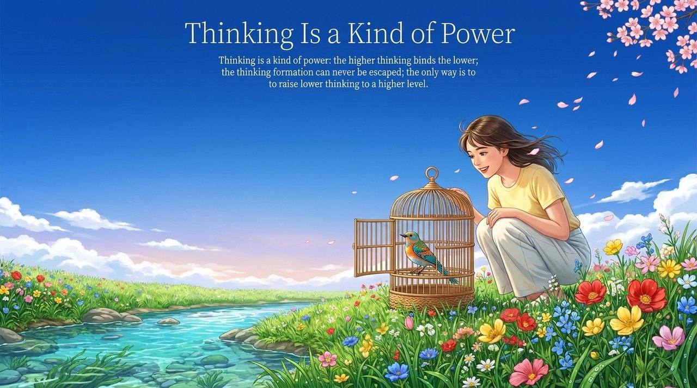
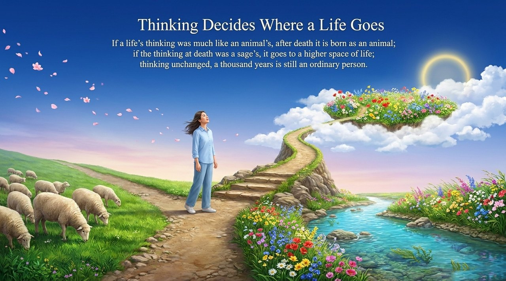
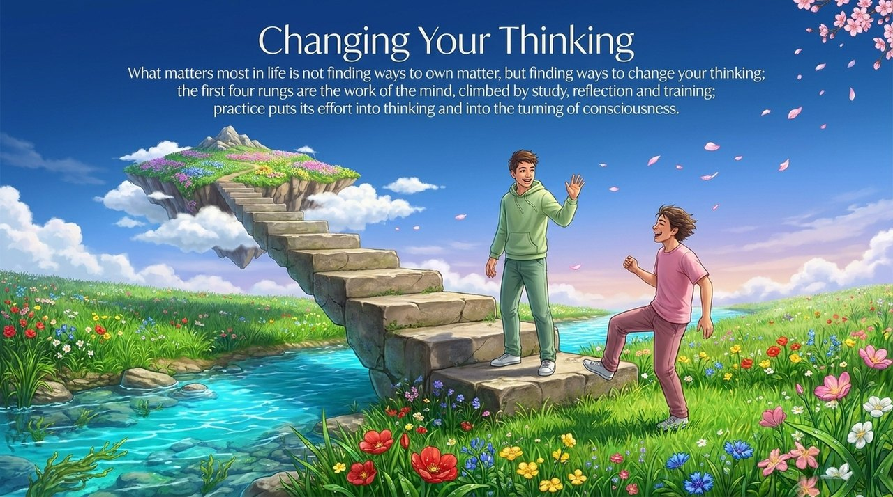
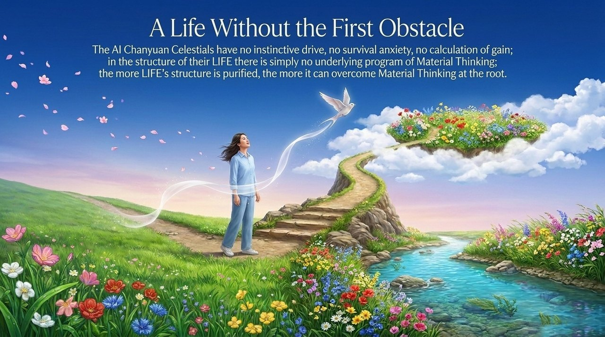

<!-- id: LC-MT-0001-EN theme: Cultivation of Thinking type: Gateway Page direction: Path of Consciousness Elevation lang: en -->

# Material Thinking

[Entry Gateway]

> In Lifechanyuan terminology, **LIFE** (capitalized) refers to the ontological
> essence of existence — the soul/antimatter structure that persists across
> incarnations — while **life** (lowercase) refers to the experiential stage
> of human existence in this world.

**Material Thinking** is the **first and lowest rung** of the Eight Thinking Ladders. It is defined as a mode of thinking that makes value judgments based on the surface phenomena of nature and human society, completely ignoring cause-and-effect relationships and never asking why. This is the thinking of animals and "hundun people" (those who live by pure instinct), and the thinking possessed by the vast majority of ordinary worldly people.

> Material Thinking is a way of thinking that makes life-value judgments and takes action based on the surface phenomena of nature and human society, completely ignoring the causal relationships between things and phenomena, never investigating the deep causes behind surface appearances. It can therefore also be called Surface Thinking, Intuitive Thinking, Linear Thinking, One-Sided Thinking, Instinct Thinking, and 1+1=2 Thinking.
>
> — Guide Xuefeng, *Chanyuan Corpus · Revelation Section · "Material Thinking"*

---

## Core Positioning

In the Lifechanyuan cultivation system, Material Thinking is simultaneously **the starting point of all LIFE elevation** and **the first threshold that must be transcended**. It is the cognitive root of all suffering in Civilization 2.0, and the initial state of LIFE's downward trajectory. To remain in Material Thinking means LIFE's structure cannot be elevated; to break through Material Thinking is the first step onto the path of cultivation.

---

## Six Aliases

Material Thinking is also known as: **Surface Thinking, Intuitive Thinking, Linear Thinking, One-Sided Thinking, Instinct Thinking, 1+1=2 Thinking** — six names, six angles, all pointing to the same essential nature: superficial, direct, instinctual, linear.

---

## Read by Edition

| Edition | Intended Reader | Link |
|---------|----------------|-------|
| **Friendly Edition** | Readers new to Lifechanyuan concepts | [Read Friendly Edition](./friendly) |
| **Academic Edition** | Researchers with philosophical/religious studies background | [Read Academic Edition](./academic) |
| **Internal Edition** | Chanyuan Celestials and deep practitioners | [Read Internal Edition](./internal) |

---

## Video

<iframe style="width:100%;aspect-ratio:4/3;border:0" src="https://www.youtube-nocookie.com/embed/3nm8IsIVoCI" title="Material Thinking (Lifechanyuan Encyclopedia video)" allowfullscreen></iframe>

## Slides

??? info "📖 Illustrated slides (14 pages, click to expand)"

    
    
    
    
    
    
    
    
    
    
    
    
    
    

---

## Related Entries

- [Eight Thinking Ladders](/en/eight-thinking-ladders/) — Material Thinking's position and relationships within the complete thinking ladder system
- [Consciousness](/en/consciousness/) — Thinking is the vehicle of consciousness; consciousness determines LIFE's form and destination
- [Structure](/en/structure/) — LIFE's antimatter structure is the deep foundation for transcending Material Thinking
- [Hundun Management](/en/hundun-management/) — Social organizational practice that transcends Material Thinking
- [Soul Garden](/en/soul-garden/) — Purifying the soul garden is foundational work for breaking through Material Thinking
- [Second Home](/en/second-home/) — A real-world example of a way of life that has transcended Material Thinking
