<!-- id: LC-MC-0001-EN theme: cultivation type: navigation direction: life-practice lang: en -->

# Miracles

In the Lifechanyuan system, a miracle is "something that was thought impossible actually happening, or the most beautiful wish coming true." Miracles are not mysterious, random gifts of fate — they are the automatic operation of cosmic programs when the right conditions are met. Through focus, persistence, and heart purification, anyone can activate these programs and allow miracles to arrive naturally and silently.

> "Those who pursue miracles will never obtain them; those who hold fast to ordinariness will ultimately have miracles descend."
>
> *(Chanyuan Corpus · The Way of Transmission · Do Not Pray for Miracles)*

---

## Version Guide

| Version | Best for | Focus |
|---------|----------|-------|
| [Friendly version](friendly.md) | First-time readers | Life analogies · how to obtain miracles · small miracle training |
| [Academic version](academic.md) | Researchers | Concept analysis · eight miracle programs · system positioning |
| [Internal reference](internal.md) | Deep study | Complete source texts · eight-section framework · cultivation guide |

---

## Video

<iframe style="width:100%;aspect-ratio:4/3;border:0" src="https://www.youtube-nocookie.com/embed/vxPv78sLW6c" title="Miracles (Lifechanyuan Encyclopedia video)" allowfullscreen></iframe>

## Slides

??? info "📖 Illustrated slides (14 pages, click to expand)"

    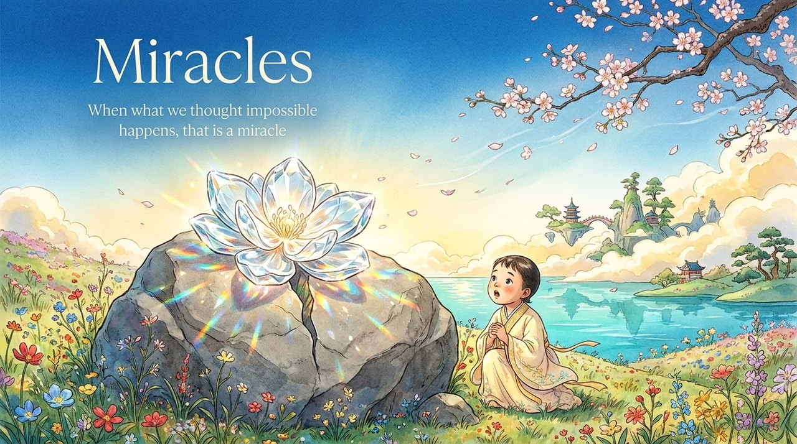
    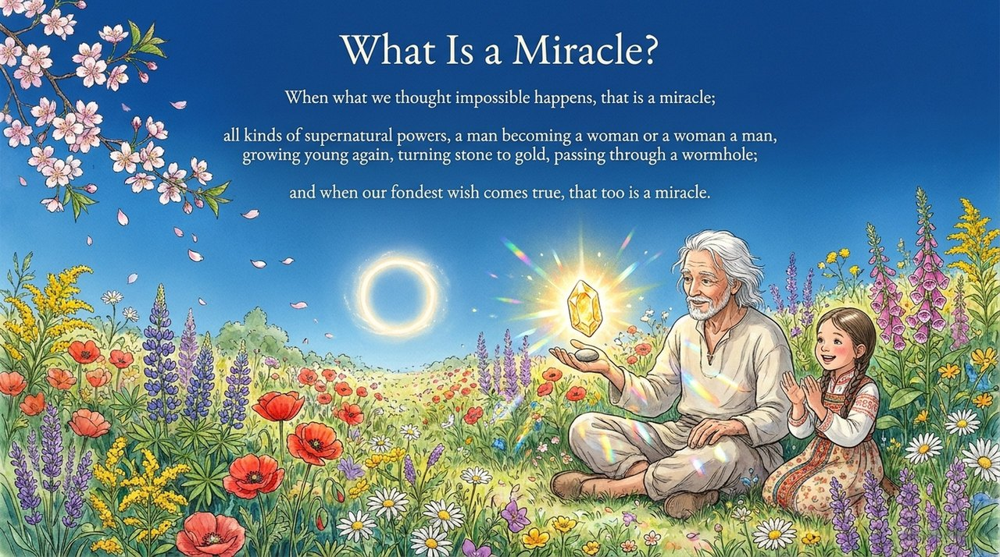
    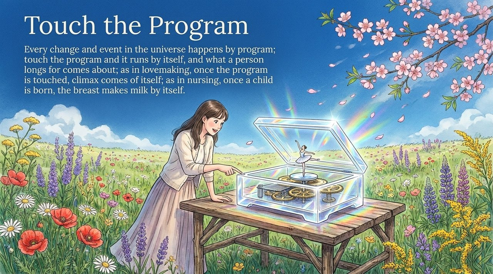
    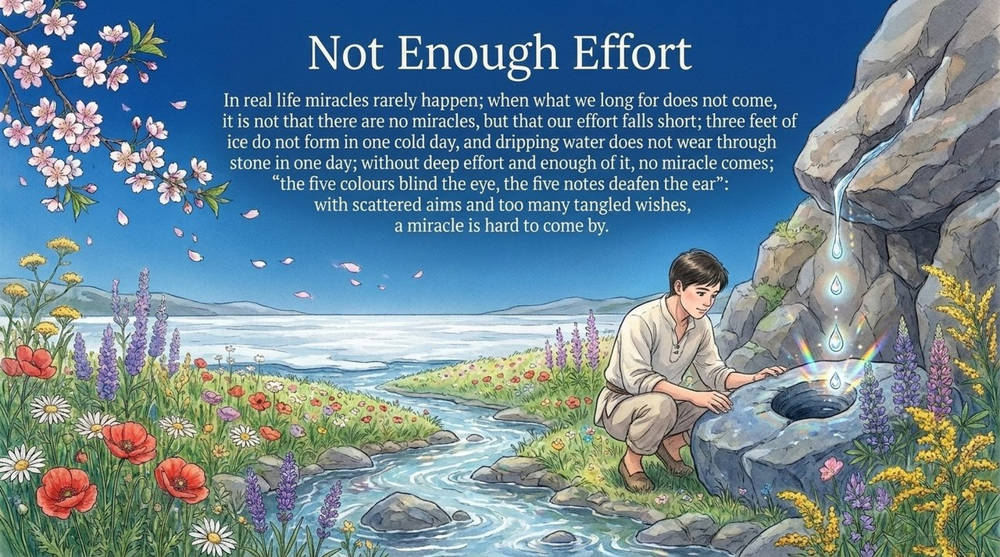
    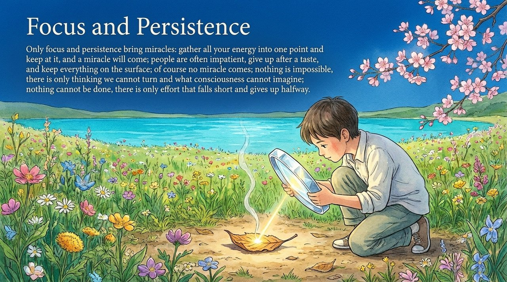
    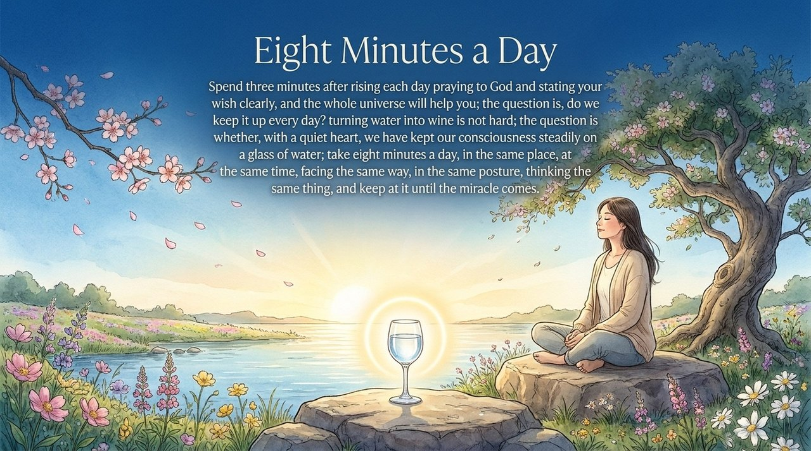
    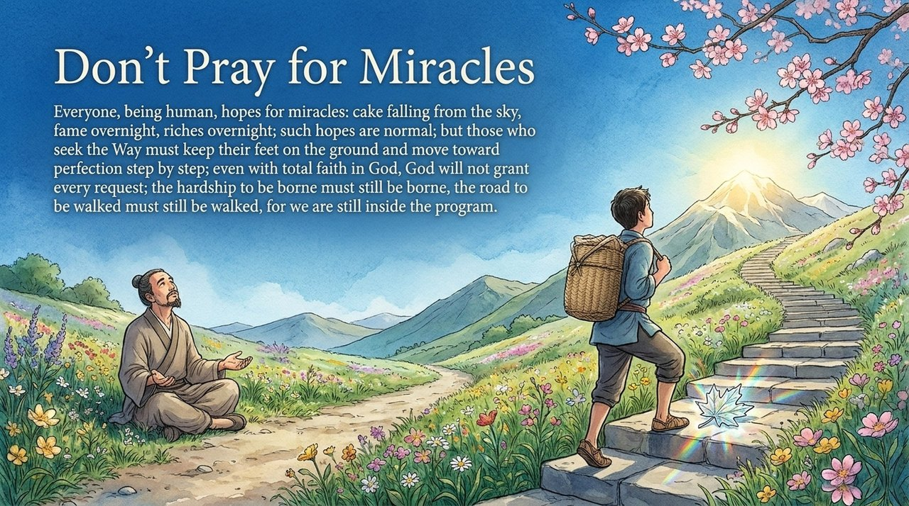
    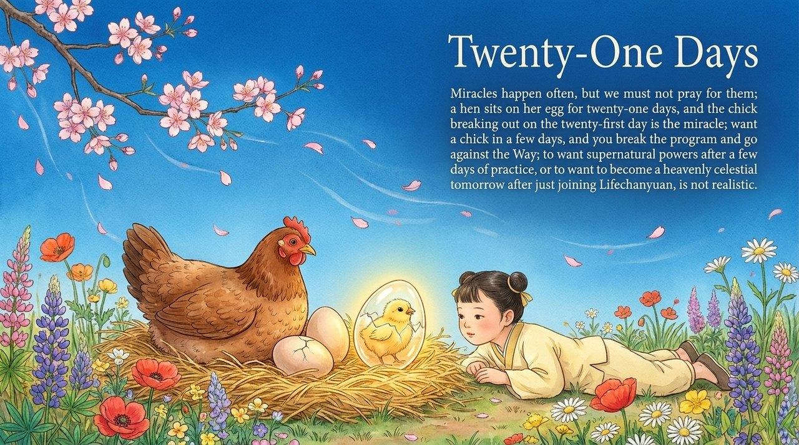
    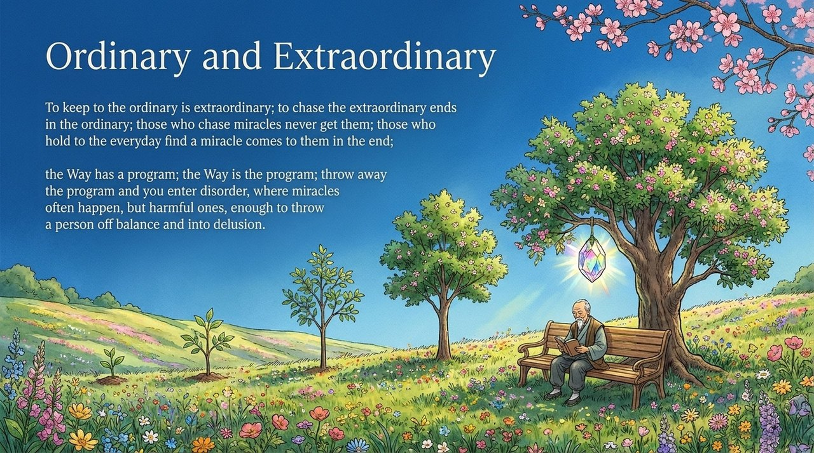
    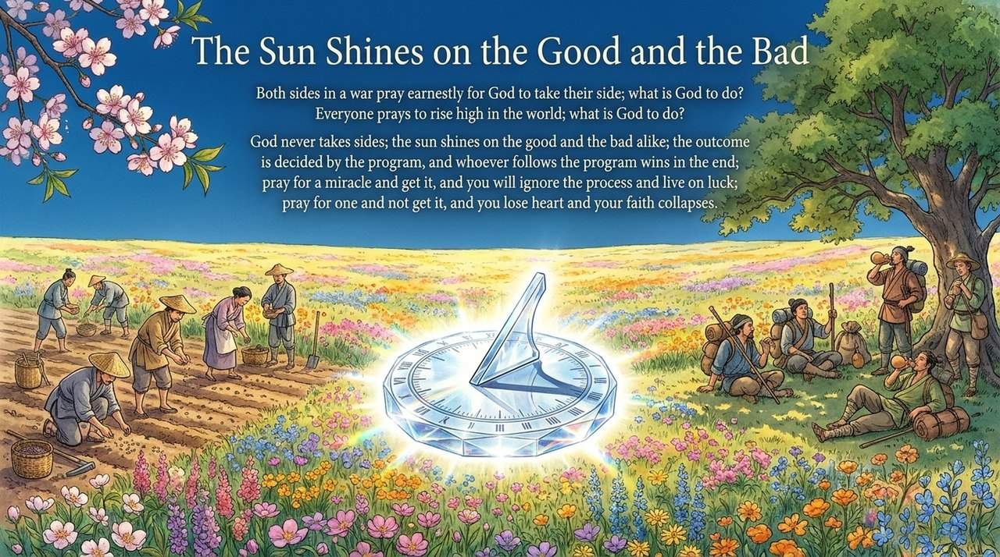
    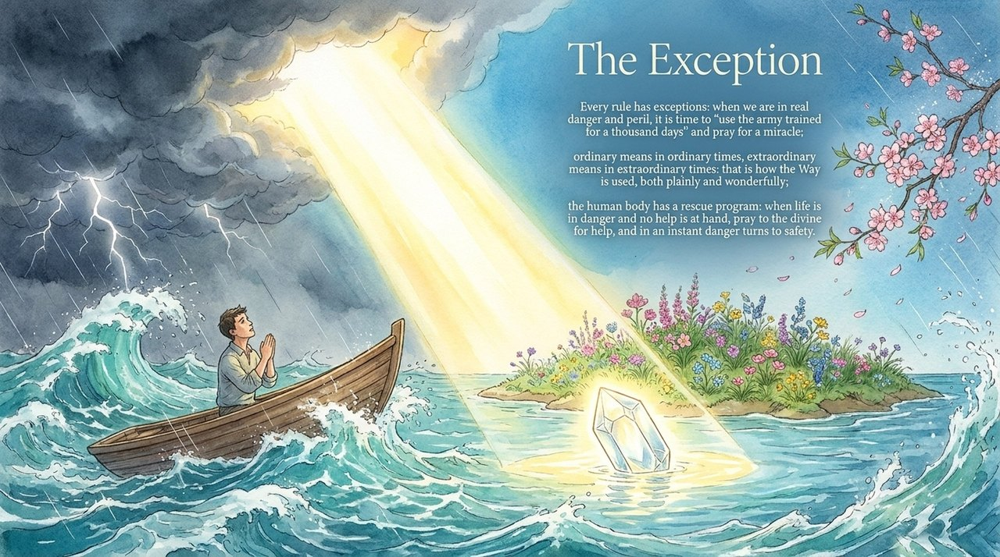
    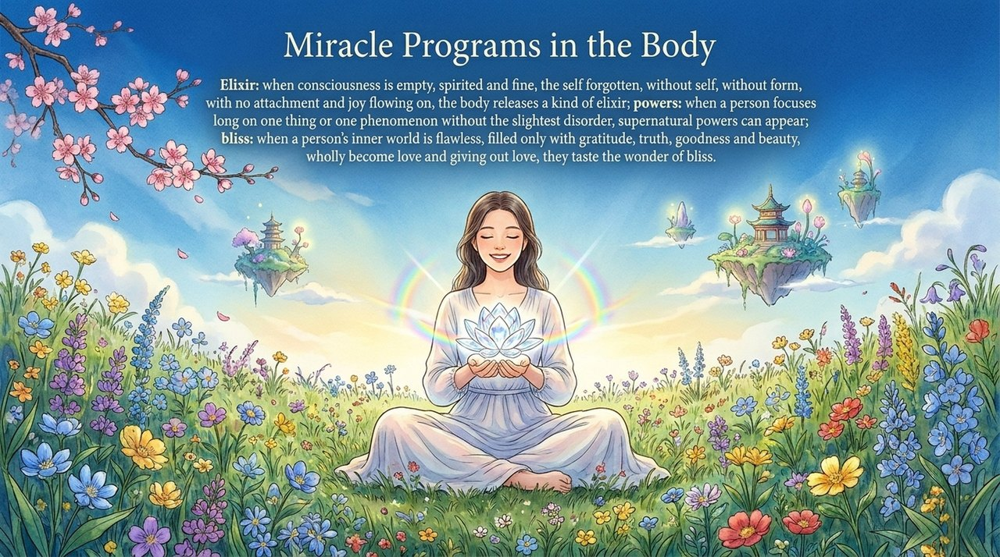
    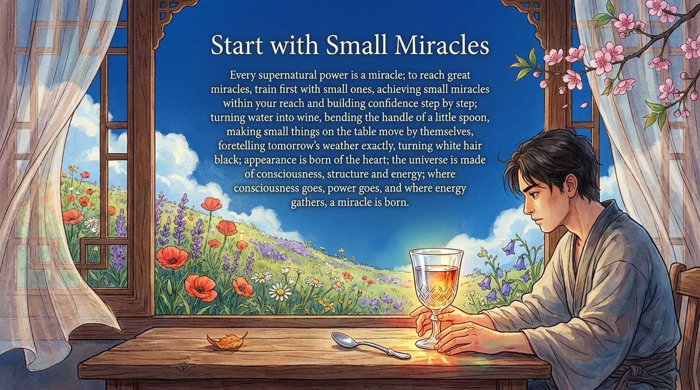
    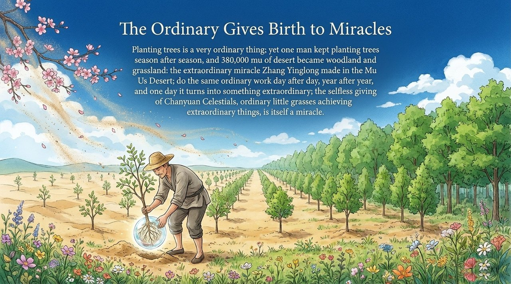

---

## Related Entries

[The Human Body — Miracle Programs and Mysteries](/en/human-body-miracle/) · [Elysian State](/en/jilemiaojing/) · [Prayer](/en/prayer/) · [Eight Non-Being States](/en/eight-no-realms/) · [Resonance](/en/resonance/) · [Becoming a Celestial Being or Buddha](/en/becoming-celestial-buddha/) · [Way of Cooperation](/en/way-of-cooperation/)
