<!-- id: LC-MRG-0001-EN theme: Universe and Space-Time type: navigation direction: Universe and Space-Time lang: en -->

# Mirage (海市蜃楼)

In the Lifechanyuan cosmological framework, a mirage is not an atmospheric optical illusion but a genuine glimpse of the Elysium World — a temporary opening in which the higher-dimensional reality of the thirty-six-dimensional universe becomes briefly visible to those who are spiritually attuned. Rather than reflected light from distant earthly objects, a mirage represents a deliberate act of communication from the Creator: a signal that another, more beautiful realm exists beyond the material world we perceive.

> "A mirage is a revelation from celestials and Buddhas — a fragmentary display of the Elysium World within the thirty-six-dimensional space made visible in the human realm. Put simply, a mirage is the true landscape of the Elysium World."
>
> *(Chanyuan Corpus · The Creator Chapter · Mirage — A Manifestation of the Elysium World)*

---

## Video

<iframe style="width:100%;aspect-ratio:4/3;border:0" src="https://www.youtube-nocookie.com/embed/wgkStLuqRT4" title="Mirage (Lifechanyuan Encyclopedia video)" allowfullscreen></iframe>

## Slides

??? info "📖 Illustrated slides (14 pages, click to expand)"

    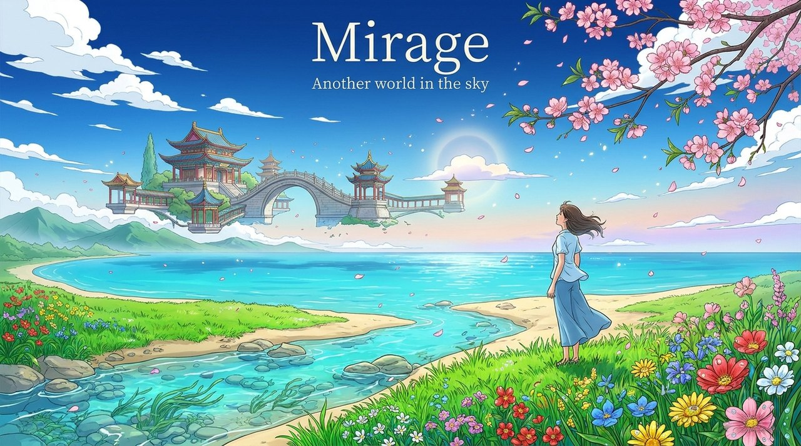
    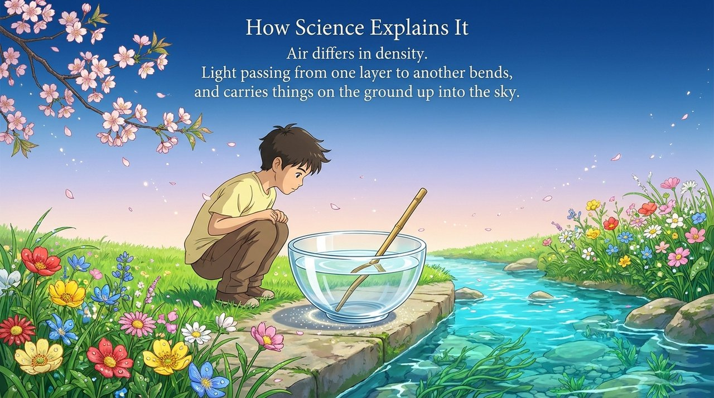
    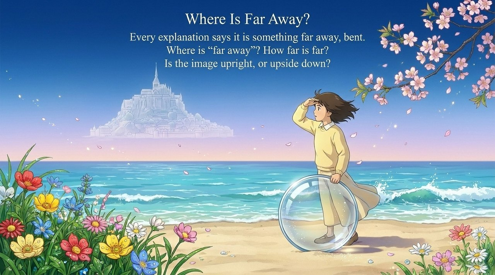
    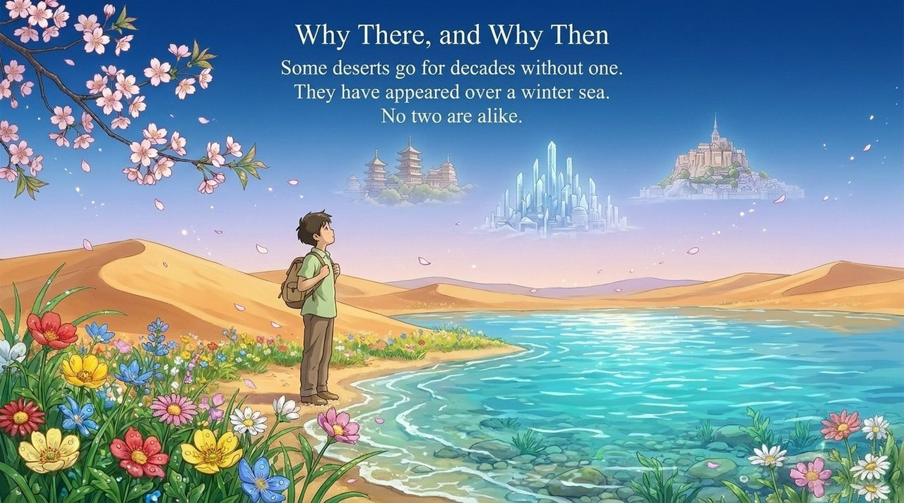
    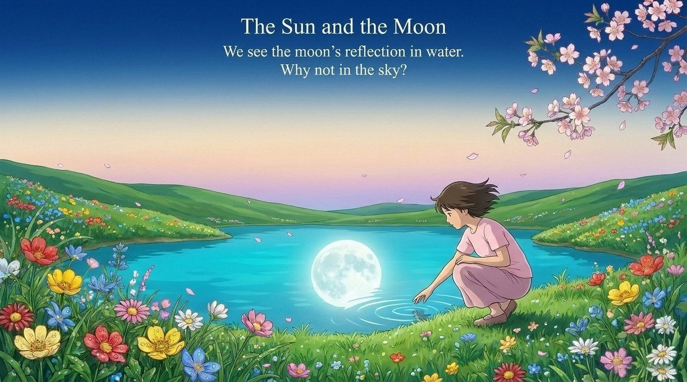
    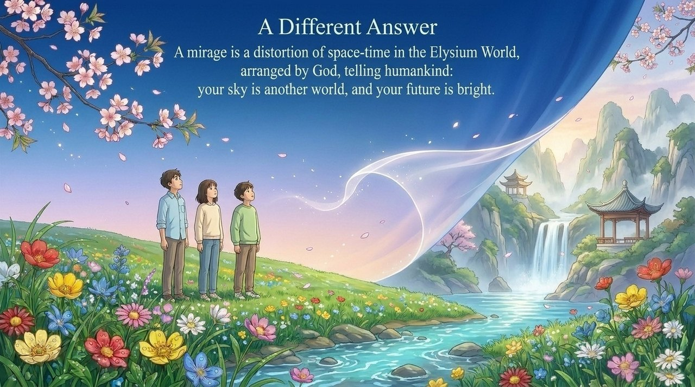
    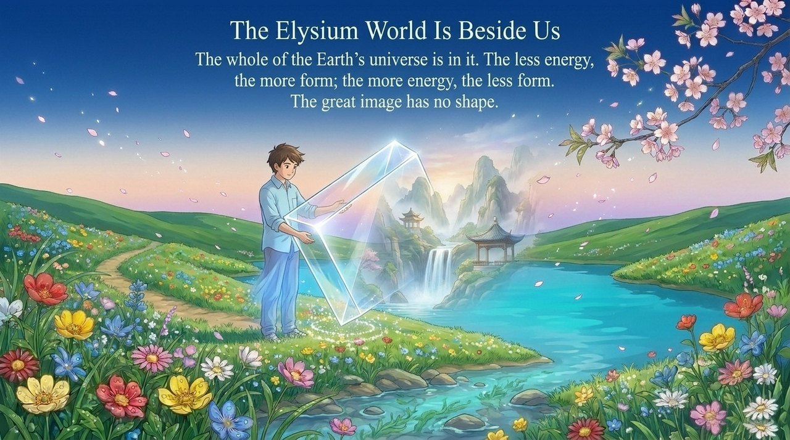
    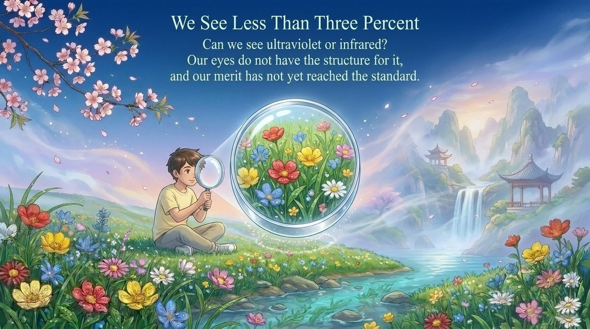
    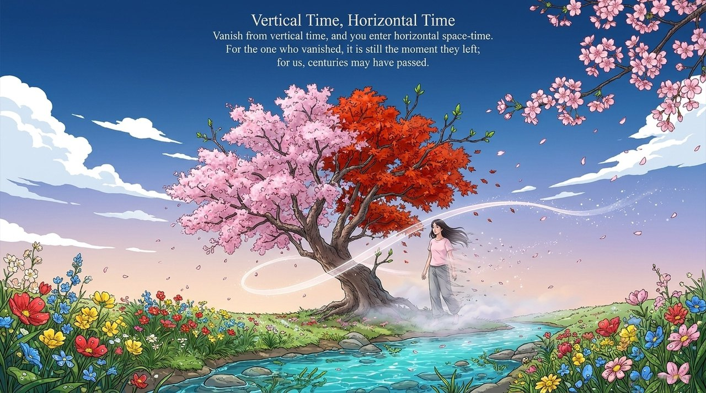
    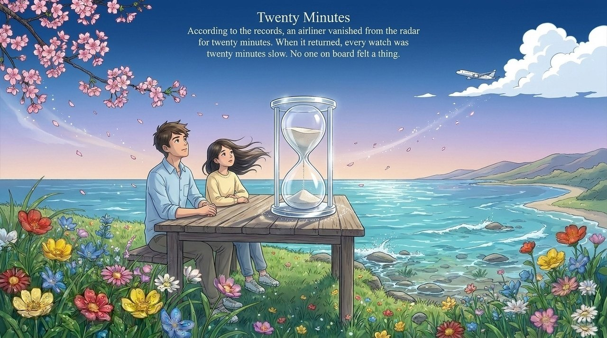
    
    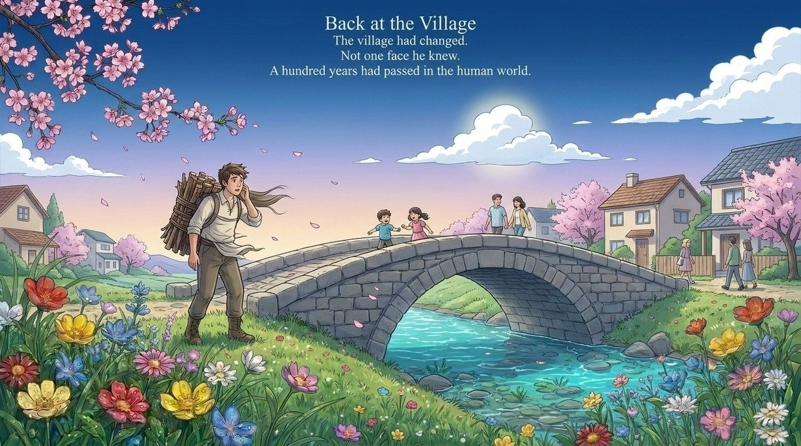
    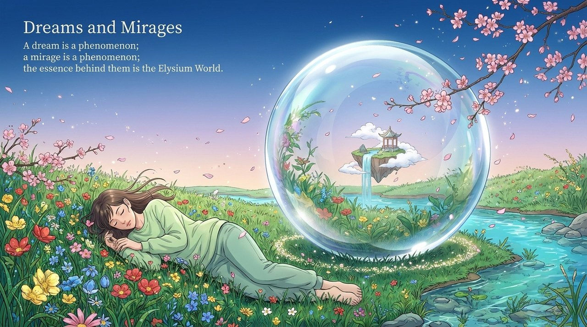
    

---

## Versions

| Version | Best for | Focus |
|---------|----------|-------|
| [Friendly version](friendly.md) | First-time readers | Stories, spiritual meaning, and invitation |
| [Academic version](academic.md) | Researchers | Concept analysis, system framework, and cross-cultural comparison |
| [Internal reference](internal.md) | Deep study | Complete source texts and cultivation guidance |

---

## Related entries

[Elysium World](/en/elysium-world/) · [Thirty-Six-Dimensional Space](/en/thirty-six-dimensional-space/) · [Space-Time](/en/spacetime/) · [Space-Time Tunnel](/en/spacetime-tunnel/) · [Cosmic Panorama](/en/cosmic-panorama/) · [Elysian Realm of Wonder](/en/jilemiaojing/) · [Cosmic Holography](/en/cosmic-holography/) · [Dreamscape](/en/dreamscape/)
