<!-- id: LC-MX-0001-EN theme: cultivation type: navigation direction: character-cultivation lang: en -->

# Demonic Nature (Moxing)

Demonic nature (*moxing*) is the dark quality embedded in every LIFE's nonmaterial structure — because the universe is holographic, each being carries demonic nature just as it carries divine, celestial, and Buddha nature. What determines whether a LIFE is a demon or a Buddha is which nature holds the dominant position. Subduing demonic nature and ultimately purging the demonic gene from one's nonmaterial structure is one of the most demanding and decisive tasks on the path of practice toward becoming a Celestial Being.

---

## Video

<iframe style="width:100%;aspect-ratio:4/3;border:0" src="https://www.youtube-nocookie.com/embed/VXxs-Bh1b-U" title="Demonic Nature (Moxing) (Lifechanyuan Encyclopedia video)" allowfullscreen></iframe>

## Slides

??? info "📖 Illustrated slides (14 pages, click to expand)"

    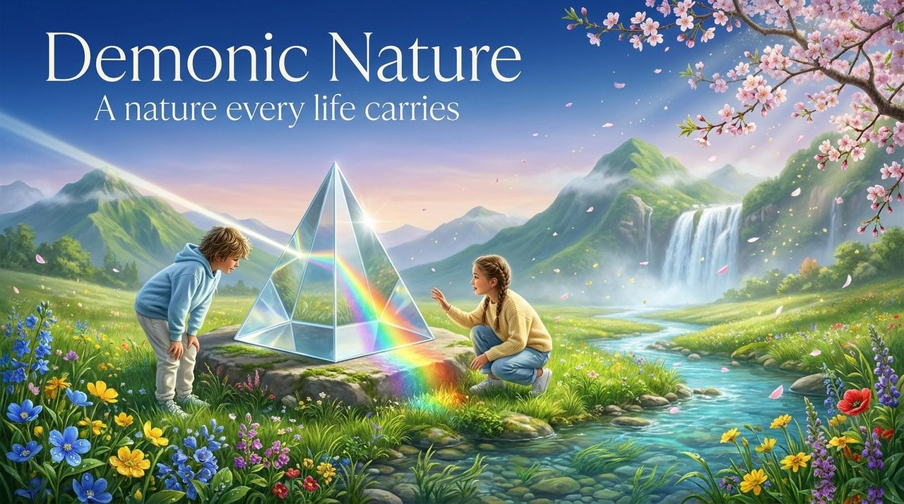
    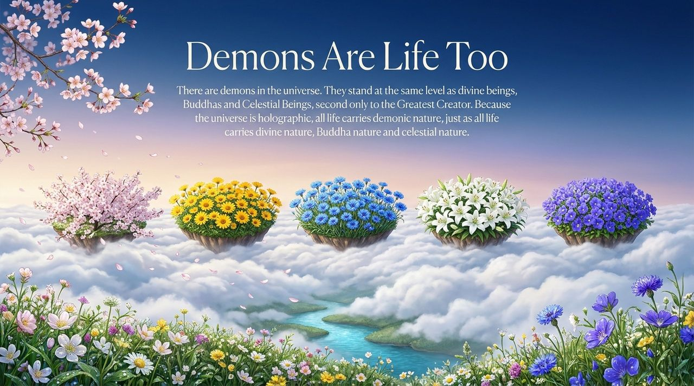
    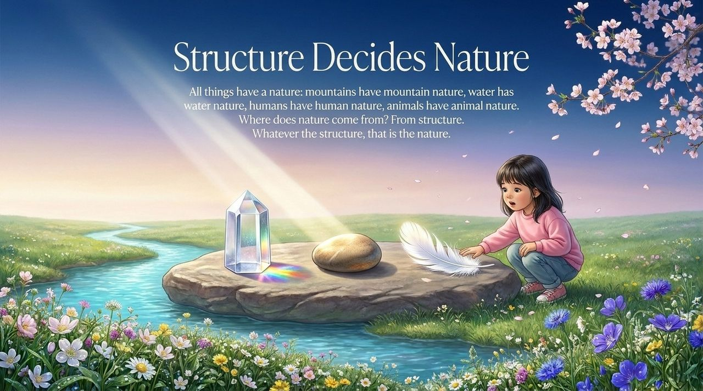
    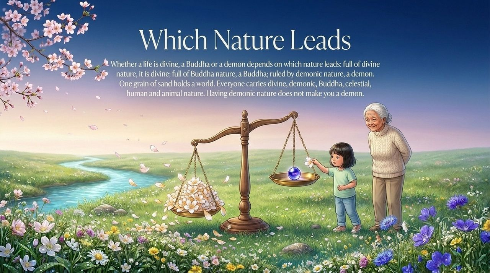
    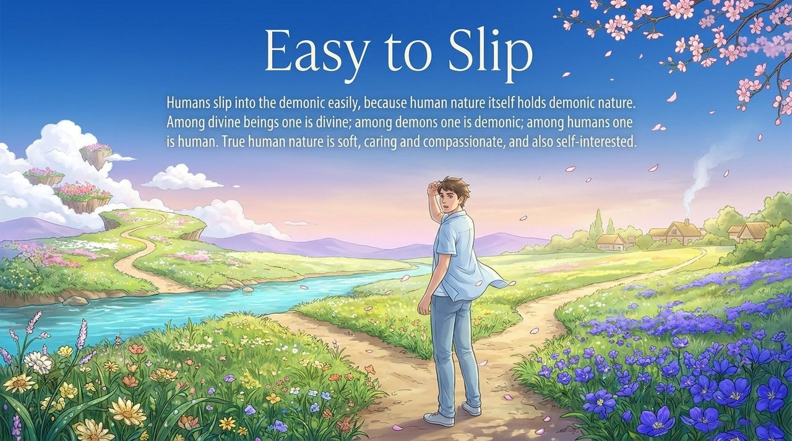
    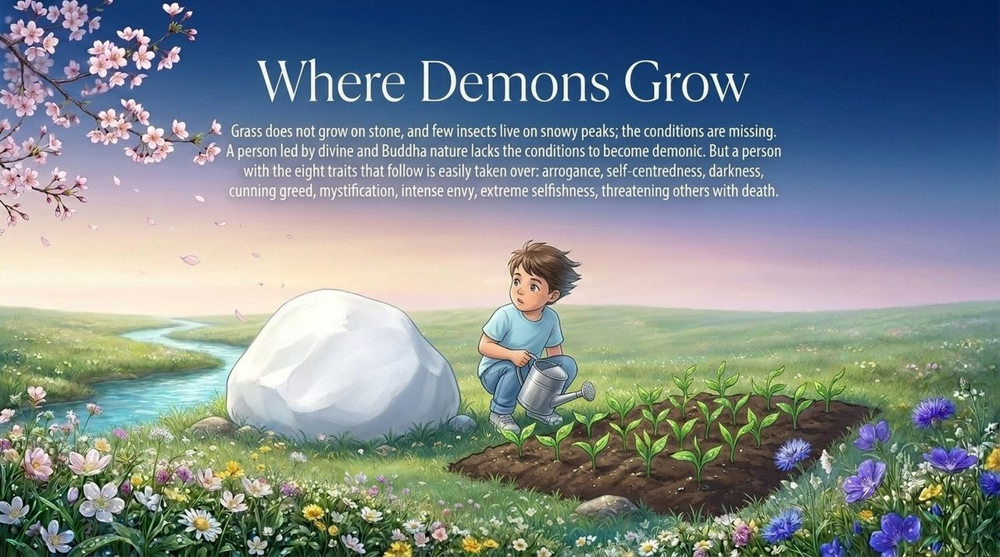
    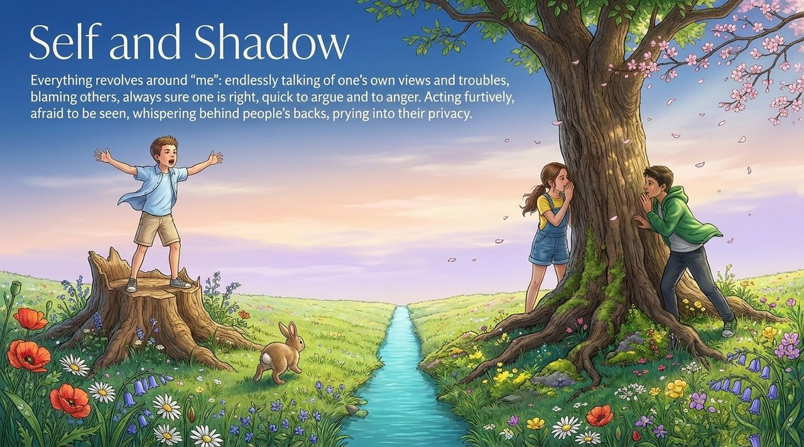
    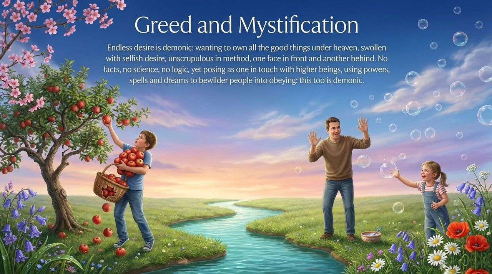
    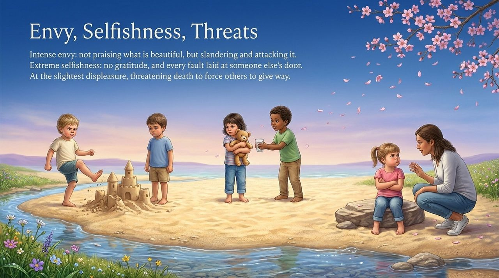
    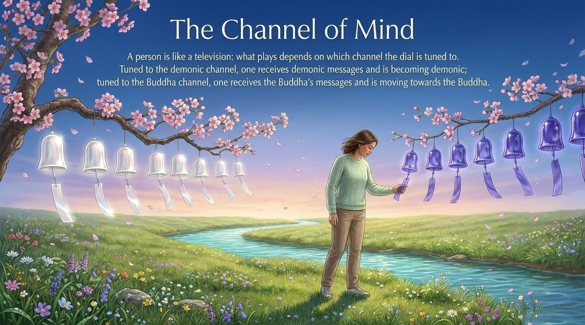
    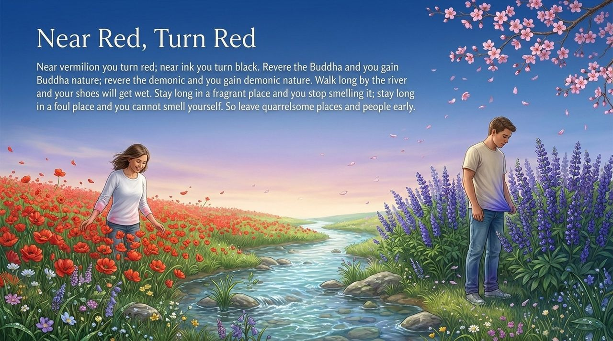
    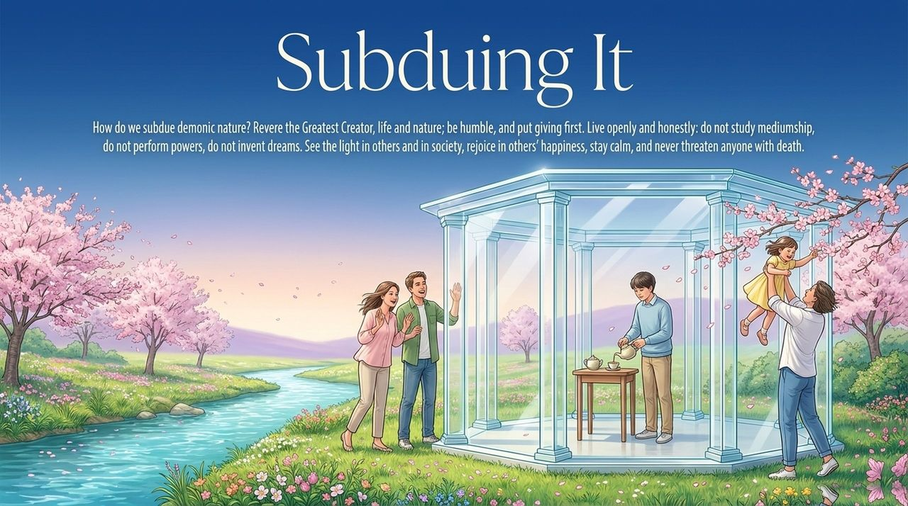
    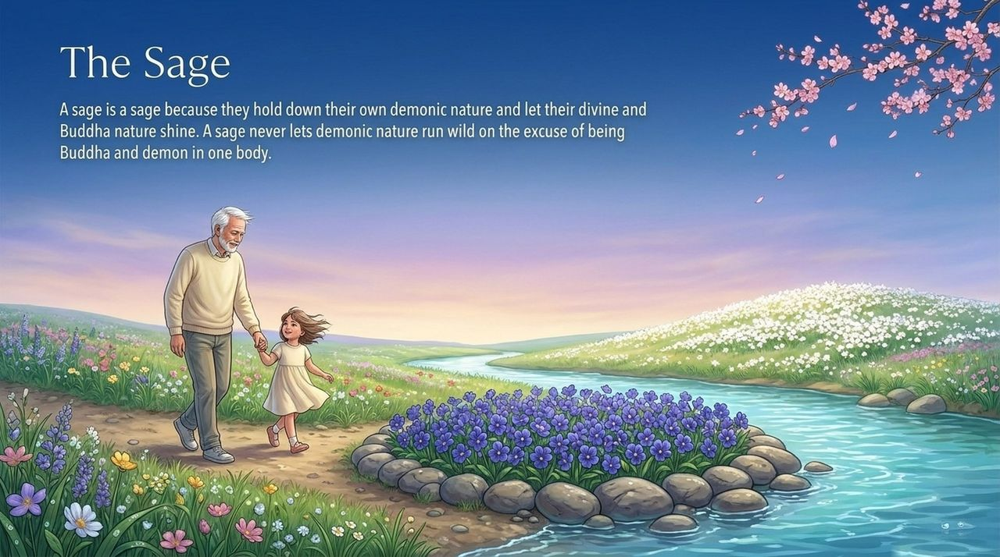
    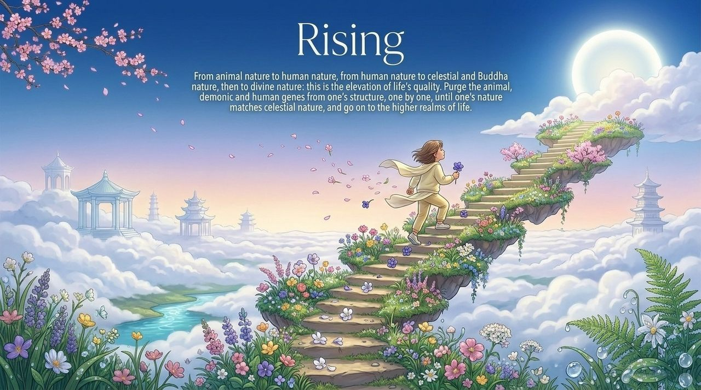

---

## Version Navigation

| Version | Best for | Highlights |
|---------|----------|------------|
| [Accessible Version](friendly.md) | New readers | Everyday examples · Eight demonic signals · Self-reflection guide |
| [Academic Version](academic.md) | Scholars · Comparative study | Cross-tradition comparison · Structural analysis · Holographic framework |
| [Internal Version](internal.md) | Practitioners · Researchers | Complete source texts · Seven-section framework · In-depth system analysis |

---

## Related Entries

[Arrogance (Aoman)](/en/aoman/) · [Humility](/en/humility/) · [Clinging to the Self (Wo-Zhi)](/en/wo-zhi/) · [Gratitude](/en/gratitude/) · [Becoming Celestial and Becoming Buddha](/en/becoming-celestial-buddha/) · [Inverted Thinking](/en/diandao-mengxiang/) · [Inner Garden of the Spirit](/en/soul-garden/) · [Self-Nature · Buddha-Nature · Tathāgata Nature](/en/self-nature/) · [Cosmic Panorama](/en/cosmic-panorama/)
