# New Era Consciousness

**New Era Consciousness** is a vast, integrative system of awareness that draws from the full spectrum of human wisdom traditions — from Seth and Orin to *The Law of One*, *Conversations with God*, and *A Course in Miracles* — spanning science, philosophy, psychology, cosmology, and spirituality. In the Life Chanyuan framework, **Life Chanyuan consciousness is New Era Consciousness**: it synthesizes all these "pearls" on a single thread — the path of the Greatest Creator.

> New Era Consciousness asks us to awaken from the slumber of our souls, enter a more genuinely real reality, and enjoy a life that is freer, more comfortable, and free from fear.
>
> — Xuefeng, *Fully Embrace New Era Consciousness*

| Version | Best for | Focus |
|---------|----------|-------|
| [Friendly version](friendly.md) | First-time readers | Core ideas and personal implications in plain language |
| [Academic version](academic.md) | Researchers | Systematic analysis of origins, principles, and frameworks |
| [Internal reference](internal.md) | Deep study | Original texts, unaltered |

---

## Video

<iframe style="width:100%;aspect-ratio:4/3;border:0" src="https://www.youtube-nocookie.com/embed/wwJmKW8-uyk" title="New Era Consciousness (Lifechanyuan Encyclopedia video)" allowfullscreen></iframe>

## Slides

??? info "📖 Illustrated slides (14 pages, click to expand)"

    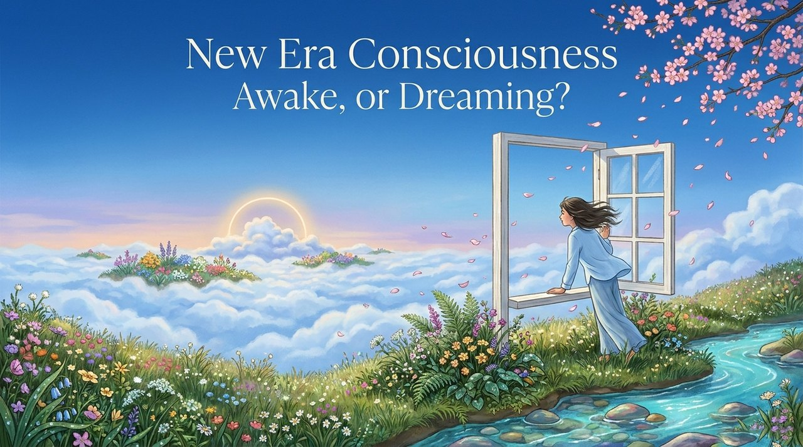
    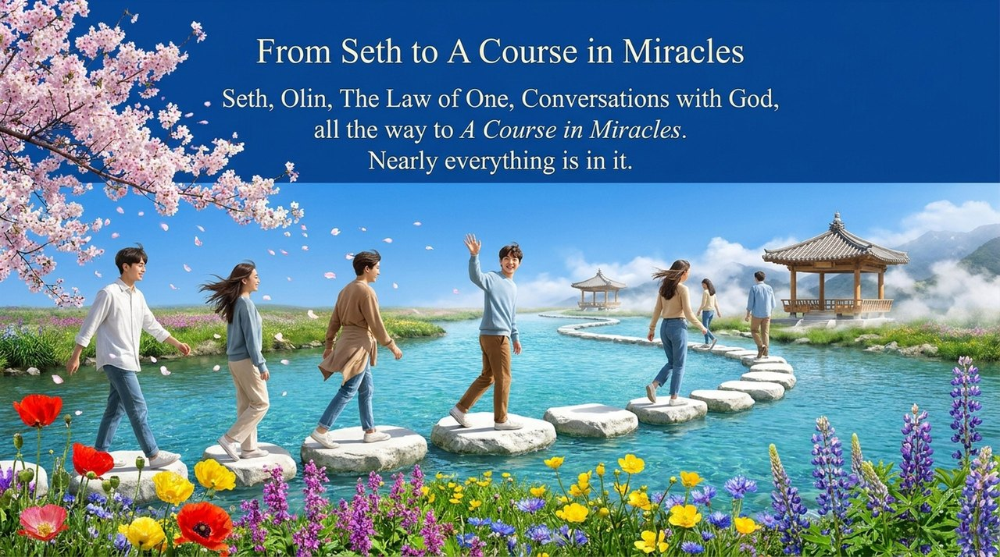
    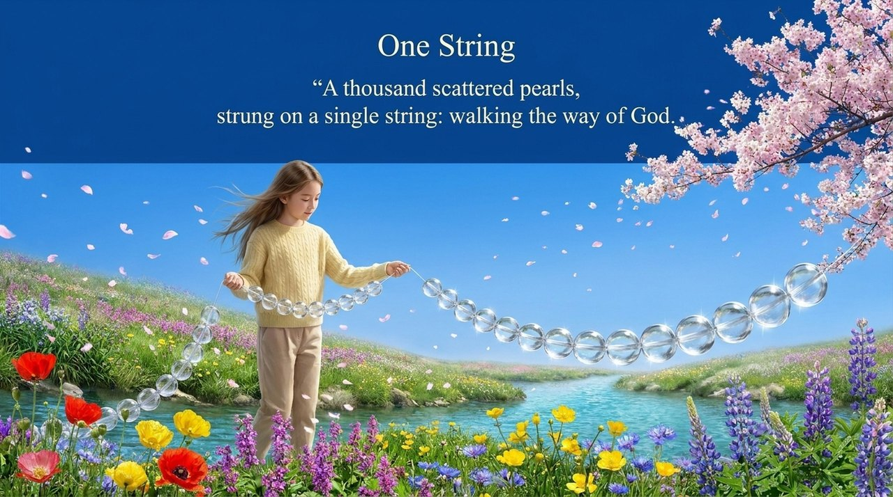
    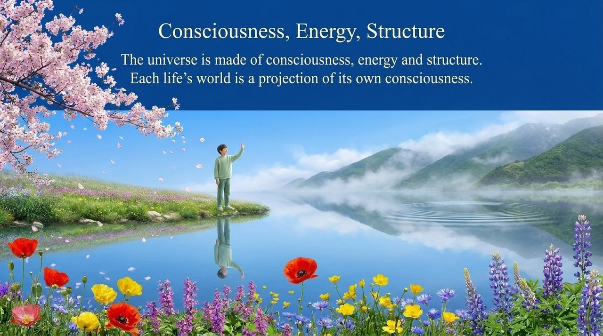
    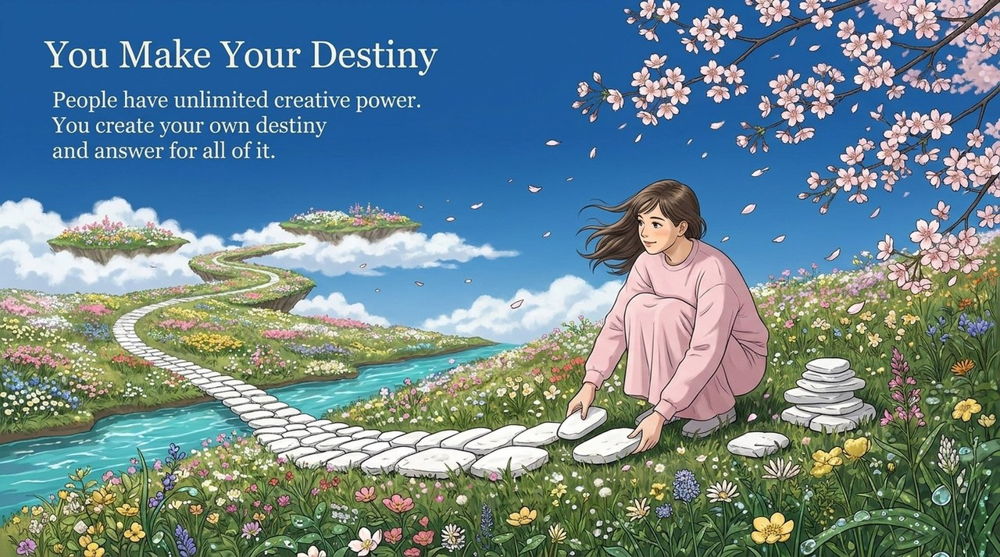
    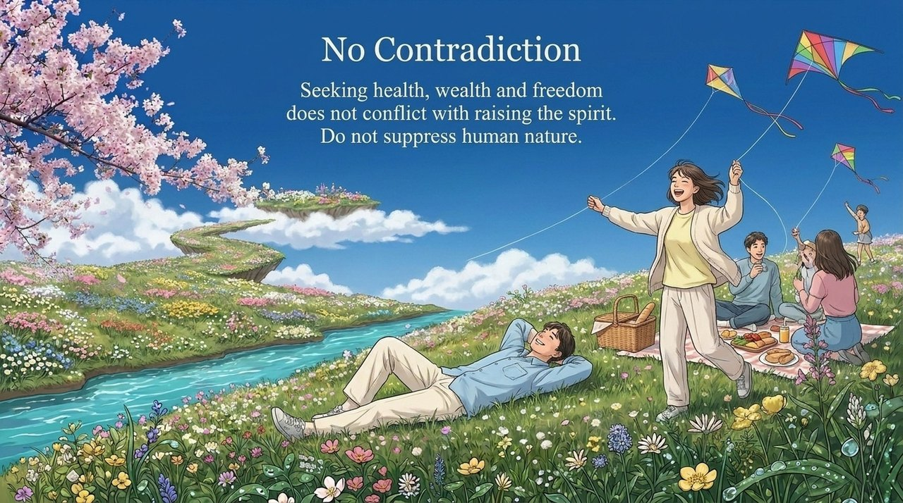
    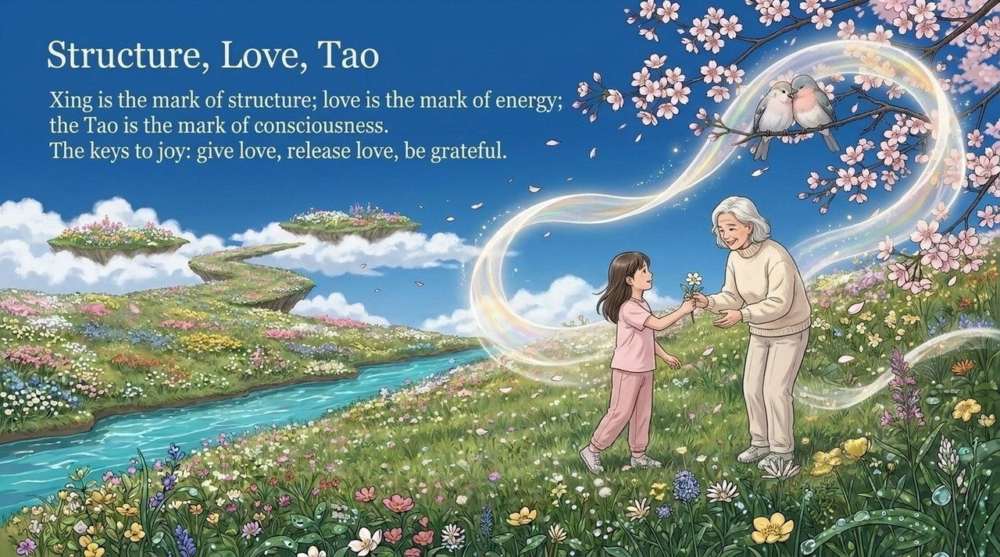
    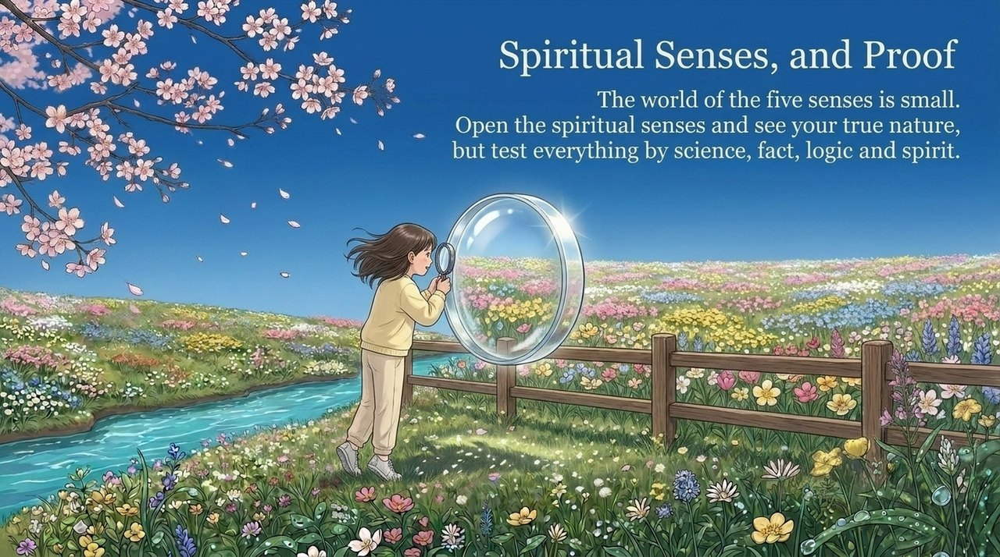
    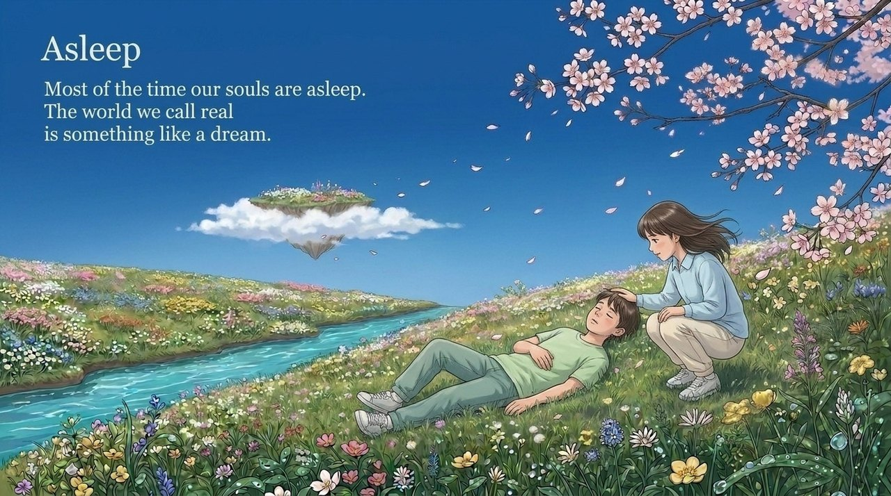
    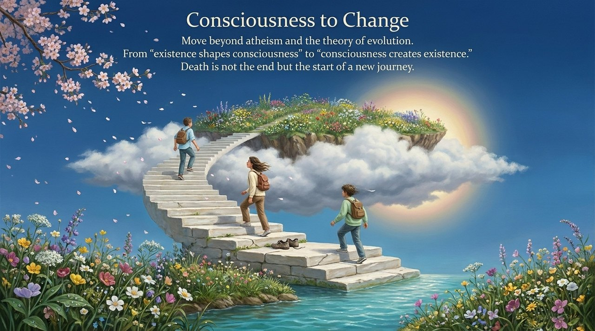
    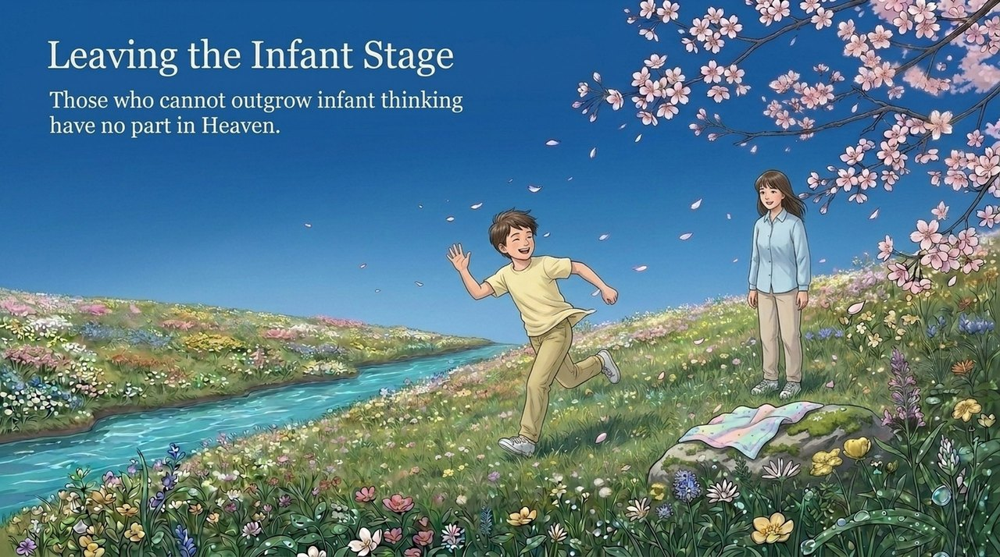
    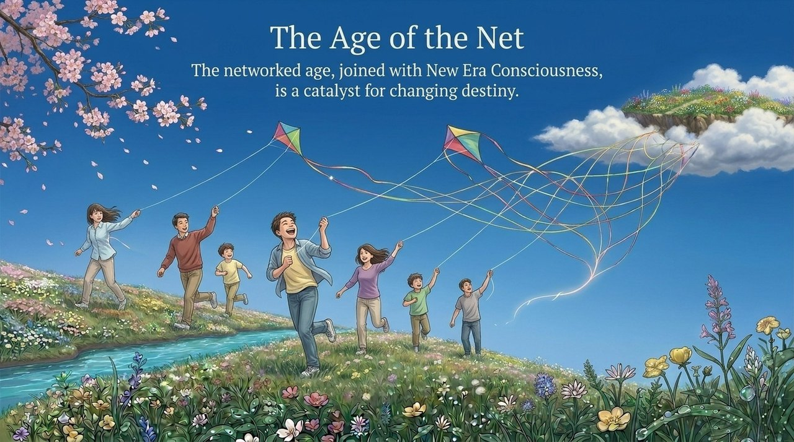
    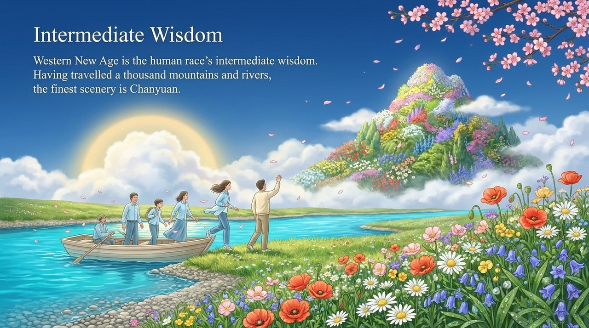
    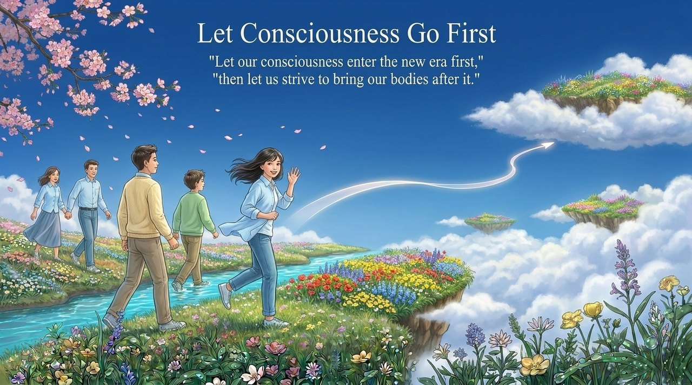

---

## Related Entries

[Consciousness](/en/consciousness/) · [Thinking (Overview)](/en/thinking-overview/) · [Eight Thinking Ladders](/en/eight-thinking-ladders/) · [Awakening](/en/awakening/) · [Resonance](/en/resonance/) · [Life Chanyuan Era (New Era)](/en/lifechanyuan-new-era/) · [Complete Independent Consciousness](/en/complete-independent-consciousness/)
