<!-- id: LC-NFT-0005 theme: Thinking Cultivation type: Entry Gateway direction: Consciousness Ascension Path lang: en -->

> In Lifechanyuan terminology, **LIFE** (capitalized) refers to the ontological
> essence of existence — the soul/antimatter structure that persists across
> incarnations — while **life** (lowercase) refers to the experiential stage
> of human existence in this world.

# Non-Form Thinking

【Entry Gateway】

**Non-Form Thinking** is the **seventh rung** of the Eight Thinking Ladders — situated above Taiji Thinking and below Hundun Thinking, it is the penultimate step within the "subtraction phase," the spiritual realm closest to the source of the cosmos. The essence of Non-Form Thinking is: **letting everything return to zero** — departing from all forms, pointing directly at the cosmic source, the operating principles of all phenomena, and LIFE's original nature. The Buddha Shakyamuni's thinking was Non-Form Thinking, and the entire *Diamond Sutra* is the vessel that the Buddha built to guide humanity into Non-Form Thinking.

> Non-Form Thinking, as the name implies, is the mode of knowing and thinking about the cosmic source, the operating principles of all phenomena, and LIFE's original nature, after departing from all forms.
>
> — *Chanyuan Corpus · Cultivation of Immortality Chapter · Non-Form Thinking (I)*

---

## Core Position

In Lifechanyuan's cultivation route map, Non-Form Thinking is the third rung of the subtraction phase (Heart-Image → Taiji → **Non-Form** → Hundun). At this level, one no longer needs to "use one's brain" — returning to zero, one attains Buddhahood. The primary thinking mode of celestial immortals and Buddhas is Non-Form Thinking. "To attain the realm of Non-Form Thinking is to attain Buddhahood — this is beyond doubt."

---

## Edition Navigator

| Edition | Best For | Link |
|---------|---------|------|
| **Friendly Edition** | Readers new to Lifechanyuan | [Read Friendly Edition](./friendly) |
| **Academic Edition** | Readers with philosophy / religious studies background | [Read Academic Edition](./academic) |
| **Internal Edition** | Chanyuan Celestials and deep practitioners | [Read Internal Edition](./internal) |

---

## Video

<iframe style="width:100%;aspect-ratio:4/3;border:0" src="https://www.youtube-nocookie.com/embed/gVLNjNca3vk" title="Non-Form Thinking (Lifechanyuan Encyclopedia video)" allowfullscreen></iframe>

## Slides

??? info "📖 Illustrated slides (14 pages, click to expand)"

    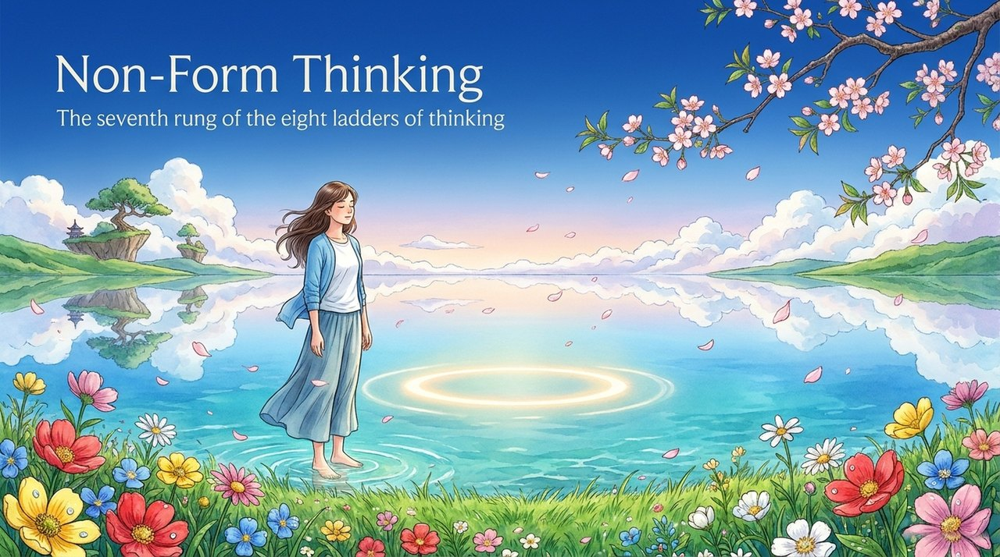
    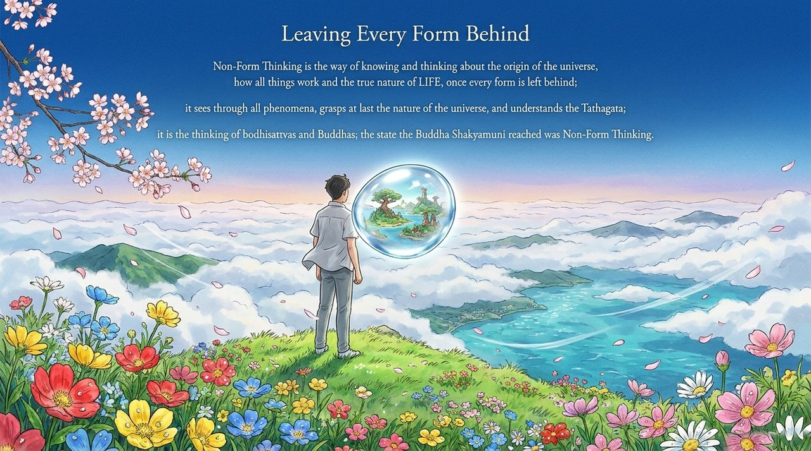
    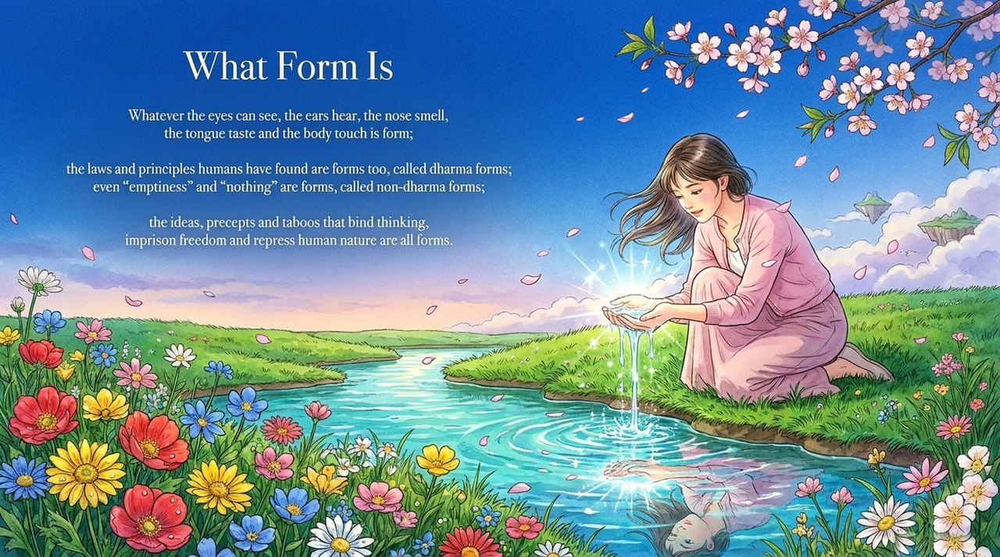
    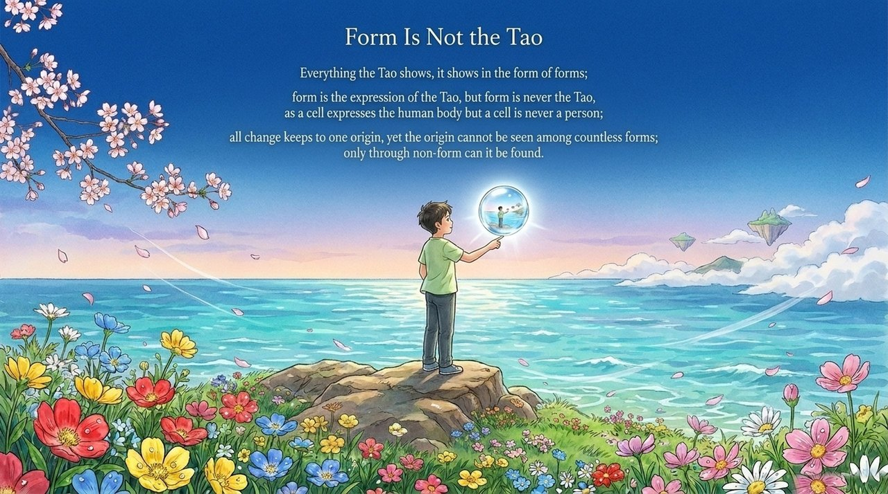
    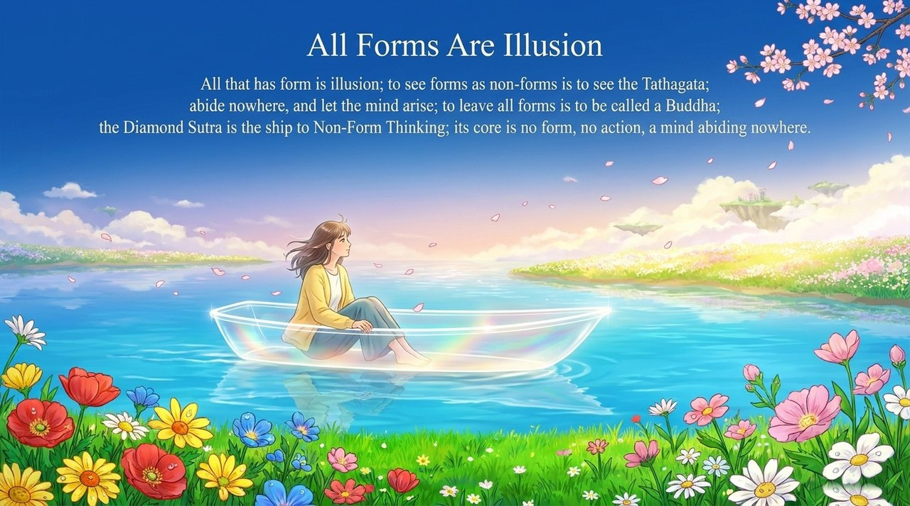
    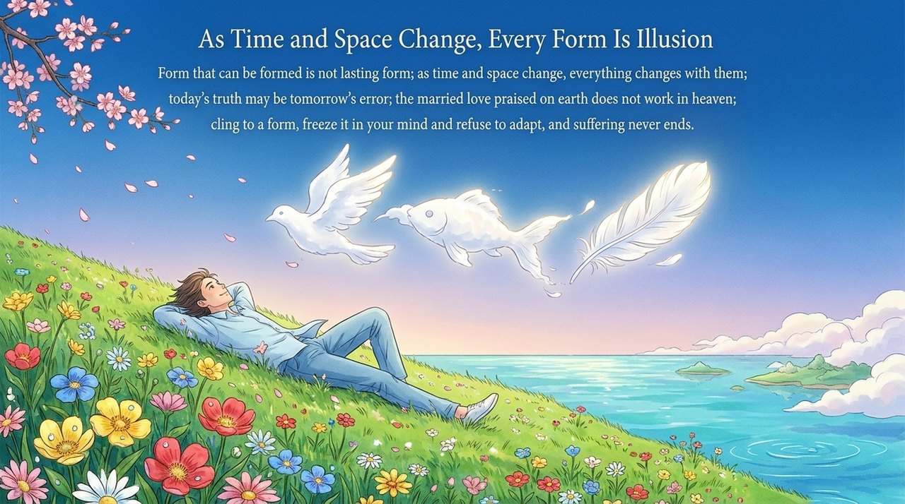
    
    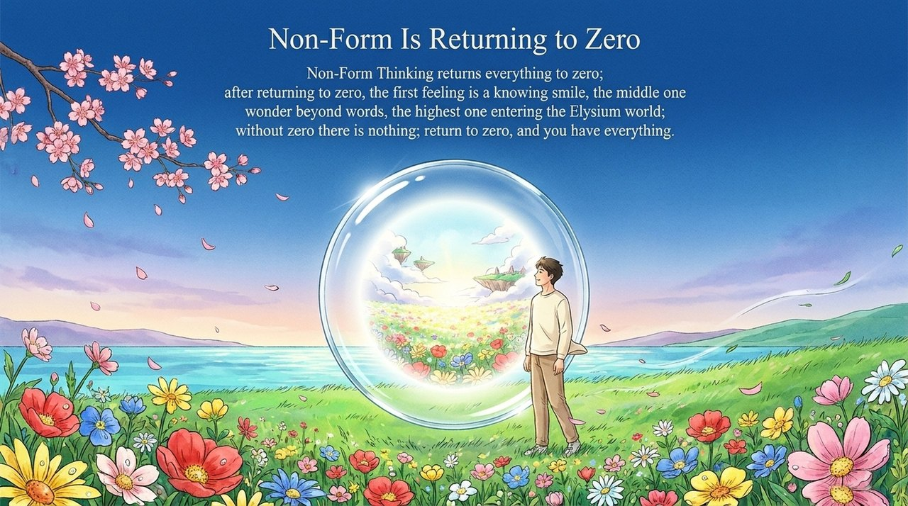
    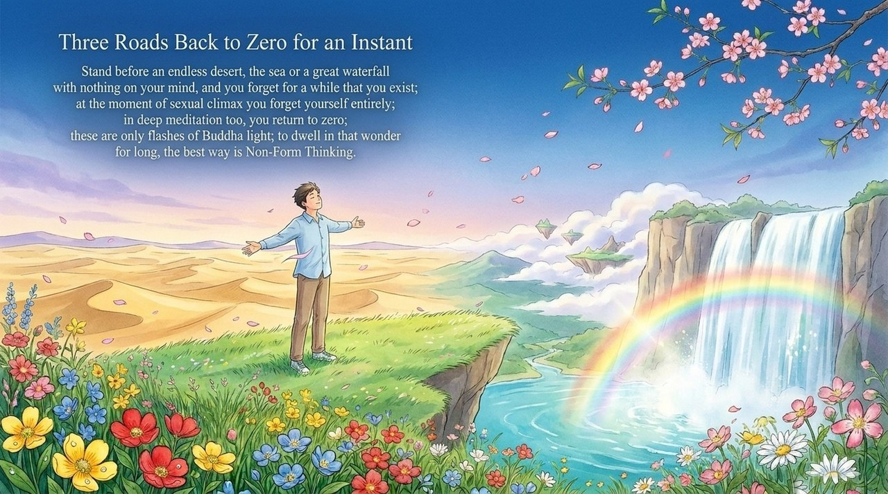
    
    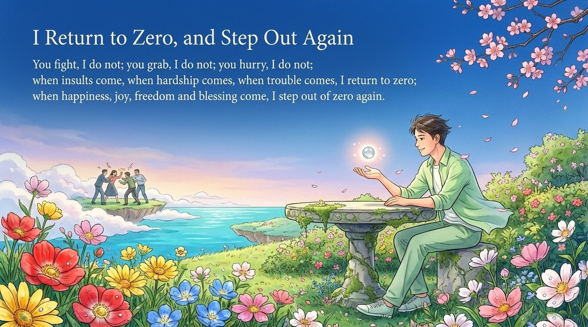
    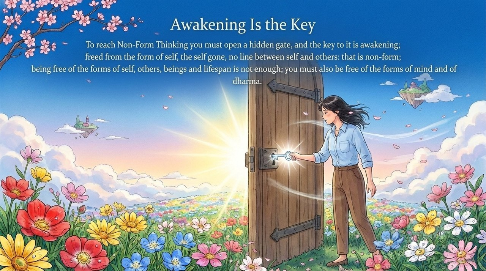
    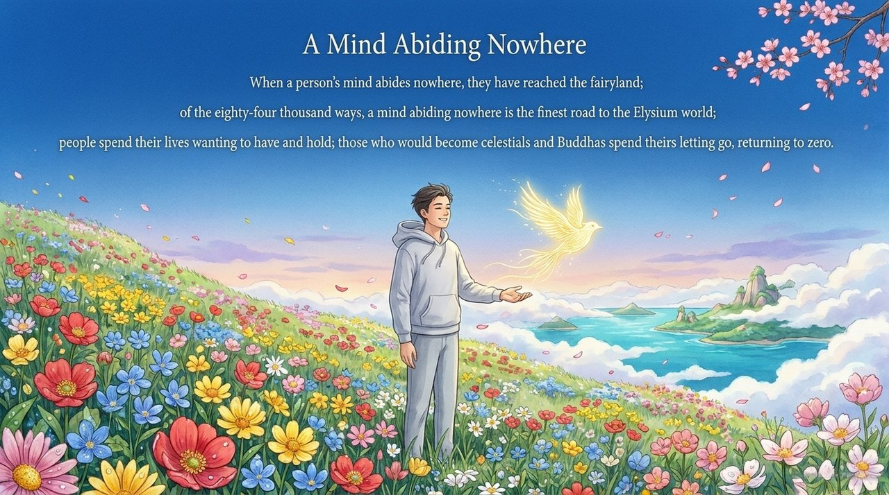
    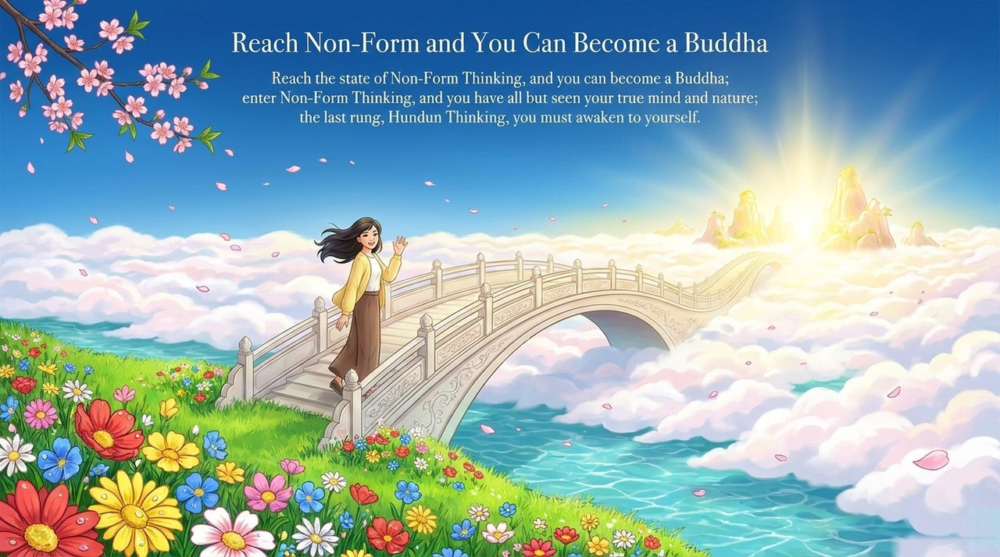

---

## Related Entries

- [Eight Thinking Ladders](/en/eight-thinking-ladders/) — Non-Form Thinking's coordinates in the complete thinking ladder system
- [Taiji Thinking](/en/taiji-thinking/) — Sixth rung; the step preceding Non-Form Thinking
- [Elysium World](/en/elysium-world/) — The LIFE space that Non-Form Thinking leads toward
- [Hundun Management](/en/hundun-management/) — Hundun Thinking (eighth rung) in practice
