<!-- id: LC-OPO-0005 theme: Cognitive Cultivation type: entry direction: Path of Consciousness Elevation lang: en -->

# 1+1 Thinking

> 1+1=2 is an increase in quantity; 1+1=1 is an increase in energy. The sage embraces the One and becomes the model for all under heaven.
>
> — *Eight Hundred Concepts for the New Era of Humanity*

> 1+(−1)=1 is a key to knowing the mysteries of the universe.
>
> — *Eight Hundred Concepts*

> In Lifechanyuan terminology, **LIFE** (capitalized) refers to the ontological essence of existence — the soul/antimatter structure that persists across incarnations — while **life** (lowercase) refers to the experiential stage of human existence in this world.

**1+1 Thinking** is the most precise and operational tool in Lifechanyuan's *Chapter on Anti-Conventional Thinking*. Through a comprehensive deconstruction of the most fundamental mathematical equation "1+1," it reveals the deep laws governing the universe: the result of any calculation is not fixed — it is determined by the **nature (attribute)** of what is being added. The universe is not the linear 1+1=2 world; it is a Hundun (primordial chaos) world, holographic, governed by the unified polarity of yin and yang.

From 1+1=2 (material thinking) → 1+1=1 (energy thinking / union with the Tao) → 1+1=0 (returning to zero / Non-Form realm) → 1+(−1)=Universe (unity of opposites / holographic cognition) → 10−9="Tao" (the path of subtraction) → 1+0=infinity (merging with the anti-universe): 1+1 Thinking uses the simplest mathematical symbols to map a complete route of consciousness elevation.

---

## Video

<iframe style="width:100%;aspect-ratio:4/3;border:0" src="https://www.youtube-nocookie.com/embed/oDT77L7K710" title="1+1 Thinking (Lifechanyuan Encyclopedia video)" allowfullscreen></iframe>

## Slides

??? info "📖 Illustrated slides (14 pages, click to expand)"

    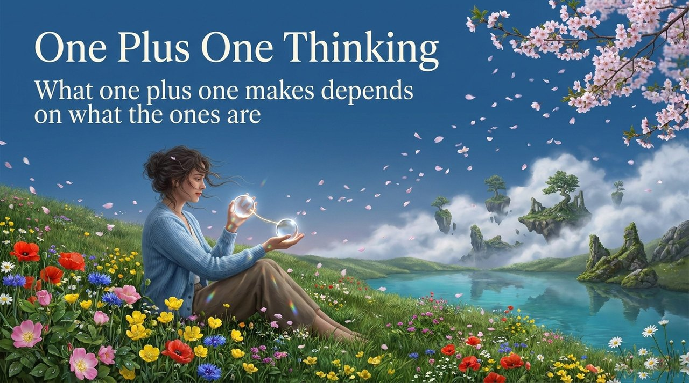
    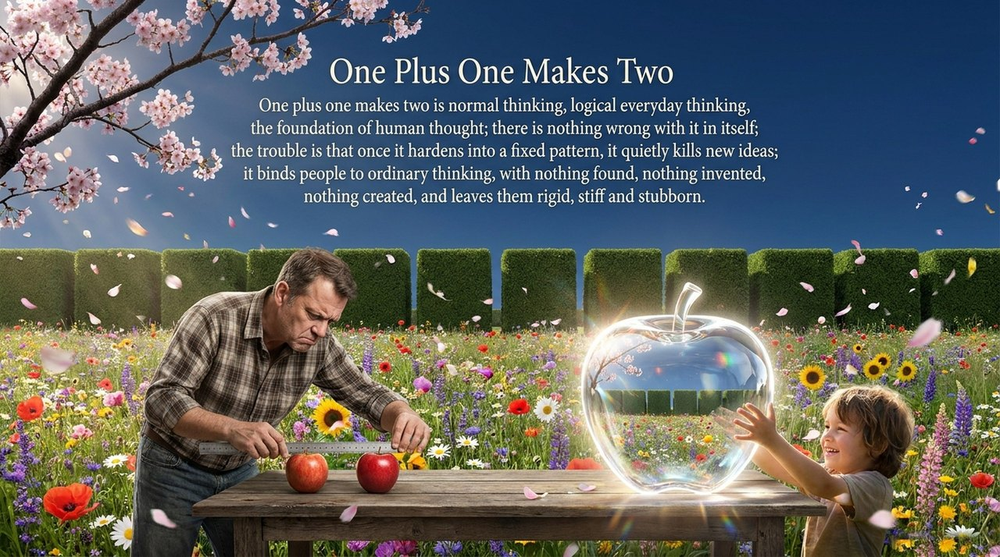
    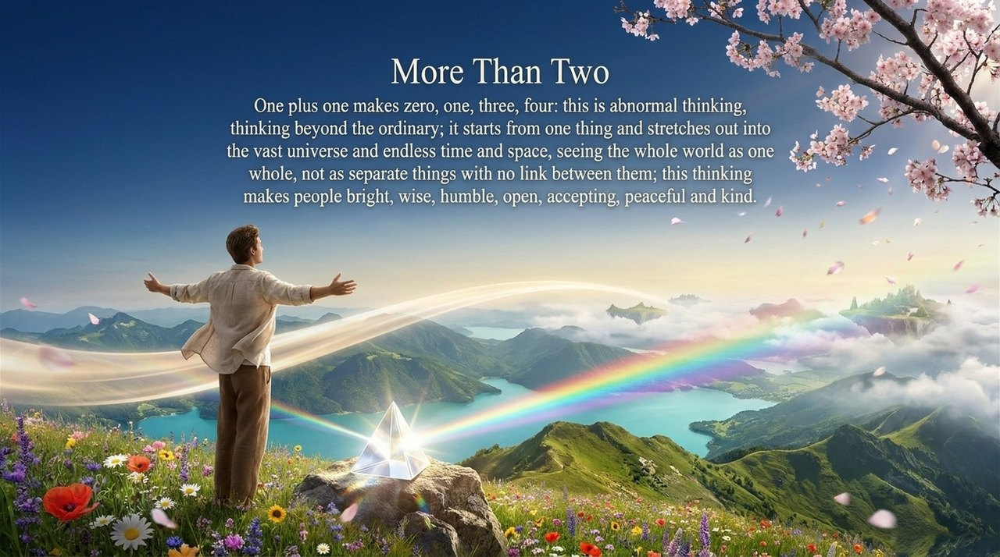
    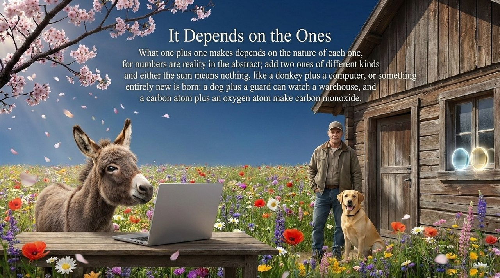
    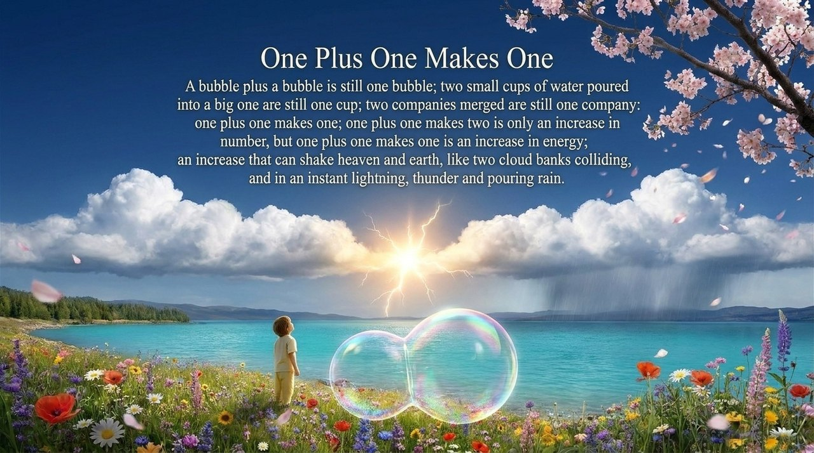
    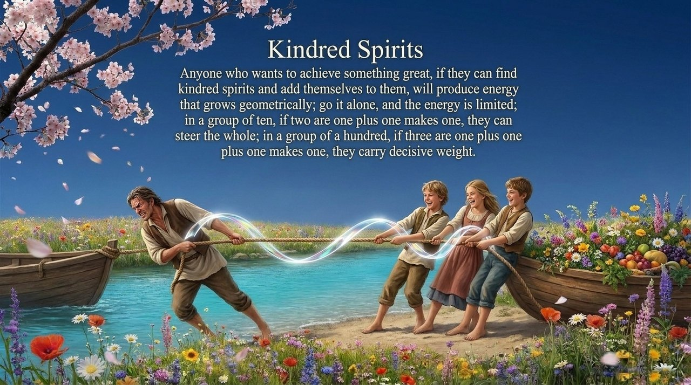
    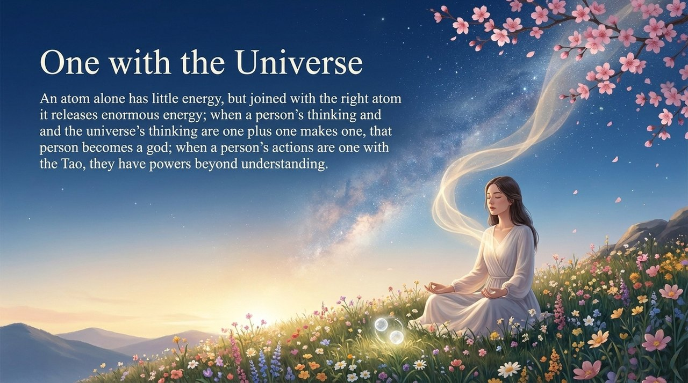
    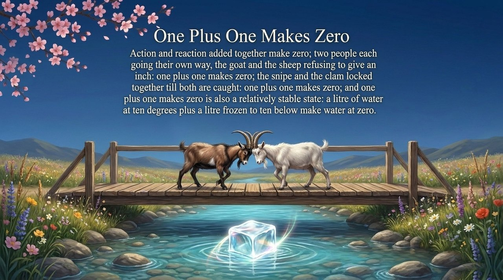
    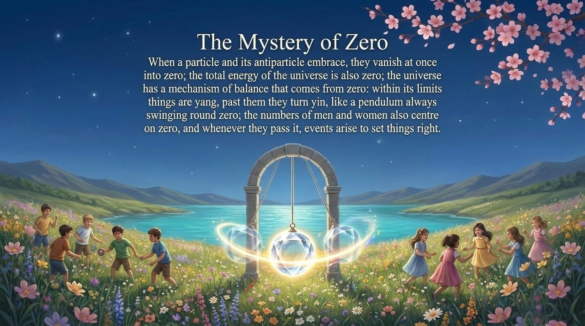
    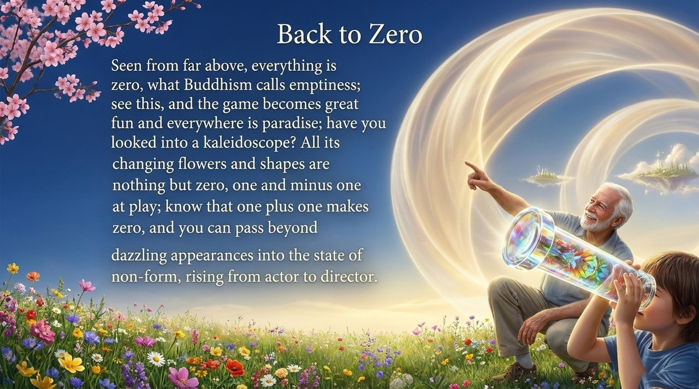
    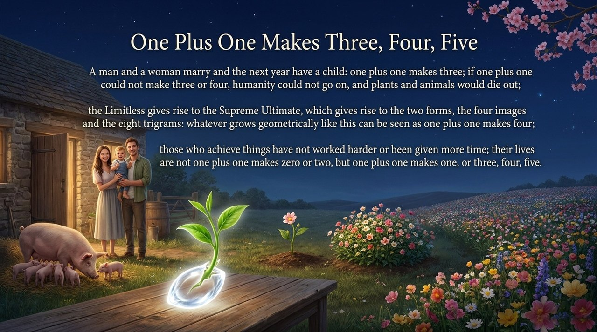
    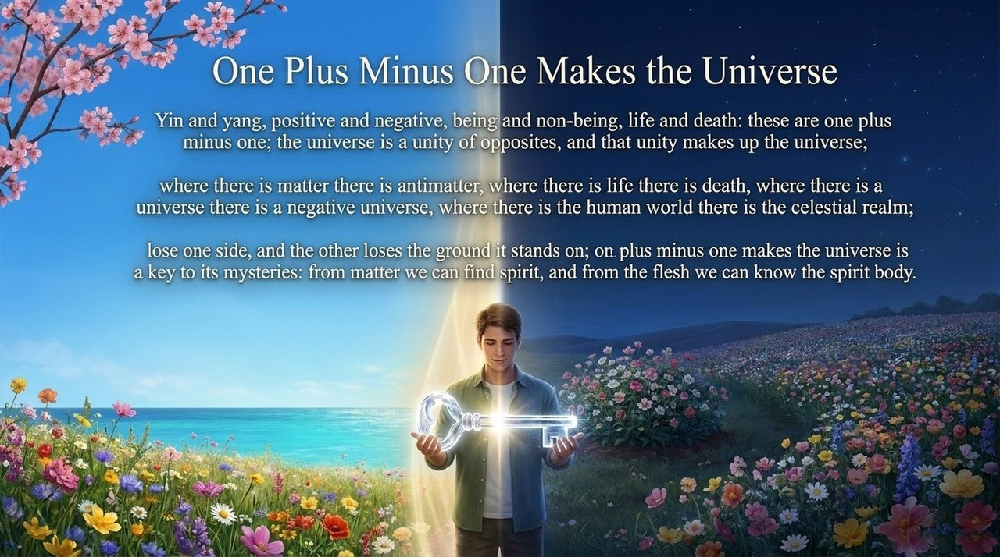
    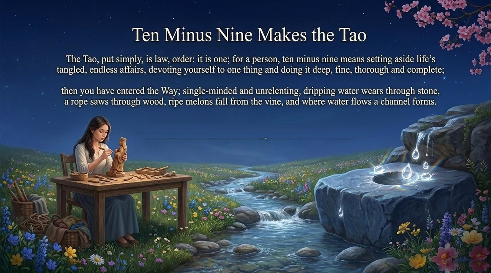
    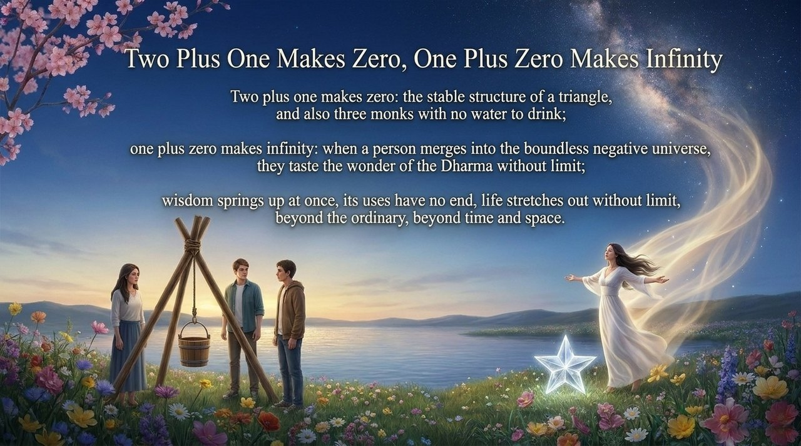

---

## Versions

| Version | Audience | Focus |
|---------|----------|-------|
| [Friendly Edition](/en/one-plus-one-thinking/friendly/) | New readers | Why doesn't 1+1 always equal 2? Seven results explained in plain language |
| [Academic Edition](/en/one-plus-one-thinking/academic/) | Researchers | Comparison with quantum field theory, Lao Tzu's "embracing the One," Aristotelian holism, Gestalt psychology |
| [Internal Edition](/en/one-plus-one-thinking/internal/) | Chanyuan Grasses | Complete source text, all 13 sections fully preserved |

---

## Related Entries

- [Anti-Conventional Thinking](/en/abnormal-thinking/)
- [Inverted Thinking](/en/inverted-thinking/)
- [Non-Form Thinking](/en/non-form-thinking/)
- [Fixed Mindset](/en/fixed-mindset/)

> Note: Concept numbers cited on this page refer to the Fourth Edition of the *New Era Human 800 Concepts*. The Fifth Edition has been re-arranged, and its numbering no longer matches the Fourth Edition one to one.
