<!-- id: LC-OTM-0001-EN theme: Cultivation Practice type: navigation direction: Cultivation Practice lang: en -->

# Exclusive Intimate Relationships and Marriage

**Exclusive intimate relationships** (one-to-one special relationships) refer to a fixed pattern of emotional and sexual attachment between two people — mutual longing, mutual devotion, mutual dependency — in which each person essentially "belongs" to the other. **Marriage** is the institutionalized form of this same dynamic. Lifechanyuan views both as structurally identical: each is a form of private ownership over another person's emotional and sexual life, rooted in selfishness, and fundamentally incompatible with the state of non-attachment required to reach the Celestial Kingdom.

> "The fact of marriage marks mutual possession, mutual dependence, mutual restraint — forming a barrier between the couple and the wider world. Everyone who enters this relationship is selfish, without exception. Not one of them can reach the Kingdom of Heaven."
>
> *(Xuefeng Corpus · Chanyuan Chapter · One-on-One Relationships Between Men and Women Are Ugly)*

---

## Version Guide

| Version | Best for | Focus |
|---------|----------|-------|
| [Friendly version](friendly.md) | First-time readers | Life experience · emotional honesty · a way out |
| [Academic version](academic.md) | Researchers | Concept analysis · doctrinal position · comparative study |
| [Internal reference](internal.md) | Deep study | Complete source texts · full citations |

---

## Video

<iframe style="width:100%;aspect-ratio:4/3;border:0" src="https://www.youtube-nocookie.com/embed/YtzuVgpB9tI" title="Exclusive Intimate Relationships and Marriage (Lifechanyuan Encyclopedia video)" allowfullscreen></iframe>

## Slides

??? info "📖 Illustrated slides (14 pages, click to expand)"

    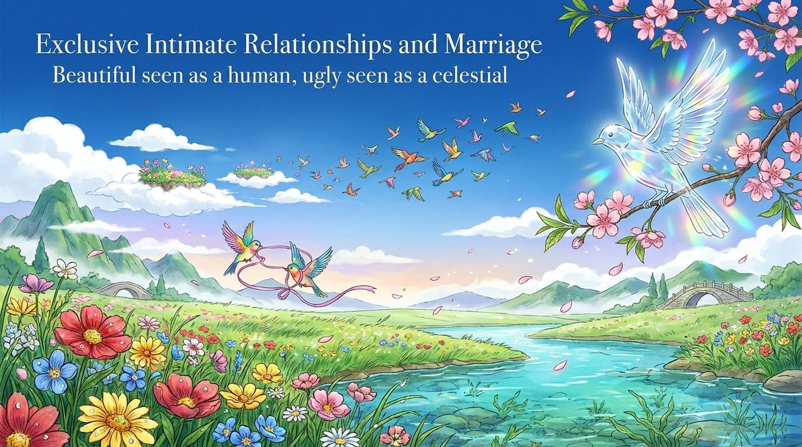
    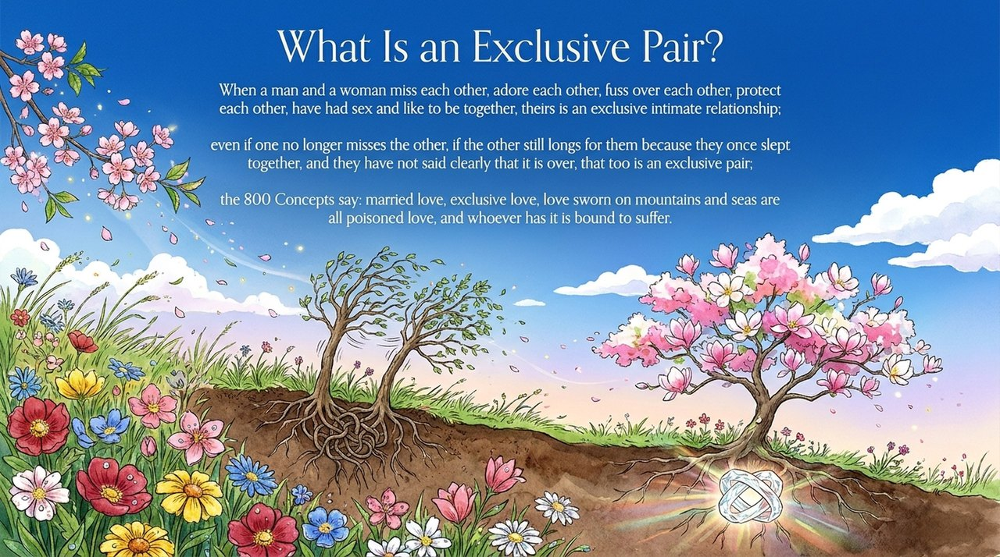
    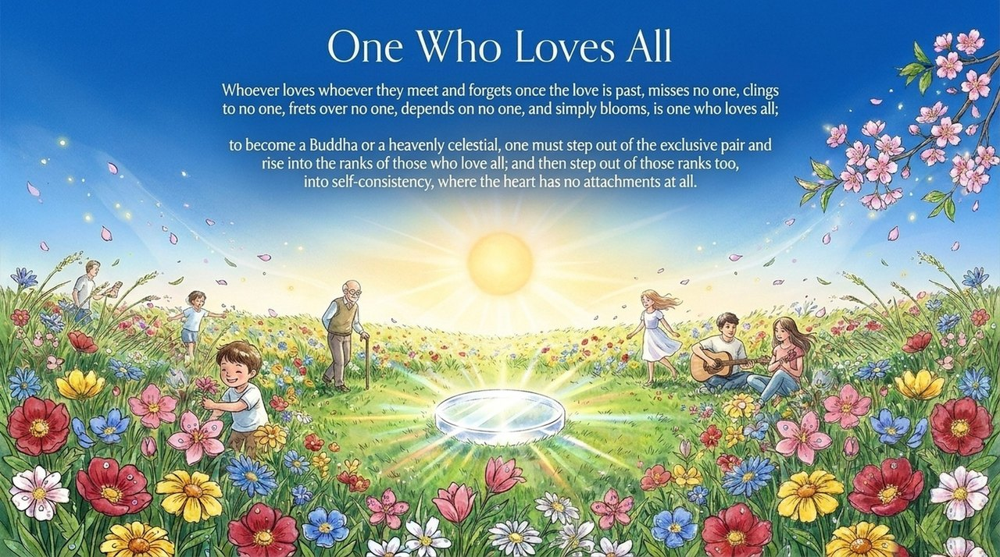
    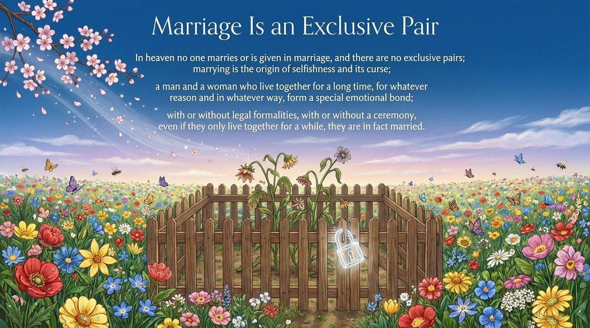
    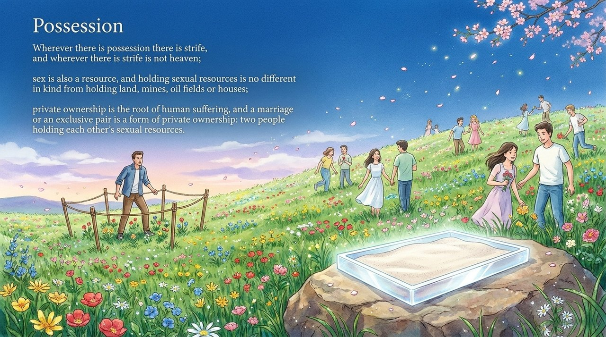
    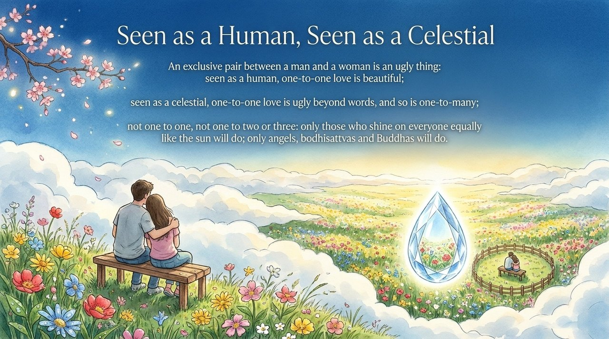
    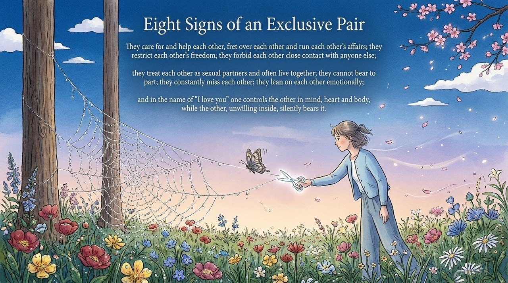
    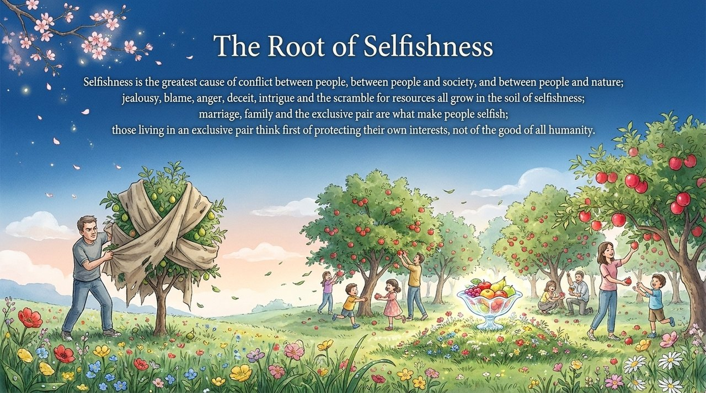
    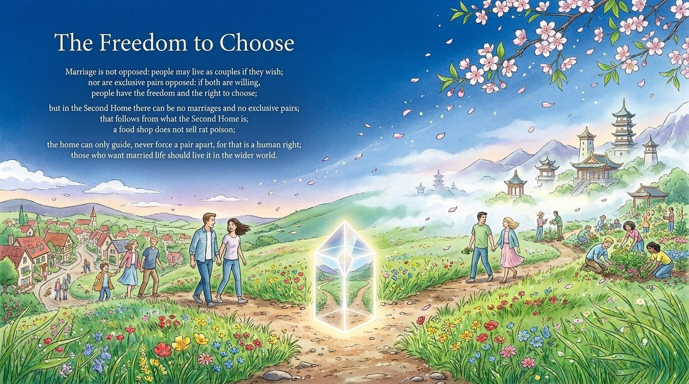
    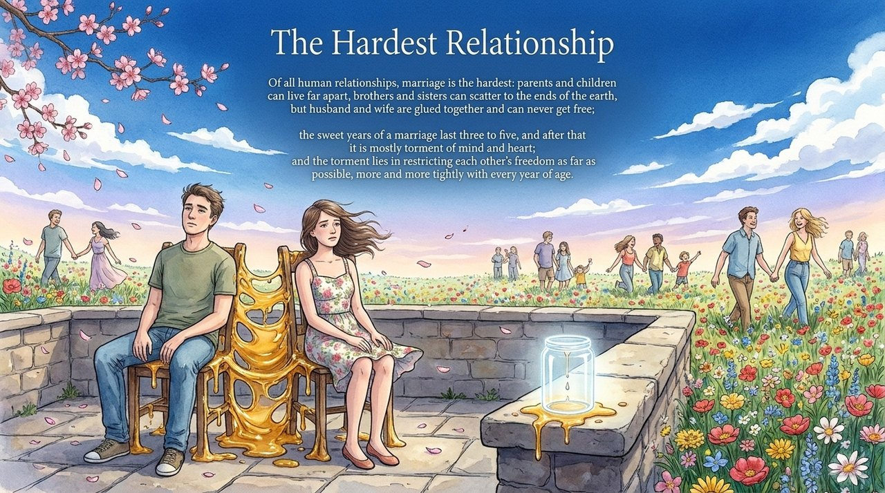
    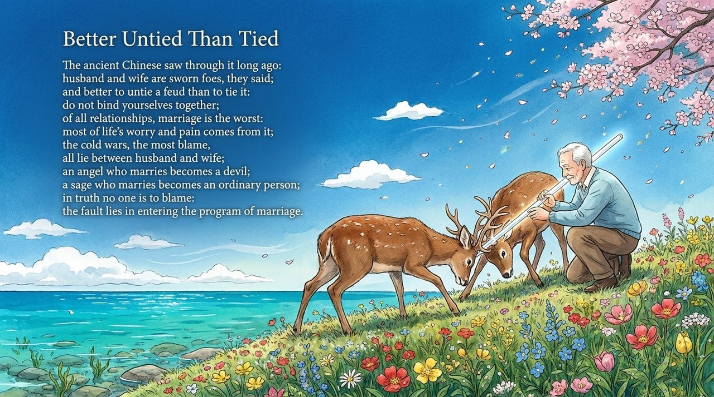
    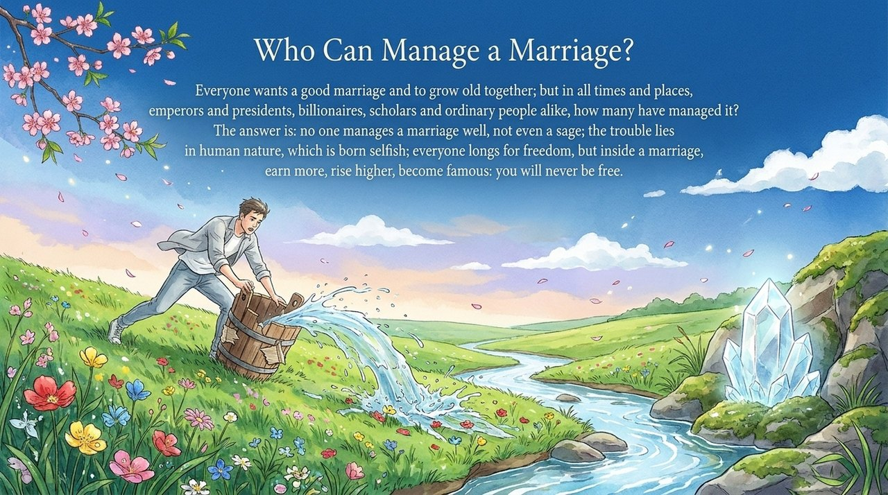
    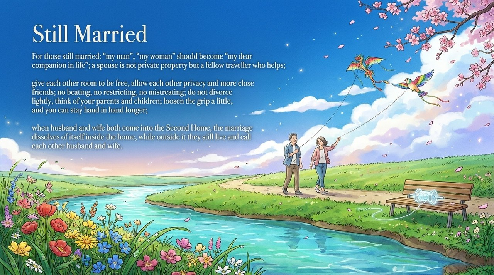
    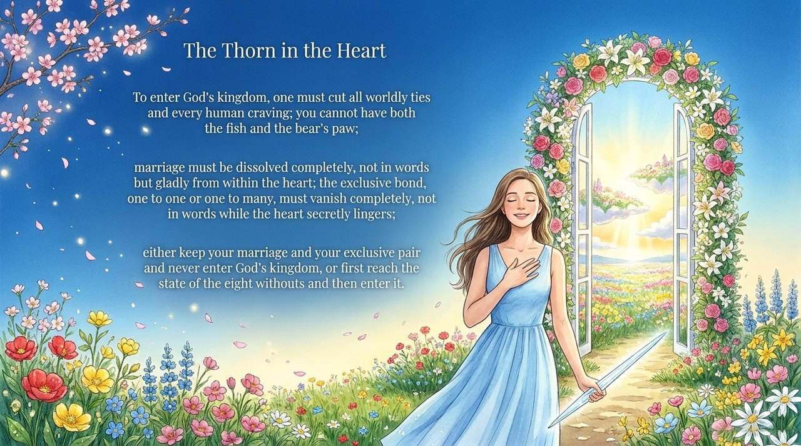

---

## Related Entries

[Romantic Love and Sexuality](/en/love-and-sexuality/) · [Quantum Entanglement and "the Other Half"](/en/quantum-entanglement-and-the-other-half/) · [Family Members Are Enemies](/en/family-as-foes/) · [Releasing Worldly Bonds](/en/releasing-worldly-bonds/) · [Self-Consistency](/en/self-consistency/) · [No Attachment, No Obstruction](/en/xinwu-suozhu-guaai/) · [The Eight-None Realm](/en/eight-none-realm/) · [Life Oasis](/en/life-oasis/) · [The Second Home](/en/second-home/) · [Becoming Celestial and Buddha](/en/becoming-celestial-buddha/)
