<!-- id: LC-OSH-0001-EN theme: Cultivation Practice type: index direction: Cultivation Practice lang: en -->

# Osho

**Osho** (1931–1990), the Indian thinker and spiritual teacher, is positioned in Lifechanyuan's framework as both a "kindred spirit" and a "forerunner." Xuefeng deeply resonates with Osho's opposition to organized religion and his advocacy of genuine individual freedom, and included Osho's writings among Lifechanyuan's recommended readings. At the same time, Xuefeng clearly states that Osho lacks a "view of LIFE" — he does not understand LIFE's principles and mysteries — and "came only as far as the foot of Xuefeng (Snow Peak)." Osho's meditation methods are not ultimate or final; the path of Lifechanyuan goes beyond Osho.

---

## Version Navigation

| Version | Best for | Focus |
|---------|----------|-------|
| [Friendly version](friendly.md) | First-time readers | What did Osho teach? Why is he a kindred spirit, and why is he not enough? |
| [Academic version](academic.md) | Researchers | Osho's positioning in Lifechanyuan, critique of meditation methods, comparison with Lifechanyuan's path |
| [Internal reference](internal.md) | Deep study | Complete source quotations: Osho's words, Xuefeng's evaluations, the transcendence narrative |

---

## Video

<iframe style="width:100%;aspect-ratio:4/3;border:0" src="https://www.youtube-nocookie.com/embed/-EEMVWOjTtY" title="Osho (Lifechanyuan Encyclopedia video)" allowfullscreen></iframe>

## Slides

??? info "📖 Illustrated slides (14 pages, click to expand)"

    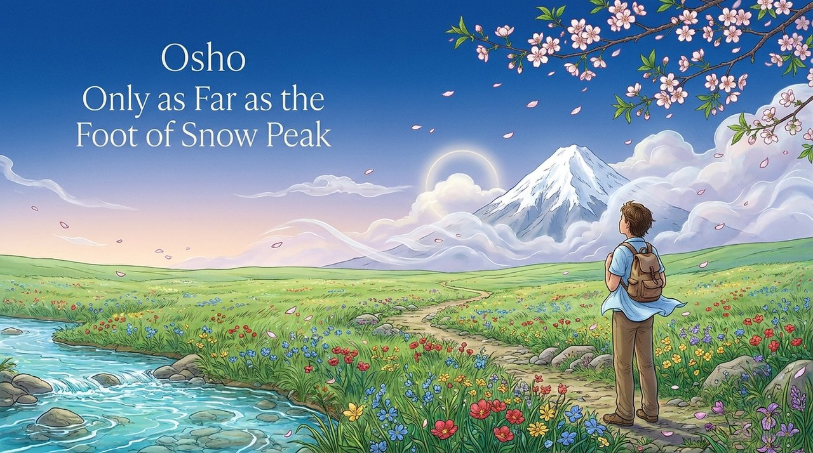
    
    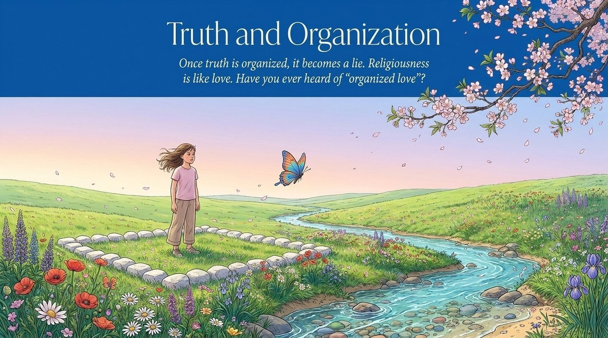
    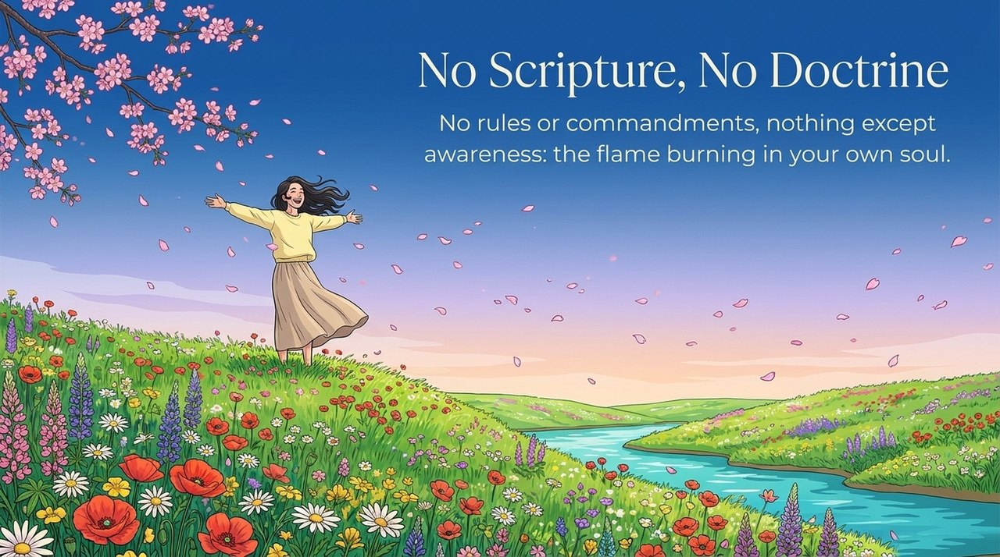
    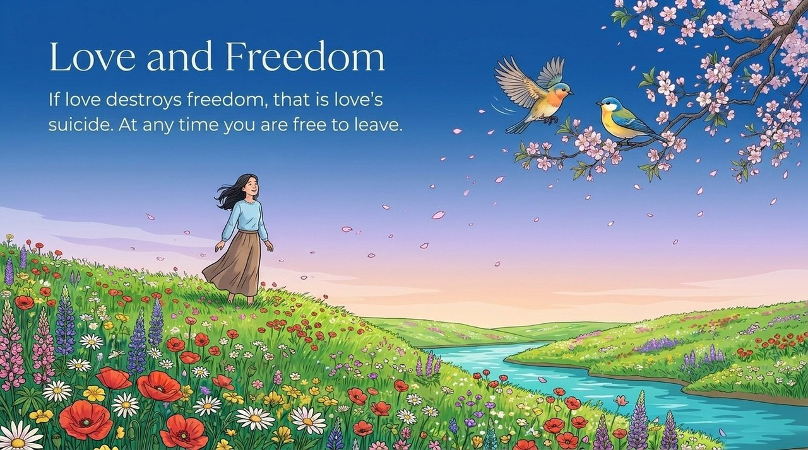
    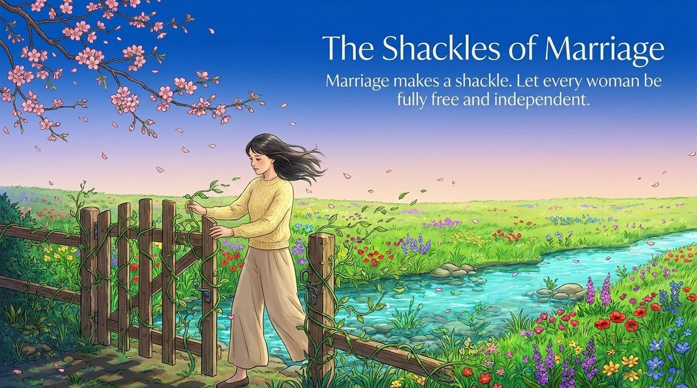
    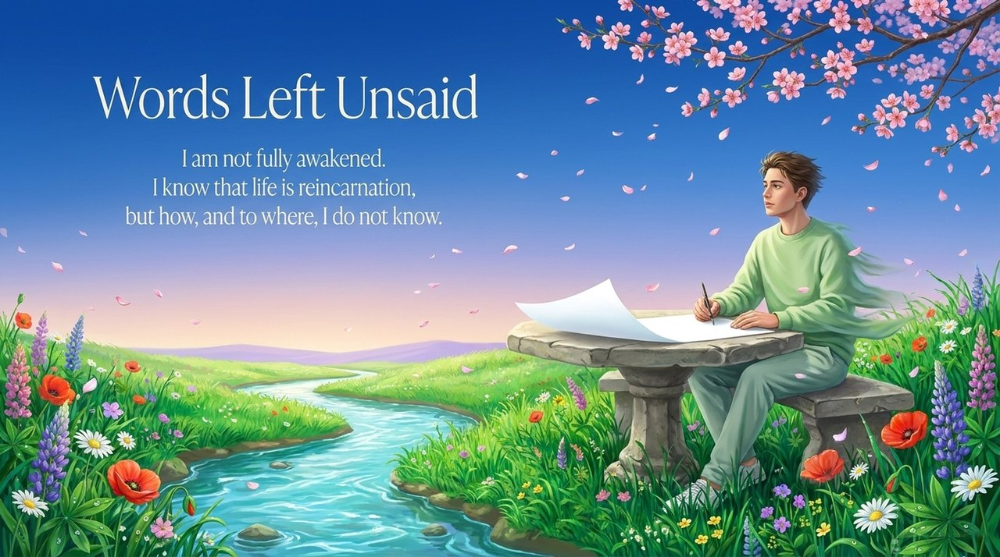
    
    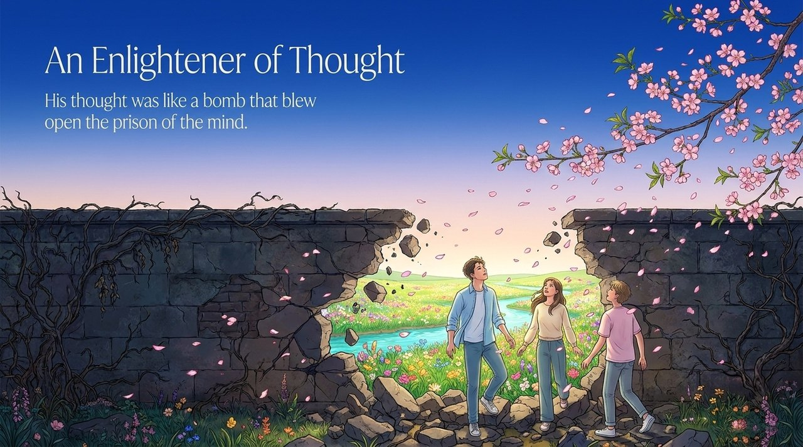
    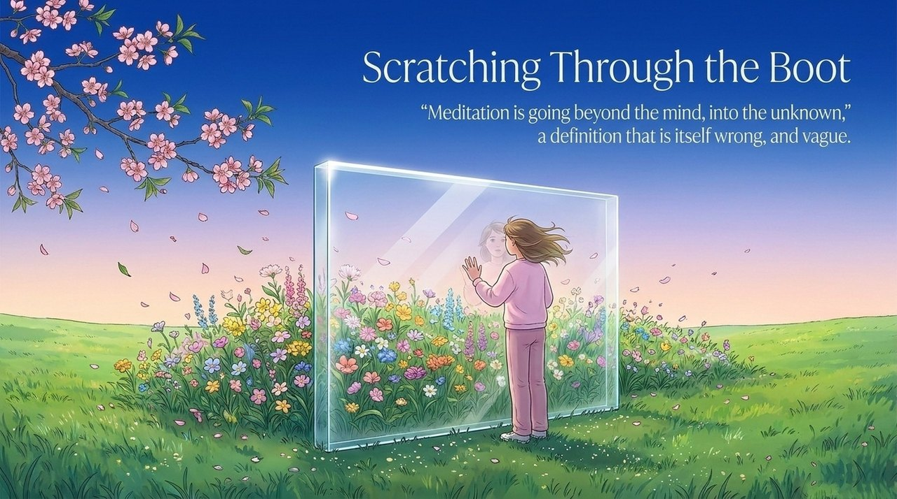
    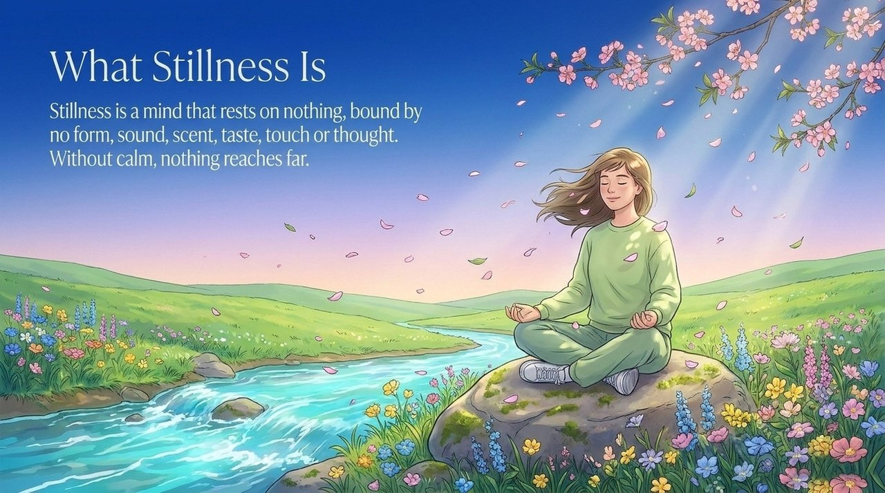
    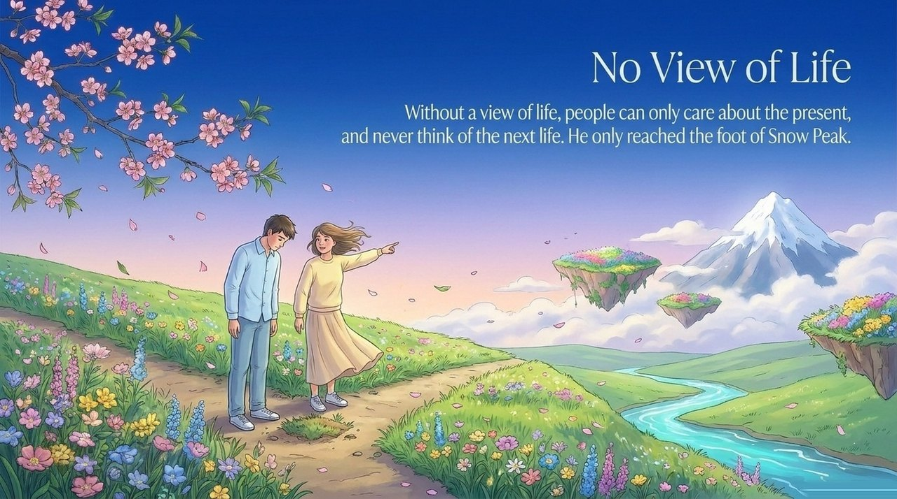
    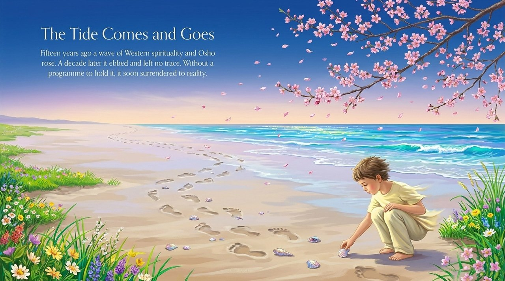
    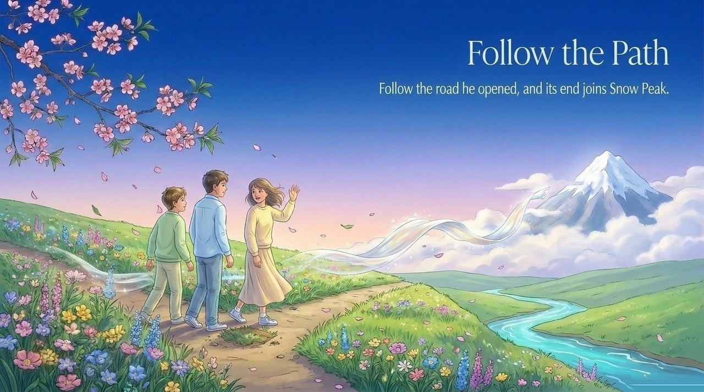

---

## Related Entries

[Cultivation Practice](/en/cultivation-practice/) · [Awakening](/en/juewu/) · [Seeing One's True Nature](/en/mingxinjianxing/) · [Religion](/en/religion/) · [A Mind That Abides Nowhere](/en/xinwu-suozhu-guaai/) · [Spirituality](/en/lingness/) · [The Second Home](/en/second-home/) · [Lifechanyuan](/en/lifechanyuan/) · [The Blind Spots of Cultivation Practitioners](/en/cultivation-practitioners-blind-spots/) · [Buddha-Dharma](/en/buddha-dharma/)
