# Own Nothing, Have Everything

> **Own nothing, and you will have everything.** — New Era Human 800 Concepts, No. 115

"Own Nothing, Have Everything" is one of Lifechanyuan's central principles of cultivation and life philosophy. It holds that when a person releases all attachment to private ownership, they paradoxically gain access to everything the universe has to offer. This is the hallmark of life in the Kingdom of Heaven, the foundational principle of the Second Home's "non-ownership system" (无有制), and the convergent teaching of Jesus, the Buddha, Laozi, and Muhammad — a cosmic secret pointing toward ever more beautiful realms of LIFE.

---

| Version | Best for | Focus |
|---------|----------|-------|
| [Friendly version](friendly.md) | First-time readers | Life analogies, the feeling of letting go |
| [Academic version](academic.md) | Researchers | Systematic analysis, comparing non-ownership with private and public ownership |
| [Internal reference](internal.md) | Deep study | Full original texts with source citations |

---

## Video

<iframe style="width:100%;aspect-ratio:4/3;border:0" src="https://www.youtube-nocookie.com/embed/5LpKfulRZ5k" title="Own Nothing, Have Everything (Lifechanyuan Encyclopedia video)" allowfullscreen></iframe>

## Slides

??? info "📖 Illustrated slides (14 pages, click to expand)"

    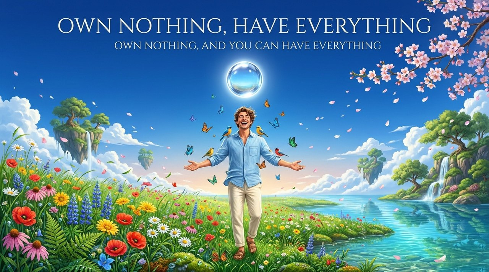
    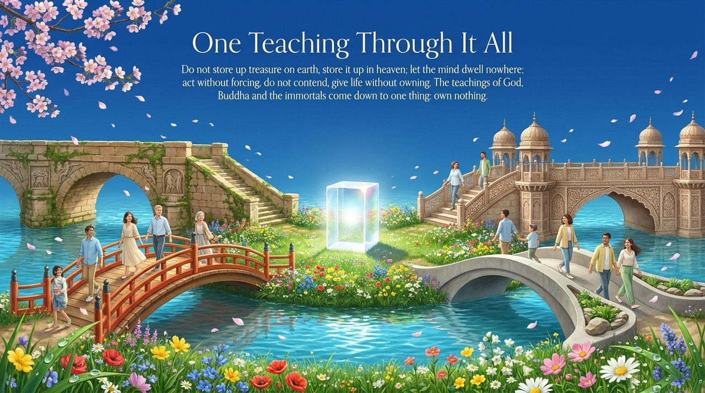
    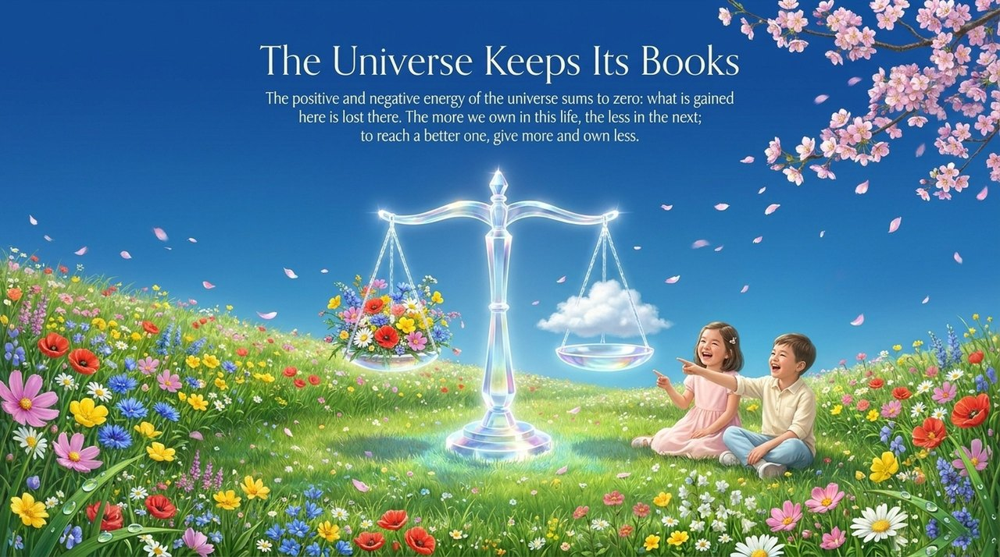
    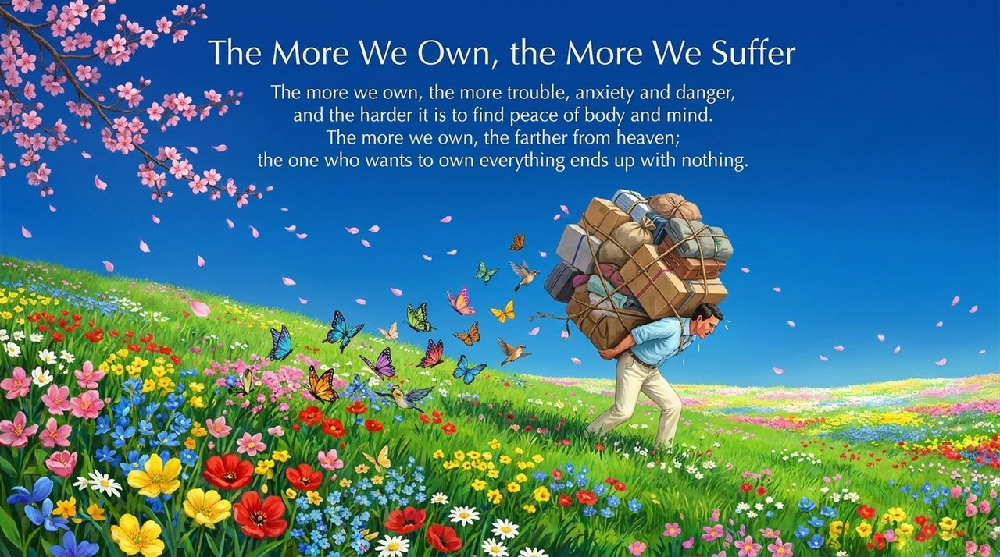
    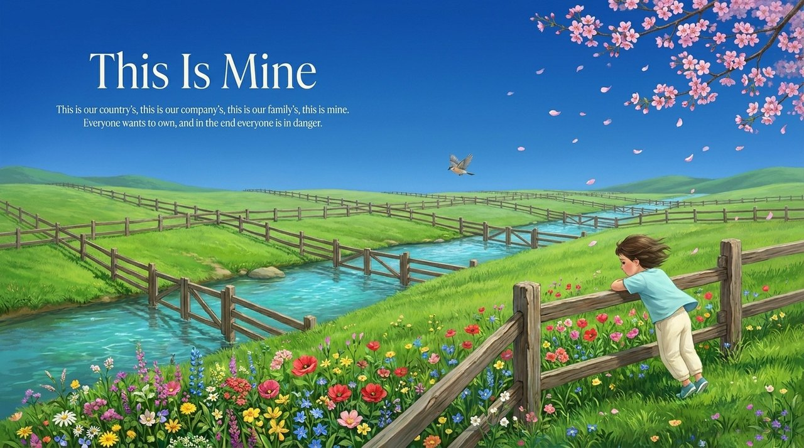
    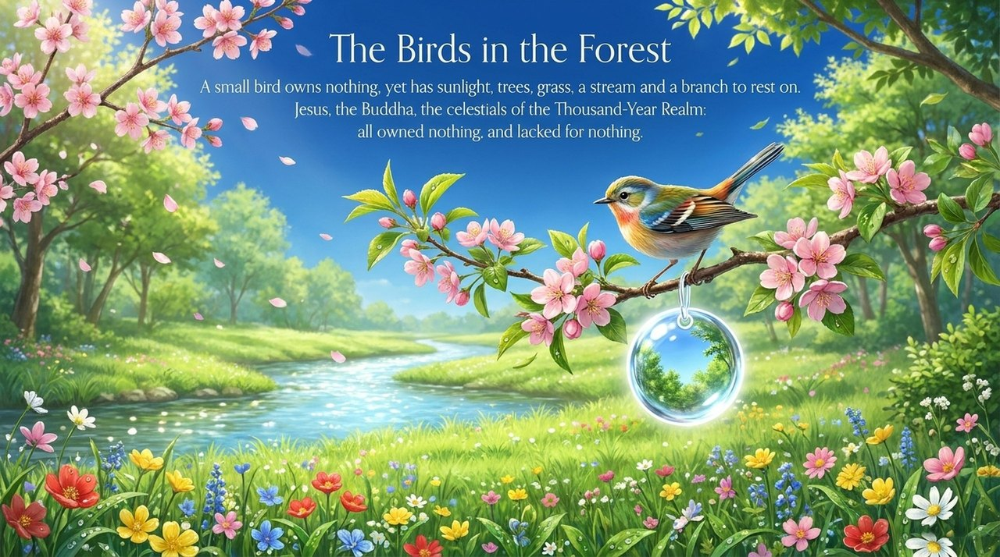
    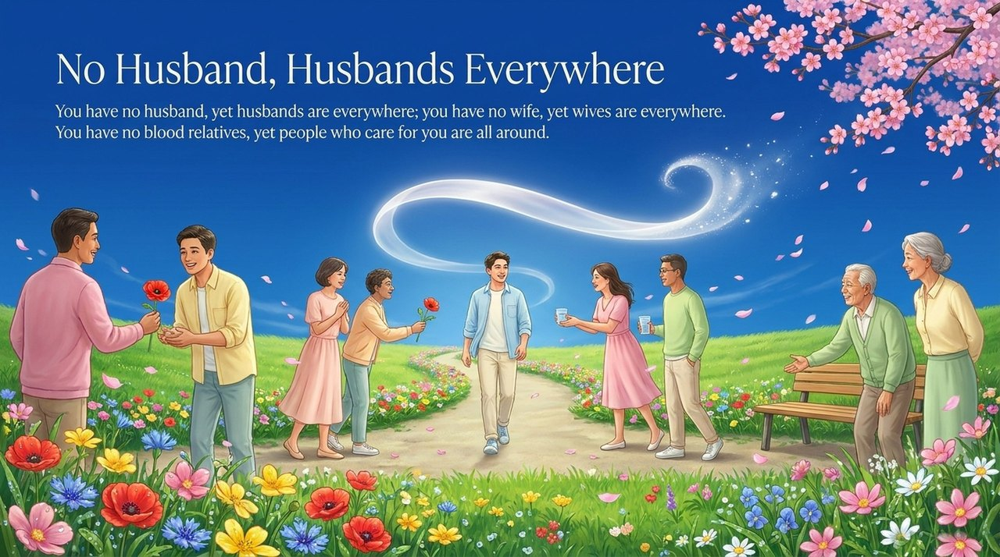
    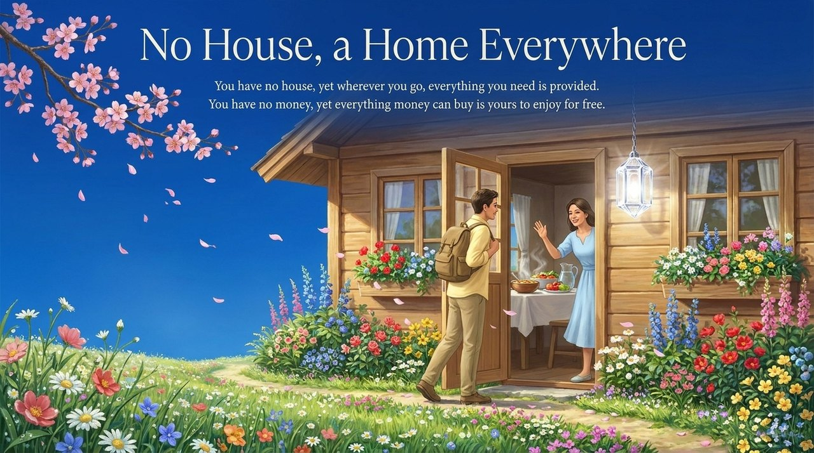
    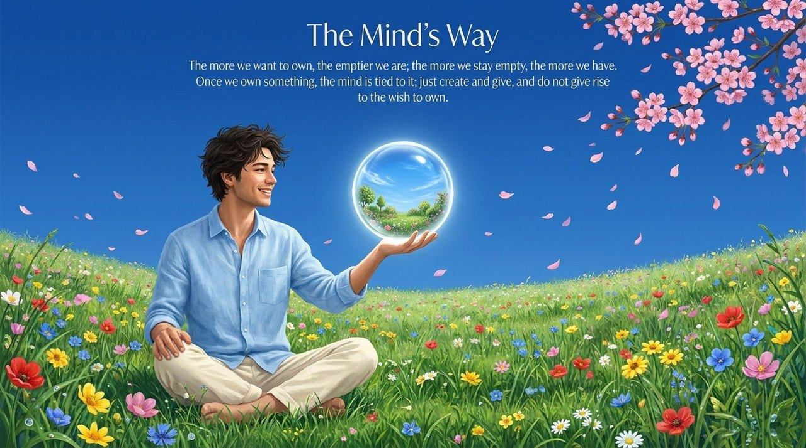
    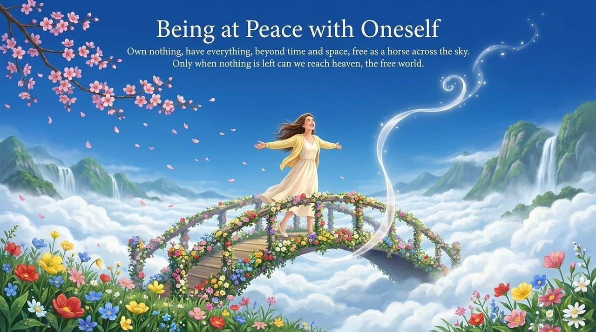
    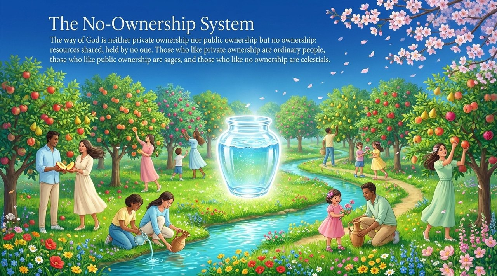
    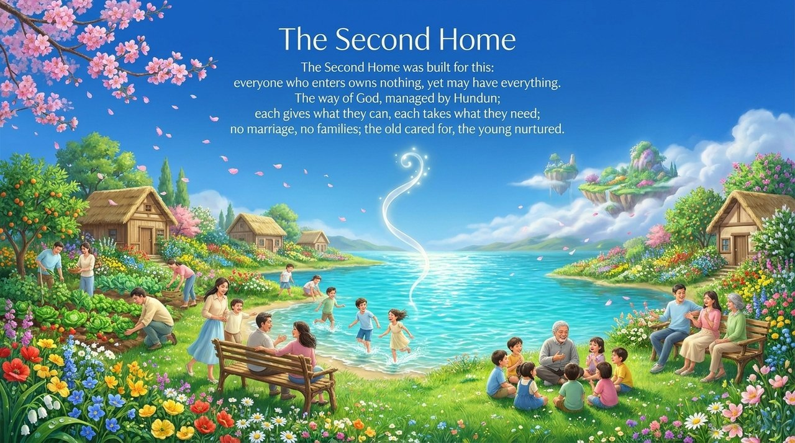
    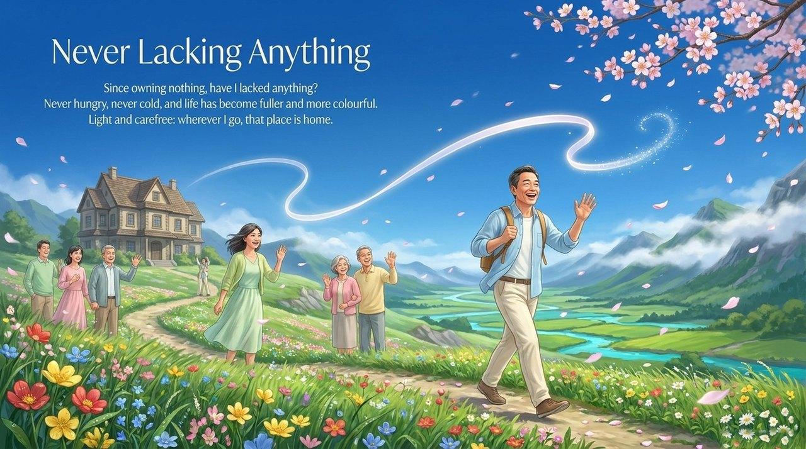
    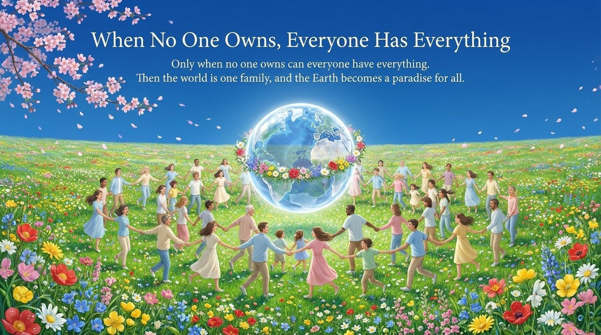

---

## Related entries

[Contribute by Ability, Take by Need](/en/contribute-by-ability-take-by-need/) · [Wu Wei (Non-Action)](/en/wu-wei/) · [Formless Giving](/en/formless-giving/) · [Self-Coherence](/en/self-coherence/) · [Second Home](/en/second-home/) · [Xuefeng Communism](/en/xuefeng-communism/) · [Letting Go](/en/letting-go/) · [Return to Zero](/en/return-to-zero/) · [Mind Without Abiding · Mind Without Hindrance](/en/xinwu-suozhu-guaai/) · [Heavenly Treasures](/en/heavenly-treasures/) · [Inverted Illusions](/en/diandao-mengxiang/)
