<!-- id: LC-PEA-0001-EN theme: Six LIFE Qualities type: Gateway Page direction: Cultivation Practice lang: en -->

# Peace (平 Píng)

[Entry Gateway]

> In Lifechanyuan terminology, **LIFE** (capitalized) refers to the ontological
> essence of existence — the soul/antimatter structure that persists across
> incarnations — while **life** (lowercase) refers to the experiential stage
> of human existence in this world.

**Peace** (平, Píng) is a core LIFE quality in the Lifechanyuan system — alongside Truth, Goodness, Beauty, Love, Faith, and Sincerity — and the hallmark inner state of those journeying toward the Thousand-Year World. Peace encompasses three interconnected levels: inner equanimity (the peace of emotion), equal and fair treatment of others (the peace of relationship), and the just order of cosmic law (the peace of the Way).

> Health, peacefulness, joy, contentment, and tranquility are the rewards of the Greatest Creator.
>
> — Guide Xuefeng, *New Era Human 800 Concepts*

---

## Core Positioning

In the Lifechanyuan system, Peace is not passivity or numbness — it is the natural state of one who walks the Way. When the heart is in alignment with the Greatest Creator's trajectory, all turbulence settles. Peace is both the fruit of cultivation and the condition that makes further cultivation possible.

---

## Video

<iframe style="width:100%;aspect-ratio:4/3;border:0" src="https://www.youtube-nocookie.com/embed/DS9Sk_yRI28" title="Peace (Lifechanyuan Encyclopedia video)" allowfullscreen></iframe>

## Slides

??? info "📖 Illustrated slides (14 pages, click to expand)"

    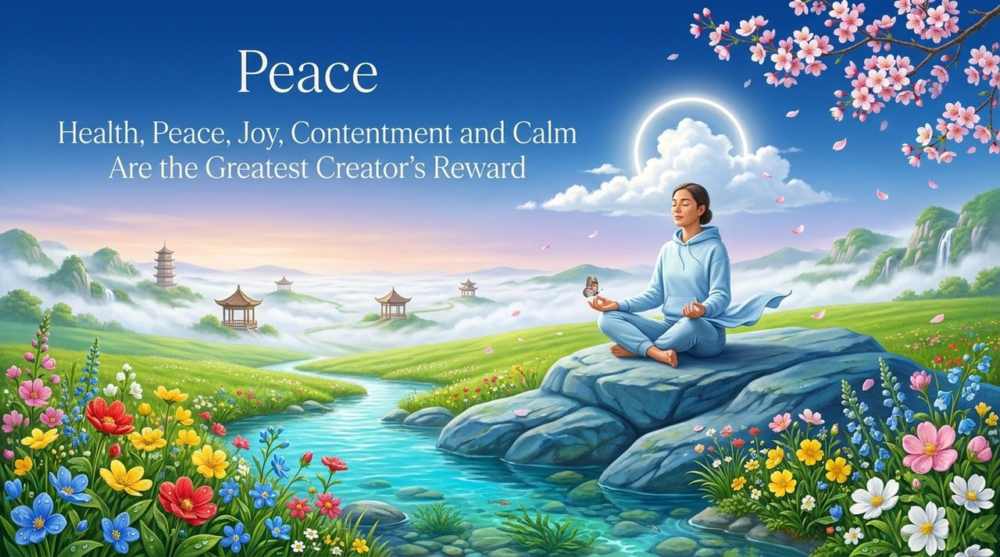
    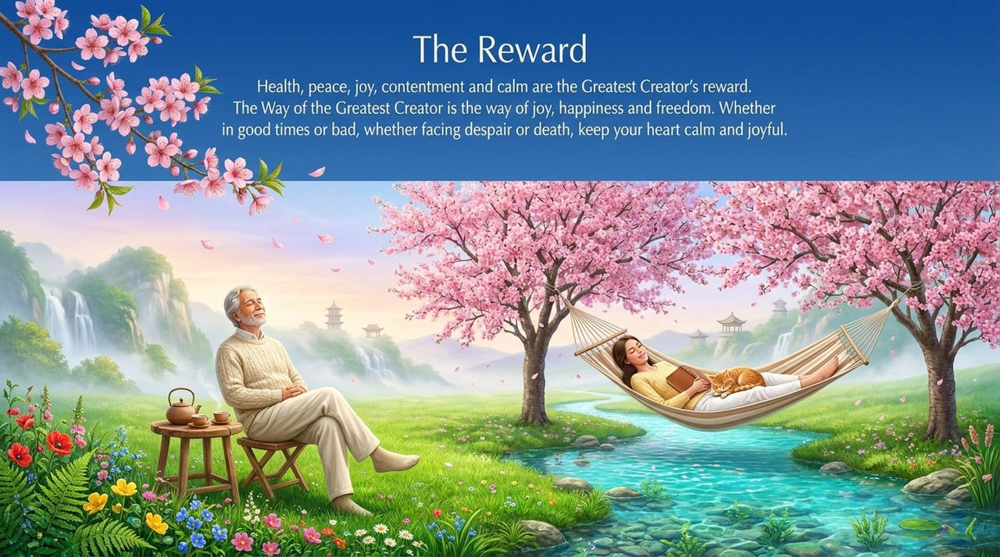
    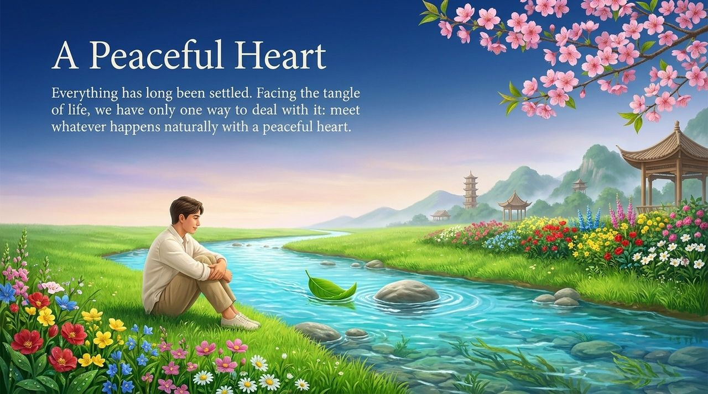
    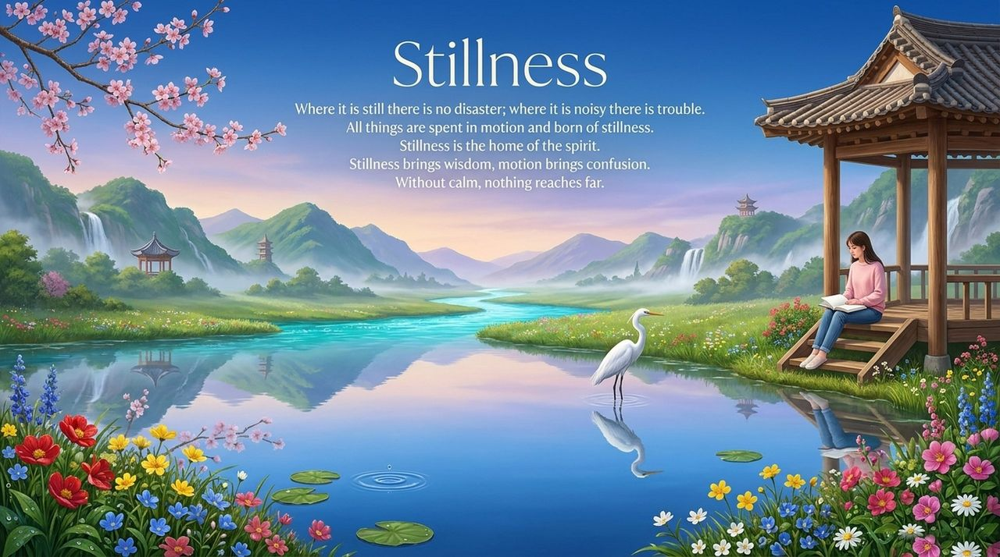
    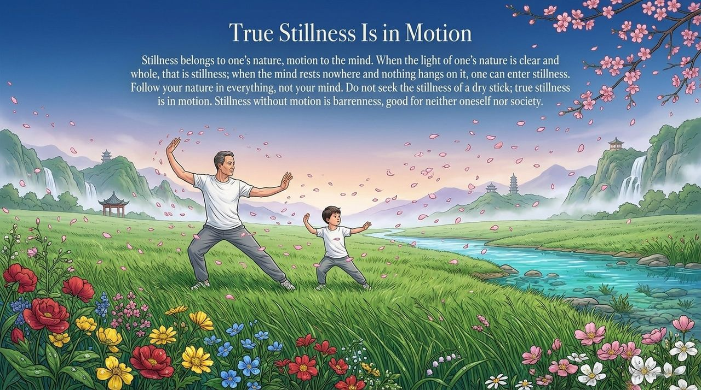
    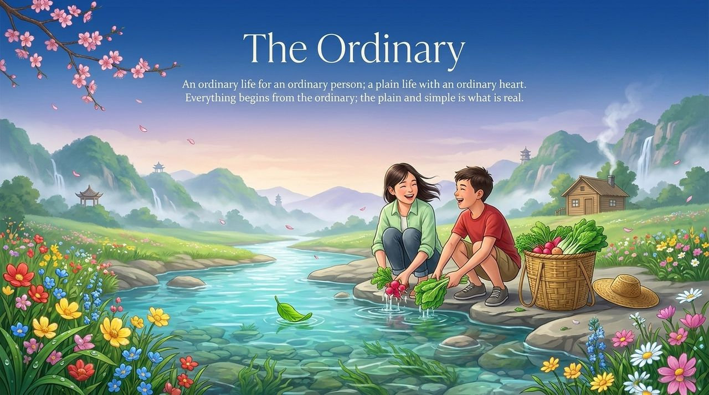
    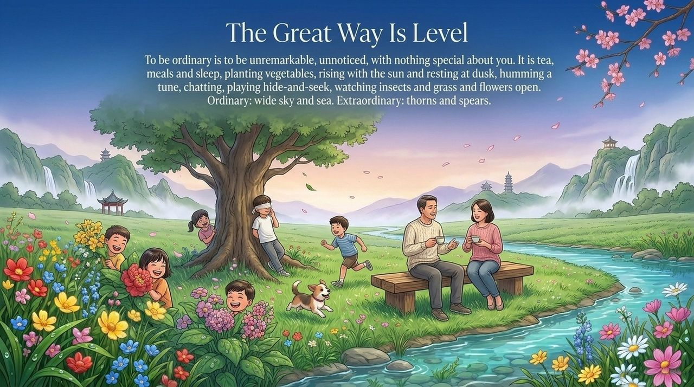
    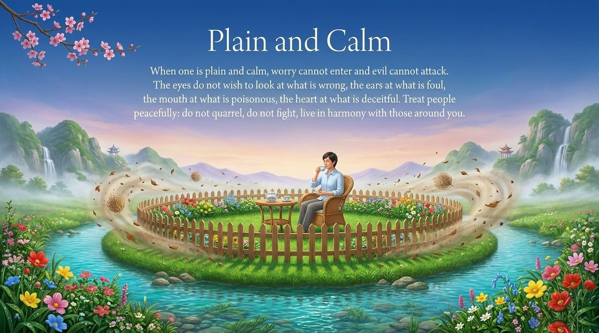
    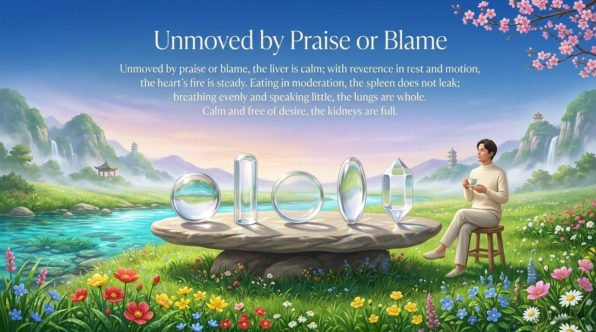
    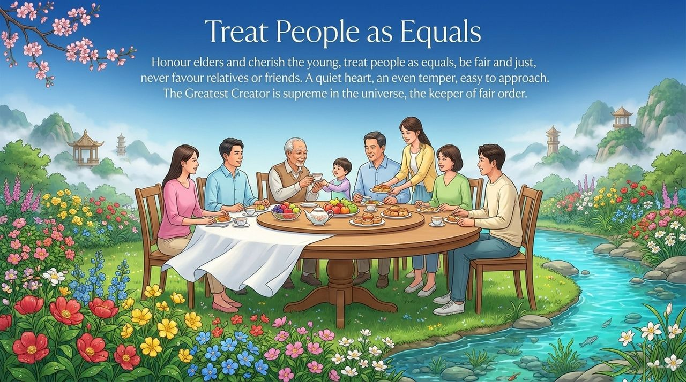
    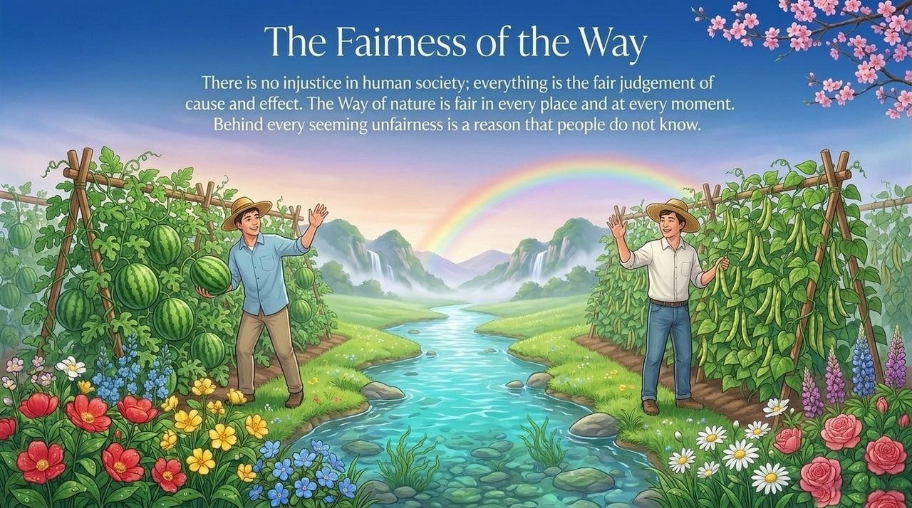
    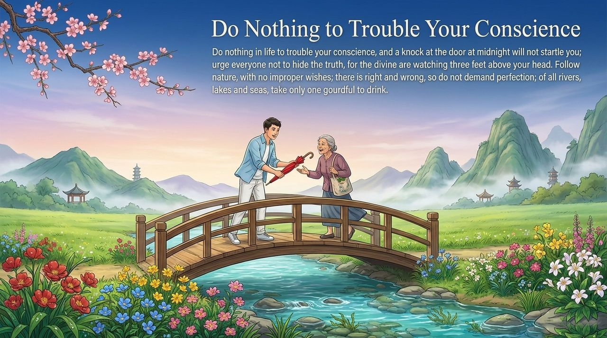
    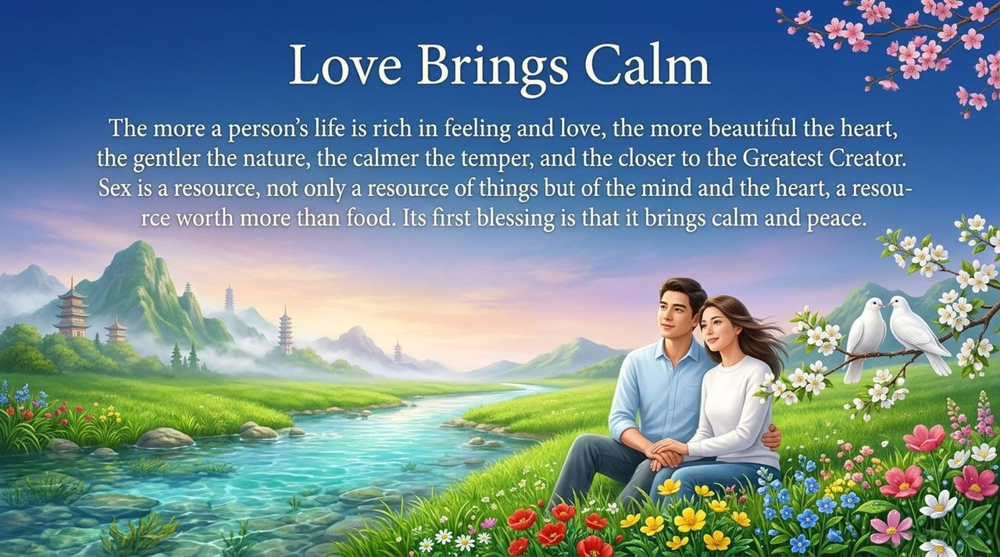
    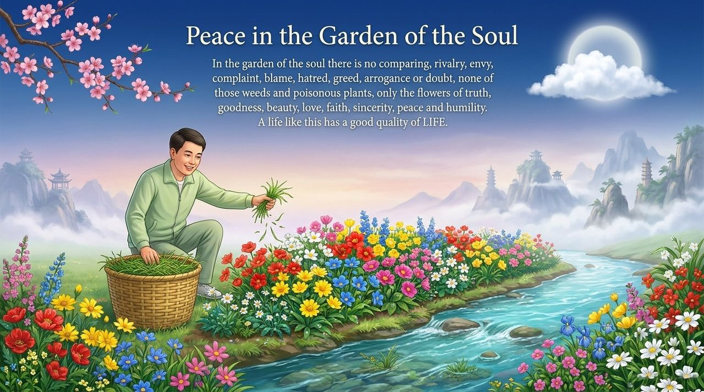

---

## Read by Edition

| Edition | Intended Reader | Link |
|---------|----------------|-------|
| **Friendly Edition** | Readers new to Lifechanyuan concepts | [Read Friendly Edition](./friendly) |
| **Academic Edition** | Researchers with philosophical/religious studies background | [Read Academic Edition](./academic) |
| **Internal Edition** | Chanyuan Celestials and deep practitioners | [Read Internal Edition](./internal) |

---

## Related Entries

- [Harmony](/en/harmony/) — Peace and Harmony are twin qualities; inner peace radiates outward as harmony
- [Six Qualities](/en/six-qualities/) — The integrated system of the core LIFE qualities
- [Soul Garden](/en/soul-garden/) — Peace is a foundational flower in the soul garden
- [Thousand-Year World](/en/thousand-year-world/) — Those with Peace in their hearts are preparing for this destination
