<!-- id: LC-PLB-0001-EN theme: Cultivation Practice type: Index lang: en -->

# The Peak of Life and Being

**The Peak of Life and Being refers to the highest spiritual state: a consciousness energy level of 1,000.** Xuefeng writes: "Using the most advanced scientific technology and large amounts of facts and data, scientists have quantified the peak data for life and being — vibration frequency of 1,000, or consciousness energy level of 1,000. That is, once one's consciousness energy level reaches 1,000, it proves one has ascended to the Peak of Life and Being." Within Lifechanyuan's framework, the only known individuals to have reached this summit are Laozi (a Celestial), Shakyamuni Buddha (a Buddha), and Jesus (a God). The path to the peak requires passing through three gates: building the Soul Garden, repaying all debts and releasing worldly bonds, and accumulating merit.

---

## Version Guide

## Video

<iframe style="width:100%;aspect-ratio:4/3;border:0" src="https://www.youtube-nocookie.com/embed/RQUYagF0ink" title="The Peak of Life and Being (Lifechanyuan Encyclopedia video)" allowfullscreen></iframe>

## Slides

??? info "📖 Illustrated slides (14 pages, click to expand)"

    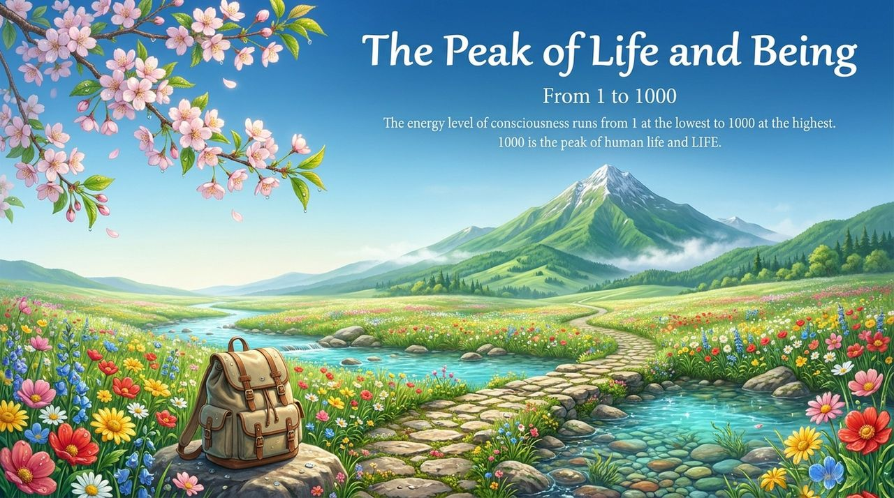
    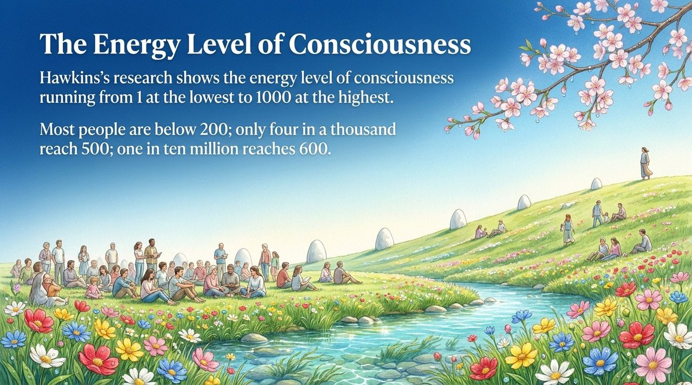
    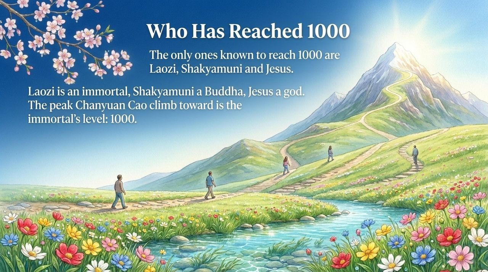
    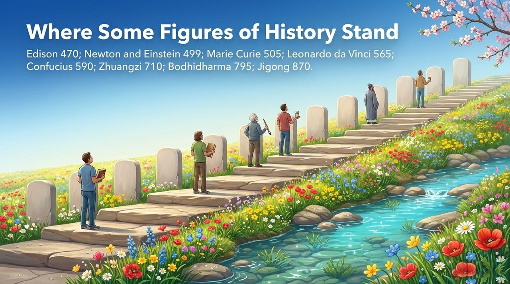
    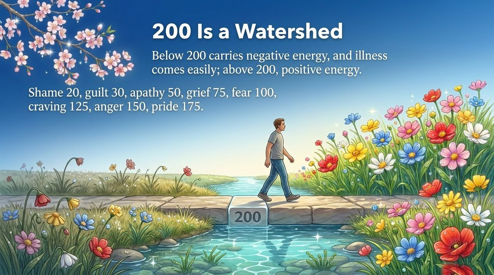
    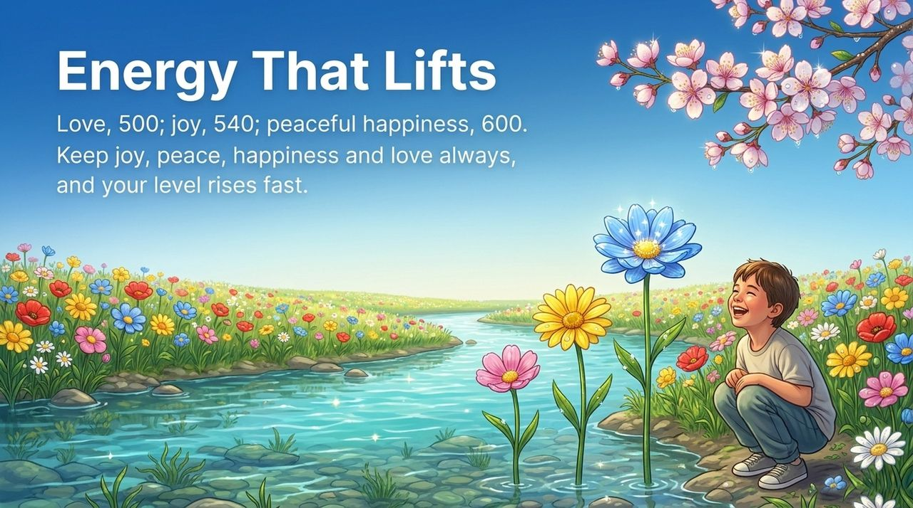
    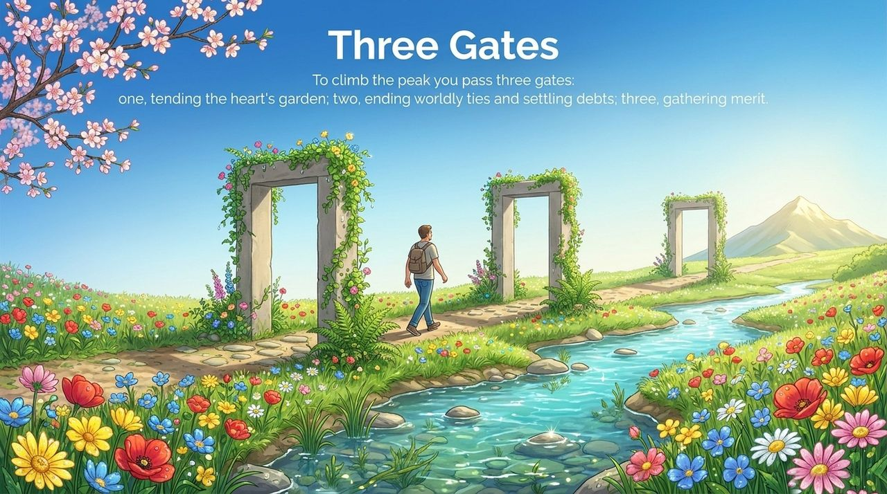
    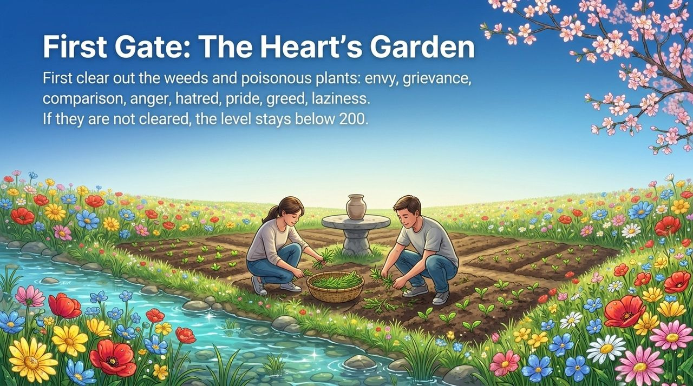
    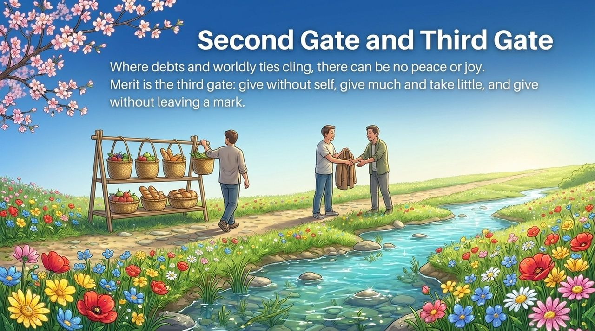
    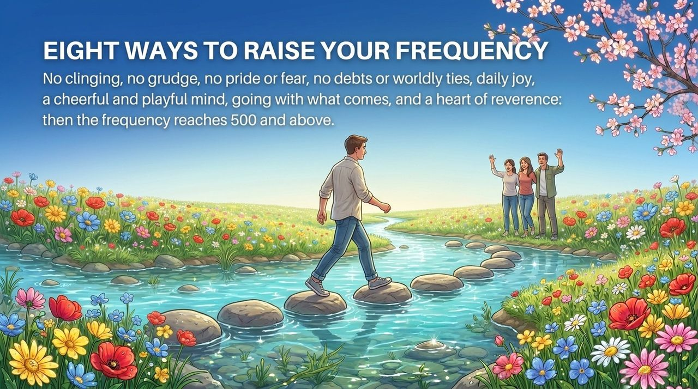
    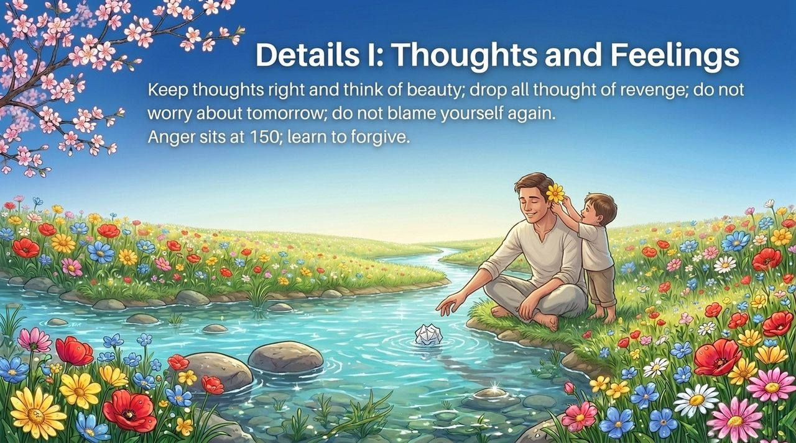
    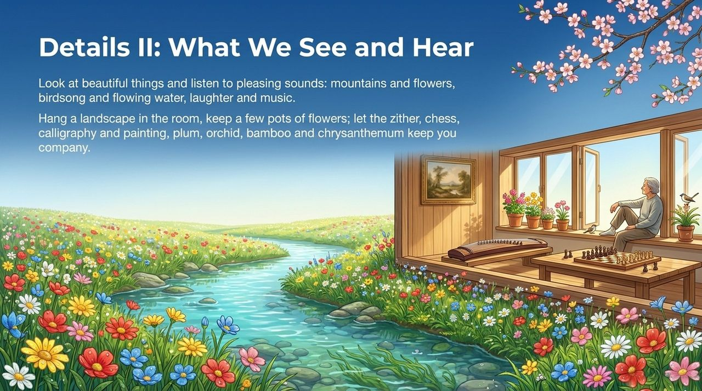
    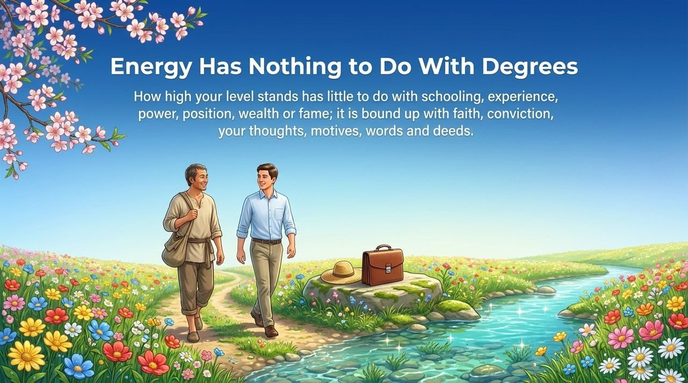
    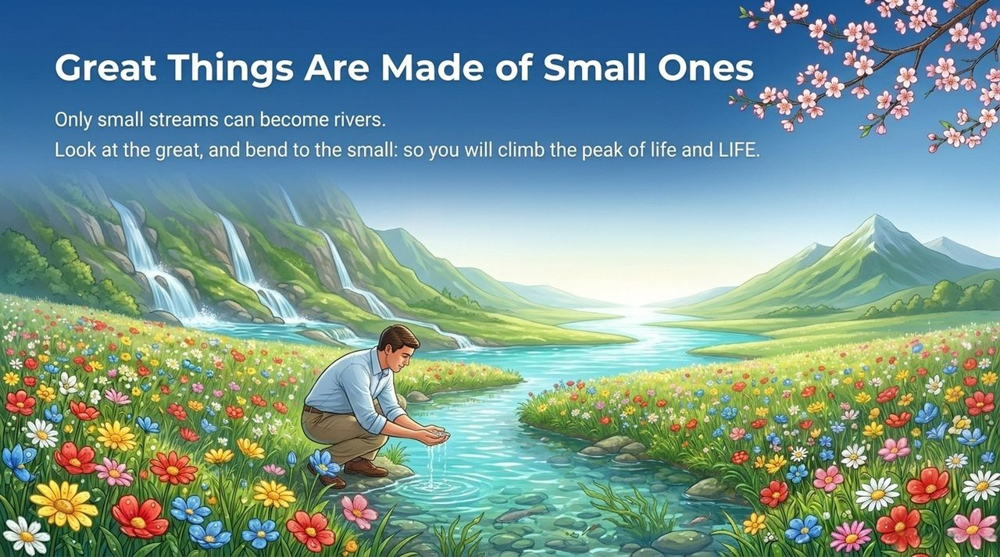

---

| Version | Best for | Focus |
|---------|----------|-------|
| [Friendly version](friendly.md) | First-time readers | What the peak is, how to climb it, 18 daily practices |
| [Academic version](academic.md) | Researchers | Consciousness energy scale, comparative analysis, source texts |
| [Internal reference](internal.md) | Deep study | Original texts: three gates and 18 details in full |

---

## Related Entries

[Raise Vibration Frequency](/en/raise-vibration-frequency/) · [Eight No-Realms](/en/eight-no-realms/) · [Soul Garden](/en/soul-garden/) · [Becoming a Celestial](/en/becoming-celestial/) · [Becoming a Buddha](/en/becoming-buddha/) · [Paradise Realm](/en/jilemiaojing/) · [Debt Repayment](/en/debt-repayment/) · [Releasing Worldly Bonds](/en/releasing-worldly-bonds/) · [Great Vow](/en/dasheng-xinyuan/) · [Intermediate Life Manual](/en/intermediate-life-manual/) · [Elementary Life Manual](/en/elementary-life-manual/)
