# Classification of People

The Classification of People is Lifechanyuan's systematic framework for understanding the spiritual levels of human beings. Based on which inner force predominates in a person's life — instinct, desire, emotion, reason, or spirituality — people are divided into five types: **the Muddled, the Worldly, the Ordinary, the Virtuous, and the Celestial**. This classification is not a moral judgment but a map: it helps each person find their "coordinate point," understand their current level, and determine the direction of their life's evolution.

> The difference between people lies mainly in spirituality and wisdom — not in wealth or social status.

---

## Video

<iframe style="width:100%;aspect-ratio:4/3;border:0" src="https://www.youtube-nocookie.com/embed/6M25o9BDqcQ" title="Classification of People (Lifechanyuan Encyclopedia video)" allowfullscreen></iframe>

## Slides

??? info "📖 Illustrated slides (14 pages, click to expand)"

    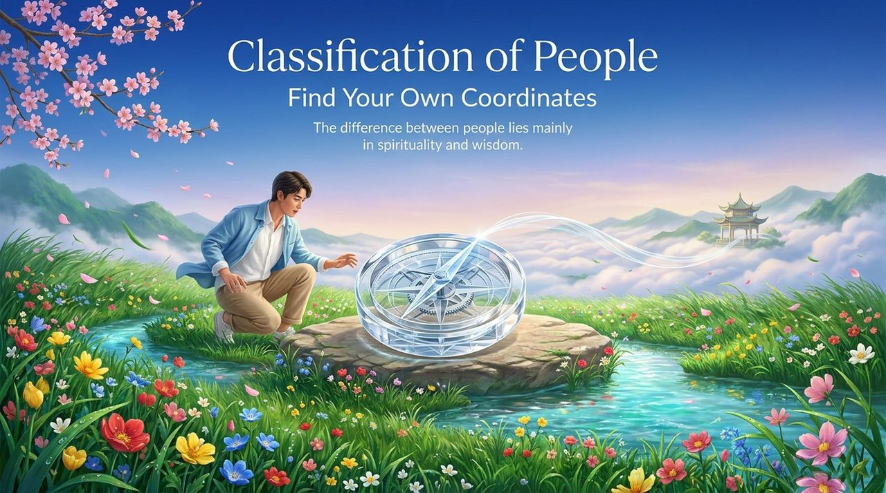
    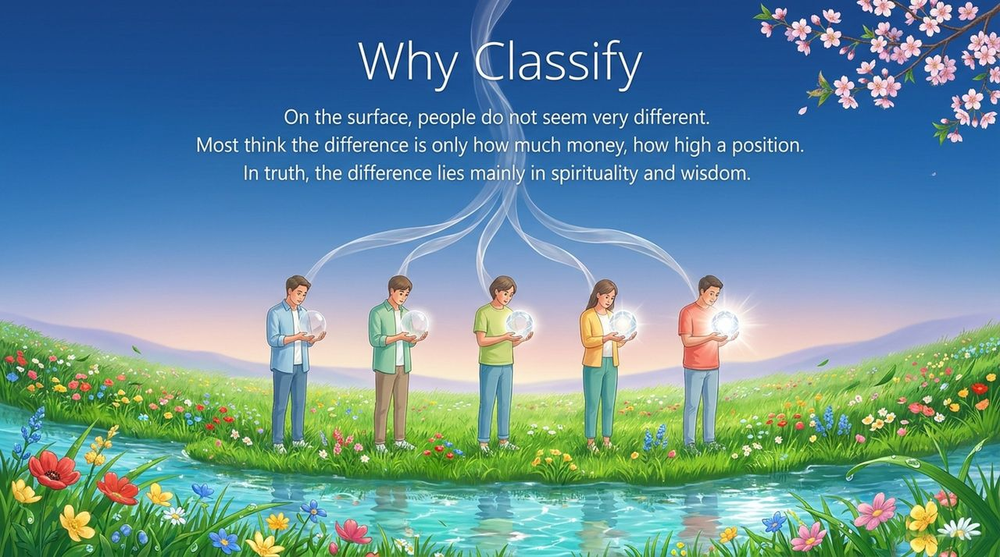
    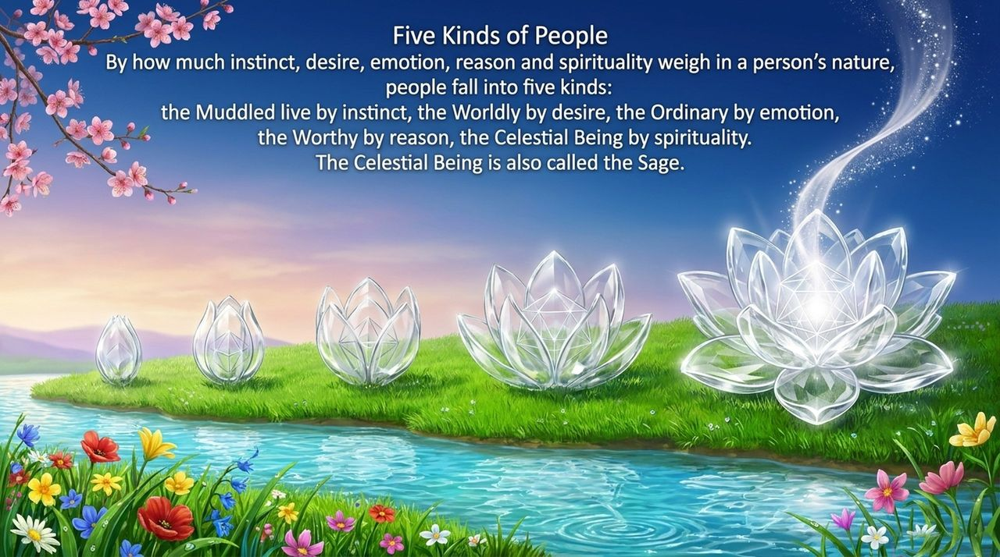
    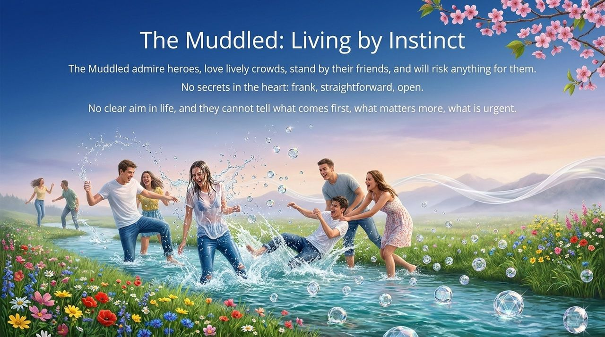
    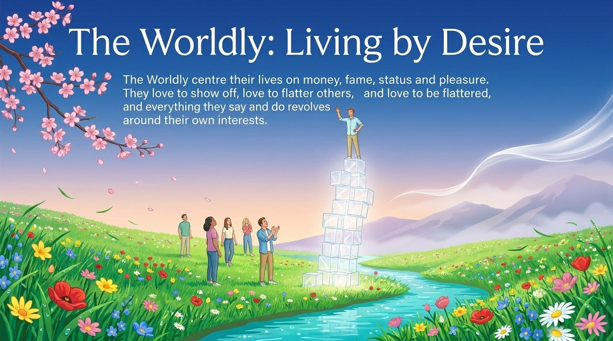
    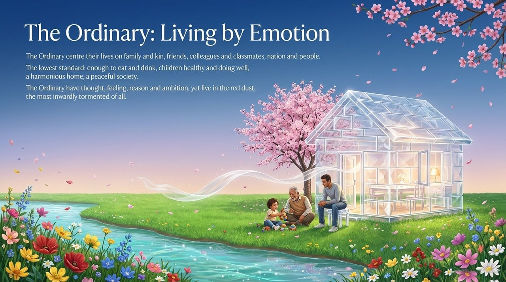
    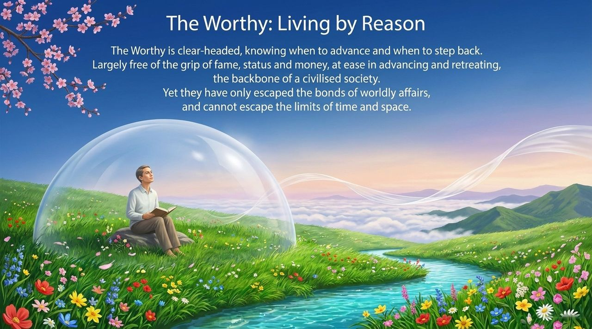
    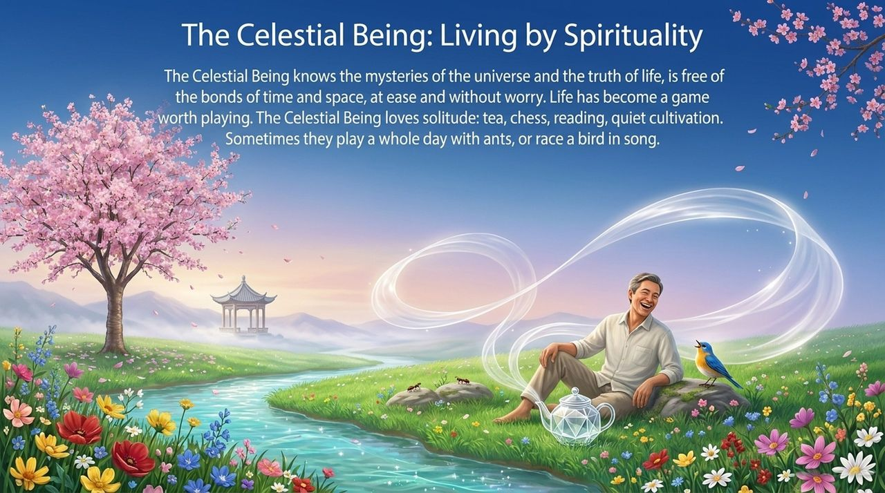
    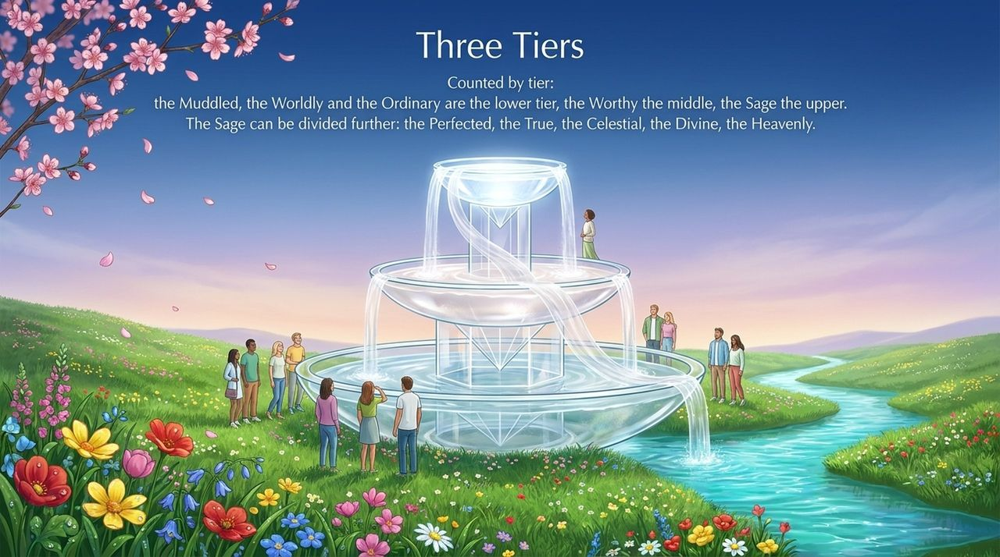
    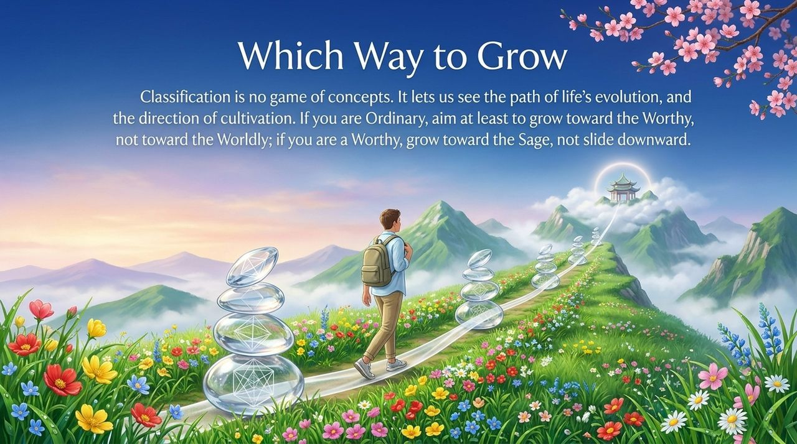
    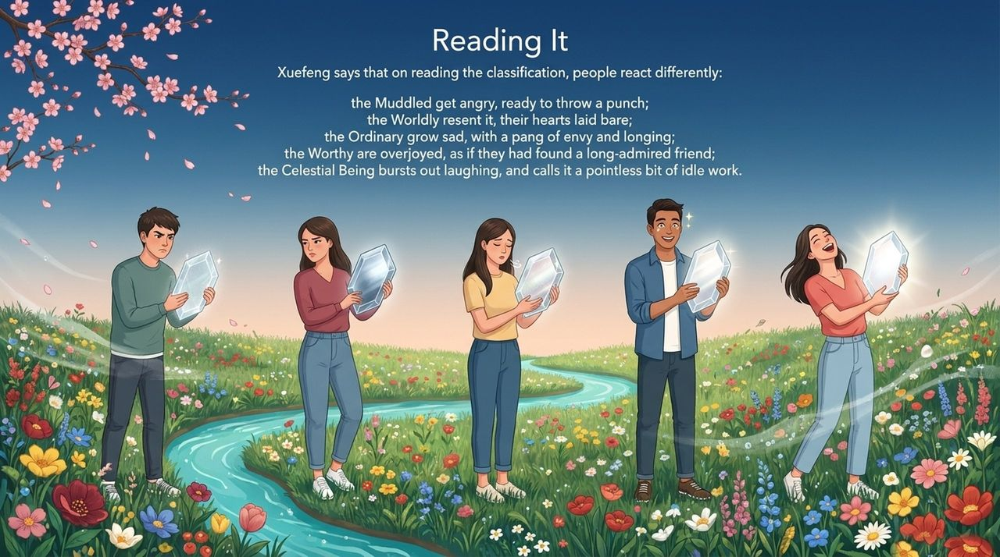
    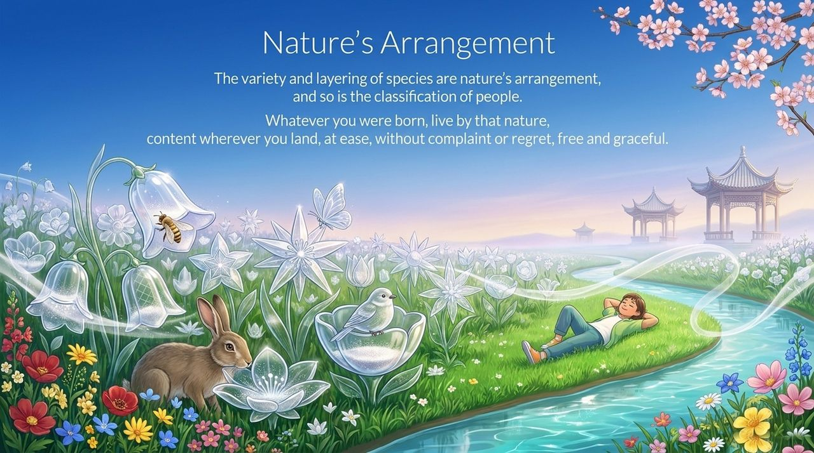
    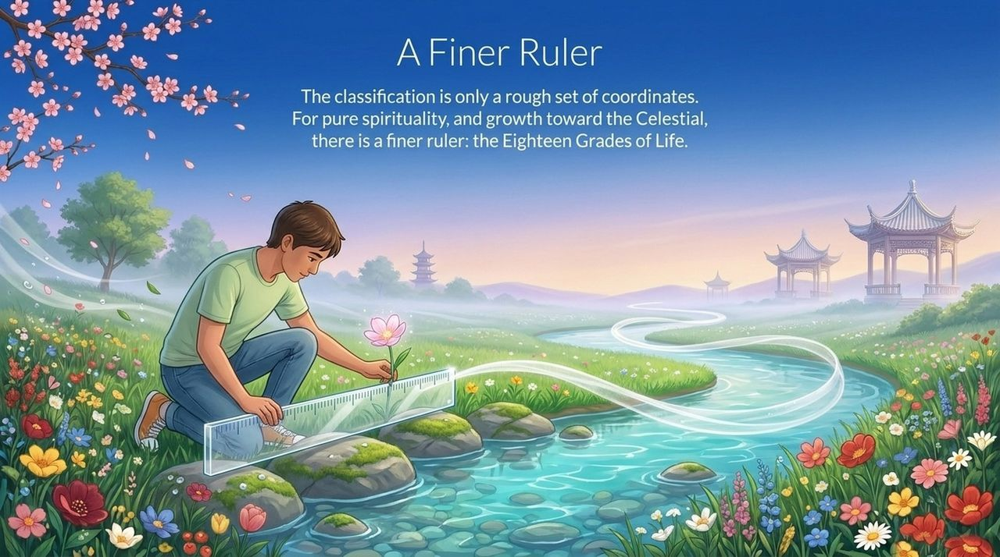
    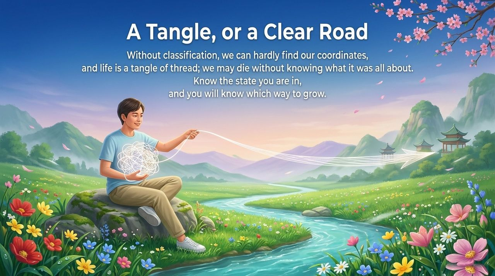

---

## Version Navigation

| Version | Best for | Focus |
|---------|----------|-------|
| [Friendly version](friendly.md) | First-time readers | Self-reflection, relatable examples |
| [Academic version](academic.md) | Researchers | Systematic analysis, comparative view |
| [Internal reference](internal.md) | Deep study | Full original texts, cultivation guidance |

---

## Related Entries

[Eighteen Grades of Life](/en/eighteen-grades-of-life/) · [Levels of Life](/en/levels-of-life/) · [Perfect Human Nature](/en/perfect-human-nature/) · [Human Nature](/en/human-nature/) · [Awakening](/en/awakening/) · [Spirituality](/en/spirituality/) · [Becoming Celestial and Buddha](/en/becoming-celestial-buddha/) · [Good People and Bad People](/en/good-person-bad-person/) · [Eight Thinking Ladders](/en/eight-thinking-ladders/)
