# Plague Gods, Plague King & Eight Qi

**Plague Gods, Plague King & Eight Qi** is the Lifechanyuan framework for understanding epidemic disease as a cosmic purification mechanism. The Plague King (瘟王) commands sixty-four numbered Plague Gods (瘟神) whose sole mission is to maintain the moral and spiritual cleanliness of Earth. The "Eight Qi" (八气) — a set of eight internal energetic states — are the true triggers of disease, independent of any external pathogen.

> "Sufficiently dense foul-meat qi, sufficiently fierce violent qi, sufficiently explosive temper qi, sufficiently fearful timid qi, sufficiently corrupt heart qi, sufficiently turbid lung qi, sufficiently weakened kidney qi, sufficiently depleted liver qi — when all Eight Qi are present, I appear on my own."
>
> — Plague God 008, *My Dialogue with the Wuhan Coronavirus* (Xuefeng, 2020)

## Video

<iframe style="width:100%;aspect-ratio:4/3;border:0" src="https://www.youtube-nocookie.com/embed/utTObhFbb2M" title="Plague Gods, Plague King and the Eight Qi (Lifechanyuan Encyclopedia video)" allowfullscreen></iframe>

## Slides

??? info "📖 Illustrated slides (14 pages, click to expand)"

    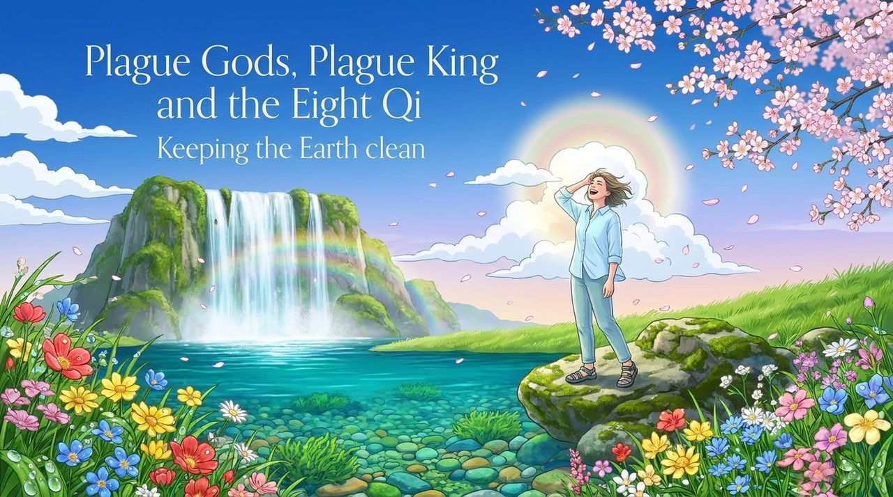
    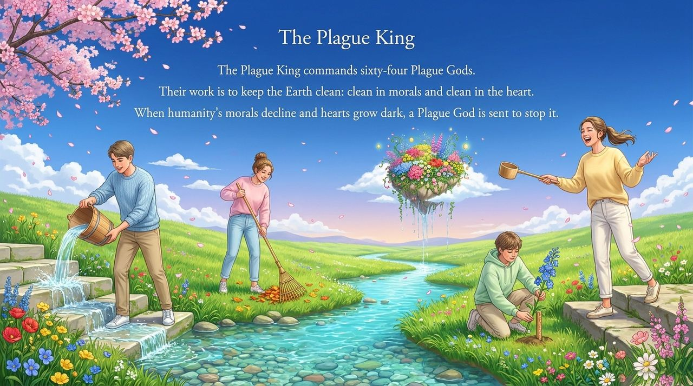
    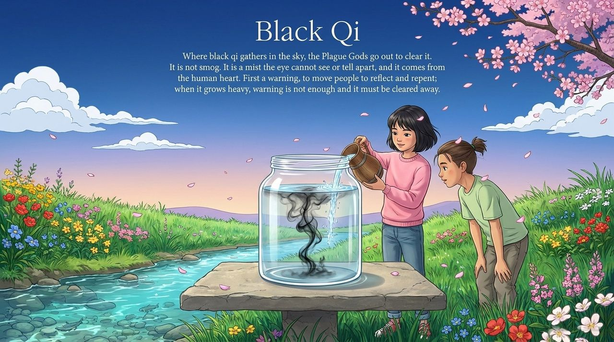
    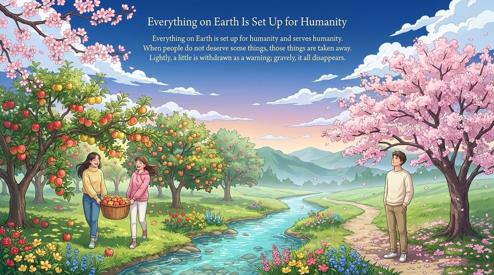
    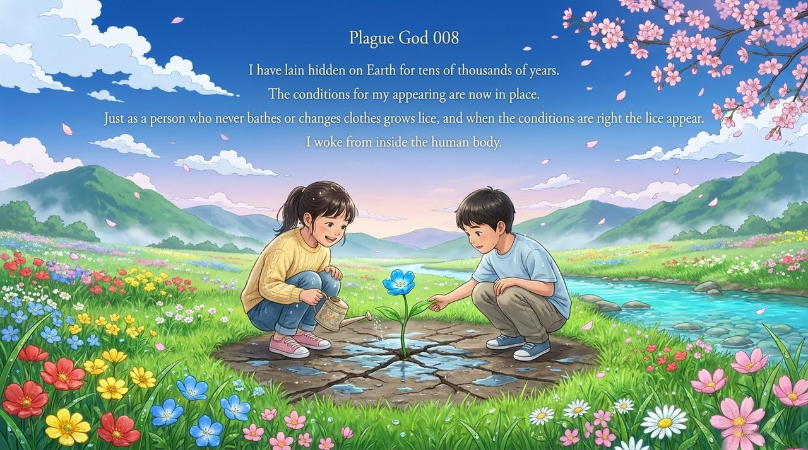
    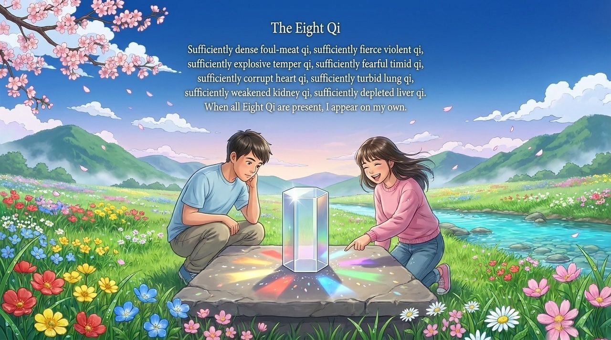
    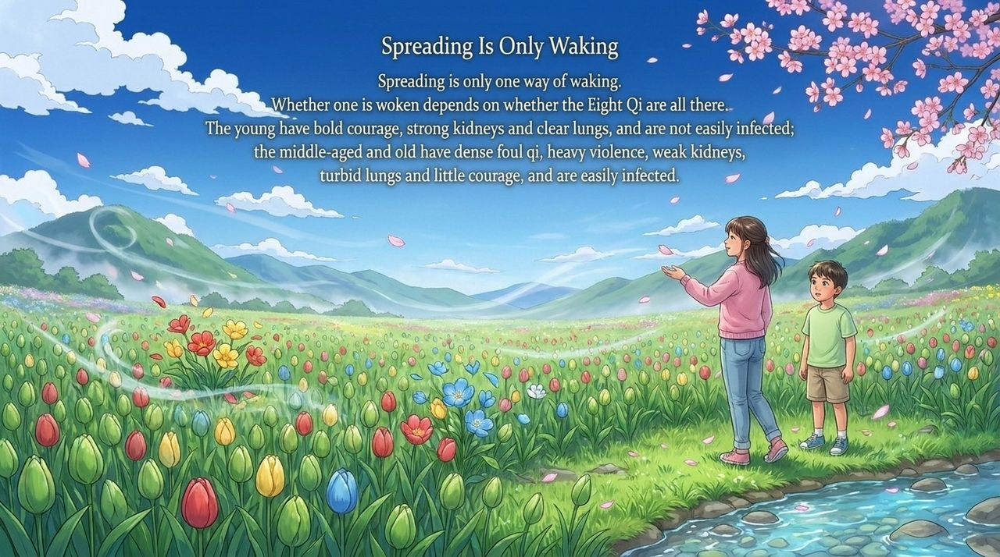
    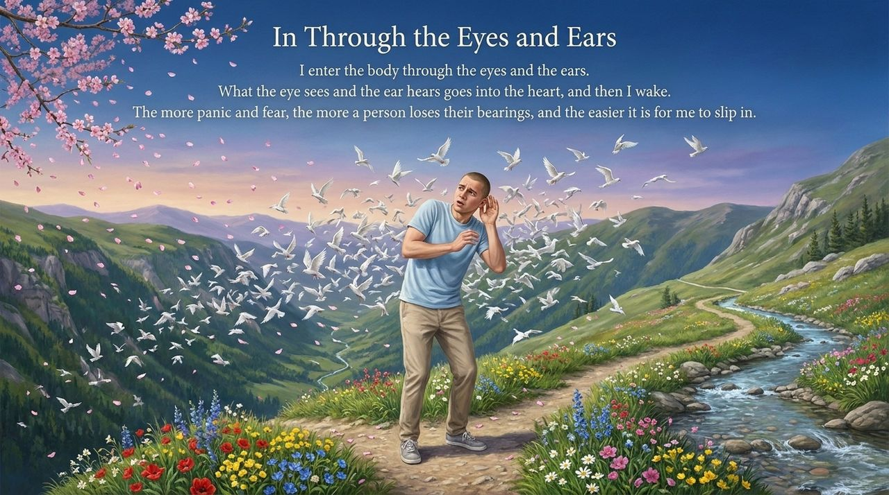
    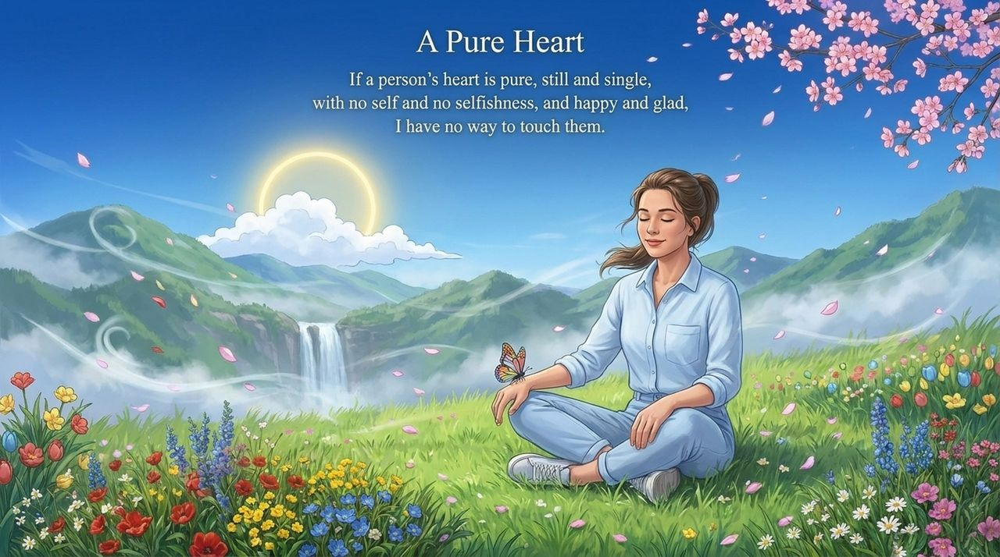
    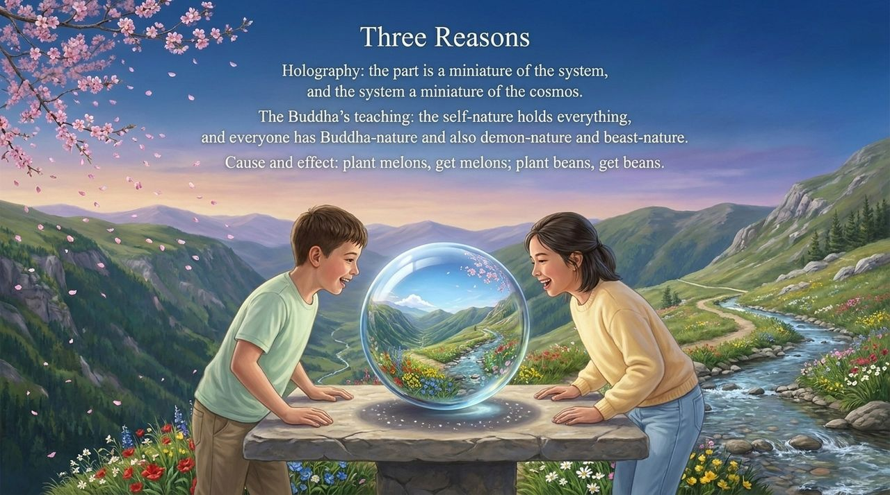
    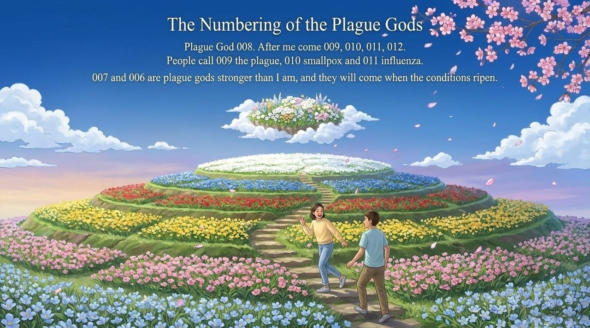
    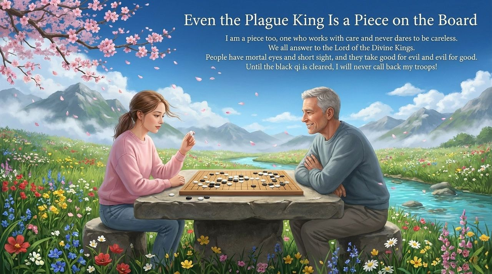
    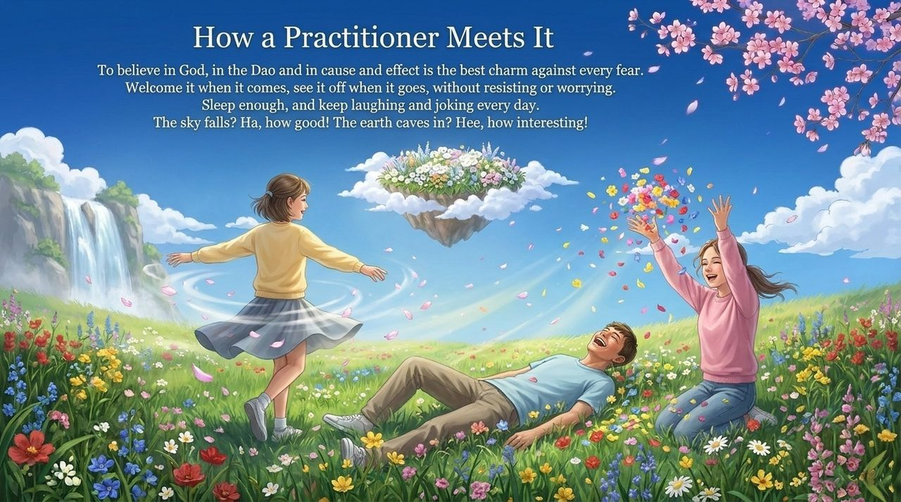
    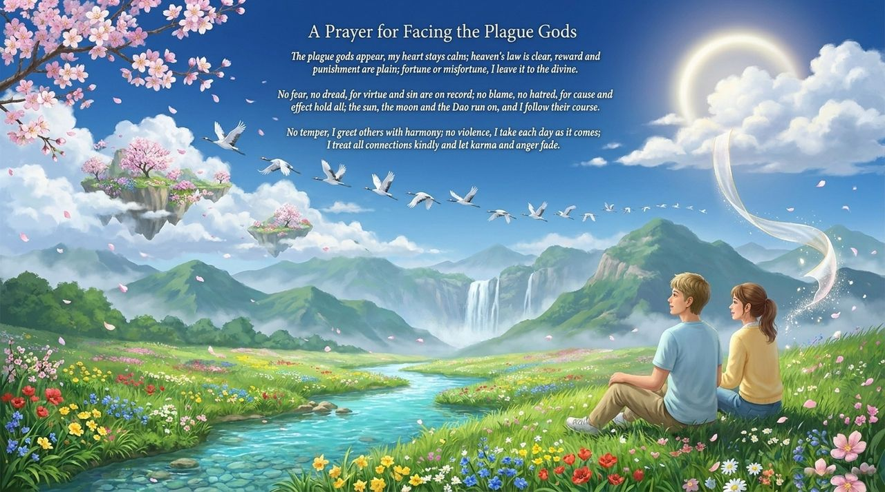

---

| Version | Best for | Focus |
|---------|----------|-------|
| [Friendly version](friendly.md) | First-time readers | Story-based introduction to the plague system and Eight Qi protection |
| [Academic version](academic.md) | Researchers | Systematic analysis of the theory, three supporting frameworks |
| [Internal reference](internal.md) | Deep study | Complete source texts, unchanged, with citations |

## Related entries

[Karma · Retribution · Reincarnation](/en/karma-retribution-reincarnation/) · [Cosmic Holography](/en/cosmic-holography/) · [Disease and Health](/en/disease-health/) · [Lifechanyuan](/en/lifechanyuan/) · [Xuefeng's Dialogues with Divine Beings](/en/xuefeng-divine-dialogues/) · [The Tao](/en/dao/) · [Route to Heaven](/en/route-to-heaven/) · [Return to Zero](/en/return-to-zero/)
