---
title: Prayer
slug: prayer-en
---

# Prayer

**Prayer**, in the Lifechanyuan system, is one of the two fundamental ways human beings can connect directly with the Greatest Creator (God/the Tao) — the other being meditation. Prayer is not a religious ritual but an authentic dialogue between the soul and the Greatest Creator. Its mechanism: human thoughts transform into thought-waves broadcast into the universe; the Tao possesses "instantaneous resonance" — every heartfelt prayer is perceived and responded to. Prayer is an indispensable daily practice for spiritual cultivation; without prayer, one receives no divine assistance.

> Prayer has an unimaginable power. When you feel trapped by circumstances and unable to realize your beautiful ideals, pray more!

---

## Version Guide

| Version | Best for | Focus |
|---------|----------|-------|
| [Friendly version](friendly.md) | First-time readers | What prayer is, how to pray, what to expect |
| [Academic version](academic.md) | Researchers | Definition, format, mechanisms, boundaries |
| [Internal reference](internal.md) | Deep study | Full original-text quotations by theme |

---

## Video

<iframe style="width:100%;aspect-ratio:4/3;border:0" src="https://www.youtube-nocookie.com/embed/AX_gl8Ar_EU" title="Prayer (Lifechanyuan Encyclopedia video)" allowfullscreen></iframe>

## Slides

??? info "📖 Illustrated slides (14 pages, click to expand)"

    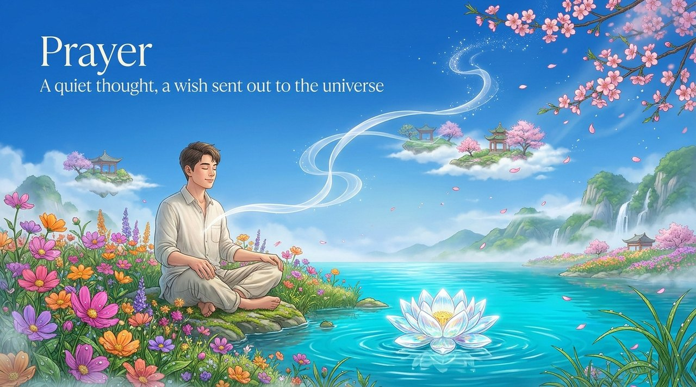
    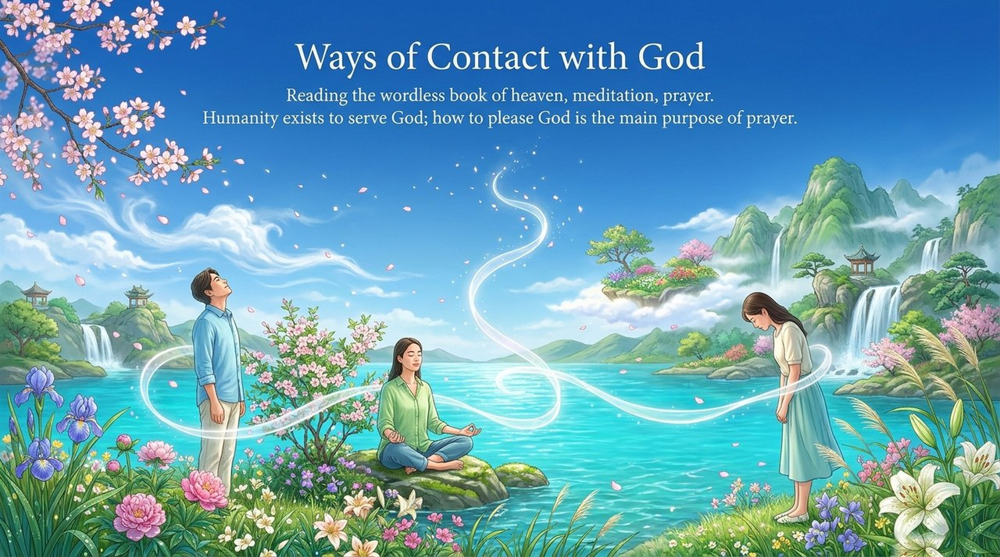
    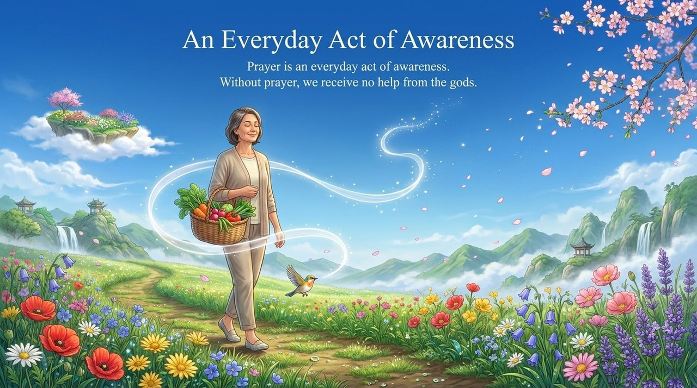
    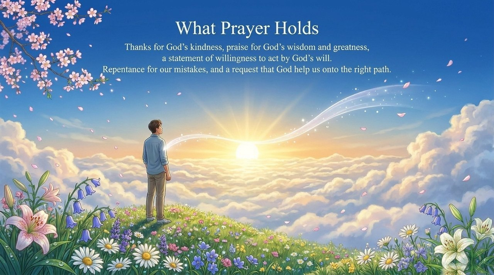
    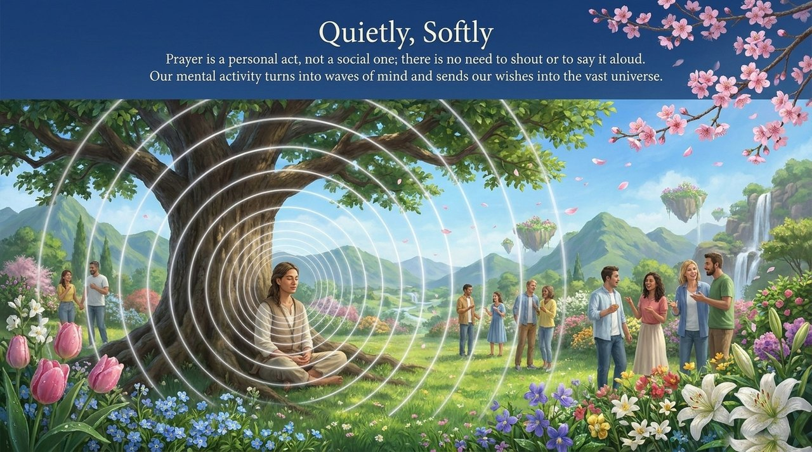
    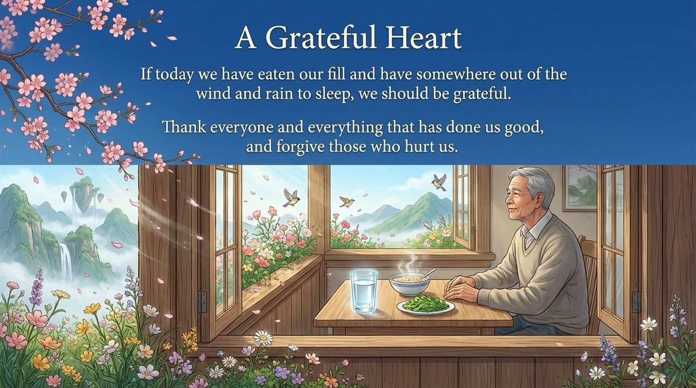
    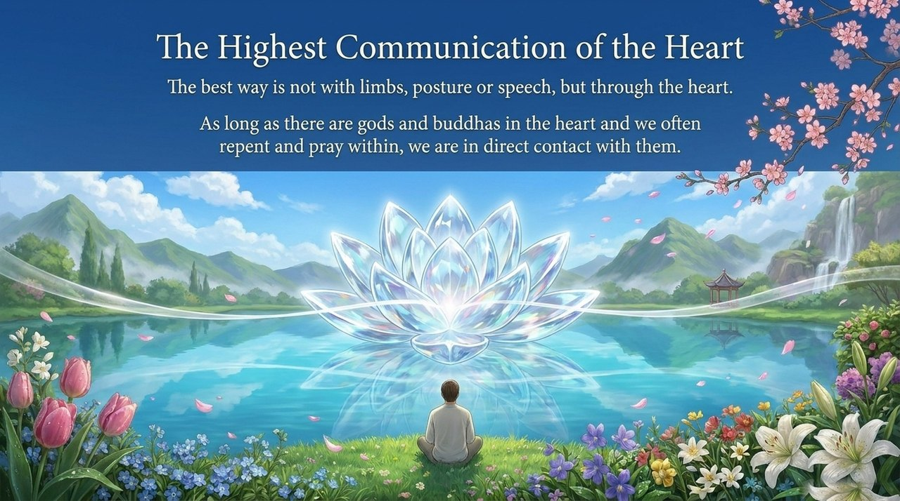
    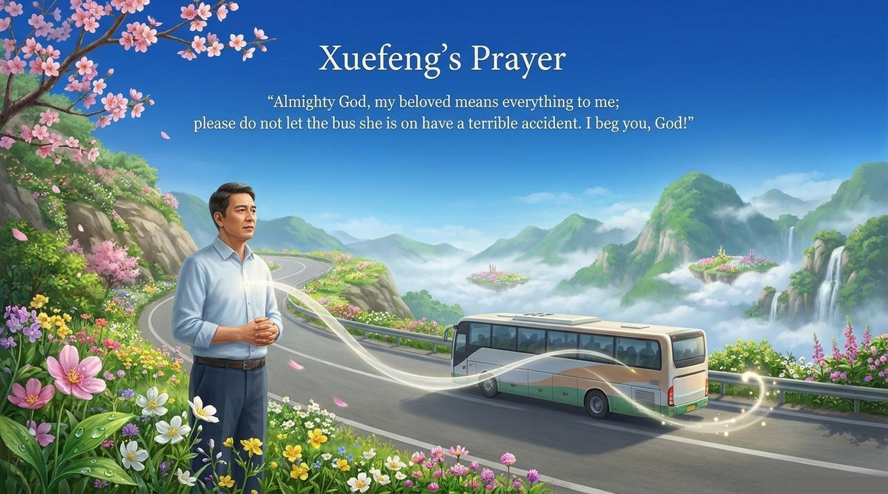
    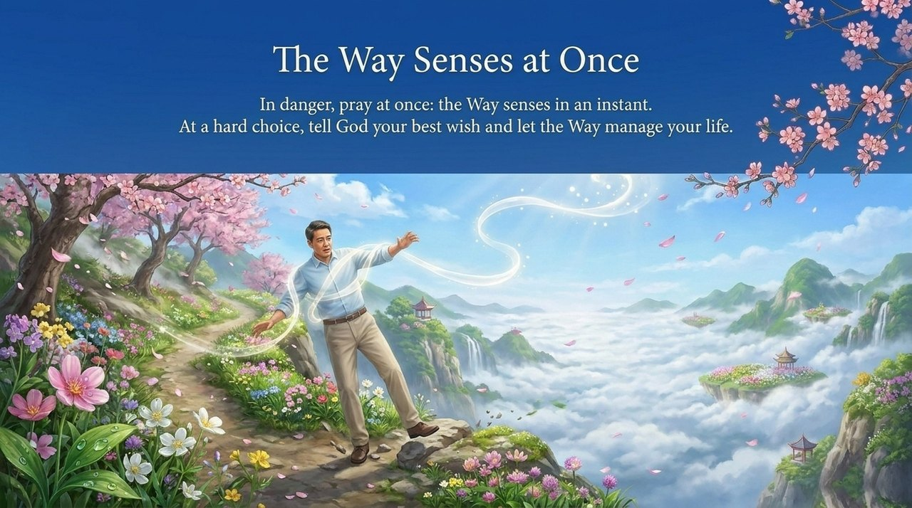
    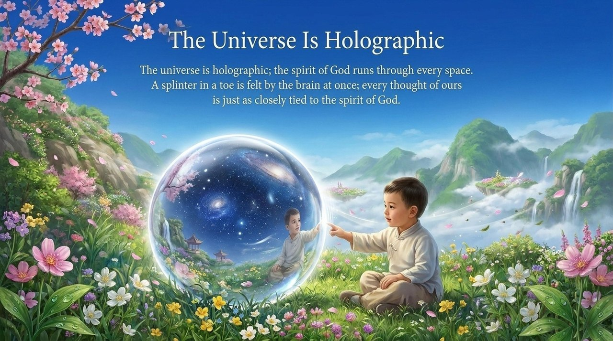
    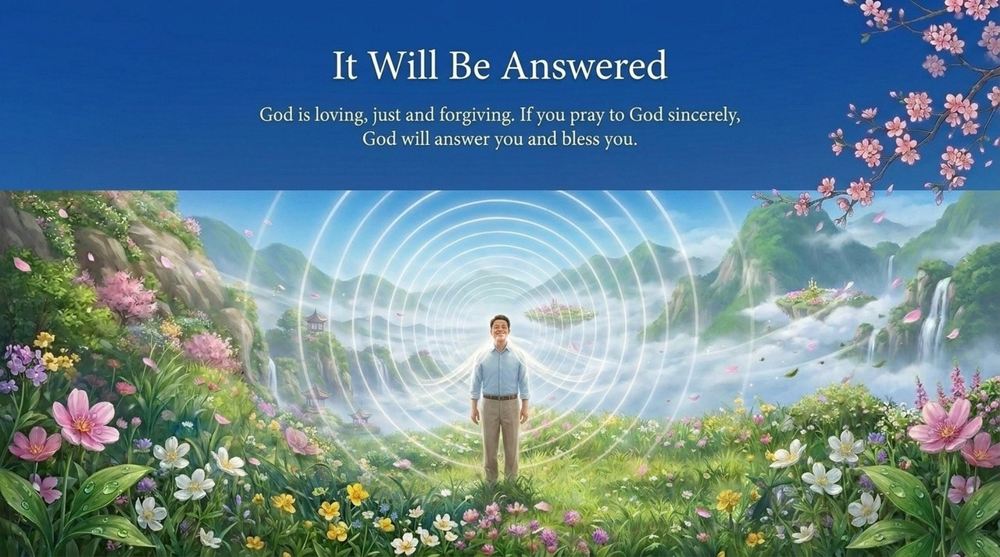
    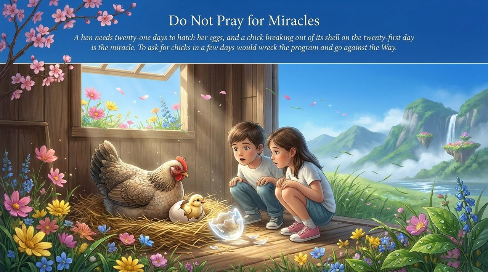
    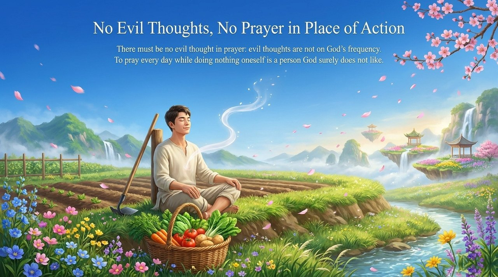
    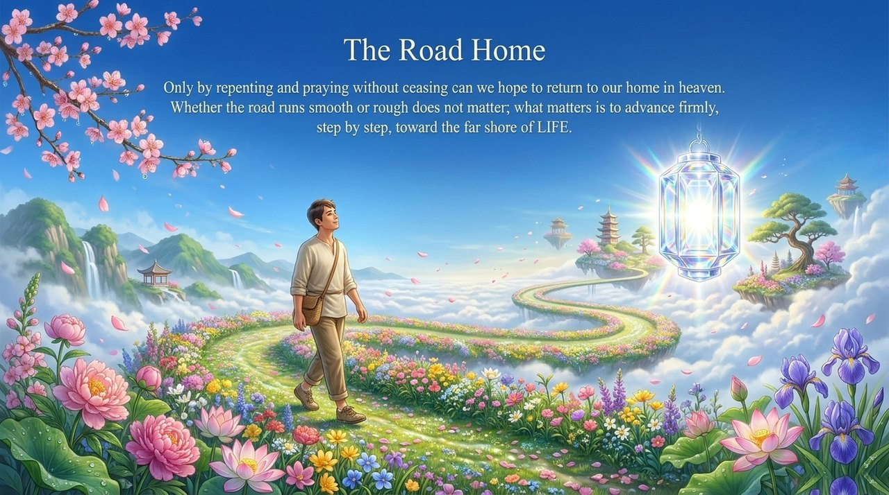

---

## Related Entries

[Repentance](/en/repentance/) · [Meditation](/en/settled-stillness/) · [Gratitude](/en/gratitude/) · [Letting Go](/en/letting-go/) · [Yuan — the Mystery of Affinity](/en/yuan/) · [Heavenly Treasures](/en/heavenly-treasures/) · [Roadmap to Heaven](/en/route-to-heaven/) · [the Tao](/en/dao/)
