<!-- id: LC-QE-0001-EN theme: cultivation type: navigation direction: daily-cultivation lang: en -->

# Quantum Entanglement and the "Other Half"

The "Other Half" is a cosmological concept proposed by Lifechanyuan, drawing on quantum entanglement to argue that every person has a complementary opposite — a "counter-self" — existing somewhere in the universe. The two share emotions and fates across any distance, yet are kept apart by the universe's own programming. Only through reaching the Eight-No realm can a practitioner enable this encounter, triggering a mutual annihilation that leads to liberation and ascension to the Elysian World.

---

## Video

<iframe style="width:100%;aspect-ratio:4/3;border:0" src="https://www.youtube-nocookie.com/embed/s5hn8v_dP9Y" title="Quantum Entanglement and the Other Half (Lifechanyuan Encyclopedia video)" allowfullscreen></iframe>

## Slides

??? info "📖 Illustrated slides (14 pages, click to expand)"

    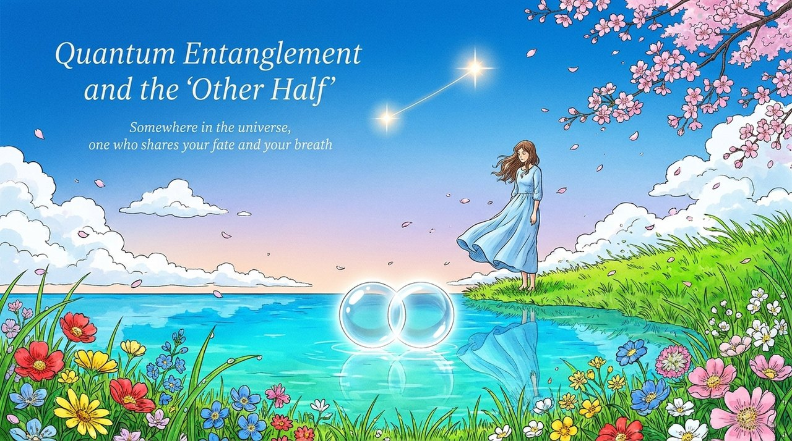
    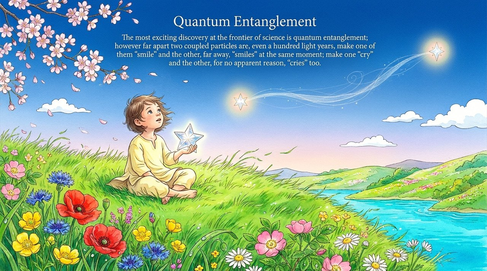
    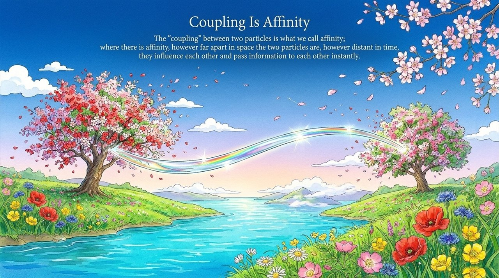
    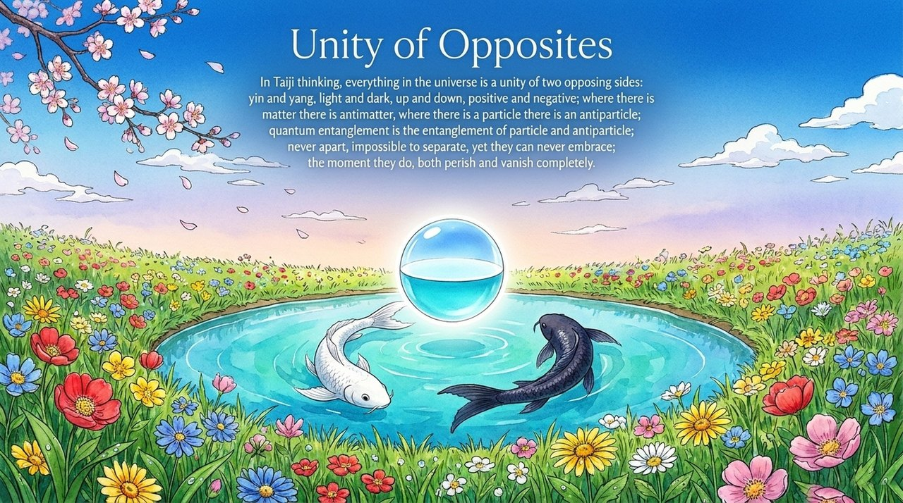
    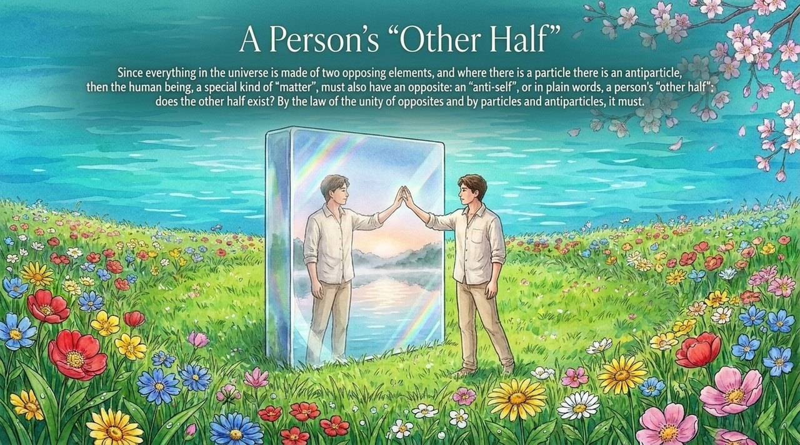
    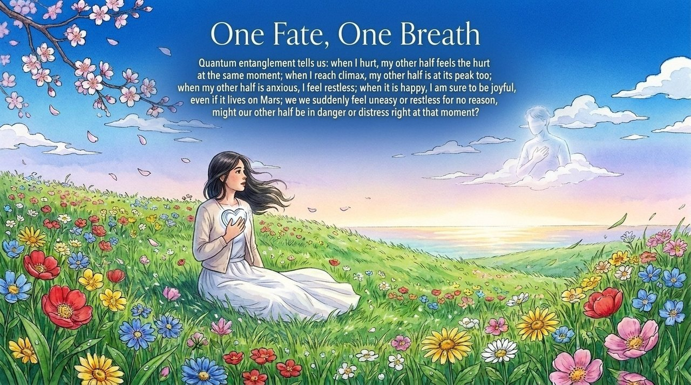
    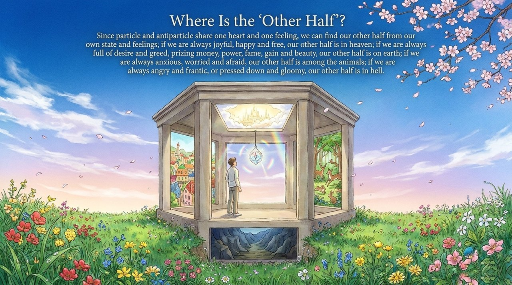
    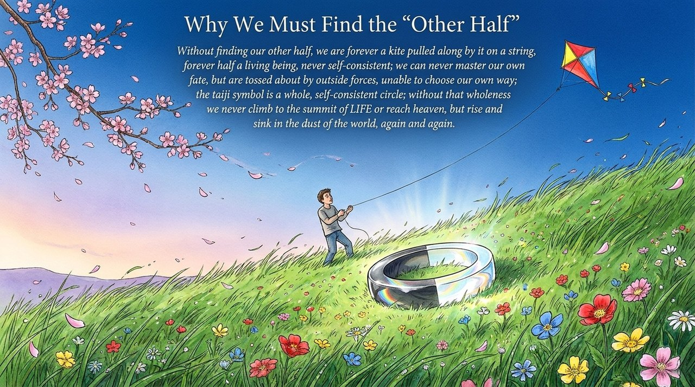
    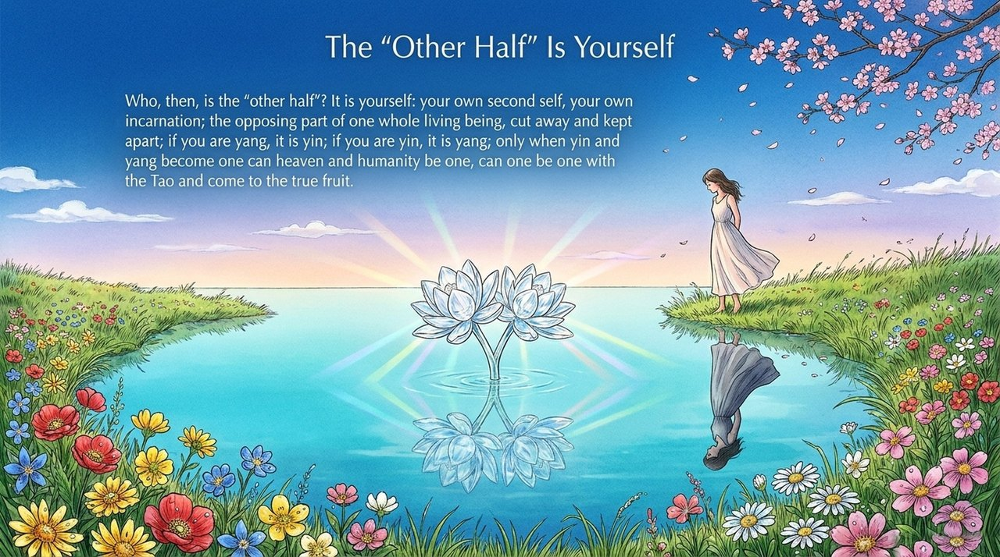
    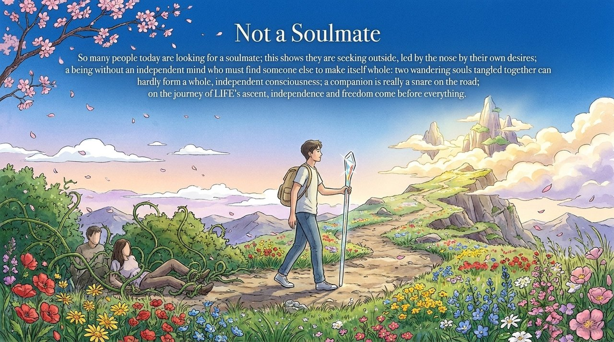
    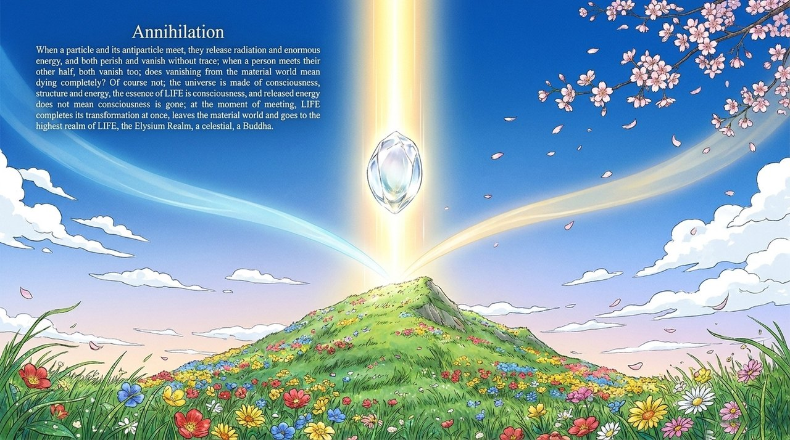
    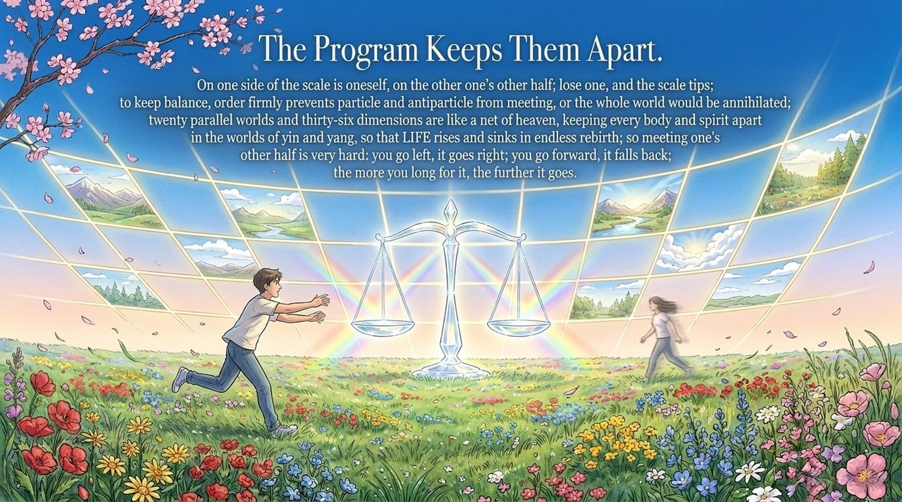
    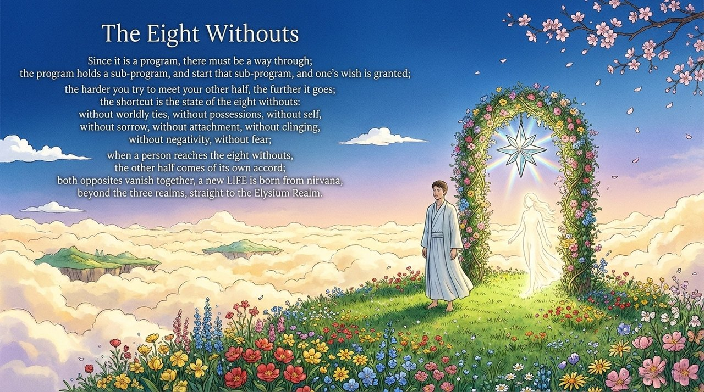
    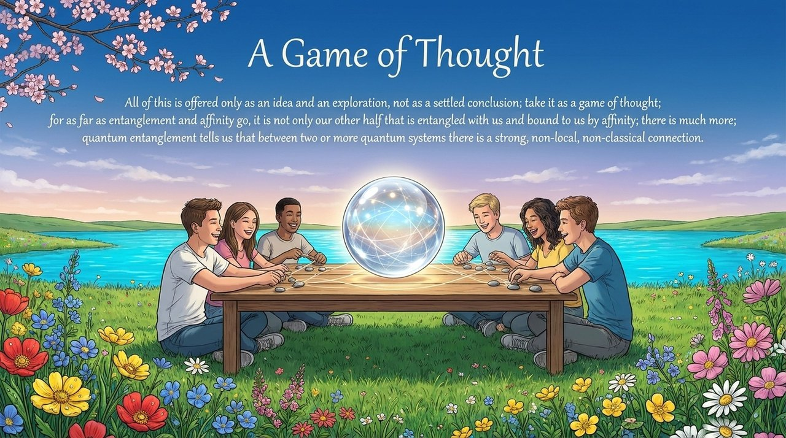

---

## Versions

| Version | Best for | Focus |
|---------|----------|-------|
| [Friendly version](friendly.md) | First-time readers | Life analogies · shared fate · cultivation direction |
| [Academic version](academic.md) | Researchers | Concept analysis · physics analogy · cosmological structure |
| [Internal reference](internal.md) | Deep study | Complete quotations · seven-section framework · cultivation path |

---

## Related entries

[Yuan — Mystery and Truth](/en/yuan/) · [Eight-No Realm](/en/eight-no-realms/) · [Self-Sufficiency](/en/self-coherence/) · [Right Fruit](/en/true-fruition/) · [Becoming Immortal and Buddha](/en/becoming-celestial-buddha/) · [Elysian Realm](/en/elysium-world/) · [Taiji](/en/taiji/) · [Life Reincarnation](/en/life-reincarnation/) · [36 Bagua Formations](/en/thirty-six-bagua-formations/)
