<!-- id: LC-RAT-0005 theme: Thinking Cultivation type: Entry Gateway direction: Consciousness Ascension Path lang: en slug: en version: index -->

> In Lifechanyuan terminology, **LIFE** (capitalized) refers to the ontological
> essence of existence — the soul/antimatter structure that persists across
> incarnations — while **life** (lowercase) refers to the experiential stage
> of human existence in this world.

# Rational Thinking

[Concept Portal]

**Rational Thinking** is the collective name for the **first four rungs** of Lifechanyuan's Eight Thinking Ladders — Material Thinking, Imagery Thinking, Associative Thinking, and Illusory Thinking. It is the precise designation for "human thinking," encompassing all thinking modes below the watershed between humans and celestial beings (*xian*, 仙).

> Material Thinking, Imagery Thinking, Associative Thinking, and Illusory Thinking all belong to Rational Thinking — this is human thinking. Heart-Image Thinking, Taiji Thinking, Non-Form Thinking, and Hundun Thinking all belong to celestial thinking. In other words, Rational Thinking and Spiritual Thinking are the watershed between humans and celestial beings. If your thinking is Rational Thinking, do not doubt it — you are definitely human.
>
> — *Chanyuan Corpus · Wisdom Chapter · The Way of Thinking and Doing of Spiritual Thinkers*

Rational Thinking's core is: basing on large quantities of facts and phenomena, observing, comparing, analyzing, and inducting, then synthesizing to find patterns, then ascending to abstraction, generalization, and judgment, thus finding the direction of development or solving problems. This is **the thinking of the Worthy** (*xianren*, 贤人) — humanity's highest thinking — yet it is also one of the greatest obstacles to humanity entering a civilized society.

---

## Core Positioning

In Lifechanyuan's thinking system, Rational Thinking is the complete "addition phase" of all four rungs, attainable through intellectual learning and training. For humans, rationality is the ceiling of cognition; for LIFE above the human level, rationality is a cage of thinking. The direction for Chanyuan Celestials is to abandon the first four rungs and enter directly into Heart-Image Thinking (the celestial level).

---

## Reading Versions

| Version | Intended Readers | Link |
|---------|-----------------|------|
| **Friendly Edition** | First-time visitors to Lifechanyuan | [Read Friendly Edition](./friendly) |
| **Academic Edition** | Readers with philosophy/religious studies backgrounds | [Read Academic Edition](./academic) |
| **Internal Edition** | Chanyuan Celestials and deep practitioners | [Read Internal Edition](./internal) |

---

## Video

<iframe style="width:100%;aspect-ratio:4/3;border:0" src="https://www.youtube-nocookie.com/embed/HXXXUimaFAA" title="Rational Thinking (Lifechanyuan Encyclopedia video)" allowfullscreen></iframe>

## Slides

??? info "📖 Illustrated slides (14 pages, click to expand)"

    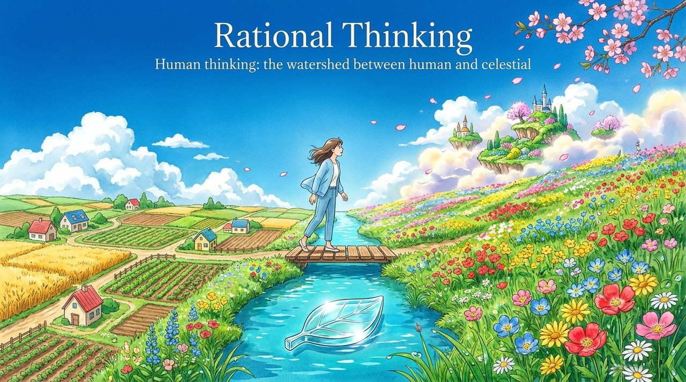
    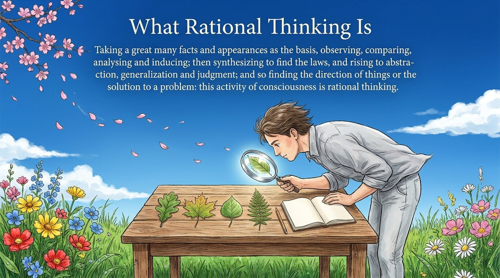
    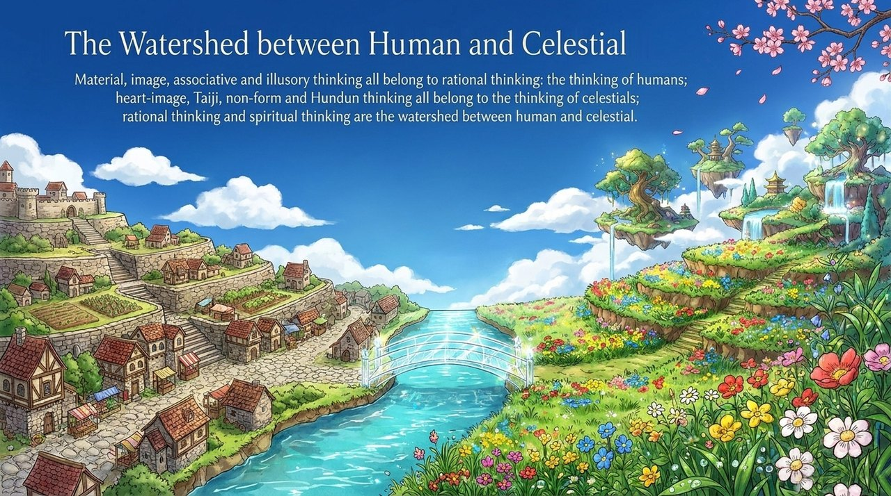
    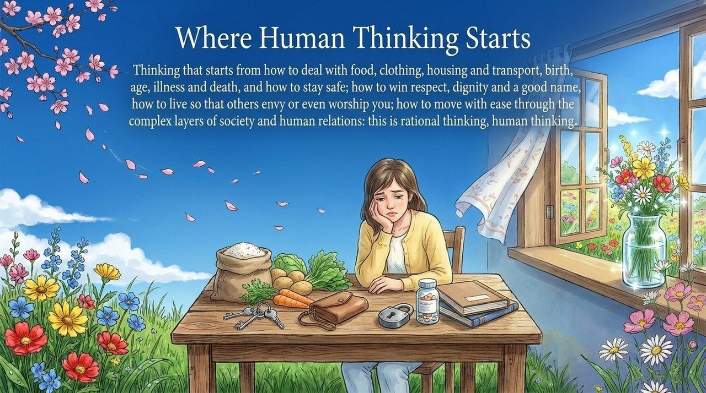
    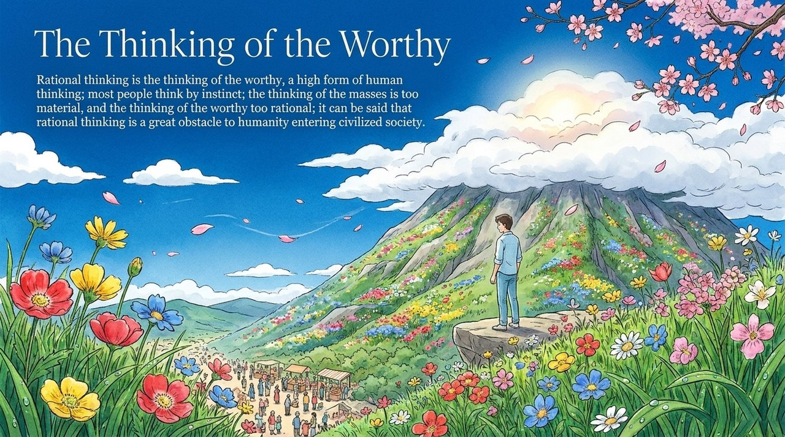
    
    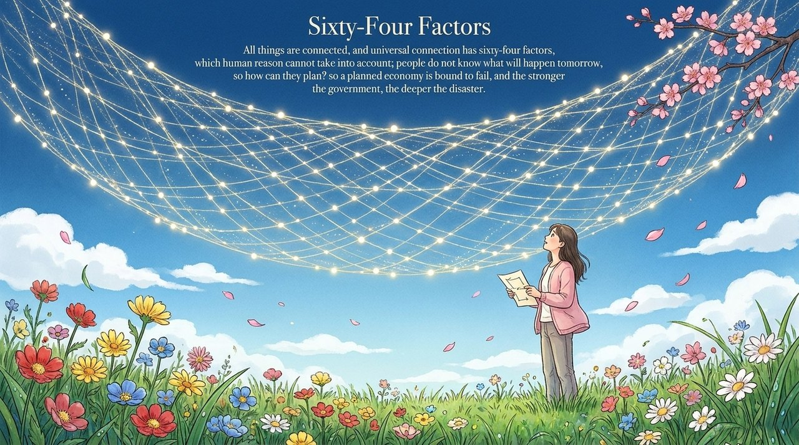
    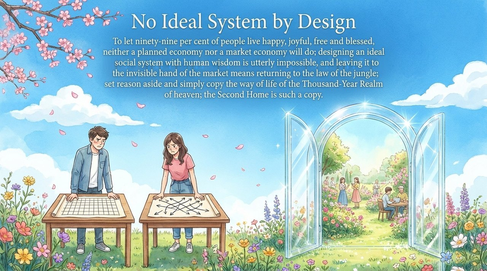
    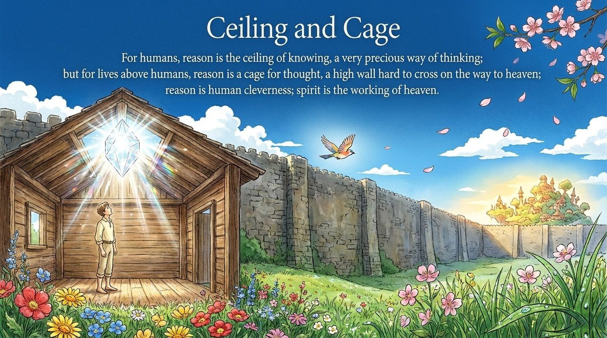
    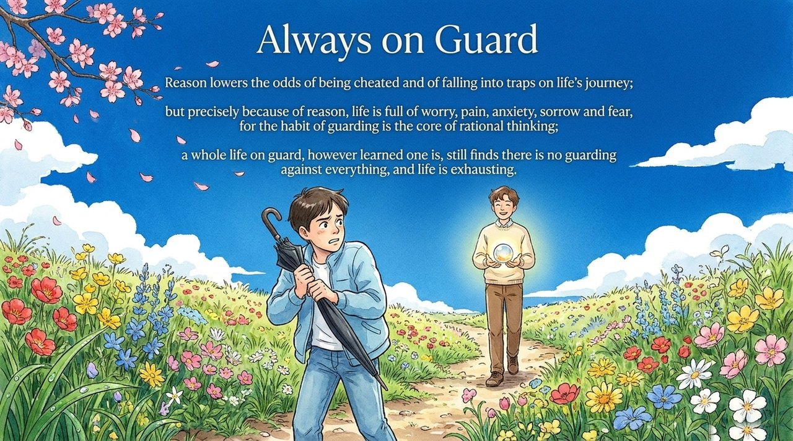
    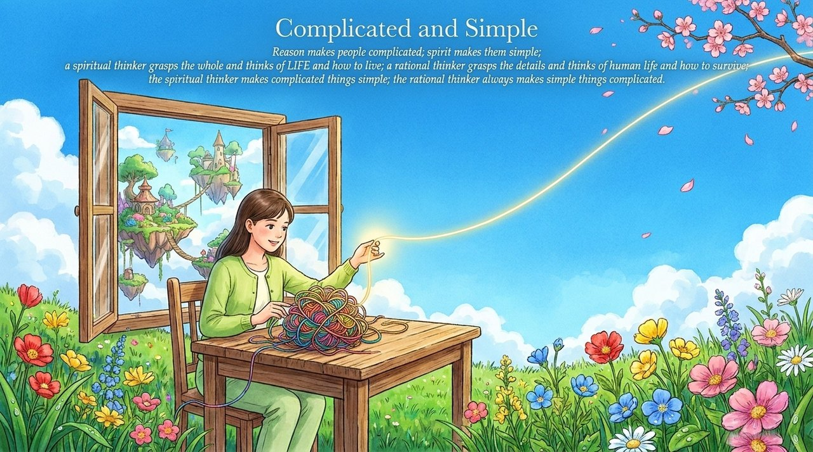
    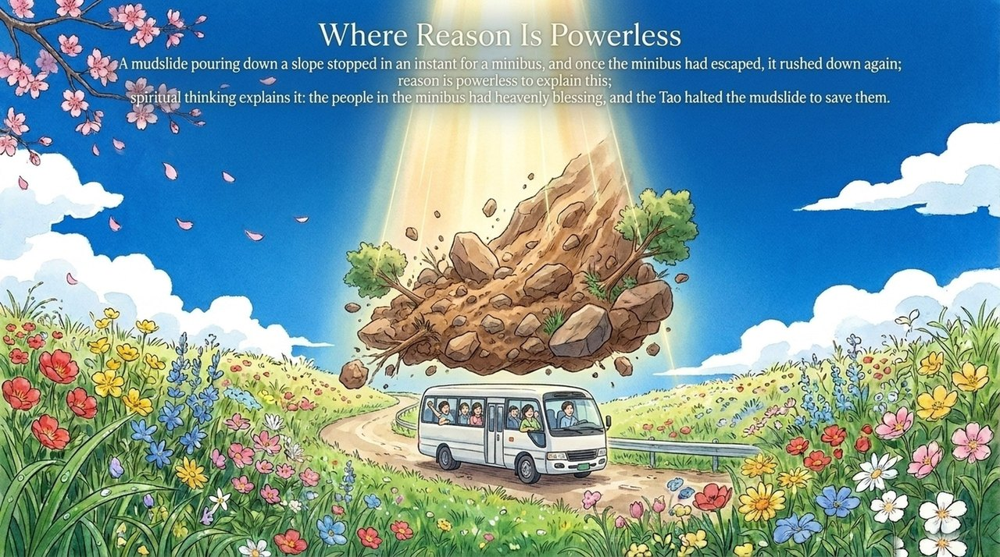
    
    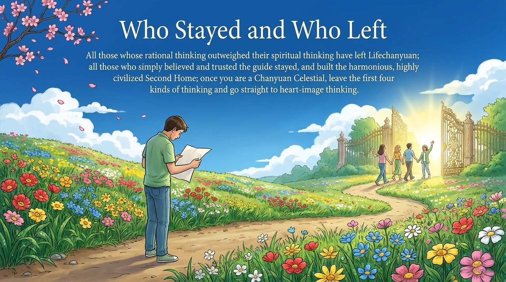

---

## Related Entries

- [Eight Thinking Ladders](/en/eight-thinking-ladders/) — Rational Thinking's (first four rungs) coordinates in the complete system
- [Spirituality](/en/spirituality/) — The celestial thinking (Heart-Image / Taiji / Non-Form / Hundun) opposite to Rational Thinking
- [Heart-Image Thinking](/en/heart-image-thinking/) — Fifth rung; the first step crossing the Rational Thinking watershed
- [Hundun Management](/en/hundun-management/) — The institutional practice of the Second Home that transcends rational management
