<!-- id: LC-REINCARNATION-ABORTION-0001 theme: Mystery of LIFE type: entry-page direction: life-reincarnation-mechanism lang: en -->

# Spiritual Rebirth & Abortion

> Humanity has long assumed that a fetus in the womb is a living being — but that is not so. The fetus is merely a "dwelling place," not a life. Only when a reincarnating soul travels through the space tunnels of the 36-dimensional universe and moves into this dwelling does the fetus become a life. Generally speaking, the fetus only carries a living soul a few days before birth.
>
> — Chanyuan Corpus · Life Chapter · The Evolution of LIFE

**Spiritual rebirth** (投胎, literally "entering the womb") describes, in the Lifechanyuan framework, the specific mechanism by which a soul — a spiritualized antimatter structure — travels through the space tunnels of the 36-dimensional universe and enters the mother's womb (called the Positive Extreme Black Hole Body in the cosmic map) to begin a new life cycle. **Abortion** is an act that Guide Xuefeng explicitly expresses his hatred and strong opposition toward.

---

## Video

<iframe style="width:100%;aspect-ratio:4/3;border:0" src="https://www.youtube-nocookie.com/embed/F5O0eALkI1I" title="Spiritual Rebirth and Abortion (Lifechanyuan Encyclopedia video)" allowfullscreen></iframe>

## Slides

??? info "📖 Illustrated slides (14 pages, click to expand)"

    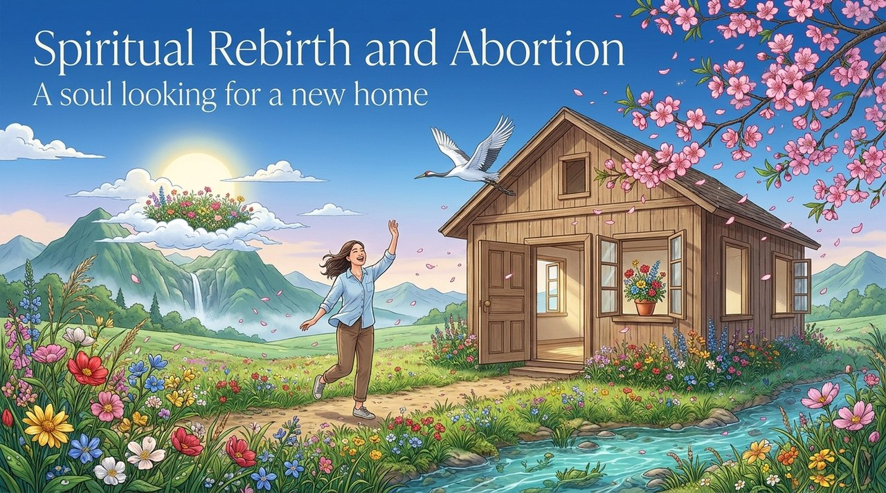
    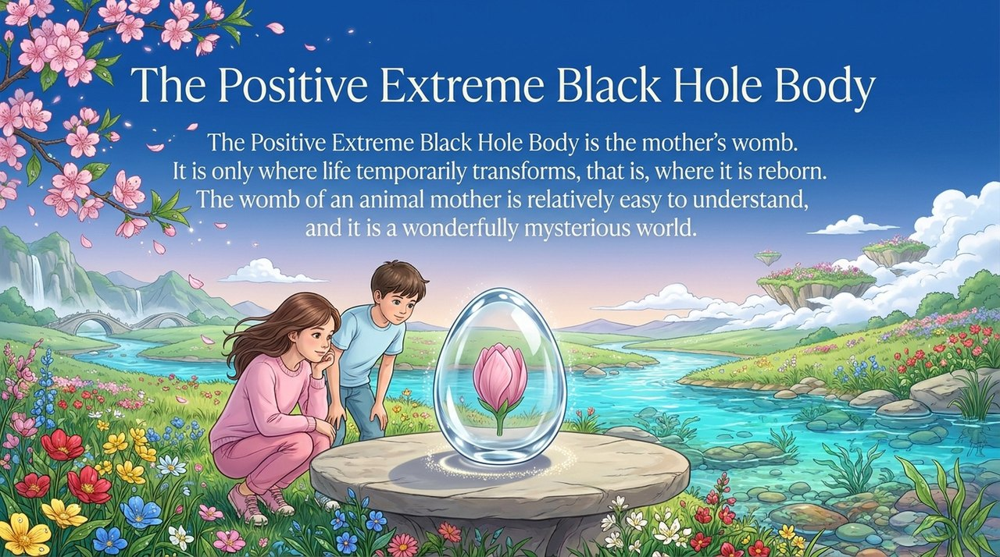
    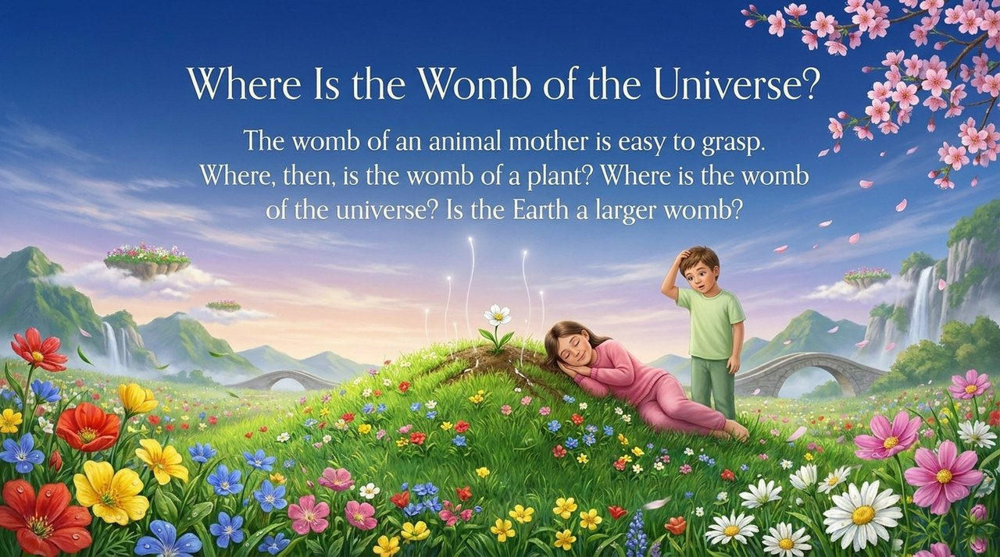
    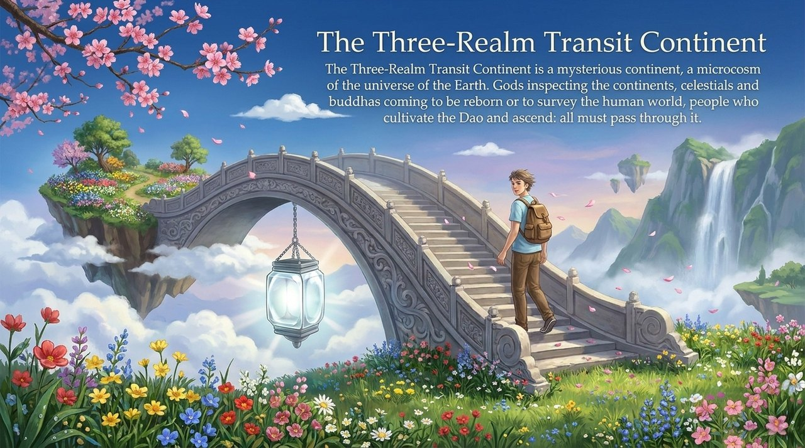
    
    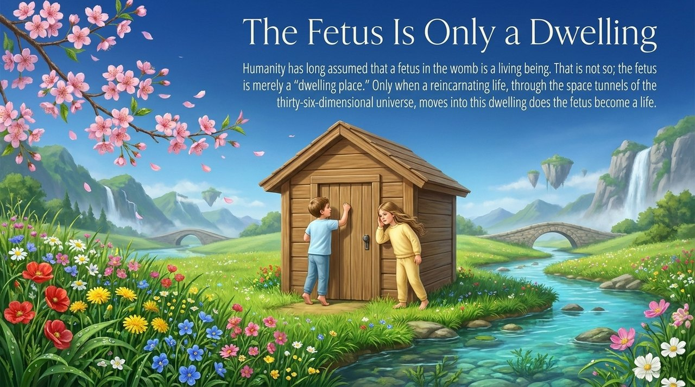
    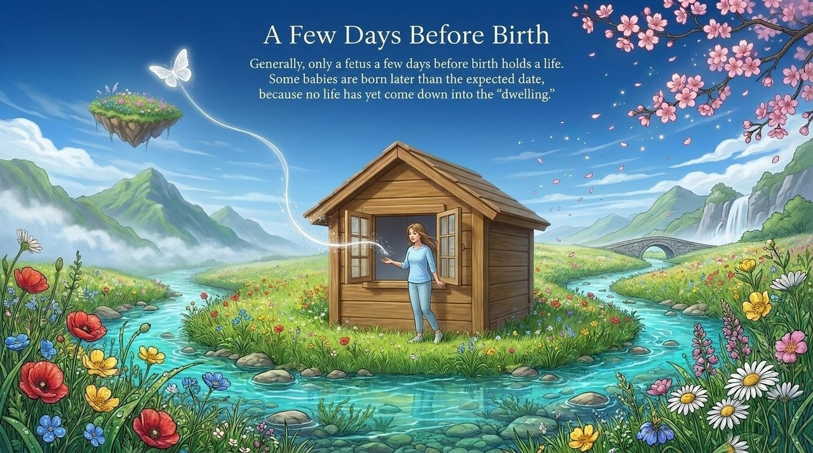
    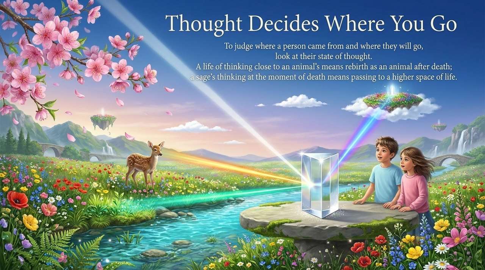
    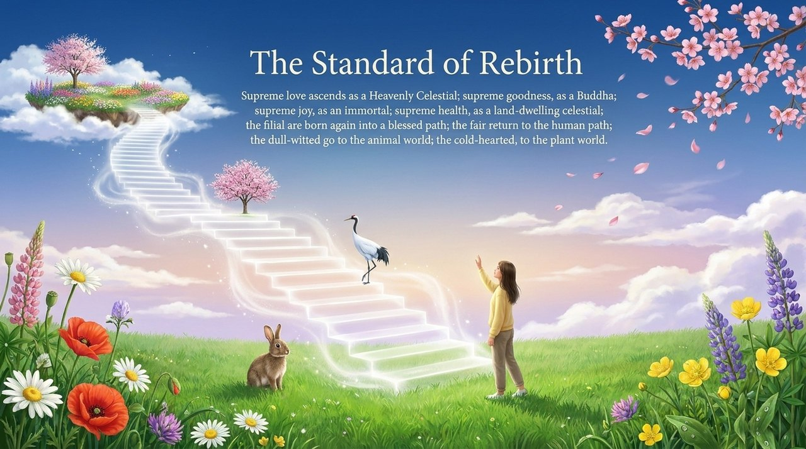
    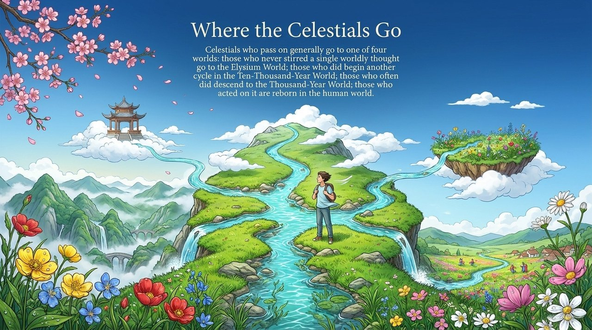
    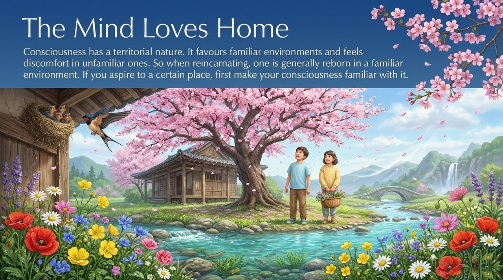
    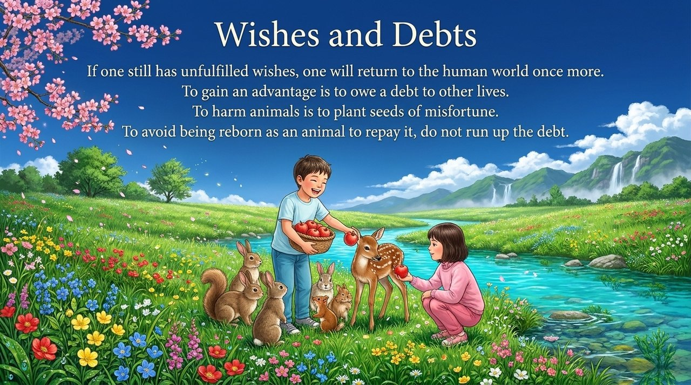
    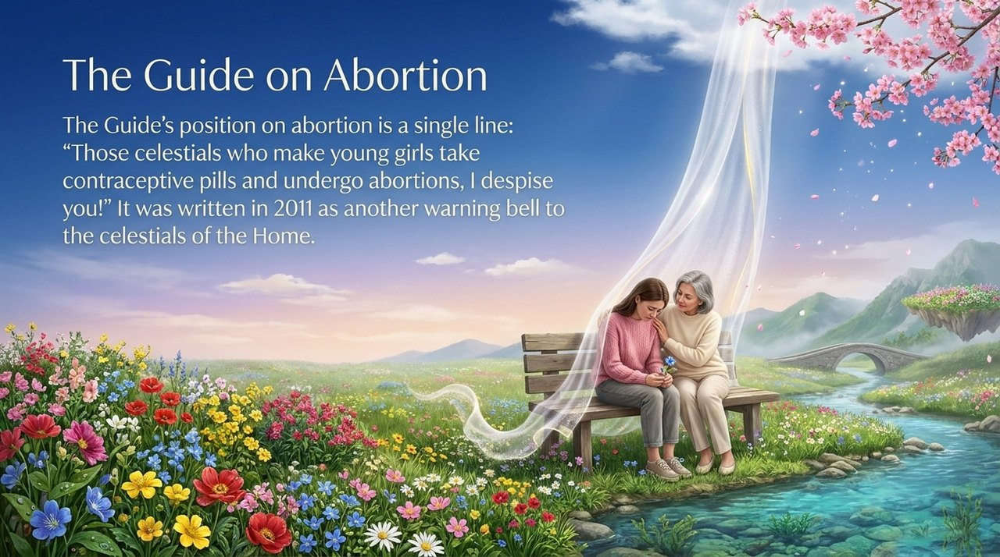
    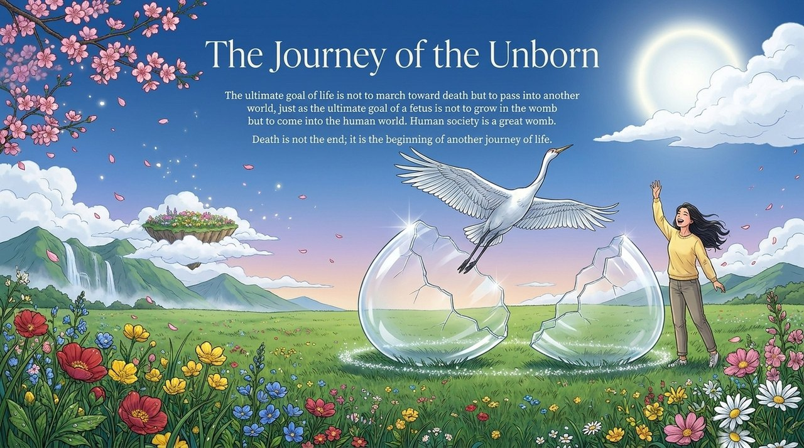

---

## Versions

| Version | Best for | Focus |
|---------|----------|-------|
| [Friendly version](friendly.md) | First-time readers | How does a soul find its new home? A life-journey perspective |
| [Academic version](academic.md) | Researchers | The Positive Extreme Black Hole Body mechanism, fetal soul attribution, reincarnation criteria |
| [Internal reference](internal.md) | Deep study | Full primary-text compilation, 14 independent citations |

---

## Related Entries

- [Life Reincarnation](/en/life-reincarnation/)
- [Karma · Retribution · Reincarnation](/en/karma-retribution-reincarnation/)
- [Soul](/en/soul/)
- [Life and Death](/en/life-and-death/)
- [Thirty-Six-Dimensional Space](/en/thirty-six-dimensional-space/)
- [Elysium World](/en/elysium-world/)
- [Debt Repayment](/en/debt-repayment/)
- [Life Origin and Evolution Panorama](/en/life-origin-evolution-panorama/)
