# Religion

**Religion**, in the Lifechanyuan system, is a field of inquiry into the relationship between humanity and nature — an ideological framework that helps people establish their worldview, life philosophy, and values, and a bridge guiding humanity from the material world toward the nonmaterial world. Its original intention is good. However, religion has eight fundamental shortcomings: it has obscured the path to Heaven, manufactured sectarian conflict, and become a stumbling block to the elevation of human civilization. The direction of the Lifechanyuan era is the convergence of all teachings: the dissolution of religion, and all of humanity revering the Greatest Creator and walking the Way of the Greatest Creator, attaining the fullest possible freedom of thought and LIFE.

> Religion's positive contributions are immeasurable, and so are its harms. Religion has become a stumbling block to the elevation of human civilization.

---

## Video

<iframe style="width:100%;aspect-ratio:4/3;border:0" src="https://www.youtube-nocookie.com/embed/Fv-SCRxmEvg" title="Religion (Lifechanyuan Encyclopedia video)" allowfullscreen></iframe>

## Slides

??? info "📖 Illustrated slides (14 pages, click to expand)"

    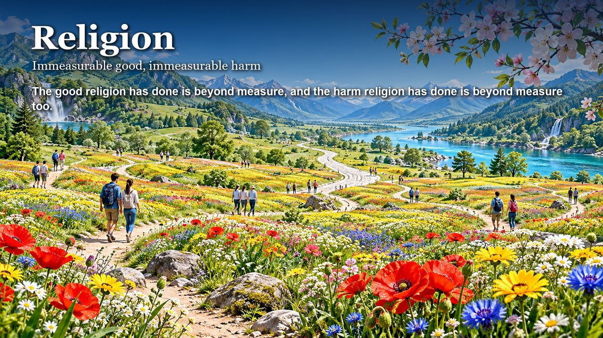
    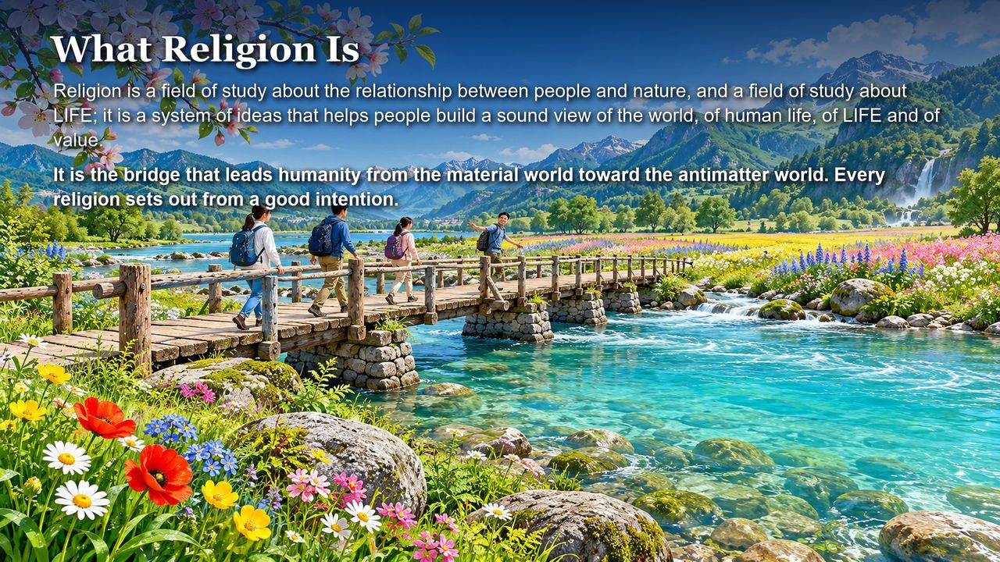
    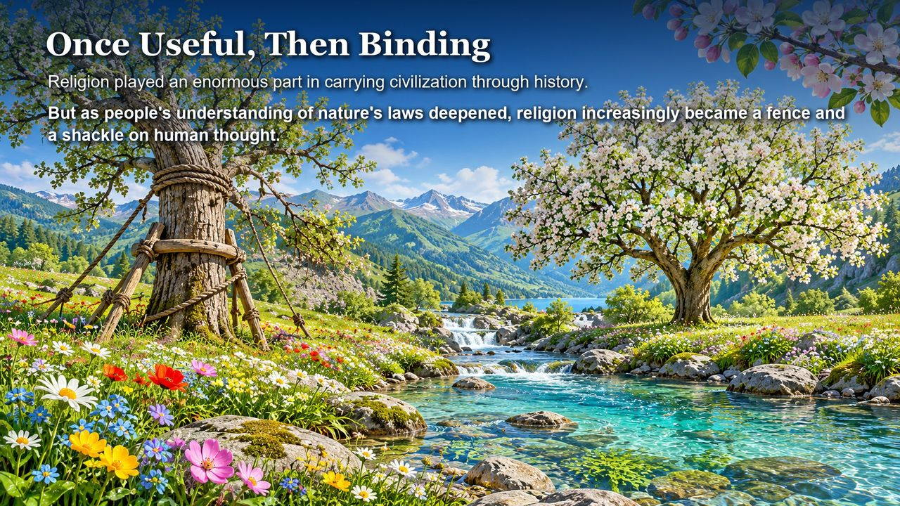
    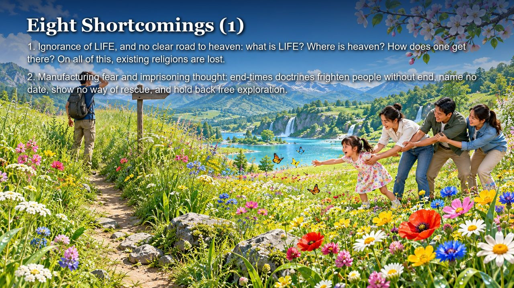
    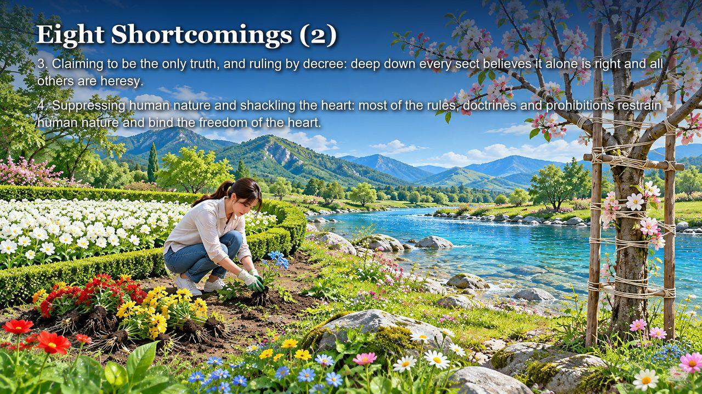
    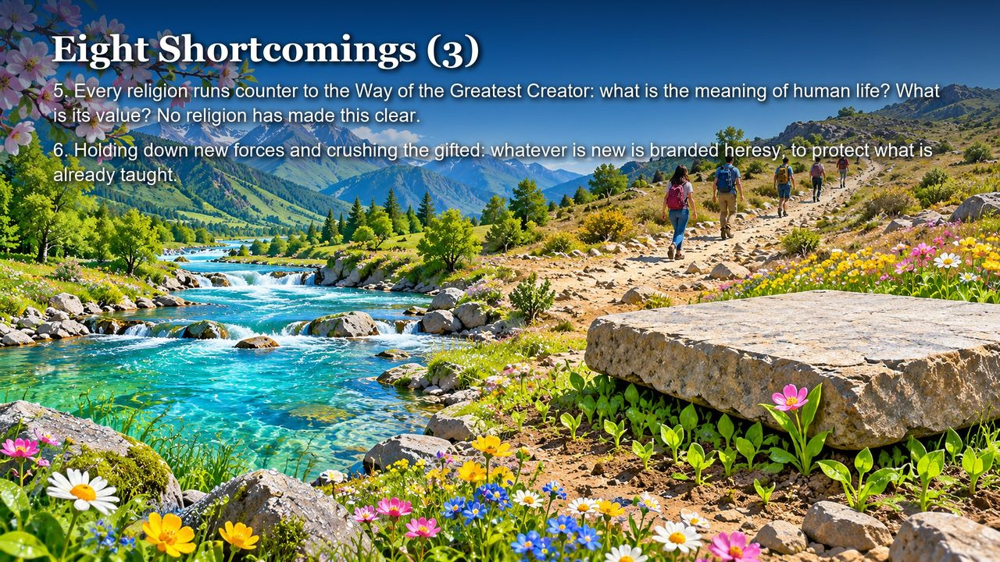
    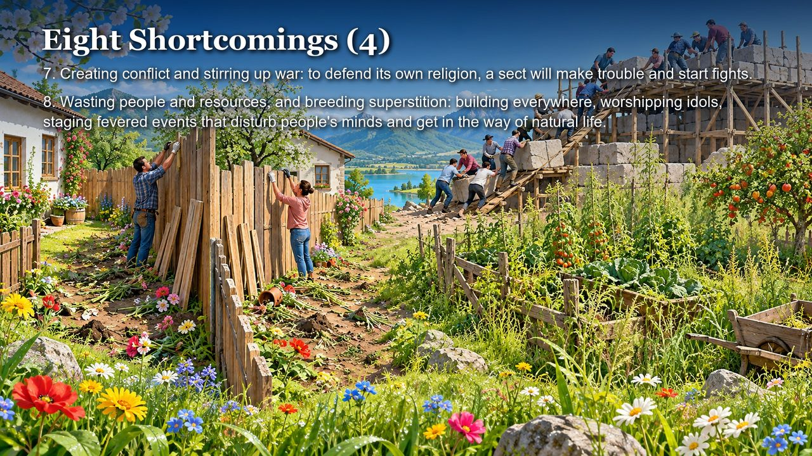
    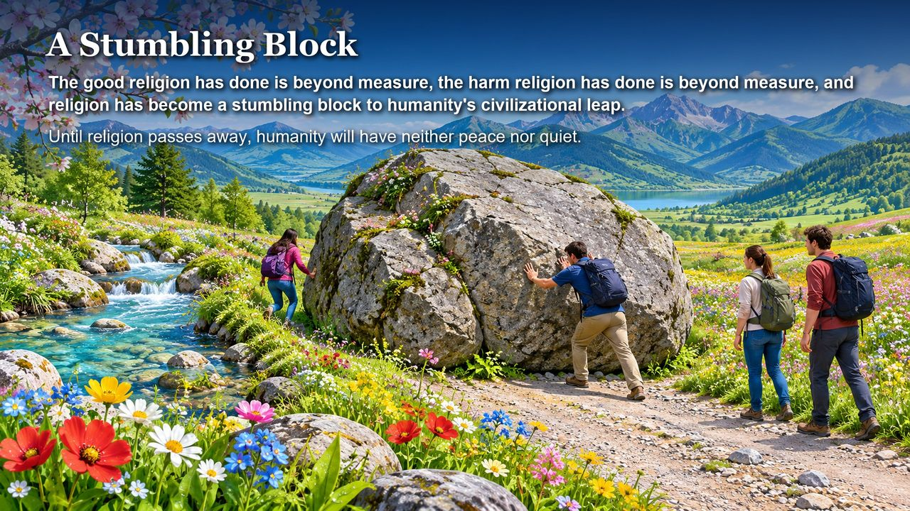
    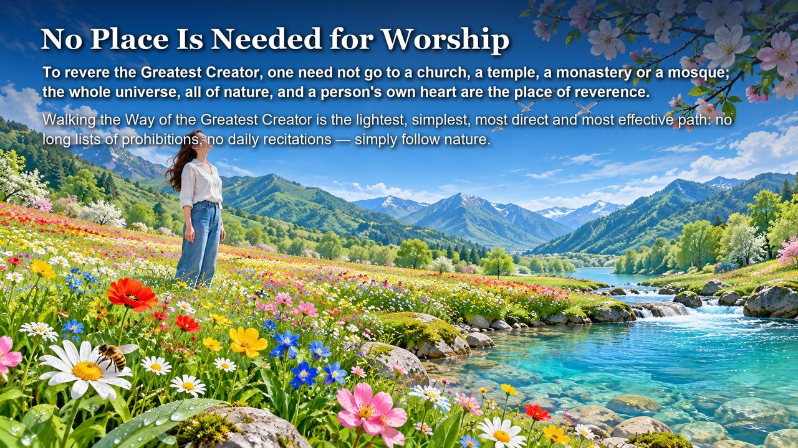
    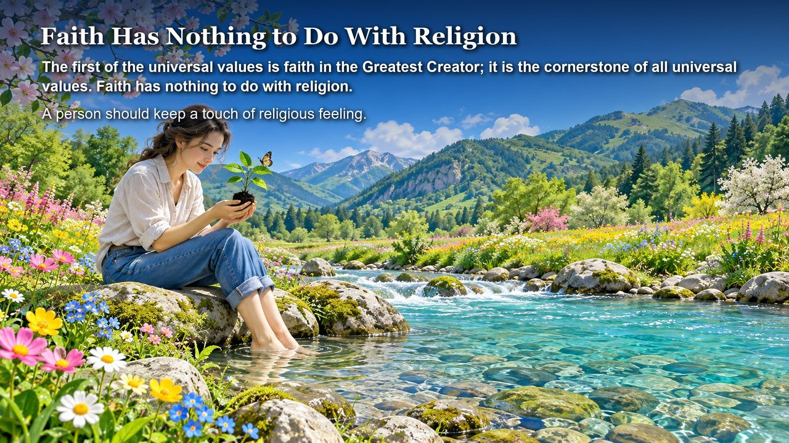
    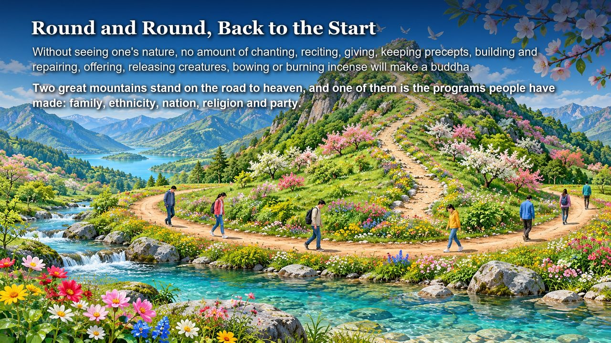
    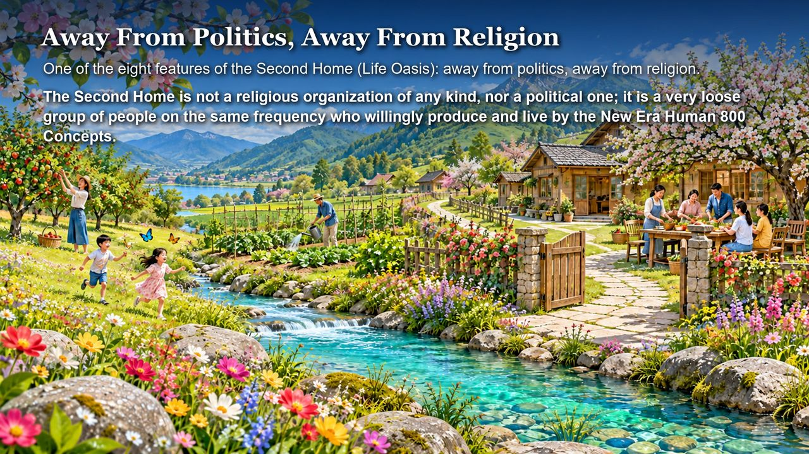
    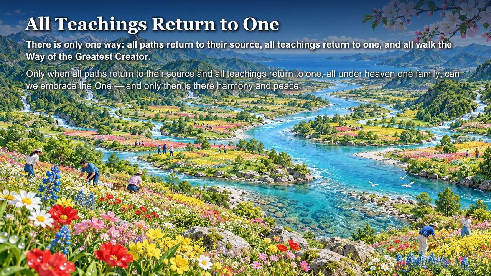
    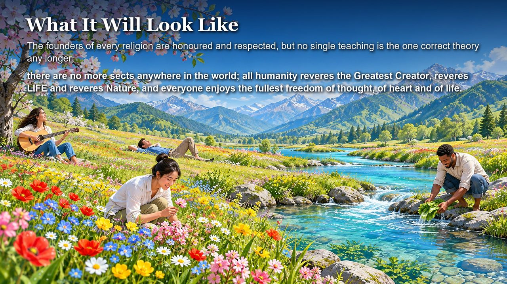

---

## Version Navigation

| Version | Best For | Link |
|---------|----------|------|
| Friendly | New readers, accessible introduction | [Read Friendly Version](/en/religion/friendly/) |
| Academic | In-depth study, systematic analysis | [Read Academic Version](/en/religion/academic/) |
| Internal | Chanyuan Celestials, original texts | [Read Internal Version](/en/religion/internal/) |

---

## Related Entries

[Way of the Greatest Creator](/en/way-of-the-greatest-creator/) · [Civilization (Overview)](/en/civilization-overview/) · [Civilization 3.0](/en/civilization-3-0/) · [Second Home](/en/second-home/) · [Illusory Thinking](/en/illusory-thinking/) · [Kingdom of Heaven](/en/kingdom-of-heaven/) · [Awakening](/en/awakening/) · [New Era Human 800 Concepts](/en/new-era-human-800-concepts/)
