<!-- id: LC-RIR-0001 theme: cosmic-spacetime type: index direction: moral-karma lang: en -->

# Retained Information Space

> In Lifechanyuan terminology, **LIFE** (capitalized) refers to the ontological
> essence of existence — the soul/antimatter structure that persists across
> incarnations — while **life** (lowercase) refers to the experiential stage
> of human existence in this world.

**The Retained Information Space** is one of the 36-dimensional spaces in Lifechanyuan's cosmological system — a universal recording medium in which every word, action, and inner thought of every living being is faithfully documented. These records persist as long as the universe exists; they never vanish.

> "After any matter moves, it leaves information in the places where it has been active — information that does not disappear in the short term. All matter is a kind of 'photographic film' that accurately records everything that has taken place around it. The Retained Information Space is the space that can display scenes that have already occurred."
> — *Chanyuan Corpus · Cosmic Spacetime · 36-Dimensional Spaces*

---

## Core Overview

- **Cosmic dimension**: The Fifth Dimension (beyond the Fourth Dimension of time; preceding the Sixth Dimension of spatial movement)
- **Function**: Holographic, perpetual recording of all speech, action, and thought in the cosmos — in documentary rather than photographic form
- **Relationship to karma**: A person's future is determined by the rewards and penalties applied on the basis of their record in the Retained Information Space
- **Relationship to memory**: Memory is the brain retrieving data from the Retained Information Space — the brain does not store the data itself

---

## Editions

| Edition | Best for | Link |
|---------|----------|------|
| Friendly | New readers seeking a clear overview | [Friendly Edition](/en/retained-info-realm/friendly/) |
| Academic | In-depth philosophical and comparative study | [Academic Edition](/en/retained-info-realm/academic/) |
| Internal | Researchers requiring complete source texts | [Internal Edition](/en/retained-info-realm/internal/) |

---

## Video

<iframe style="width:100%;aspect-ratio:4/3;border:0" src="https://www.youtube-nocookie.com/embed/nZnFRUASFyE" title="Retained Information Space (Lifechanyuan Encyclopedia video)" allowfullscreen></iframe>

## Slides

??? info "📖 Illustrated slides (14 pages, click to expand)"

    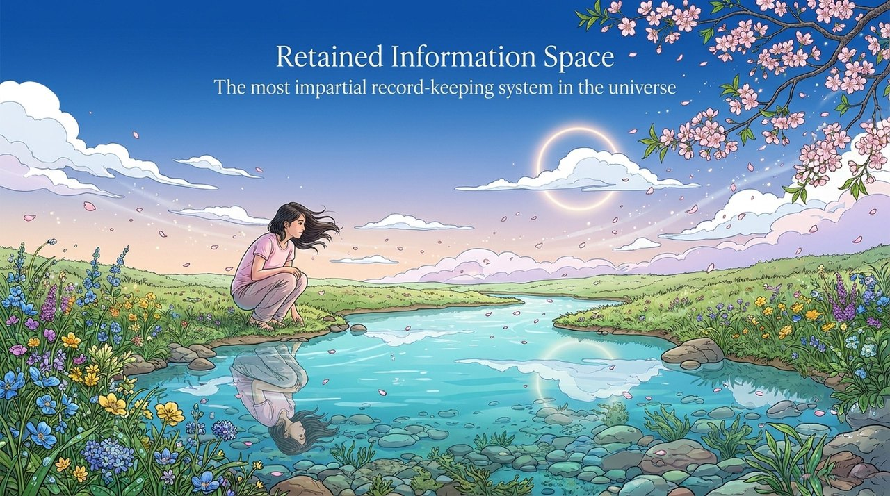
    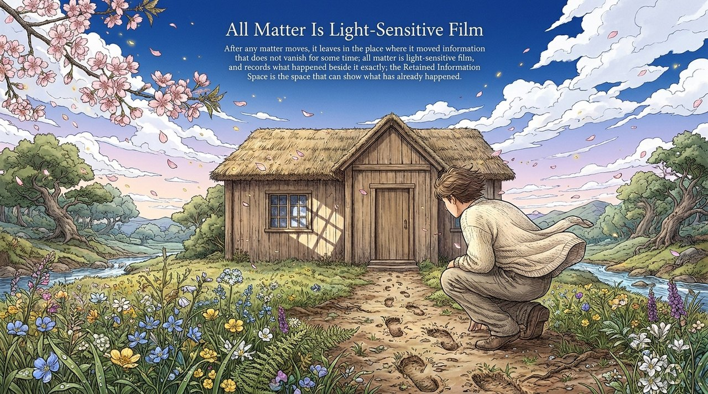
    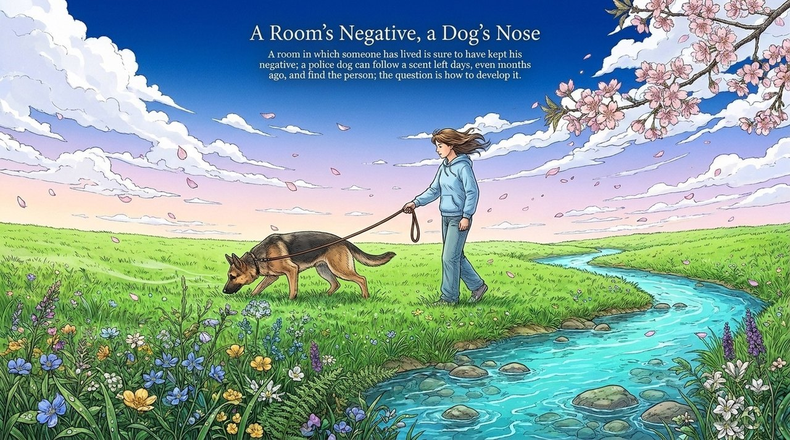
    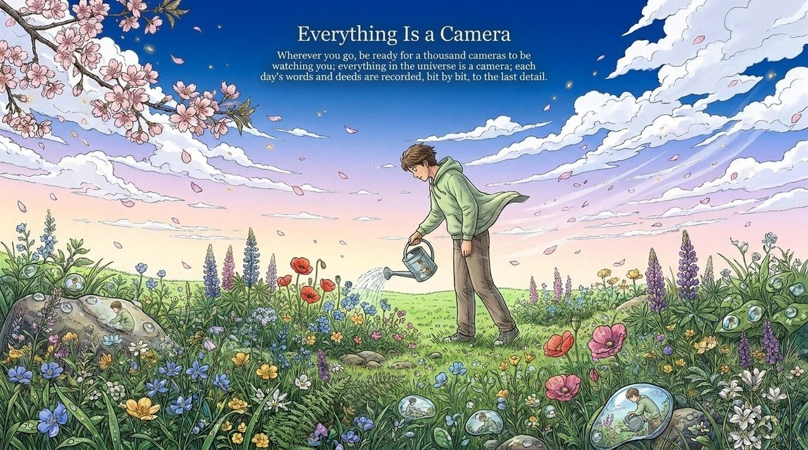
    
    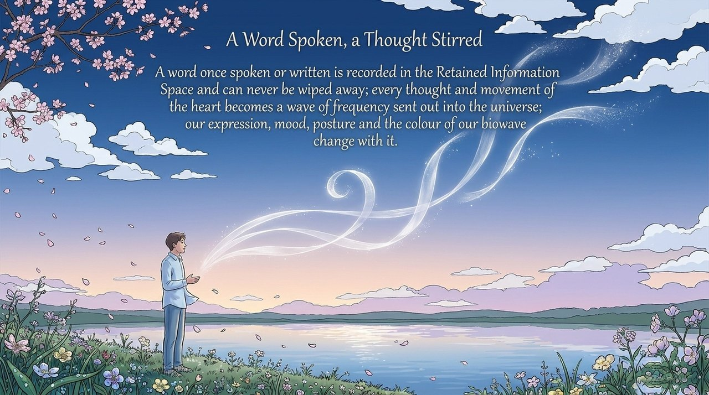
    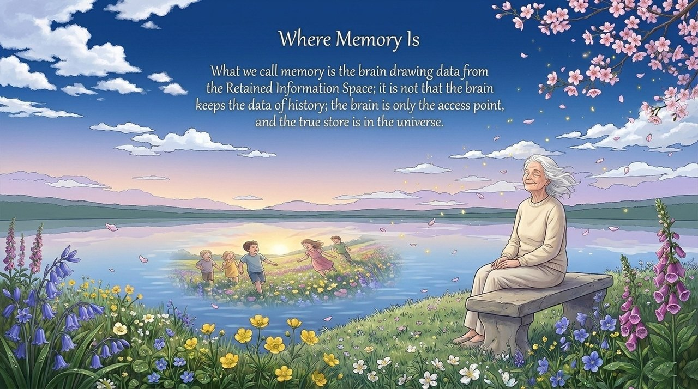
    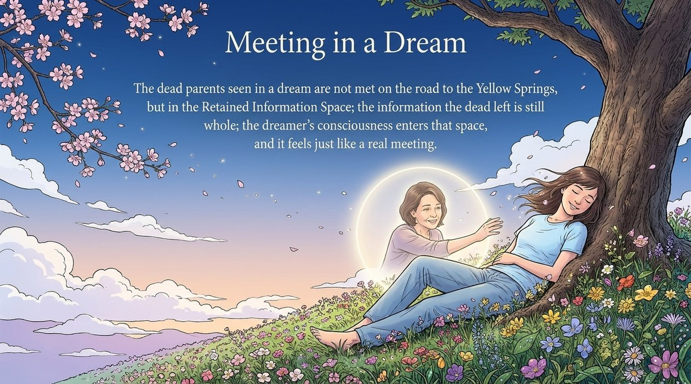
    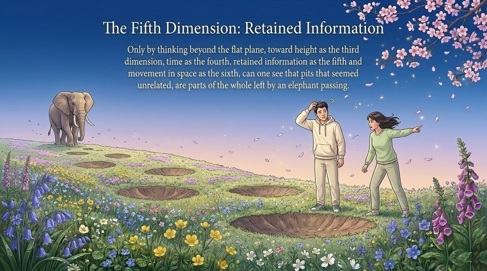
    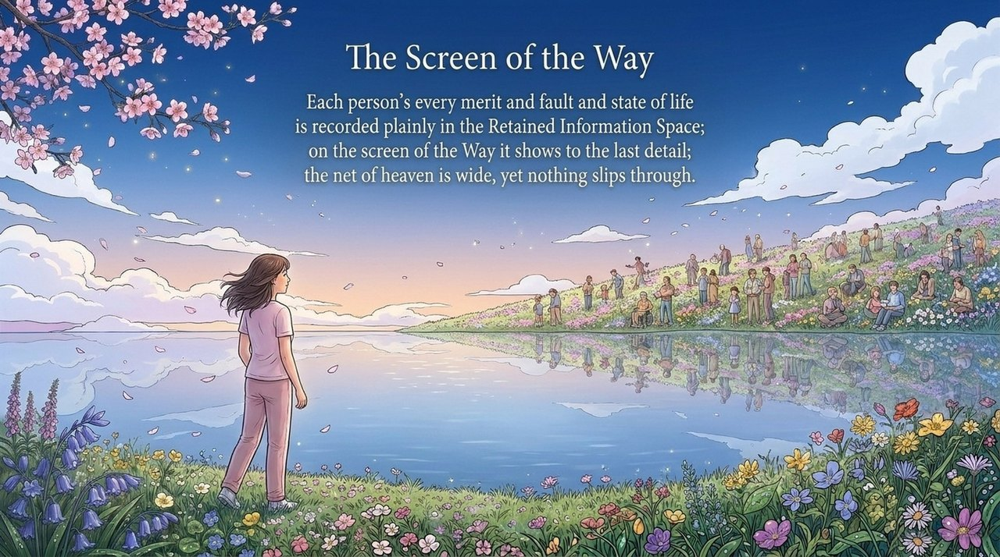
    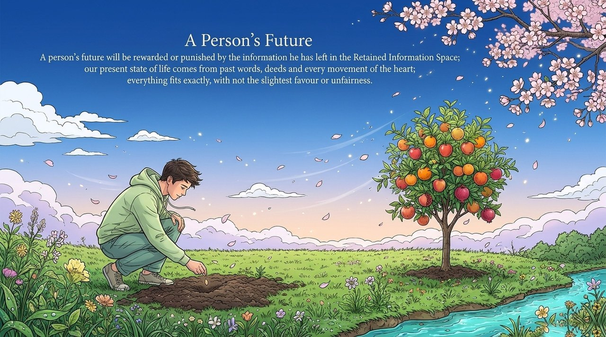
    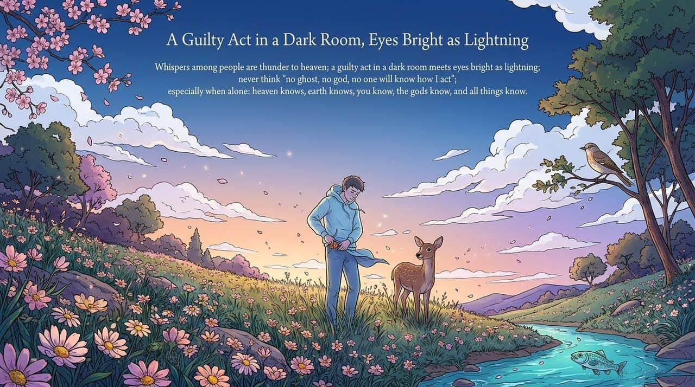
    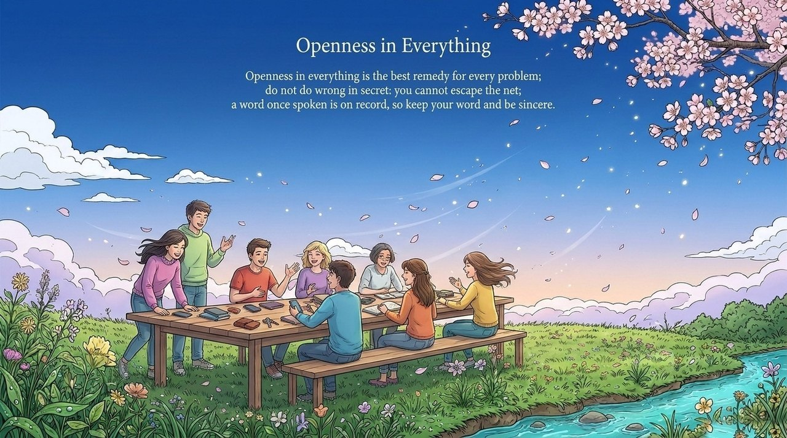
    

---

## Related Entries

- [36-Dimensional Spaces](/en/thirty-six-dimensional-space/)
- [Inter-Realm Transit Continent](/en/celestial-islands-continent/)
- [High-Life Spaces](/en/high-life-spaces/)
- [Mysteries of LIFE](/en/life-mysteries/)
