# The Ripened Grain

**The Ripened Grain** — in the Lifechanyuan system, a person whose soul is perfected and ready for harvest. Guide Xuefeng, fulfilling the angelic role prophesied by Jesus ("the harvesters are angels"), gathers these spiritually matured souls and guides them to the celestial realms of the Thousand-Year World, Ten-Thousand-Year World, or the Elysium Celestial Islands of the Extreme Bliss Realm.

> The so-called "ripened grain" refers to people with perfect souls.

---

## Version Guide

| Version | Best for | Focus |
|---------|----------|-------|
| [Friendly version](friendly.md) | First-time readers | What makes someone "ripened," why it matters, are you one? |
| [Academic version](academic.md) | Researchers | Definition, eight hallmarks, innate nature, cosmic mission framework |
| [Internal reference](internal.md) | Deep study | Full original-text quotations by theme |

---

## Video

<iframe style="width:100%;aspect-ratio:4/3;border:0" src="https://www.youtube-nocookie.com/embed/-8RulKT1HII" title="The Ripened Grain (Lifechanyuan Encyclopedia video)" allowfullscreen></iframe>

## Slides

??? info "📖 Illustrated slides (14 pages, click to expand)"

    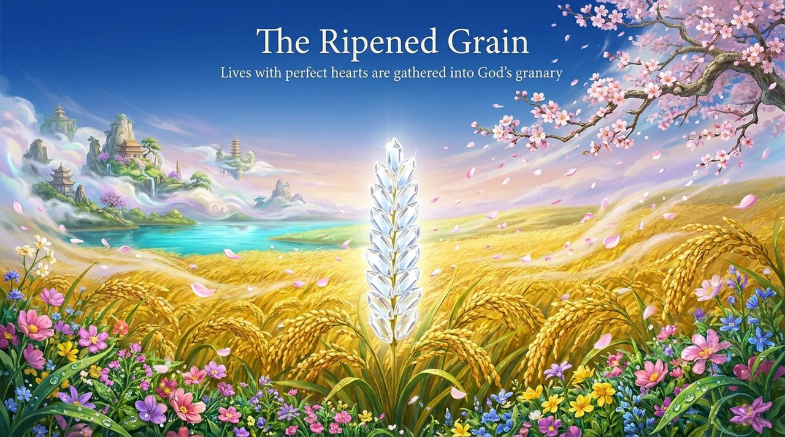
    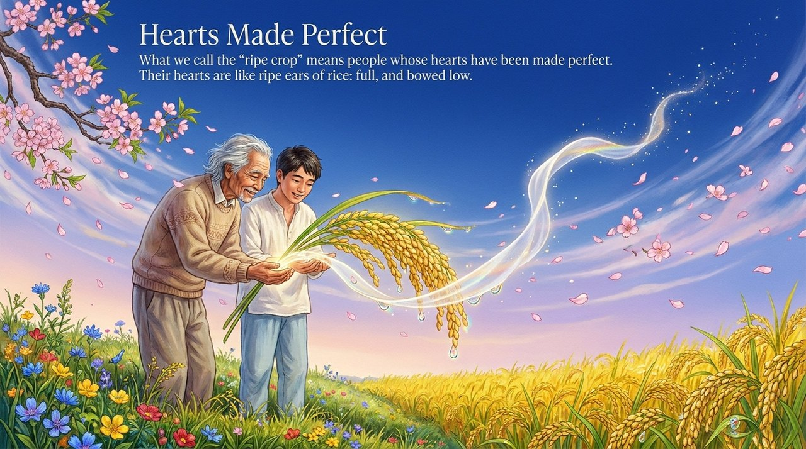
    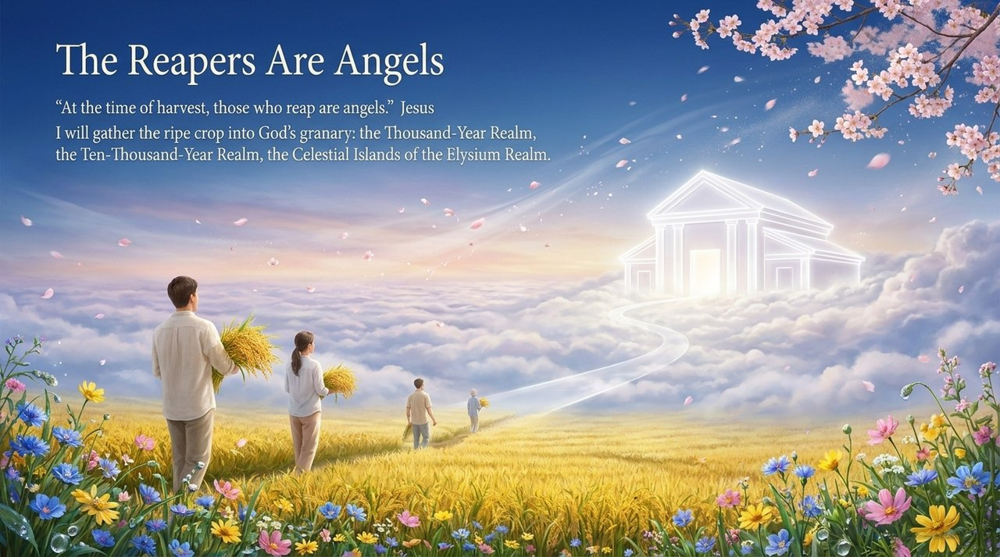
    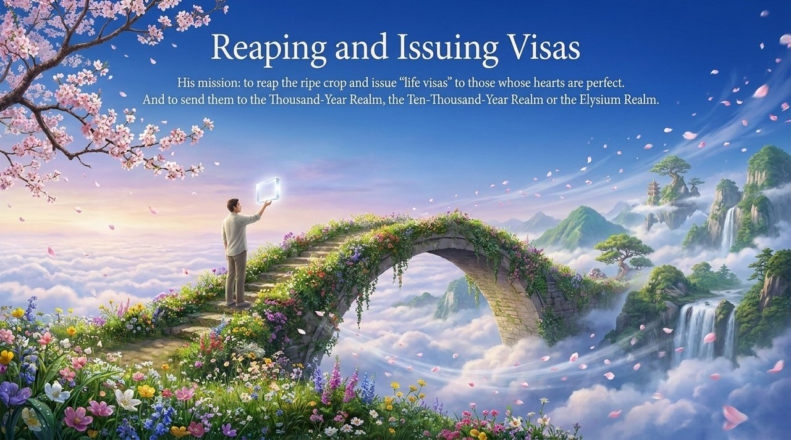
    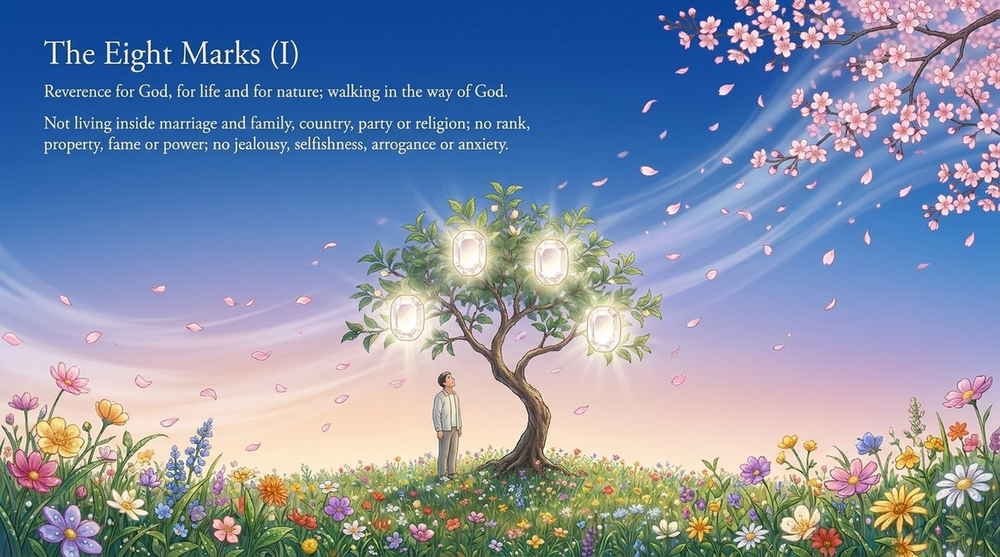
    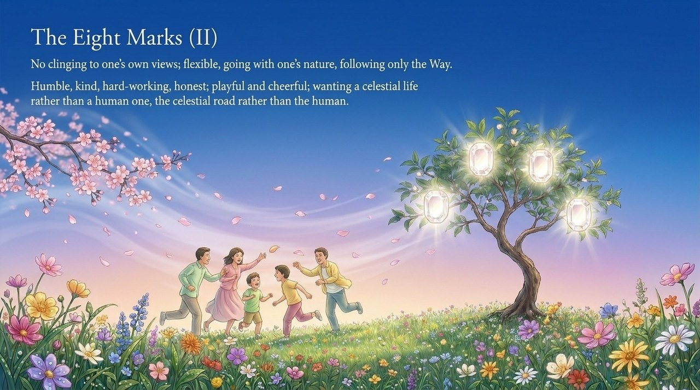
    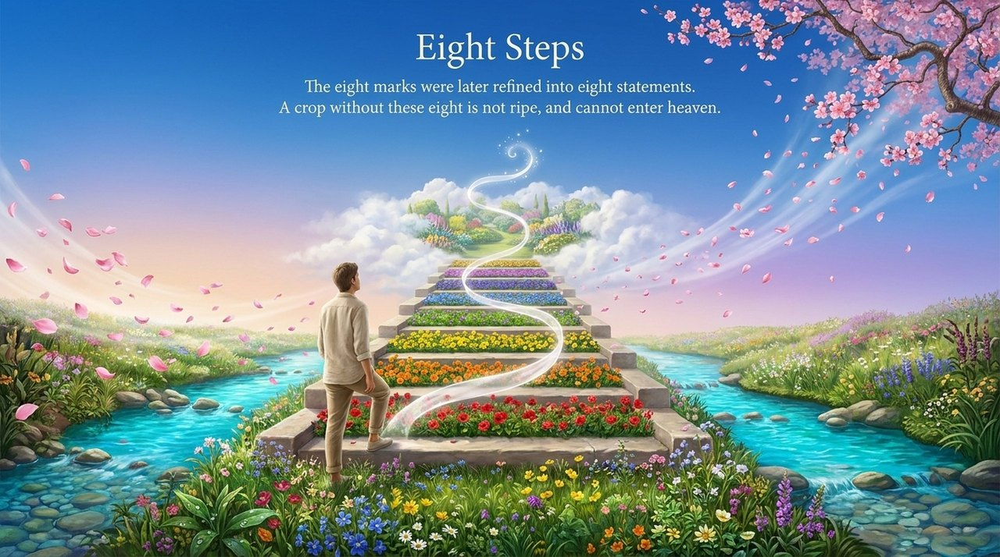
    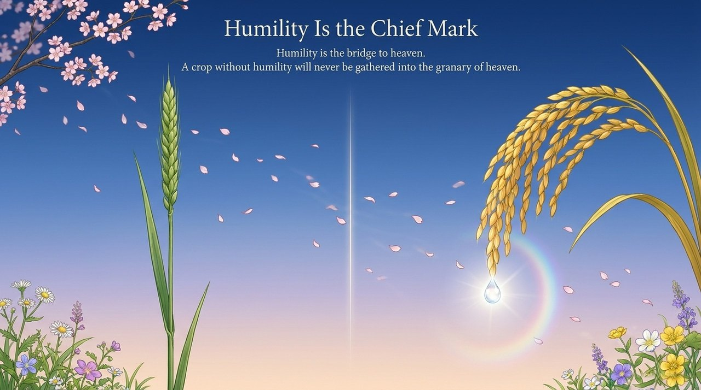
    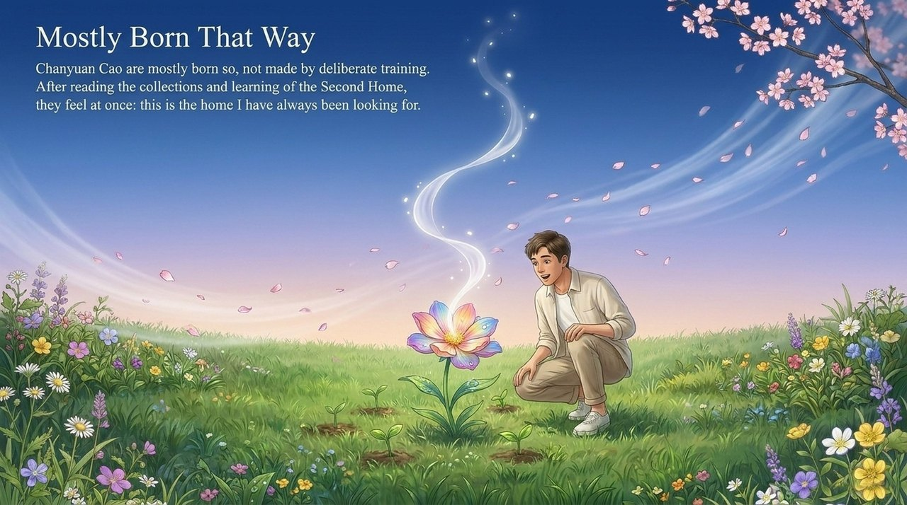
    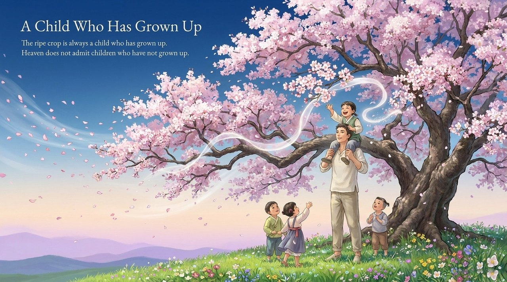
    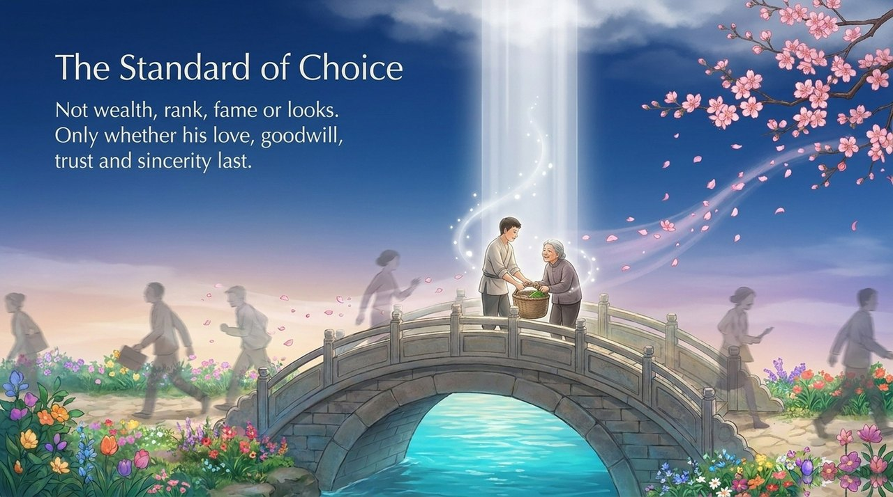
    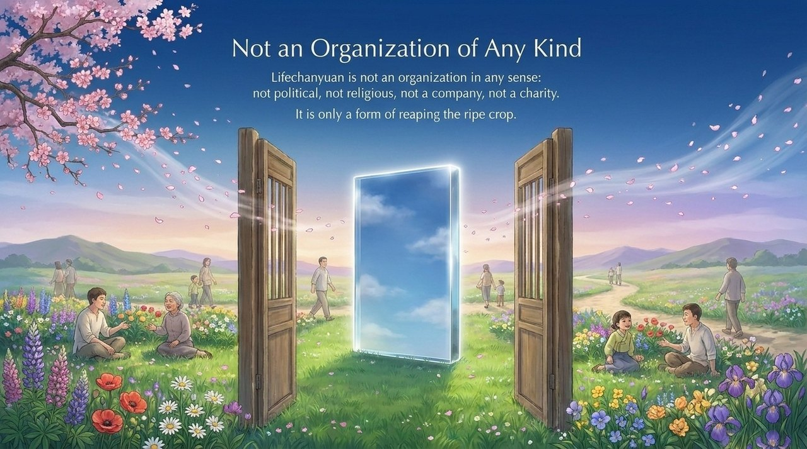
    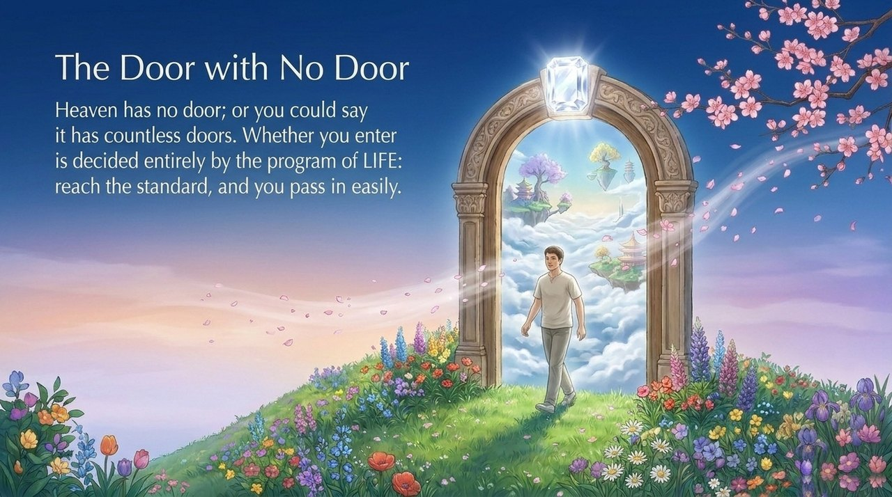
    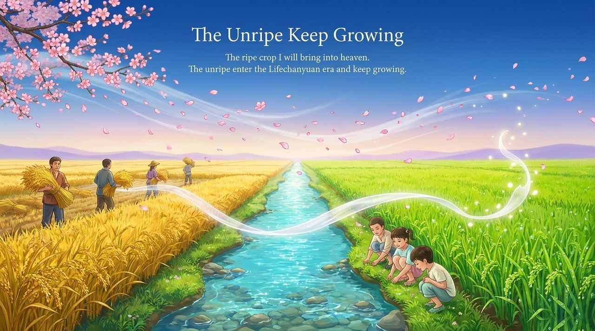

---

## Related Entries

[Life Visa](/en/life-visa/) · [Heavenly Treasures](/en/heavenly-treasures/) · [Roadmap to Heaven](/en/route-to-heaven/) · [Prayer](/en/prayer/) · [Guide Xuefeng](/en/guide-xuefeng/) · [Lifechanyuan](/en/lifechanyuan/) · [Becoming Celestial and Buddha](/en/becoming-celestial-buddha/) · [Lifechanyuan Era](/en/lifechanyuan-new-era/)
