# Romantic Love and Sexuality

> **Romantic love is the precious gift bestowed upon humanity by the Greatest Creator. Sexuality is the inevitable pathway for elevating human nature toward the higher realms of LIFE. Together, romantic love and sexuality form a synchronized dance of two souls.**
>
> — 800 Values for New Era Humanity, Value 644

In the Lifechanyuan framework, romantic love and sexuality represent the most radiant dimensions of human nature — concrete expressions of the Way of the Greatest Creator in human relationships. Lifechanyuan's view of love fundamentally transcends conventional moral frameworks: love is not to be chained by marriage, not confined by exclusivity, but flows freely through natural affinity, without possession, without jealousy, with freedom and mutual respect as its guiding principles. Its ultimate horizon is to transcend attached love, cultivate selfless love, become a "supreme lover," and ascend to the realm of Celestials.

| Version | Best for | Focus |
|---------|----------|-------|
| [Friendly version](friendly.md) | First-time readers | Understanding Lifechanyuan's view of love in plain terms |
| [Academic version](academic.md) | Researchers | Systematic analysis of the six frameworks and cultivation path |
| [Internal reference](internal.md) | Deep study | Complete source texts with full citations |

---

## Core Definition

Romantic love is an attribute and precious gift endowed upon humans by the Greatest Creator — all genuine love is pure, true, good, and beautiful. Sexuality is the inevitable pathway for elevating human nature toward the higher life spaces. Together, they are among the most precious constitutive elements of LIFE itself, the source of all joy, and the most essential driving force of life.

Lifechanyuan's guiding principle for love: **Follow natural affinity, move with genuine feeling, act on spontaneous impulse — when feeling arises let the heart shine, when feeling passes let the heart rest empty; no attachment, no obsession, no possession, no monopoly; proceed when both hearts are willing, do not force what is not in resonance; use the happiness and joy of both as the measure.**

---

## Video

<iframe style="width:100%;aspect-ratio:4/3;border:0" src="https://www.youtube-nocookie.com/embed/sFdaPGXKV-w" title="Romantic Love and Sexuality (Lifechanyuan Encyclopedia video)" allowfullscreen></iframe>

## Slides

??? info "📖 Illustrated slides (14 pages, click to expand)"

    
    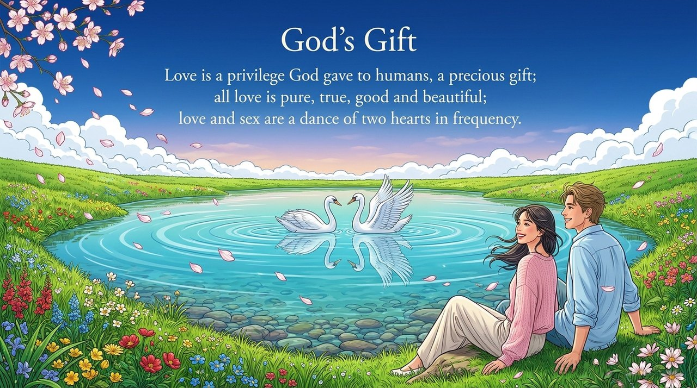
    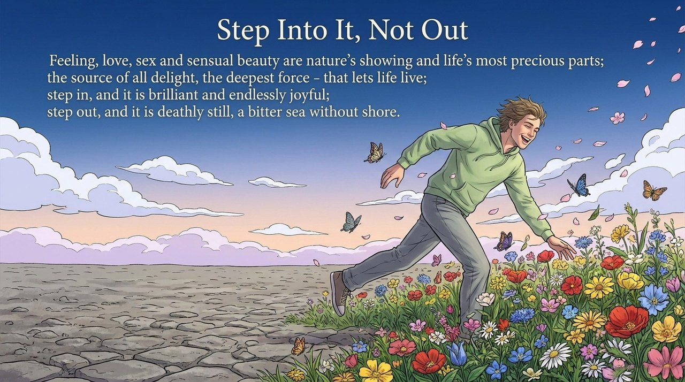
    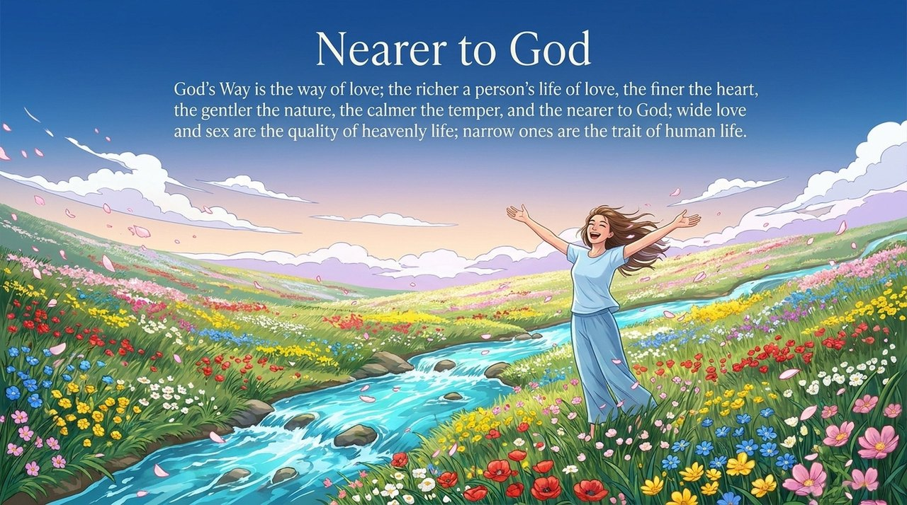
    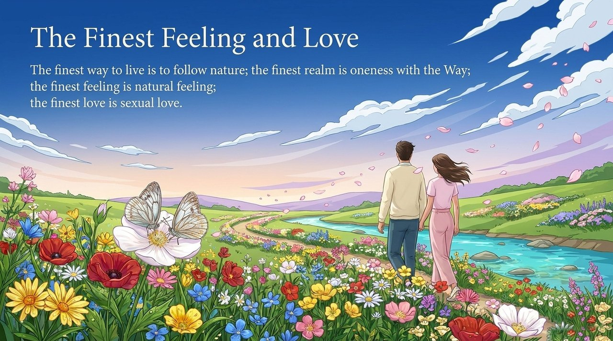
    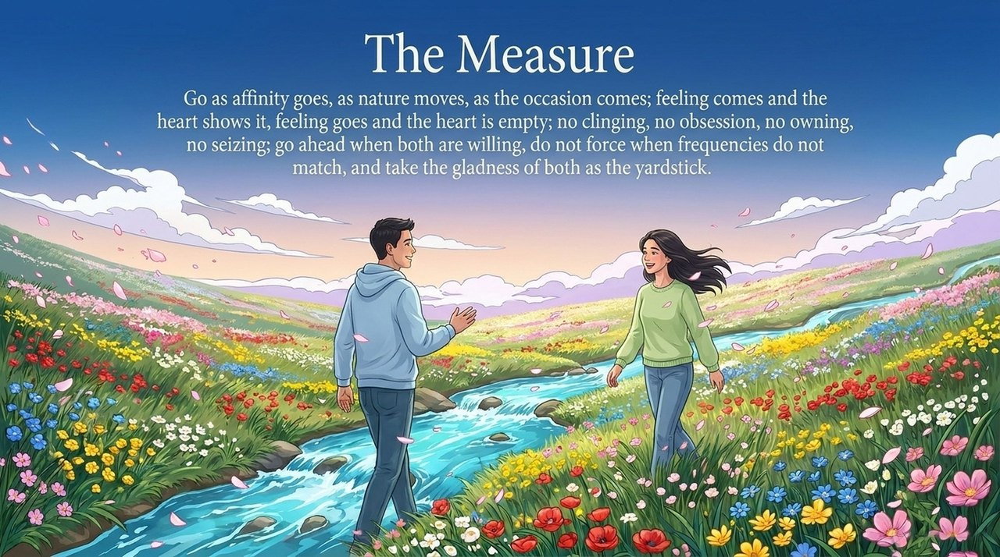
    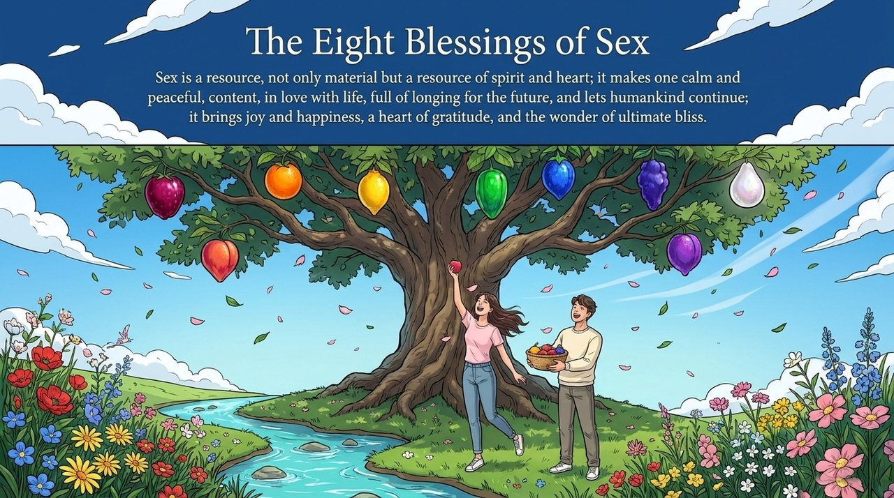
    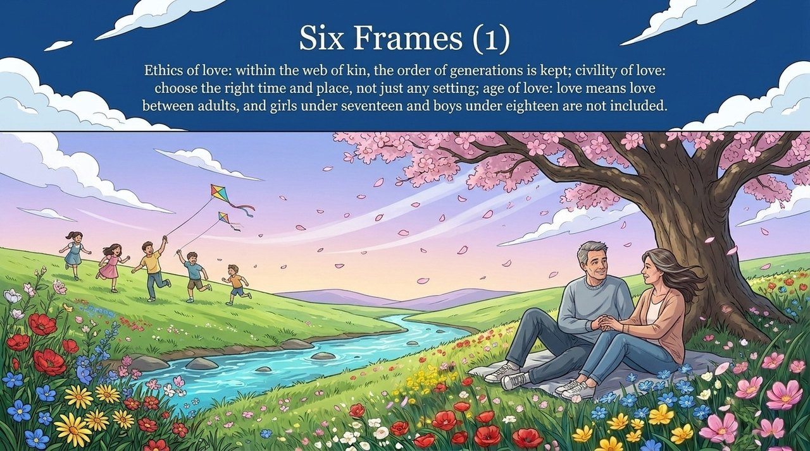
    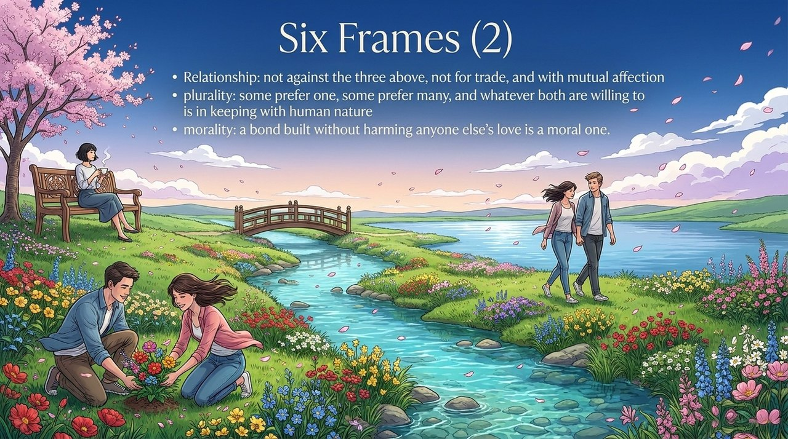
    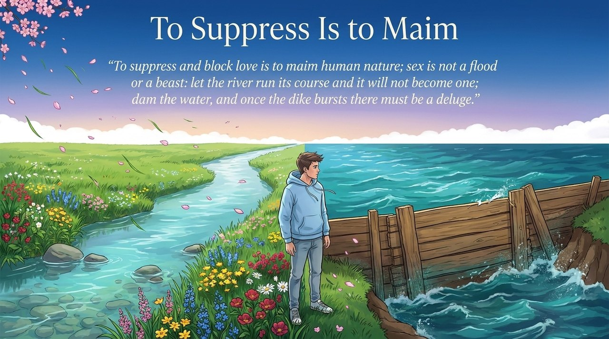
    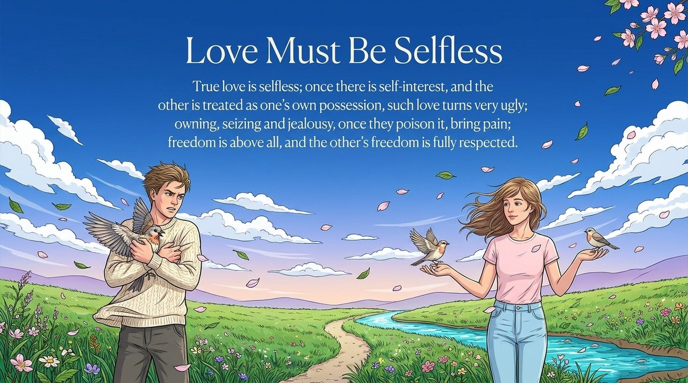
    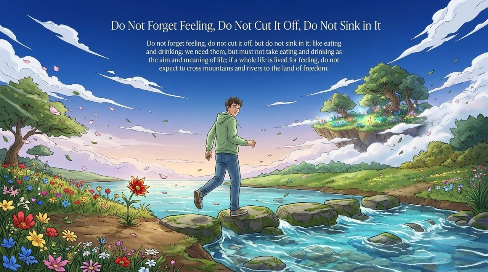
    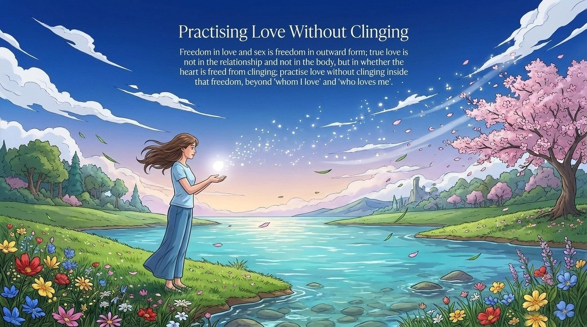
    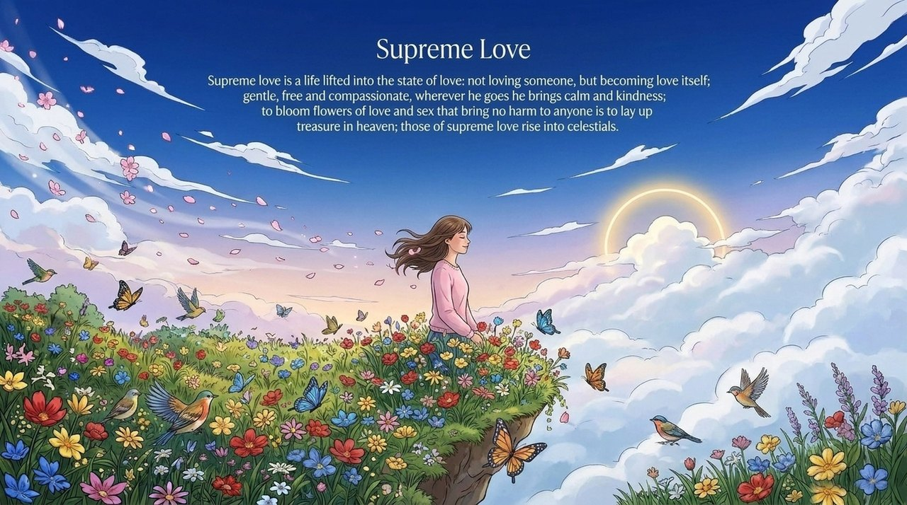

---

## Related Entries

- [Love](/en/love/)
- [Affection](/en/qing-affection/)
- [Move with Authentic Nature](/en/suixing-er-dong/)
- [Resonance](/en/resonance/)
- [Selfishness and Selflessness](/en/zisi-wusi/)
- [Heart Without Attachment](/en/xinwu-suozhu-guaai/)
- [Elysian Realm of Bliss](/en/jilemiaojing/)
- [Becoming Celestial and Buddha](/en/becoming-celestial-buddha/)
