# Sages and Worthies

**Sages** (*shèngrén* 圣人) and **Worthies** (*xiánrén* 贤人) represent the two highest tiers in Lifechanyuan's five-level classification of humanity. The Worthy, driven primarily by reason, is the backbone of civilized society — morally upright, balanced, and standing one threshold away from sagehood. The Sage, driven by spirituality, is equated with the celestial (*xiān* 仙) — a being whose wisdom flows directly from resonance with the Tao rather than from accumulated knowledge. Together they form the apex of human possibility within this framework.

> Humanity is divided into five types: the Muddled (driven by instinct), the Worldly (driven by desire), the Common (driven by emotion), the Worthy (driven by reason), and the Sage (driven by spirituality). The Sage is the Celestial.
>
> — *New Era 800 Concepts*, 4th Edition, No. 22

---

## Video

<iframe style="width:100%;aspect-ratio:4/3;border:0" src="https://www.youtube-nocookie.com/embed/1Q2q1V5OAtw" title="Sages and Worthies (Lifechanyuan Encyclopedia video)" allowfullscreen></iframe>

## Slides

??? info "📖 Illustrated slides (14 pages, click to expand)"

    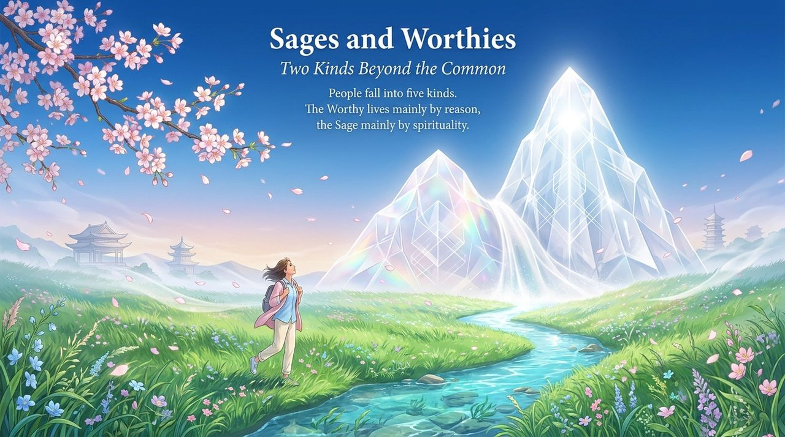
    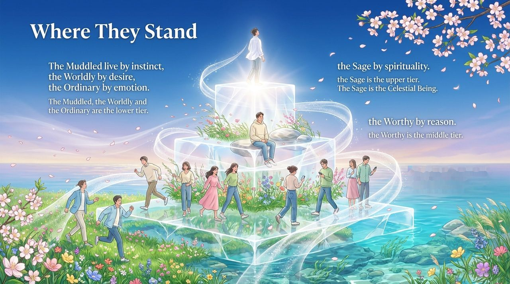
    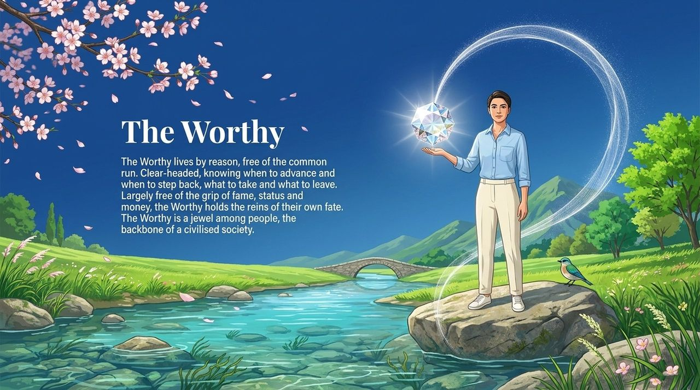
    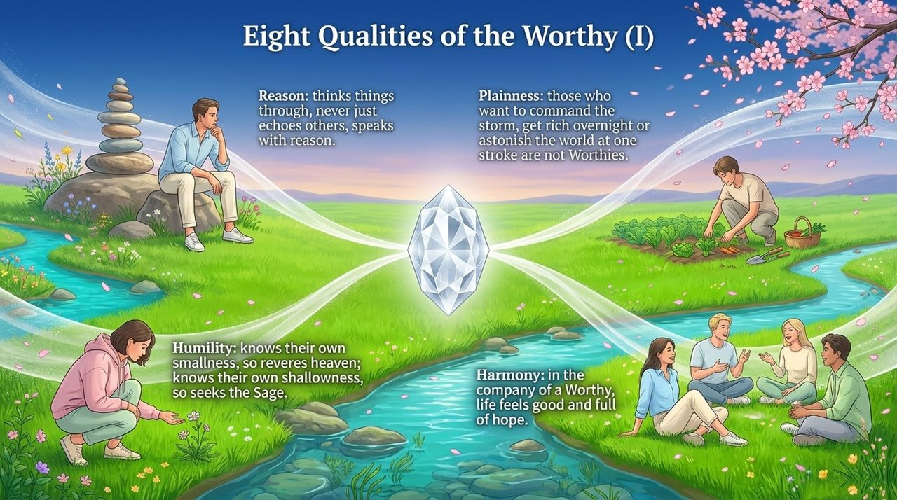
    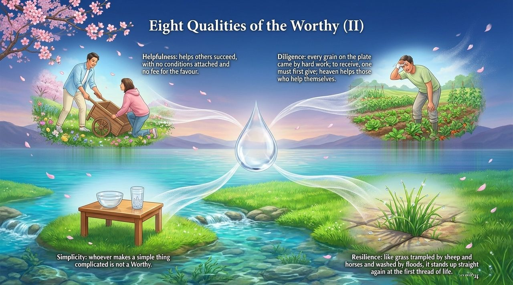
    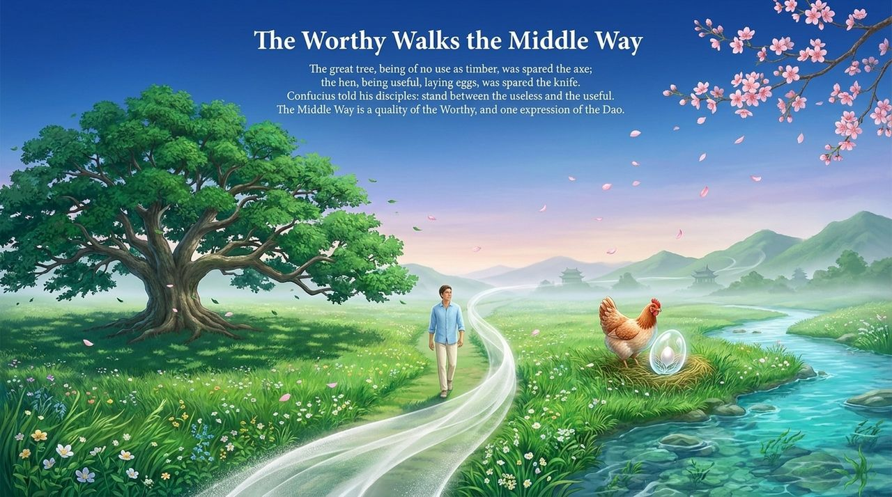
    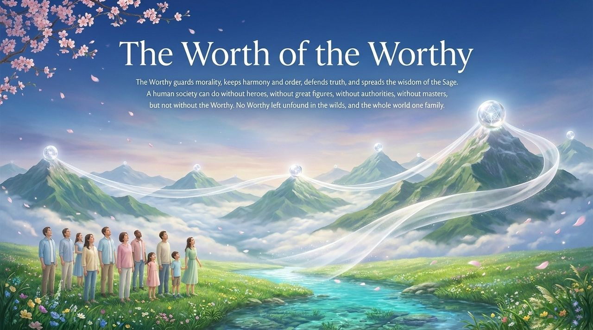
    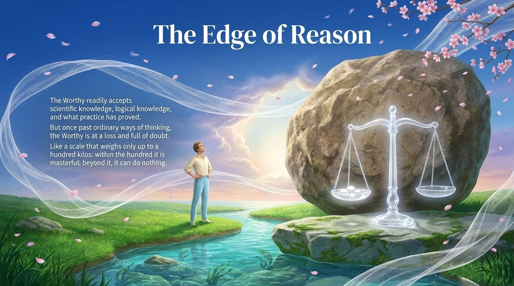
    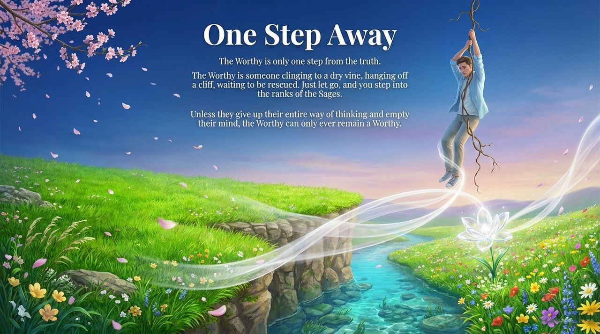
    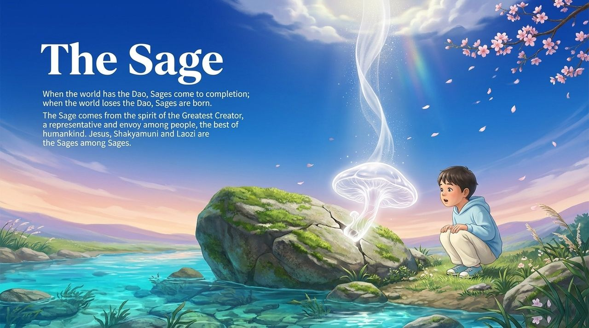
    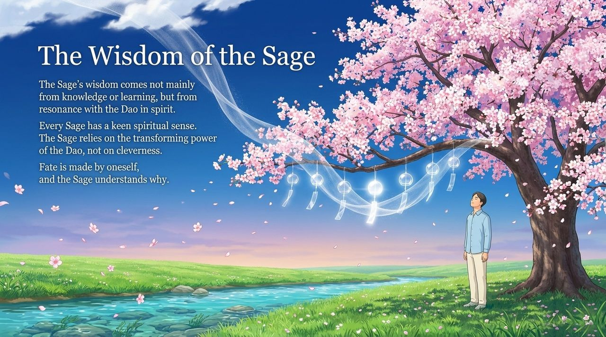
    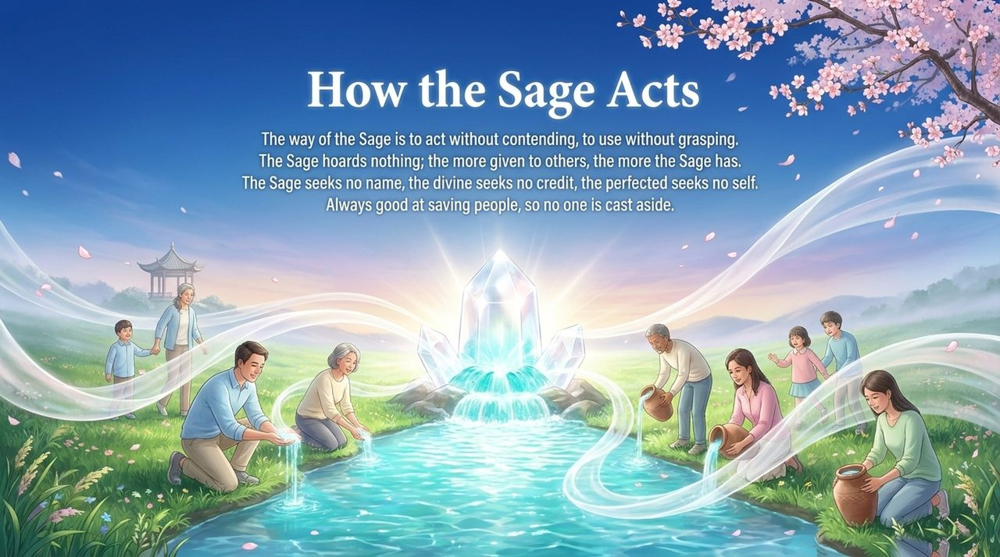
    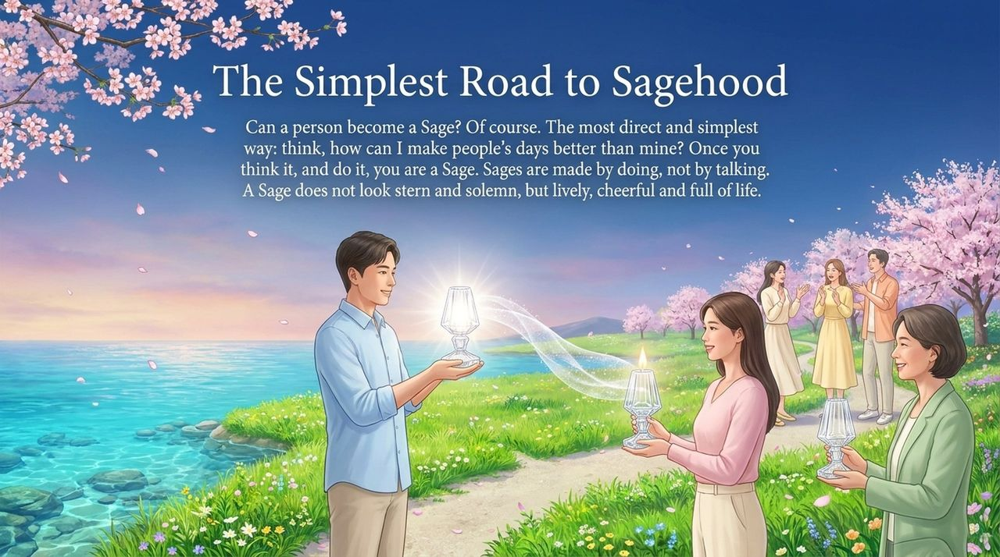
    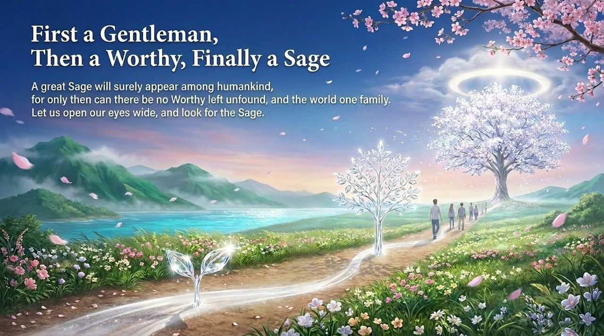

---

## Version Navigation

| Version | Best for | Focus |
|---------|----------|-------|
| [Friendly version](friendly.md) | First-time readers | What sages and worthies are · how to become one |
| [Academic version](academic.md) | Researchers | Five-tier framework · comparative analysis · key citations |
| [Internal reference](internal.md) | Deep study | Guide's original text · full source compilation |

---

## Related Entries

[People Classification](/en/people-classification/) · [Value, Meaning and Purpose of Life](/en/value-meaning-purpose-of-life/) · [Becoming Celestial and Buddha](/en/becoming-celestial-buddha/) · [Awakening](/en/awakening/) · [Spirituality](/en/spirituality/) · [Eight Thinking Ladders](/en/eight-thinking-ladders/) · [No-Self No-Form](/en/no-self-no-form/) · [Humility](/en/humility/) · [Self-Nature](/en/self-nature/)
