<!-- id: LC-ZW-0263-EN theme: Thinking type: Navigation direction: Civilizational Evolution · Levels of LIFE lang: en -->

# Sensory · Rational · Intellectual · Spiritual

In the Lifechanyuan system, sensory awareness, rational thinking, intellectual understanding, and spiritual freedom are four ascending levels of LIFE consciousness — and four successive eras of human civilization. They share the common root *xìng* (性), the essential nature that pervades all existence: to be sensory is to feel and receive this nature; to be rational is to understand and order it; to be intellectual is to know and grasp it; to be spiritual is to flow with it freely and spontaneously. From Lemuria to Atlantis to the present age and into the coming Lifechanyuan Era, humanity has been climbing this ladder — and the destination is a spiritual civilization where people live like celestial beings.

---

## Version Navigation

| Version | Best for | Focus |
|---------|----------|-------|
| [Friendly version](friendly.md) | First-time readers | Four levels explained · civilization timeline · how to cultivate |
| [Academic version](academic.md) | Researchers | Textual analysis · comparison with Western philosophy and Buddhism |
| [Internal reference](internal.md) | Deep study | Complete original passages · multi-source synthesis |

---

## Video

<iframe style="width:100%;aspect-ratio:4/3;border:0" src="https://www.youtube-nocookie.com/embed/Uaa7jlvA_bk" title="Sensory, Rational, Intellectual and Spiritual Awareness (Lifechanyuan Encyclopedia video)" allowfullscreen></iframe>

## Slides

??? info "📖 Illustrated slides (14 pages, click to expand)"

    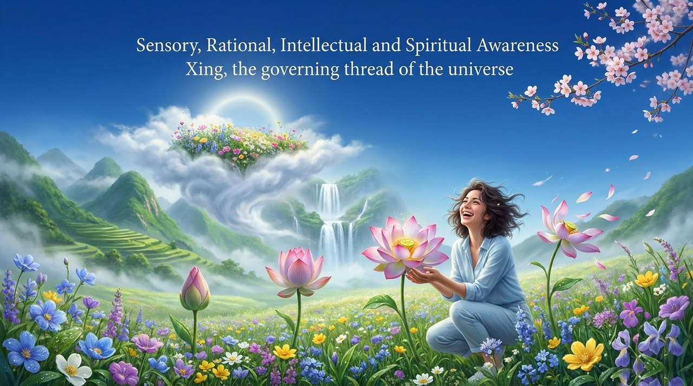
    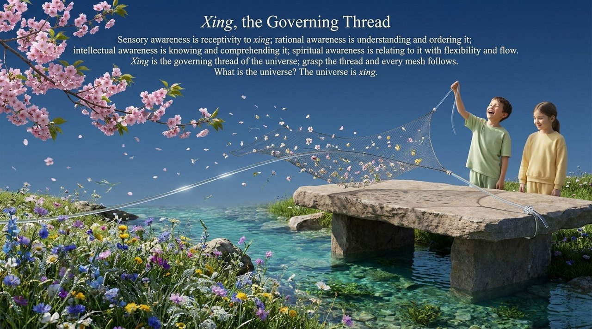
    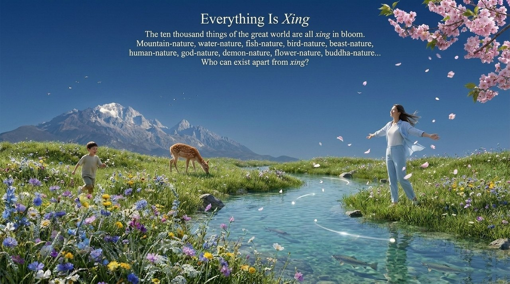
    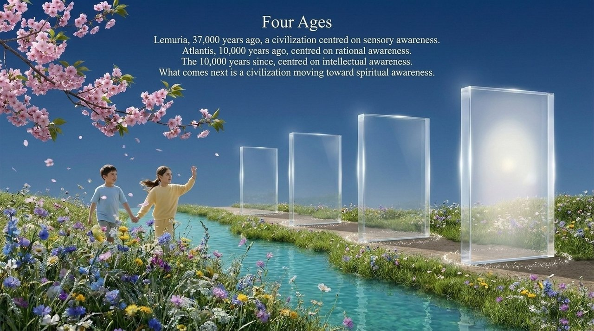
    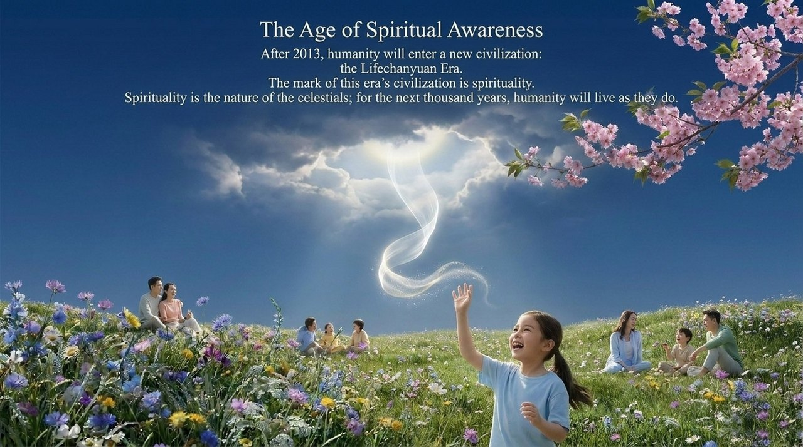
    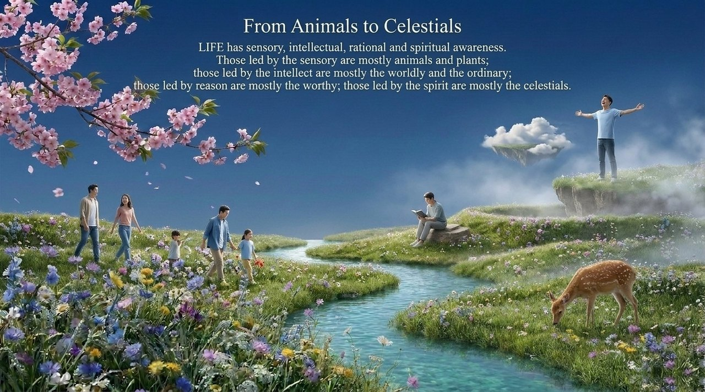
    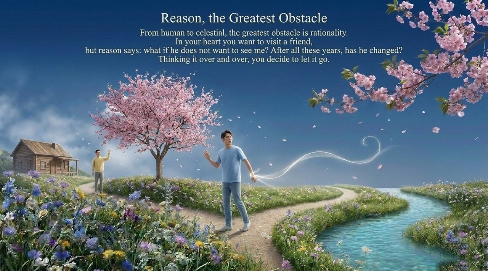
    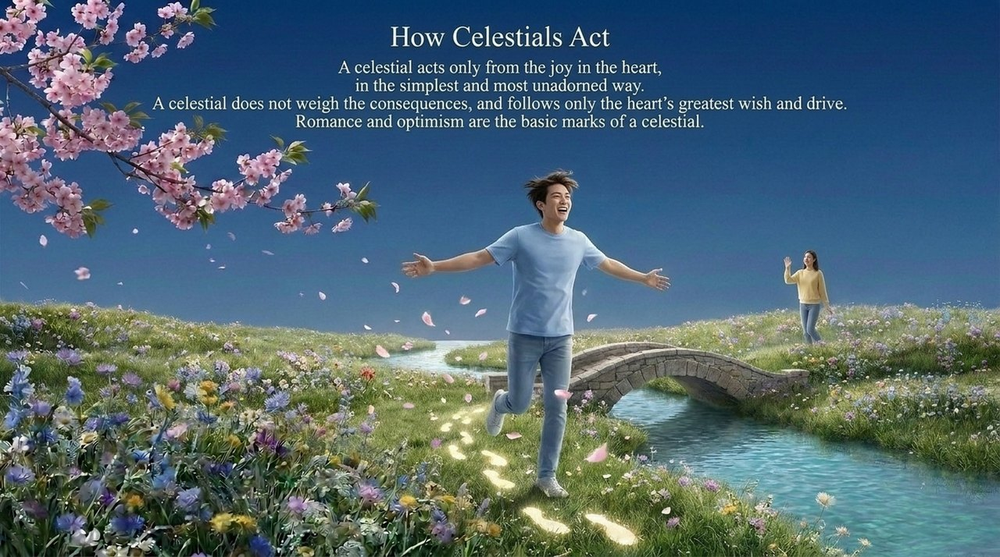
    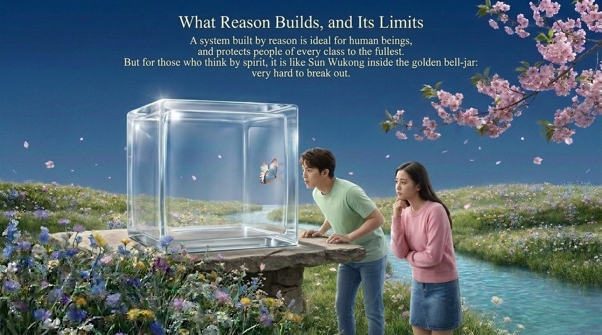
    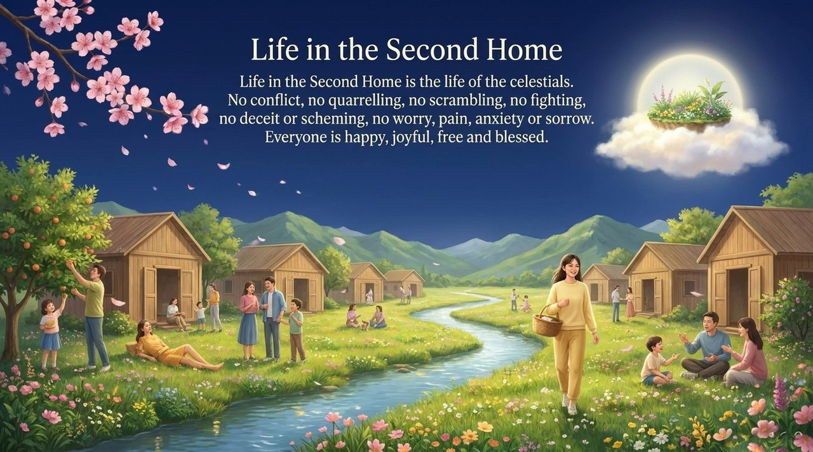
    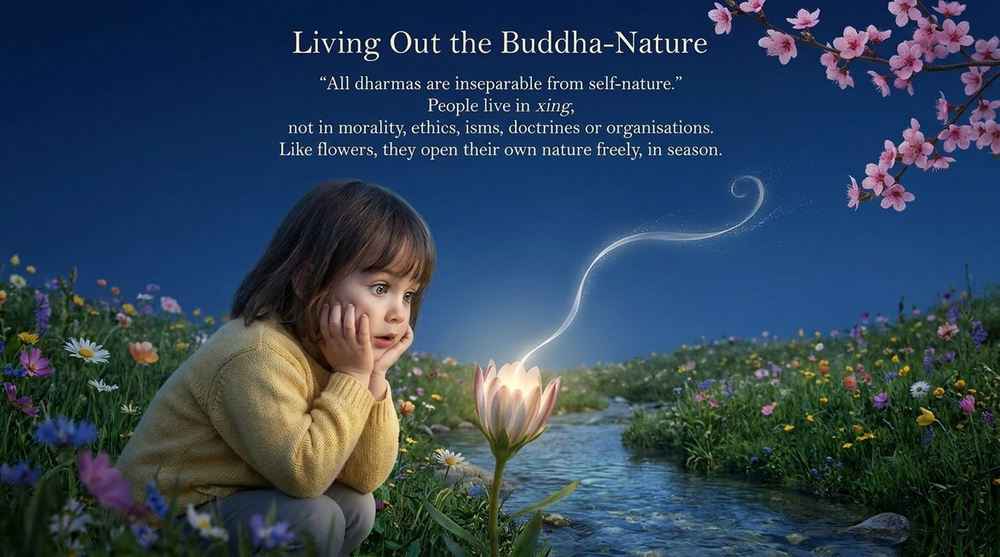
    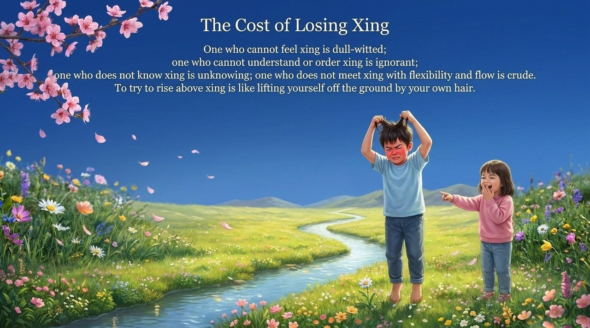
    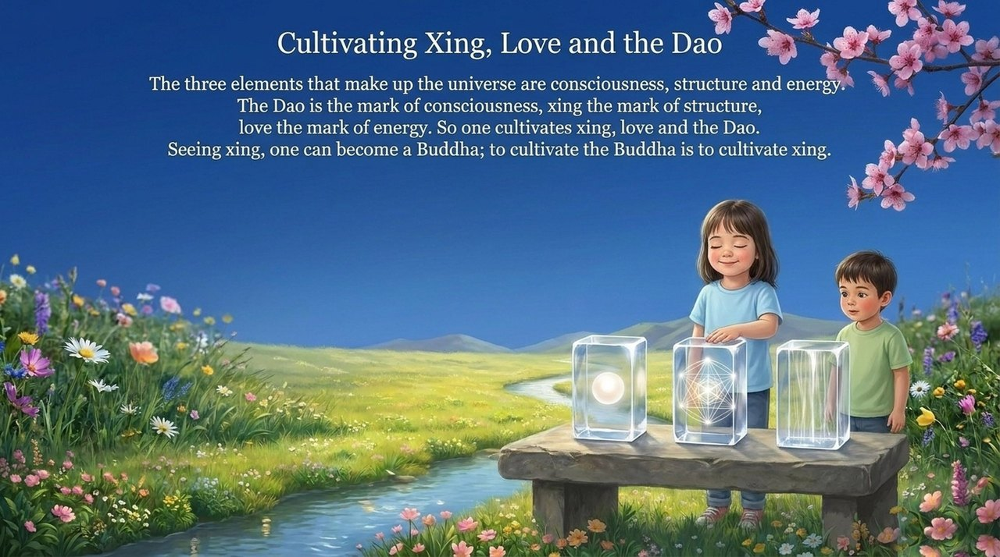
    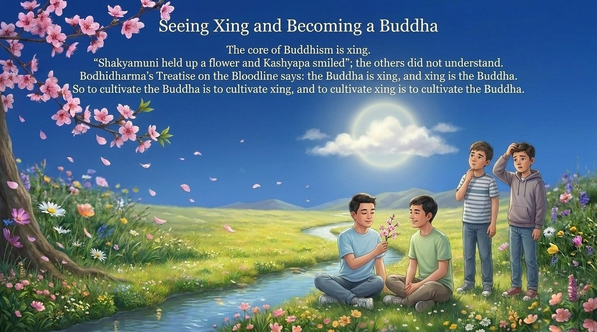

---

## Related Entries

[Self-Nature · Buddha-Nature · Original Nature](/en/self-nature/) · [Spiritual Thinking](/en/spiritual-thinking/) · [Eight Thinking Ladders](/en/eight-thinking-ladders/) · [Illuminate the Mind, See True Nature](/en/illuminate-mind-see-nature/) · [Becoming Celestial](/en/becoming-celestial/) · [Becoming Buddha](/en/becoming-buddha/) · [Natural · Inborn · Habitual Nature](/en/tianxing-bingxing-xixing/) · [Spiritual Life](/en/spiritual-life/) · [The Lifechanyuan Era](/en/lifechanyuan-new-era/)
