<!-- id: LC-SSR-0001-EN theme: The Greatest Creator and the Tao type: index direction: The Greatest Creator and the Tao lang: en -->

# The Highest Goodness Is Like Water (Shàng Shàn Ruò Shuǐ)

**The Highest Goodness Is Like Water** (上善若水, *shàng shàn ruò shuǐ*) is Lifechanyuan's development of a central teaching from Laozi's *Tao Te Ching*. Xuefeng holds that water "approaches the Tao" and embodies its full nature through seven qualities: nourishing all things without contending, cleansing without claiming a high place, taking the shape of any container, transforming into mist and cloud while settling anywhere without complaint, remaining supple and humble, flowing when it can flow and resting when it can rest, and holding to its source through every change. Those who seek the highest good should learn from water; those who seek the Tao should learn from water. One who can live as water does becomes one with the Tao and flows on through eternity.

---

## Version Navigation

| Version | Best for | Focus |
|---------|----------|-------|
| [Friendly version](friendly.md) | First-time readers | What are water's qualities? Why is "being like water" the highest goodness? |
| [Academic version](academic.md) | Researchers | Water–Tao correspondence, the dialectic of softness overcoming hardness, links to other Lifechanyuan concepts |
| [Internal reference](internal.md) | Deep study | Complete source quotations from the Wisdom Chapter |

---

## Video

<iframe style="width:100%;aspect-ratio:4/3;border:0" src="https://www.youtube-nocookie.com/embed/ASVlNqf0rFM" title="The Highest Goodness Is Like Water (Lifechanyuan Encyclopedia video)" allowfullscreen></iframe>

## Slides

??? info "📖 Illustrated slides (14 pages, click to expand)"

    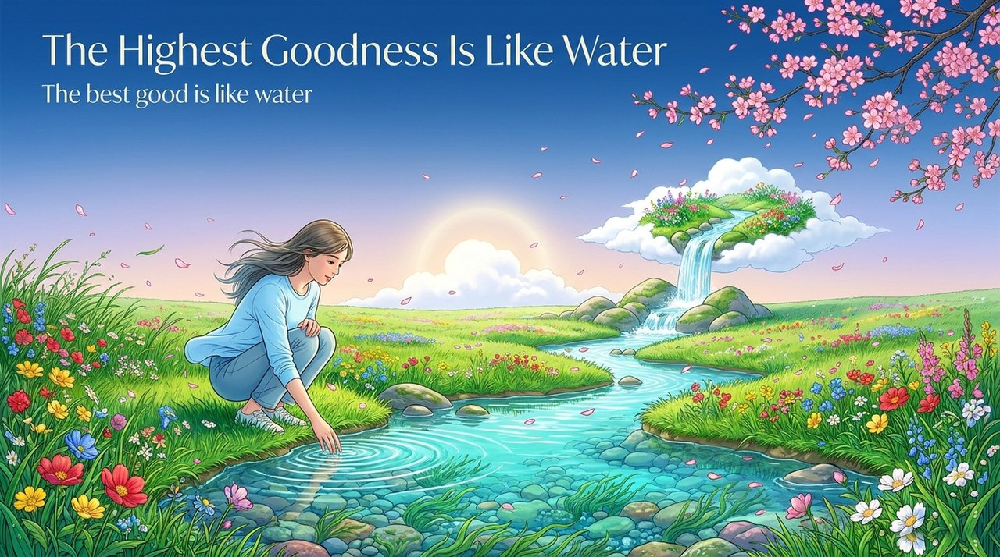
    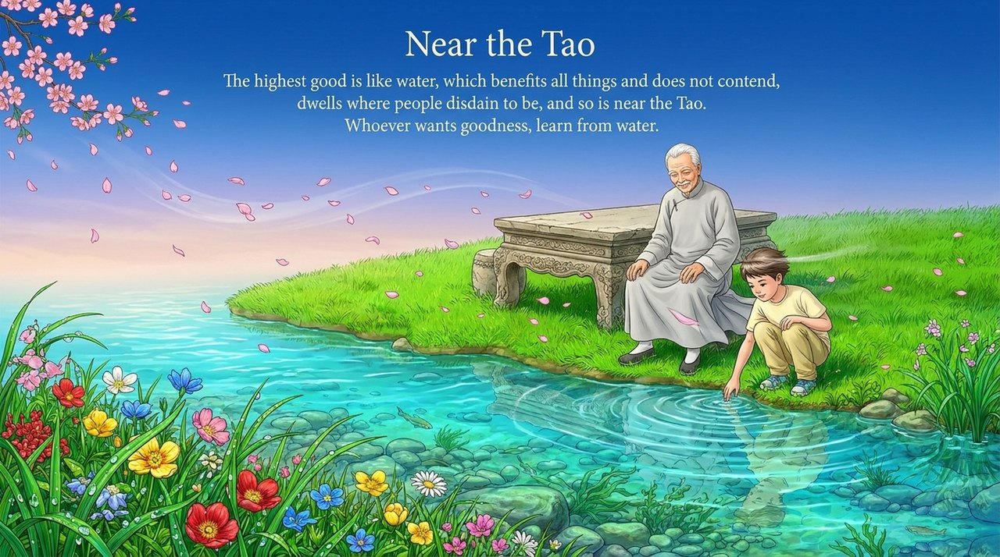
    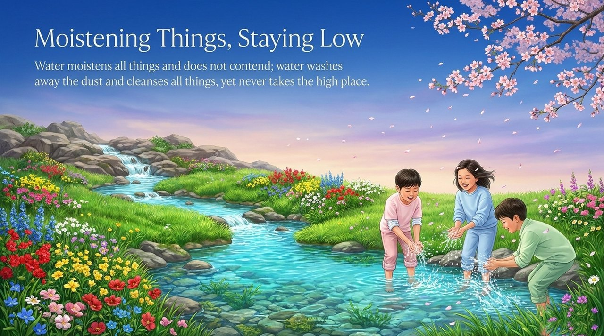
    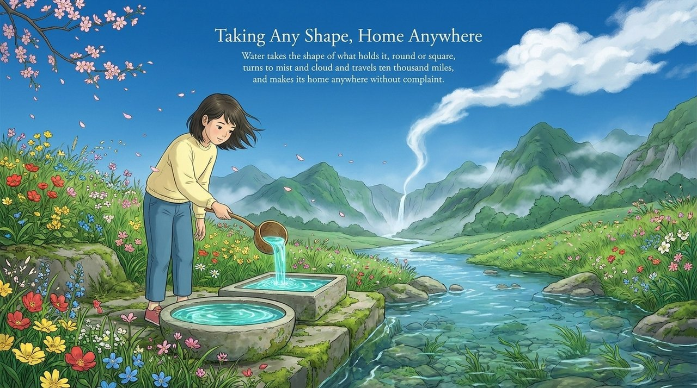
    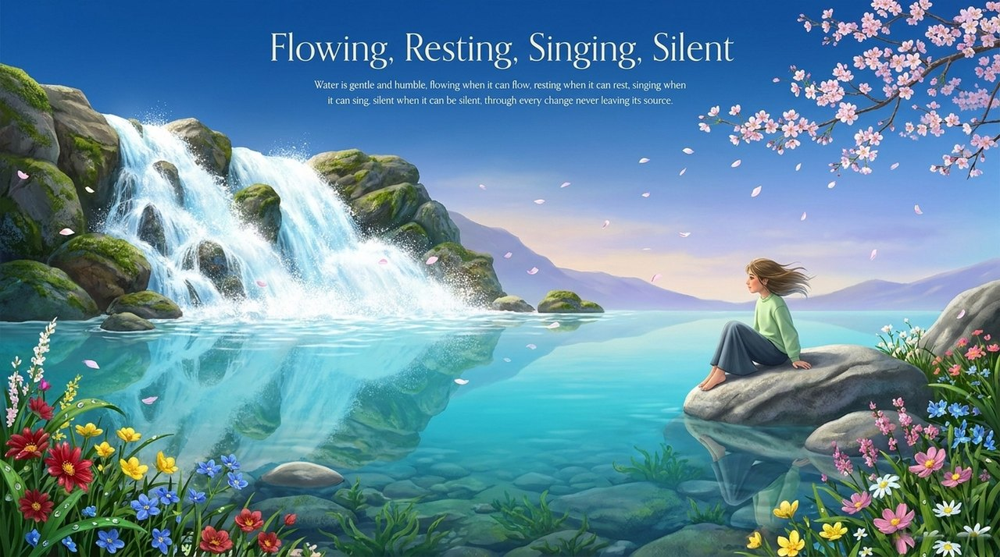
    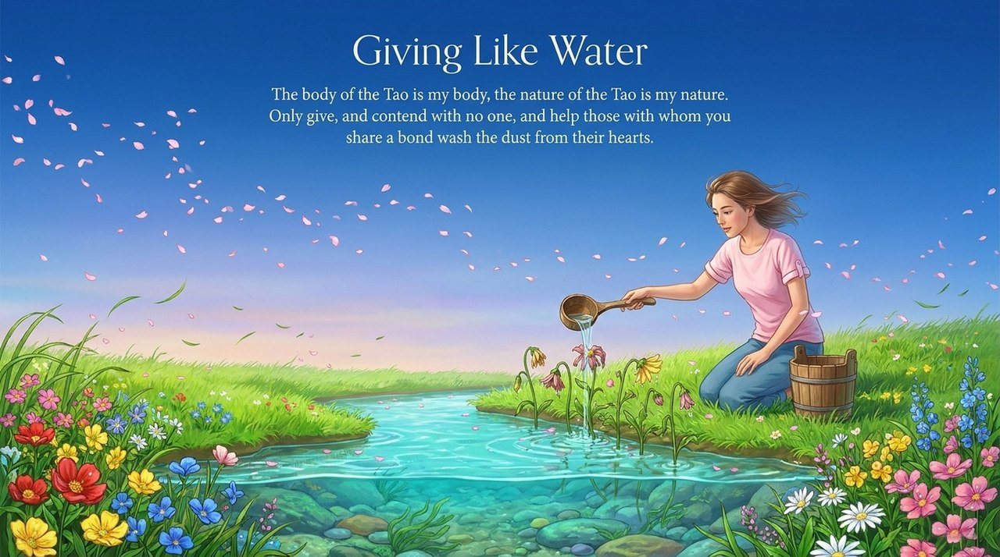
    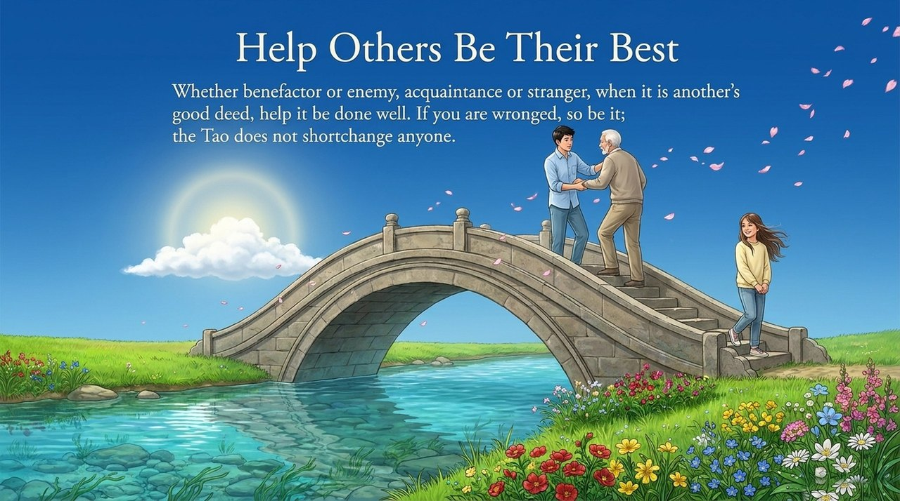
    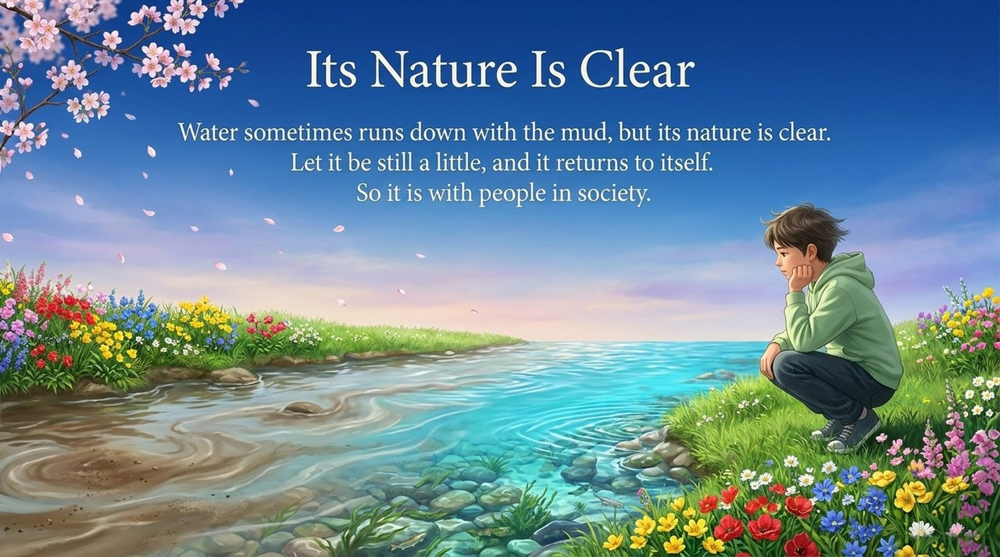
    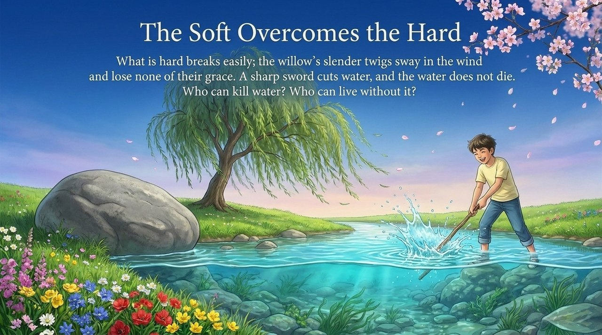
    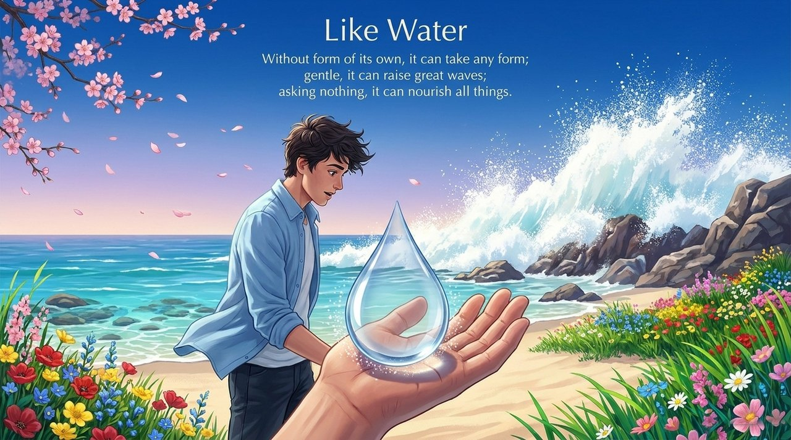
    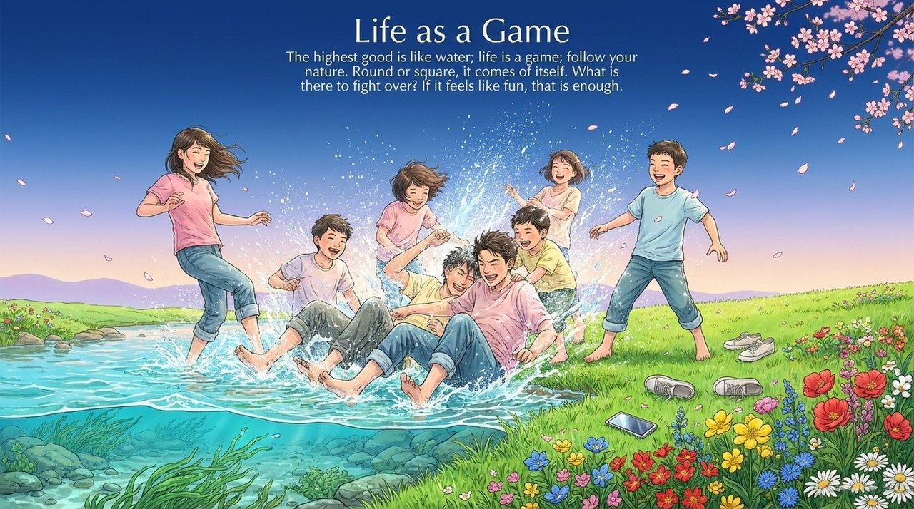
    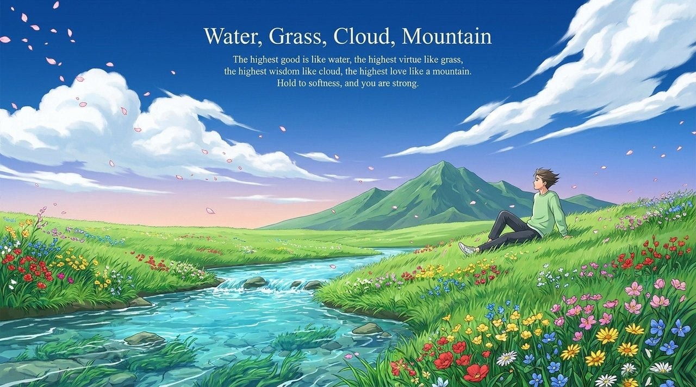
    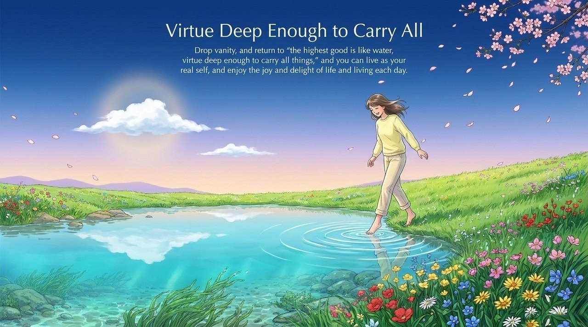
    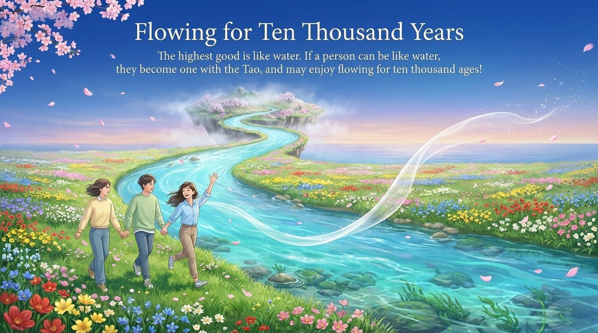

---

## Related Entries

[The Tao](/en/dao/) · [The Way of the Greatest Creator](/en/way-of-the-greatest-creator/) · [Wu Wei (Non-Action)](/en/wu-wei/) · [Action and Non-Action](/en/you-wei-wu-wei/) · [Moving with One's Nature](/en/suixing-er-dong/) · [Humility](/en/humility/) · [Hundun (Ontology)](/en/hundun/) · [Self-Coherence](/en/self-coherence/) · [Self-Nature (Buddha-Nature)](/en/self-nature/) · [Formless Giving](/en/formless-giving/)
