# Minimal Desires, Unshaken Composure

**Minimal Desires, Unshaken Composure** (少私寡欲·宠辱不惊, *shǎo sī guǎ yù · chǒng rǔ bù jīng*) identifies two paired entry-level qualities in the Lifechanyuan cultivation system. "Minimal desires" (少私寡欲) means reducing selfish motives and lowering material craving, so that fame and profit no longer function as traps. "Unshaken composure" (宠辱不惊) means remaining inwardly undisturbed whether one is favored or humiliated, refusing to become a slave to external conditions and thus preserving the wholeness of one's original nature. Guide Xuefeng grounds both qualities in a soul-body framework: only by shifting attention from the physical body (pò) to the spirit (hún) can genuine cultivation begin.

> Fame, profit, glory, and wealth are traps on the path to transcendence; honor and humiliation, favor and disgrace are obstacles. Only through minimal desires and unshaken composure can one step onto the cultivation path.
>
> — Chanyuan Corpus · Immortal Cultivation · "Minimal Desires, Unshaken Composure"

## Video

<iframe style="width:100%;aspect-ratio:4/3;border:0" src="https://www.youtube-nocookie.com/embed/7nB_1oL2SYI" title="Minimal Desires, Unshaken Composure (Lifechanyuan Encyclopedia video)" allowfullscreen></iframe>

## Slides

??? info "📖 Illustrated slides (14 pages, click to expand)"

    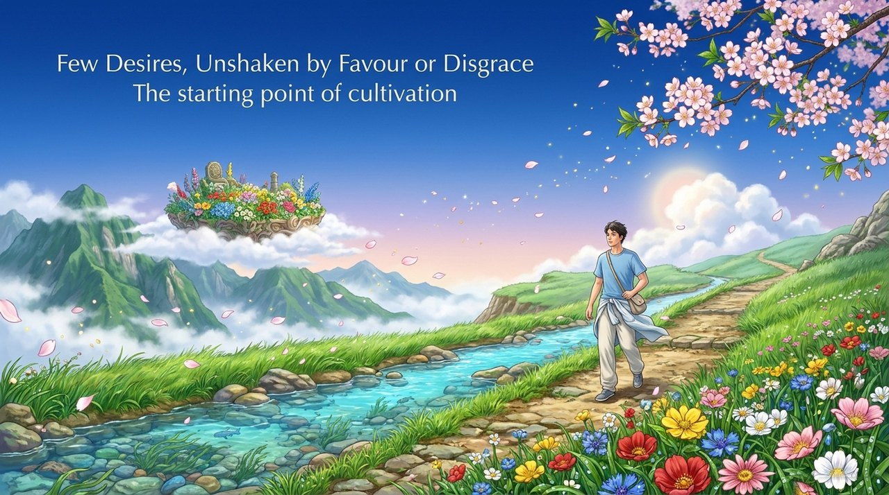
    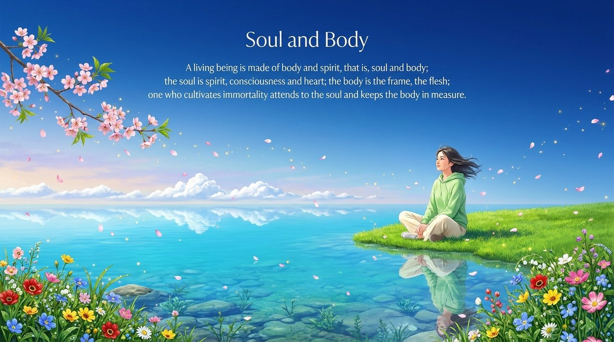
    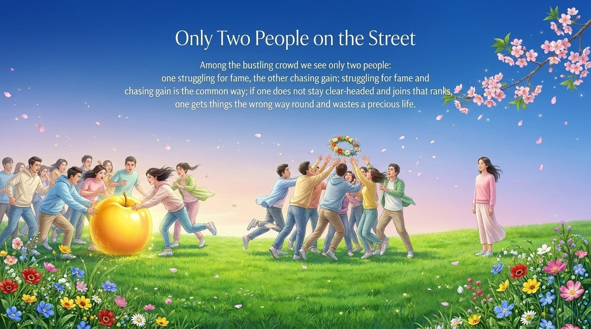
    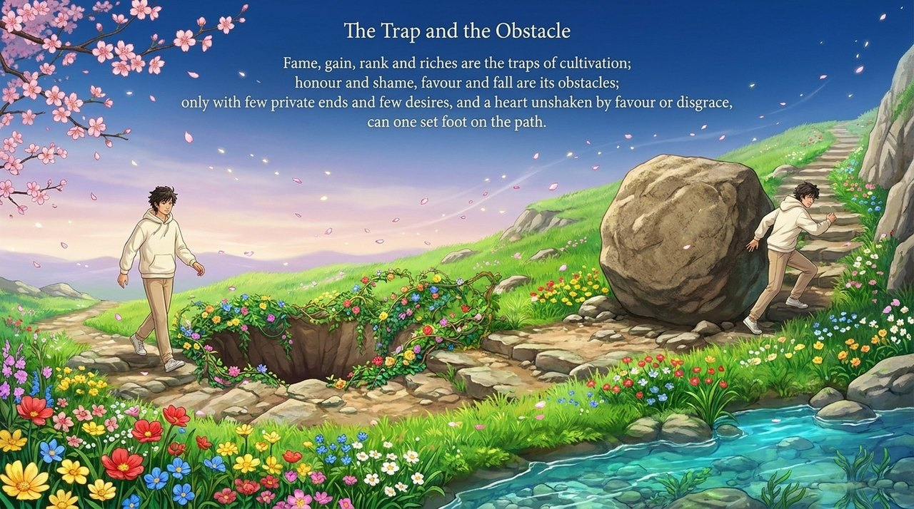
    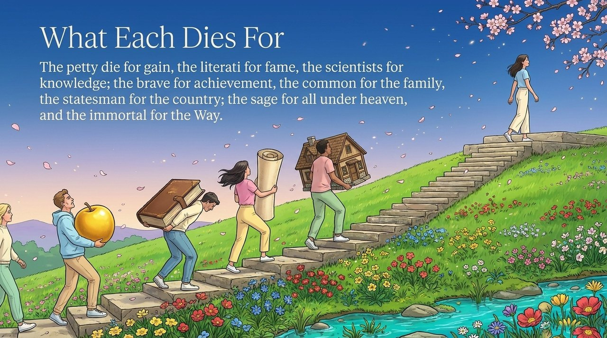
    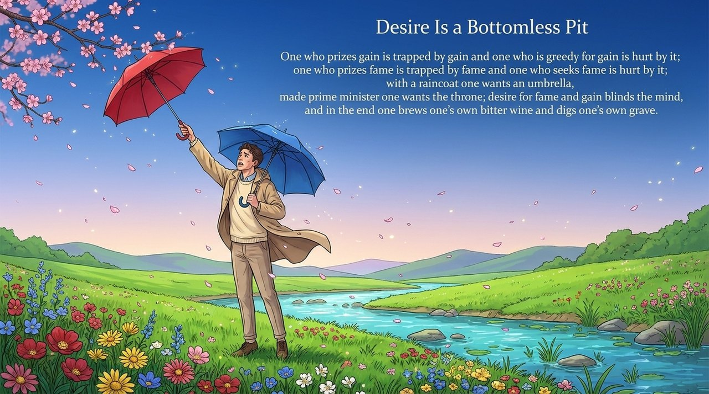
    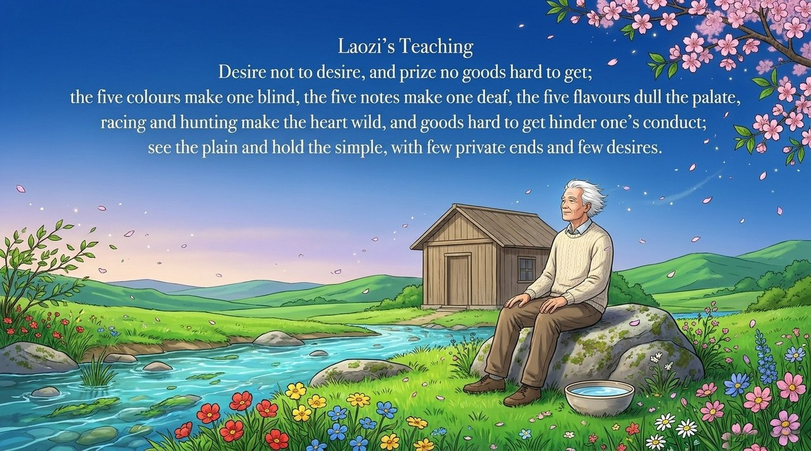
    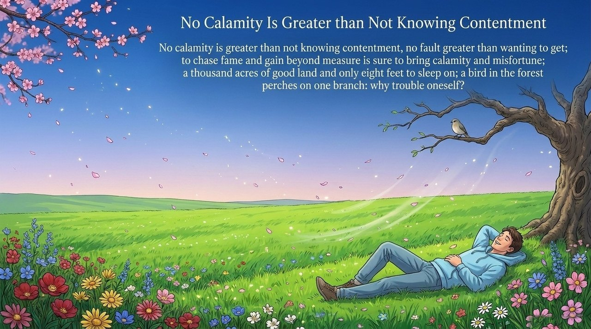
    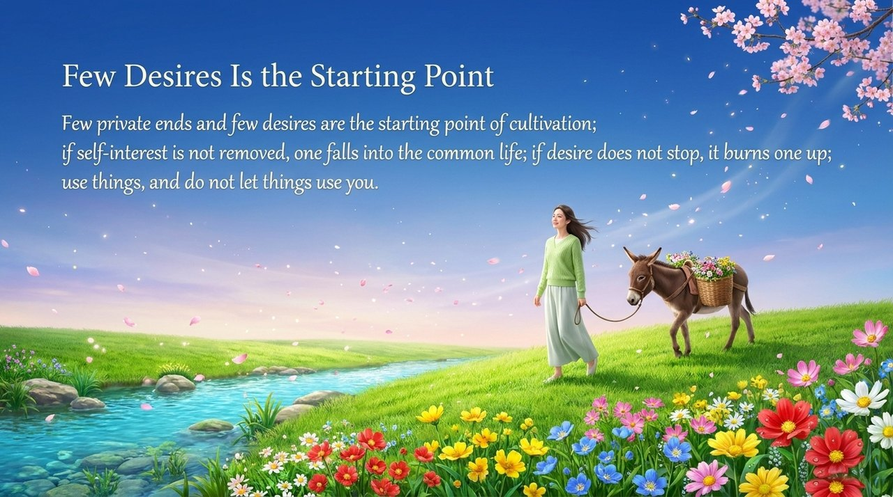
    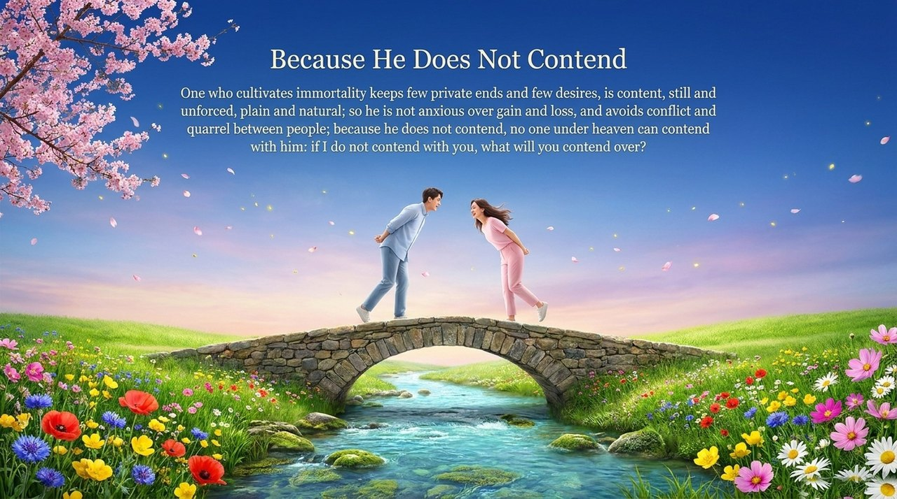
    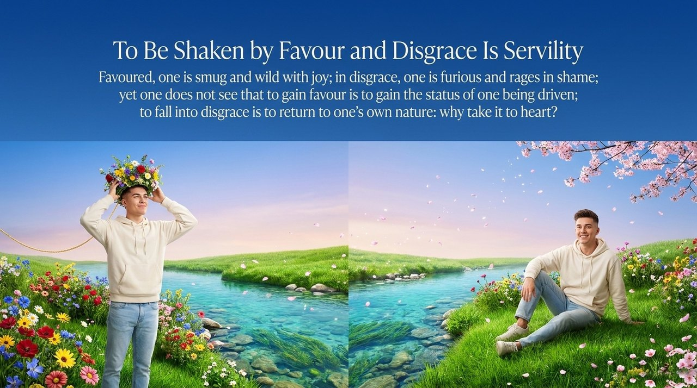
    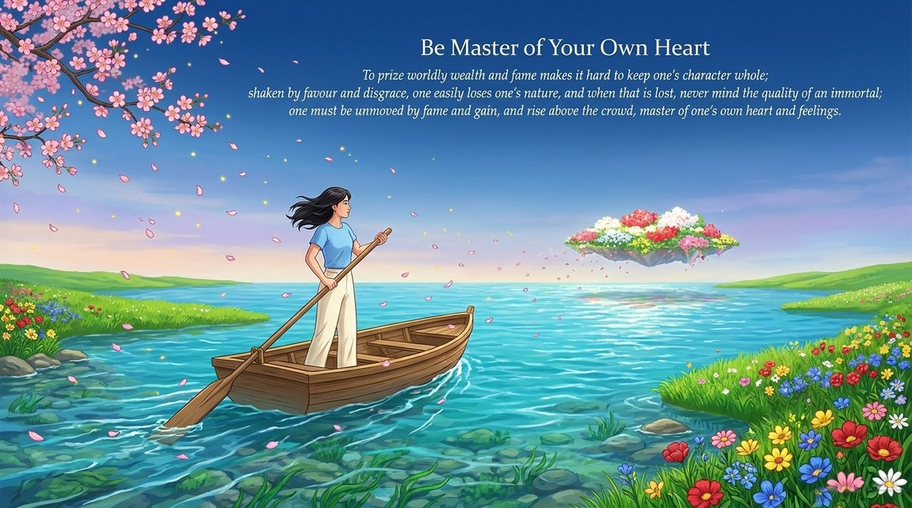
    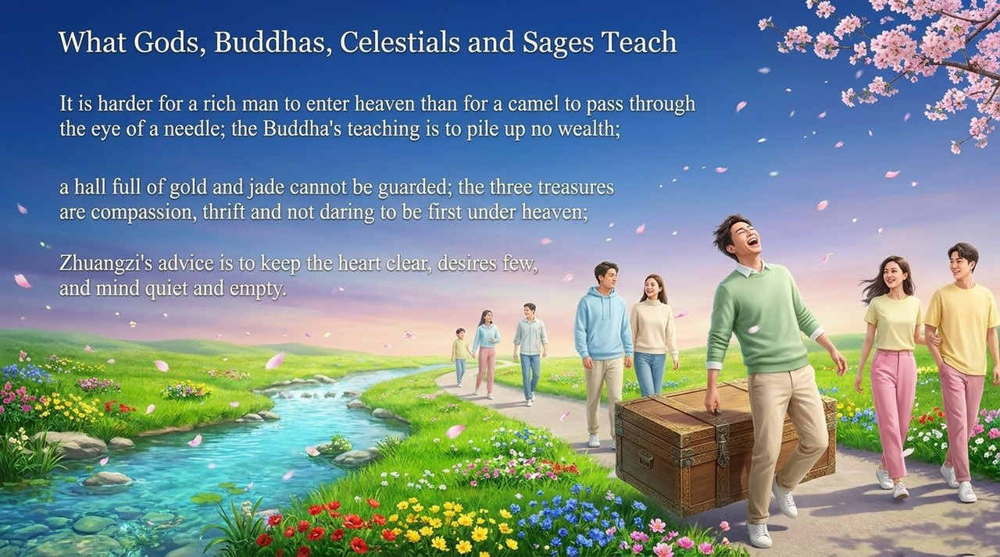
    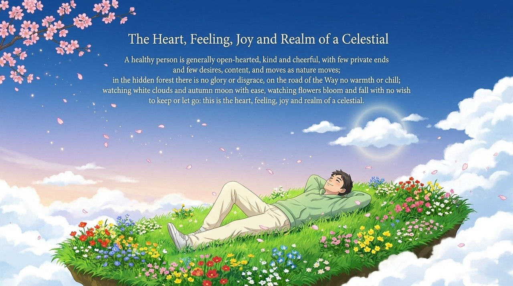

---

## Versions

| Version | Best for | Focus |
|---------|----------|-------|
| [Friendly version](friendly/) | First-time readers | Life wisdom and practical insight |
| [Academic version](academic/) | Researchers | Systematic analysis and cross-cultural comparison |
| [Internal reference](internal/) | Deep study | Guide Xuefeng's original texts |

## Related entries

[Detachment and Serenity](/en/dan-bo-ming-zhi/) · [Going with the Flow, Free and Easy](/en/sui-yuan-fangguan/) · [Deep Roots, Lasting Vision](/en/shen-gen-gu-di/) · [Selfishness and Selflessness](/en/zisi-wusi/) · [Arrogance](/en/aoman/) · [Ego-Clinging](/en/wo-zhi/) · [Transcending the Ordinary](/en/chaofantuosu/) · [Becoming a Celestial Being](/en/becoming-celestial/) · [Innate Nature](/en/tianxing/)
