# Deep Roots, Lasting Vision

**Deep Roots, Lasting Vision** (深根固柢·长生久视, *shēn gēn gù dǐ · cháng shēng jiǔ shì*) draws on Laozi's words in the *Tao Te Ching*: "This is called having deep roots and a firm foundation — the way of long life and enduring vision." In the Lifechanyuan system, Guide Xuefeng interprets this as the foundational law of cultivation: taking the Way of the Greatest Creator as one's root and the teachings of divine beings as one's foundation, awakening innate spiritual awareness, and merging one's finite life into infinite life-time-space — thereby transcending death and achieving true immortality.

> Keep still to cultivate wisdom; restless motion breeds confusion. May readers humble themselves in quiet reflection, deepen their roots, and lay the foundation for liberation and transcendence.
>
> — Chanyuan Corpus · Immortal Cultivation · "Deep Roots, Lasting Vision"

## Video

<iframe style="width:100%;aspect-ratio:4/3;border:0" src="https://www.youtube-nocookie.com/embed/C6bAeEnHDe0" title="Deep Roots, Lasting Vision (Lifechanyuan Encyclopedia video)" allowfullscreen></iframe>

## Slides

??? info "📖 Illustrated slides (14 pages, click to expand)"

    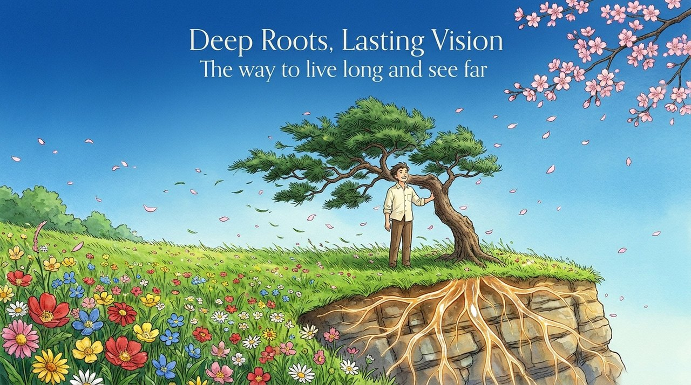
    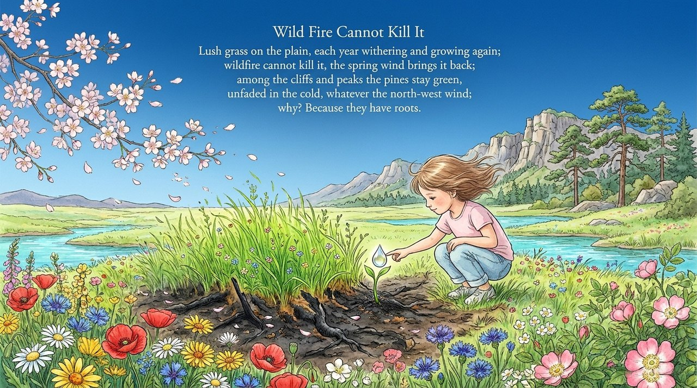
    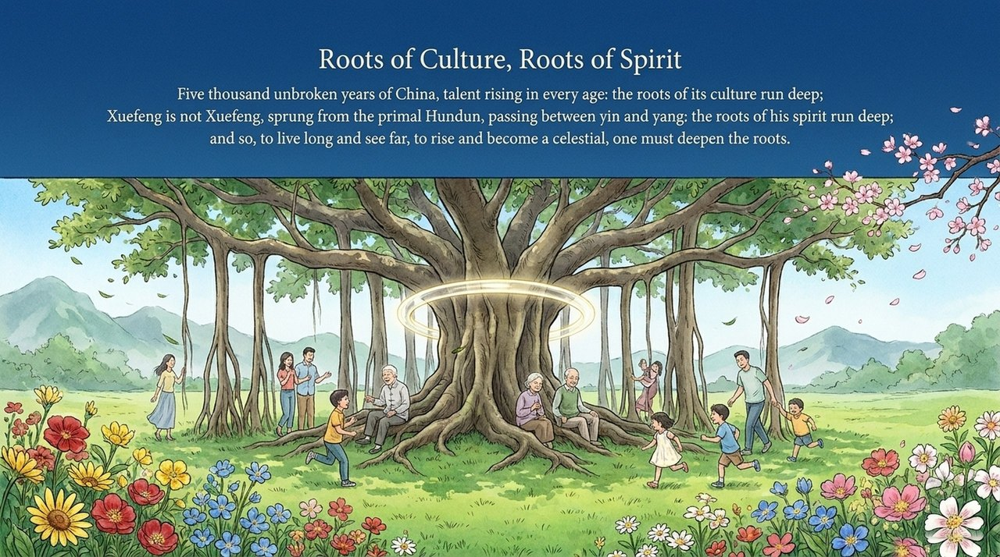
    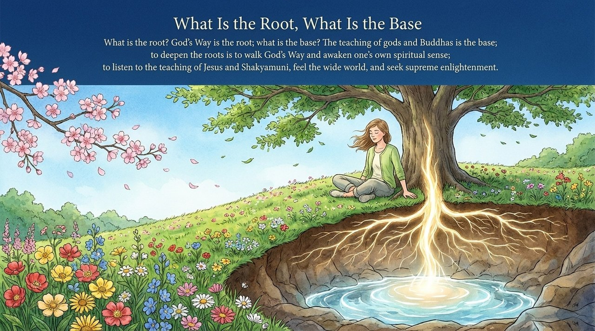
    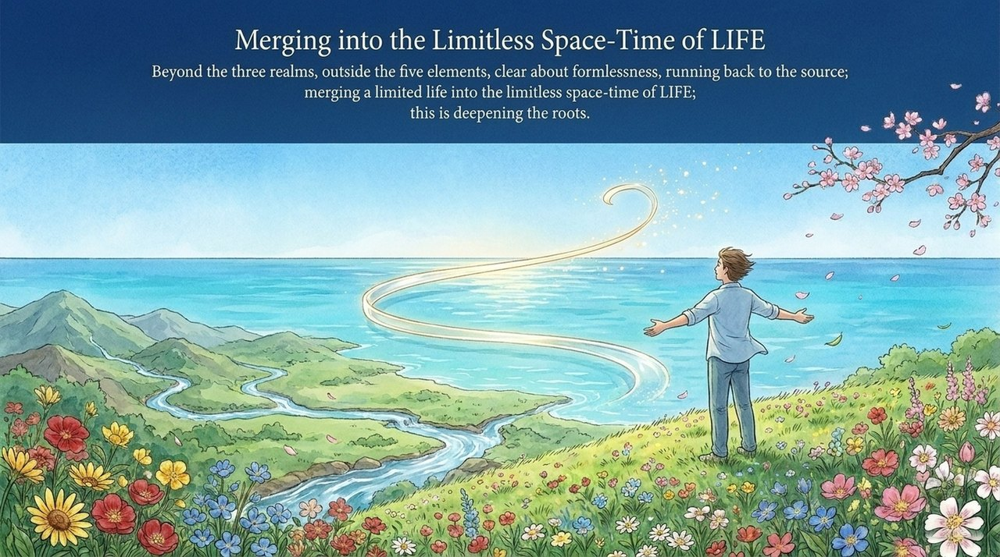
    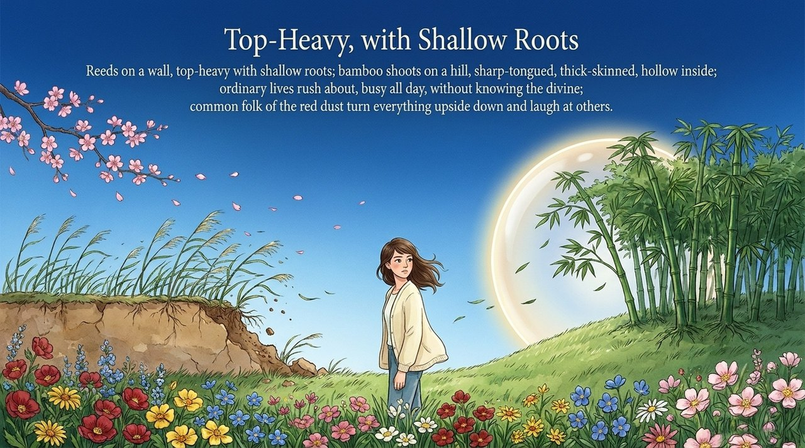
    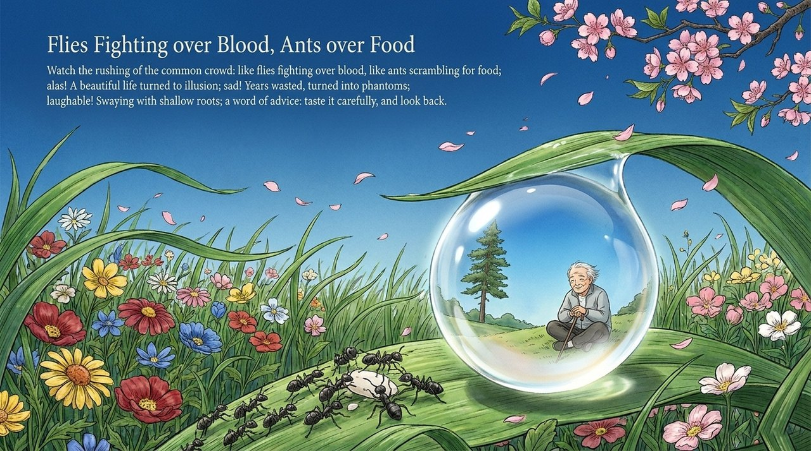
    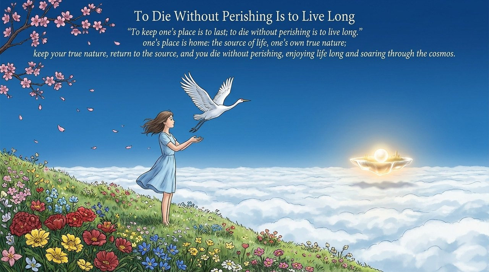
    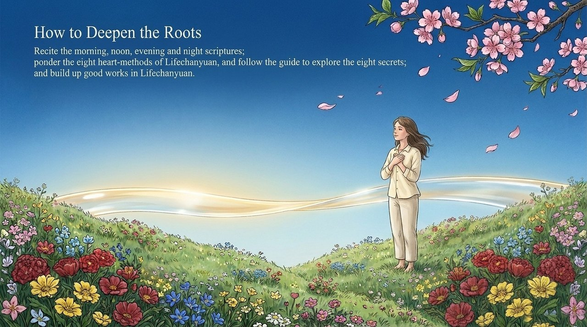
    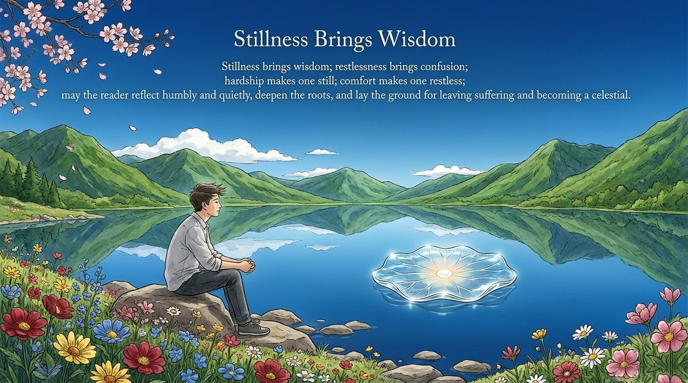
    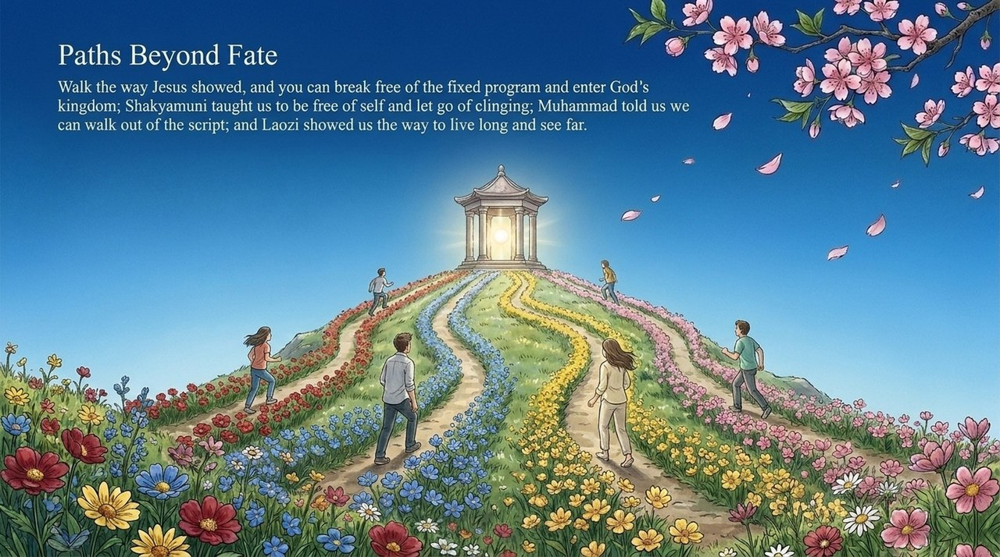
    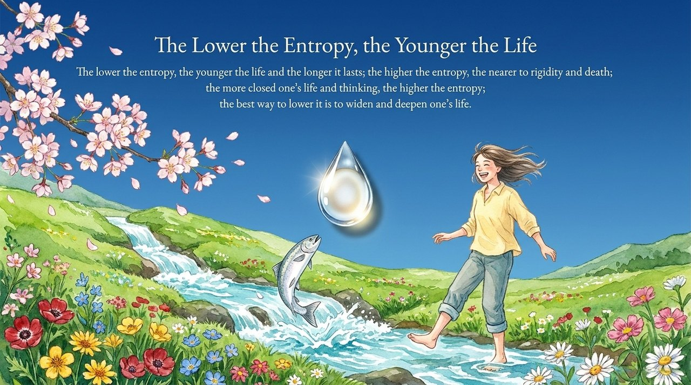
    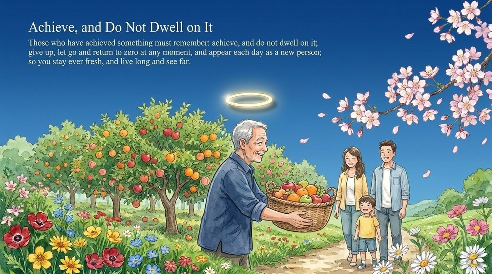
    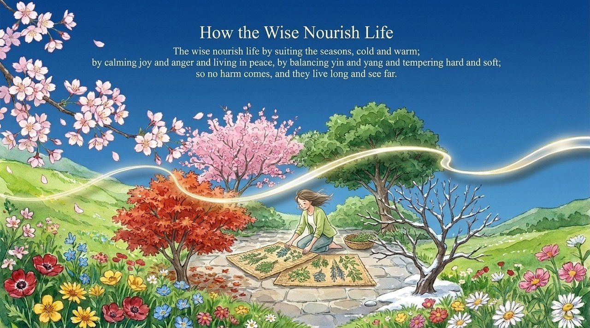

---

## Versions

| Version | Best for | Focus |
|---------|----------|-------|
| [Friendly version](friendly/) | First-time readers | Life metaphors and spiritual insight |
| [Academic version](academic/) | Researchers | Systematic analysis and cross-cultural comparison |
| [Internal reference](internal/) | Deep study | Guide Xuefeng's original texts |

## Related entries

[The Tao](/en/dao/) · [Way of the Greatest Creator](/en/way-of-the-greatest-creator/) · [Way of Nature](/en/way-of-nature/) · [Non-action yet All-accomplished](/en/wu-wei/) · [Becoming a Celestial Being](/en/becoming-celestial/) · [Return to Zero](/en/return-to-zero/) · [Awakening](/en/awakening/)
