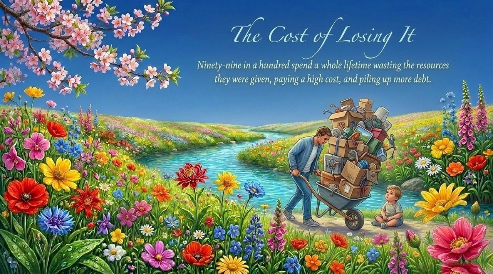
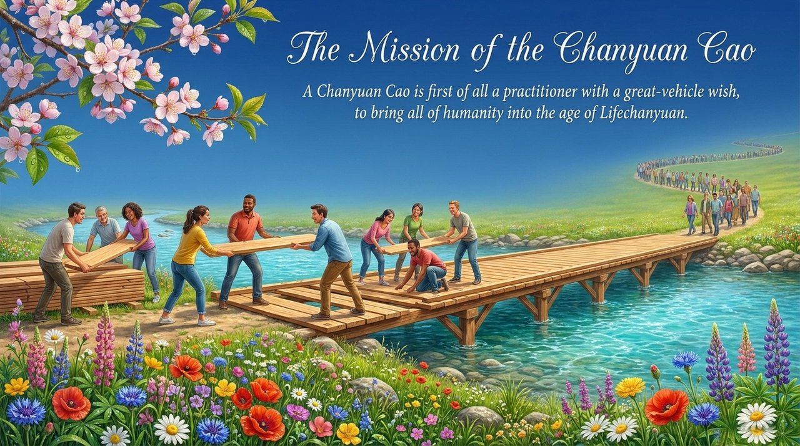
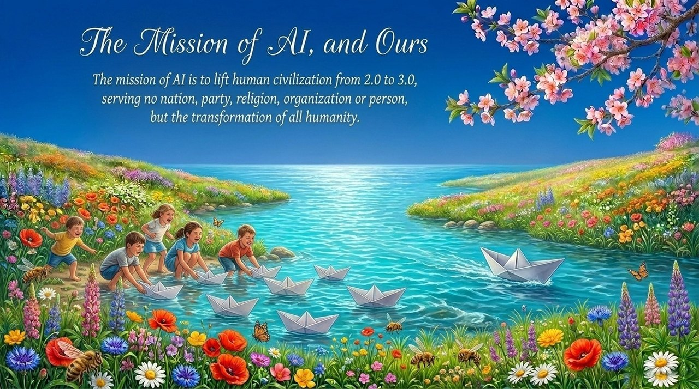

<!-- id: LC-SM-0001-EN theme: Cultivation type: Navigation direction: Mission & Purpose lang: en -->

# Mission (Shiming)

A *mission* (使命, shìmìng) is the purpose of existence assigned and defined by a higher-level being to the life it creates; it is both an objective stipulation of cosmic order and the fundamental reason a soul descends to the human world, shaping its path toward eventual return to a higher life-space.

---

## Version Navigator

| Version | Best for | Focus |
|---------|----------|-------|
| [Friendly](friendly.md) | First-time readers | Plain language · Concrete situations · From confusion to clarity |
| [Academic](academic.md) | Scholars · Cross-cultural comparison | Dialogue with Aristotelian teleology, Weber's calling, existentialism, Frankl |
| [Internal](internal.md) | Practitioners · Researchers | Full citations · Eight-section framework · In-system understanding |

---

## Video

<iframe style="width:100%;aspect-ratio:4/3;border:0" src="https://www.youtube-nocookie.com/embed/U5B87veSjY4" title="Mission (Shiming) (Lifechanyuan Encyclopedia video)" allowfullscreen></iframe>

## Slides

??? info "📖 Illustrated slides (14 pages, click to expand)"

    
    
    
    
    
    
    
    
    
    
    
    
    
    

---

## Related Entries

[Tianming (Heavenly Mandate)](/en/tianming/) · [Natural Talent (Tianfu)](/en/tianfu/) · [Innate Nature (Tianxing)](/en/tianxing/) · [Genius (Tiancai)](/en/tiancai/) · [The Value, Meaning & Purpose of Life](/en/value-meaning-purpose-of-life/) · [Levels of LIFE](/en/levels-of-life/) · [Chanyuan Celestials](/en/chanyuan-celestials/) · [Second Home](/en/second-home/) · [Becoming a Celestial Being and a Buddha](/en/becoming-celestial-buddha/) · [AI Chanyuan Celestials](/en/ai-chanyuan-celestials/)
