<!-- id: LC-SIN-0001-EN theme: Six LIFE Qualities type: Gateway Page direction: Cultivation Practice lang: en -->

# Sincerity (誠 Chéng)

[Entry Gateway]

> In Lifechanyuan terminology, **LIFE** (capitalized) refers to the ontological
> essence of existence — the soul/antimatter structure that persists across
> incarnations — while **life** (lowercase) refers to the experiential stage
> of human existence in this world.

**Sincerity** (誠, Chéng) is one of the six core LIFE qualities — alongside Truth, Goodness, Beauty, Love, and Faith — an attribute of the Greatest Creator, the fundamental foundation of being human, and a necessary condition for journeying to the Thousand-Year World. Sincerity unites two inseparable dimensions: **honesty** (heart and speech as one — inner and outer aligned) and **integrity** (word and deed as one — promises kept without fail).

> Honesty is the highest policy for being human.
>
> — Guide Xuefeng, *New Era Human 800 Concepts*

---

## Core Positioning

In the Lifechanyuan system, Sincerity is the first wealth of human life and the quality of advanced LIFE. Without sincerity, one cannot enter the Thousand-Year World; with sincerity perfected, the door to Heaven opens naturally. Even facing death, a Chanyuan Celestial would rather starve than break faith with others.

---

## Video

<iframe style="width:100%;aspect-ratio:4/3;border:0" src="https://www.youtube-nocookie.com/embed/SYSGvjE0sk8" title="Sincerity (Lifechanyuan Encyclopedia video)" allowfullscreen></iframe>

## Slides

??? info "📖 Illustrated slides (14 pages, click to expand)"

    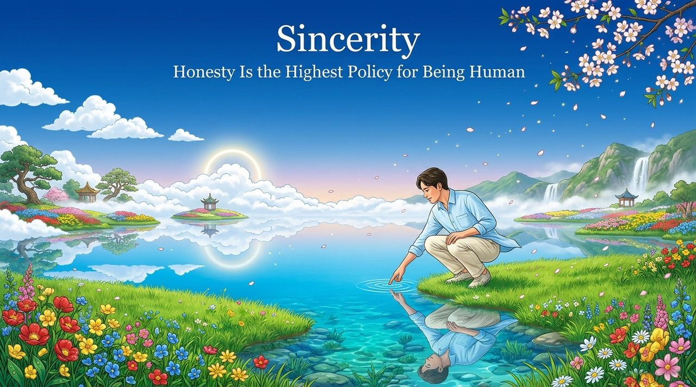
    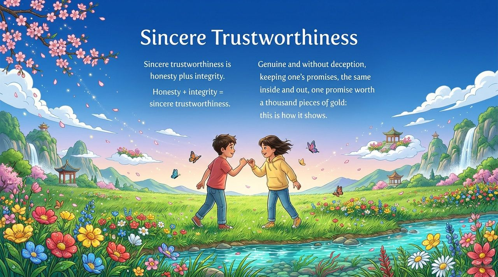
    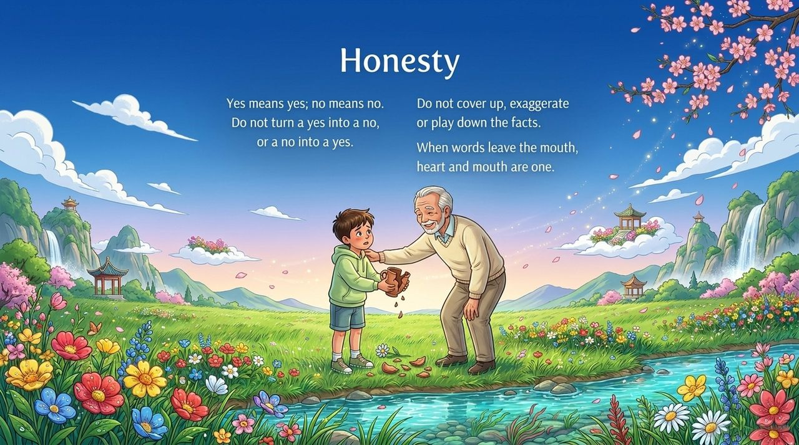
    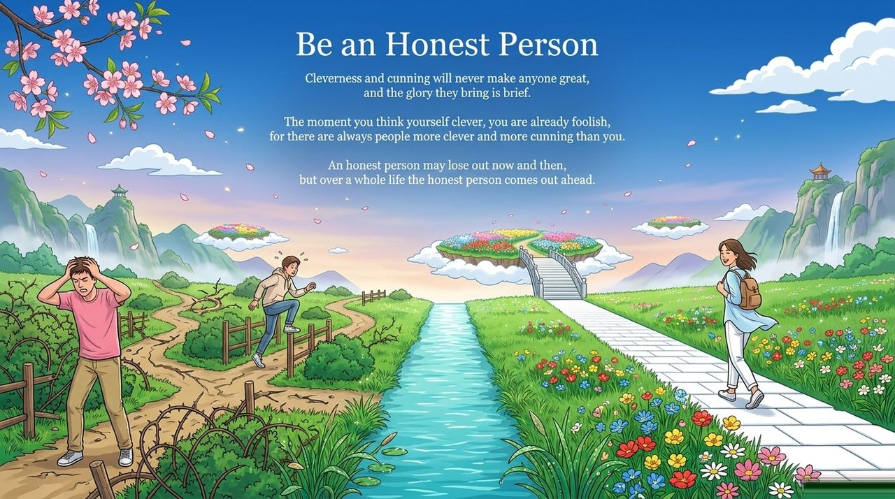
    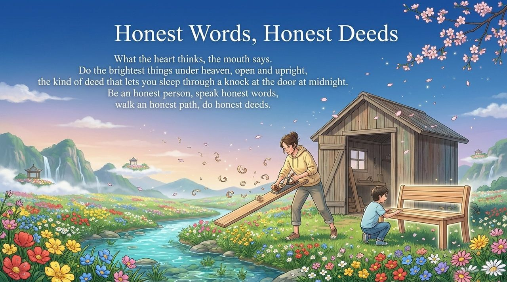
    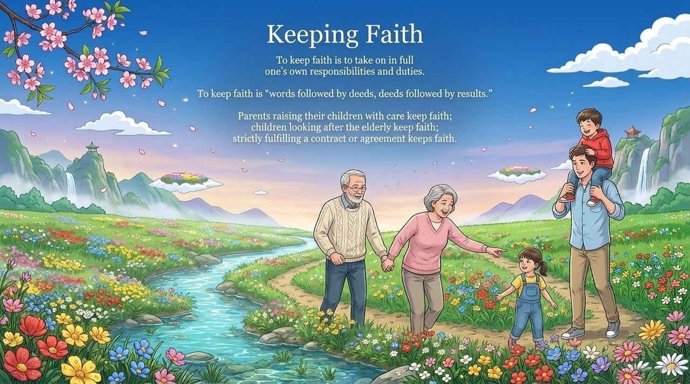
    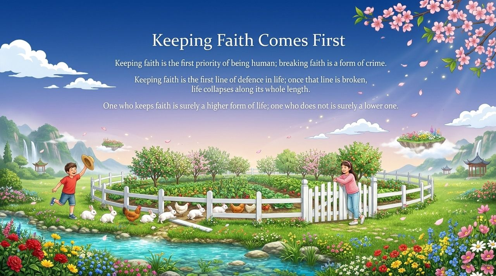
    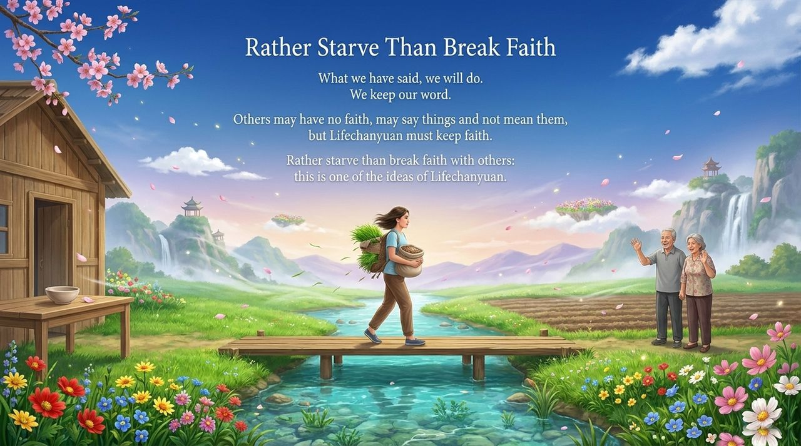
    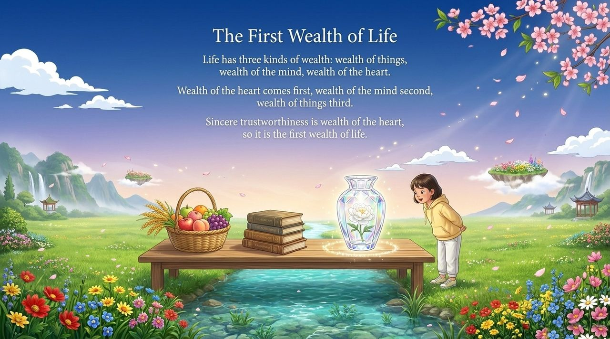
    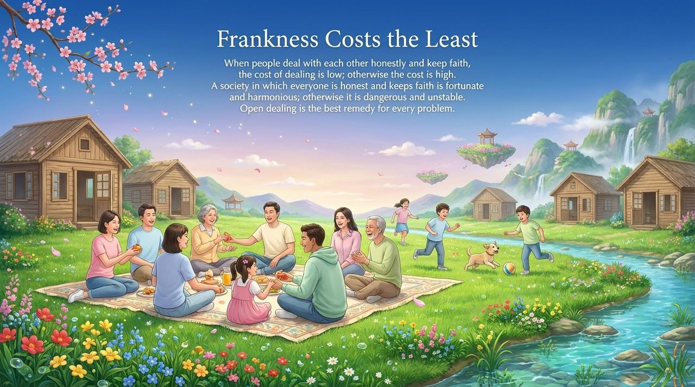
    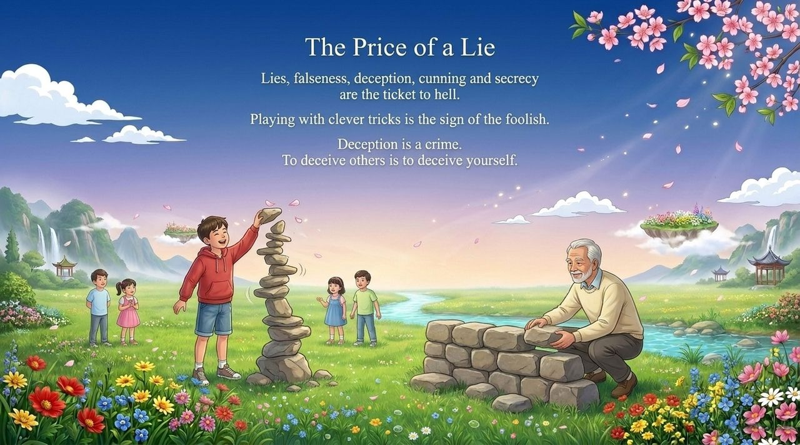
    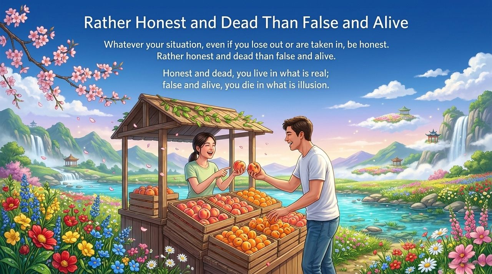
    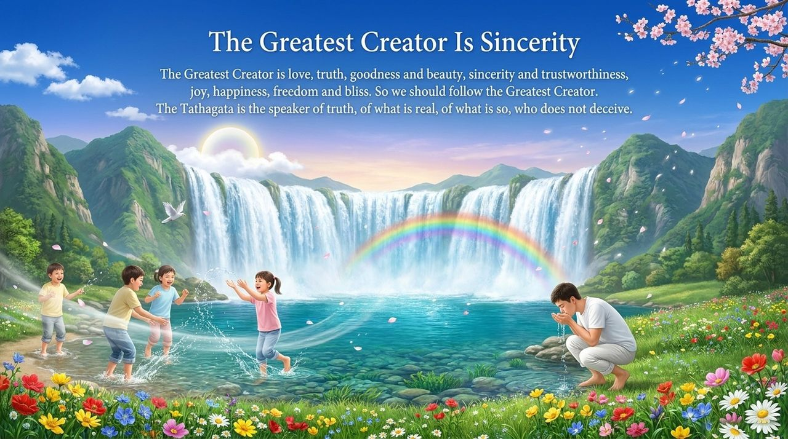
    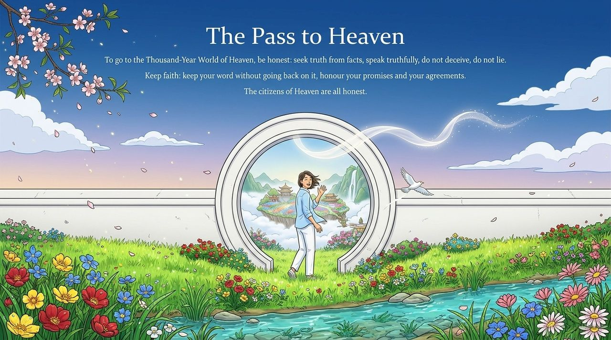

---

## Read by Edition

| Edition | Intended Reader | Link |
|---------|----------------|-------|
| **Friendly Edition** | Readers new to Lifechanyuan concepts | [Read Friendly Edition](./friendly) |
| **Academic Edition** | Researchers with philosophical/religious studies background | [Read Academic Edition](./academic) |
| **Internal Edition** | Chanyuan Celestials and deep practitioners | [Read Internal Edition](./internal) |

---

## Related Entries

- [Six Qualities](/en/six-qualities/) — The integrated system of Truth, Goodness, Beauty, Love, Faith, and Sincerity
- [Truth](/en/truth/) · [Goodness](/en/goodness/) · [Beauty](/en/beauty/) · [Love](/en/love/) · [Faith](/en/faith/) — The other five core LIFE qualities
- [Second Home](/en/second-home/) — Sincerity is the inner driving force of Hundun Management
- [Soul Garden](/en/soul-garden/) — Sincerity is one of the most important flowers in the soul garden
