<!-- id: LC-SWE-0001-EN theme: The Mystery of LIFE type: index direction: The Mystery of LIFE lang: en -->

# Sound Wave Energy

**Sound Wave Energy** is Lifechanyuan's systematic discussion of the relationship between sound and LIFE energy. Xuefeng argues that sound waves carry frequencies, different frequencies carry different energies, and these energies affect LIFE and the world in correspondingly different ways. Positive, uplifting sound waves benefit LIFE; negative, dissonant sound waves harm it — and harm the speaker and the listener alike. Evidence is drawn from the Chladni figures experiment (physics), the Guanyin Heart Mantra and the correct pronunciation of "Amitabha" (spiritual practice), and historical and literary accounts such as Meng Jiangnu, Dou E's injustice, the Walls of Jericho, and the Egyptian pyramids. The guiding principle: the sounds you enjoy are beneficial to you; the sounds you dislike are harmful to you.

---

## Video

<iframe style="width:100%;aspect-ratio:4/3;border:0" src="https://www.youtube-nocookie.com/embed/bPBsKG28-M4" title="Sound Wave Energy (Lifechanyuan Encyclopedia video)" allowfullscreen></iframe>

## Slides

??? info "📖 Illustrated slides (14 pages, click to expand)"

    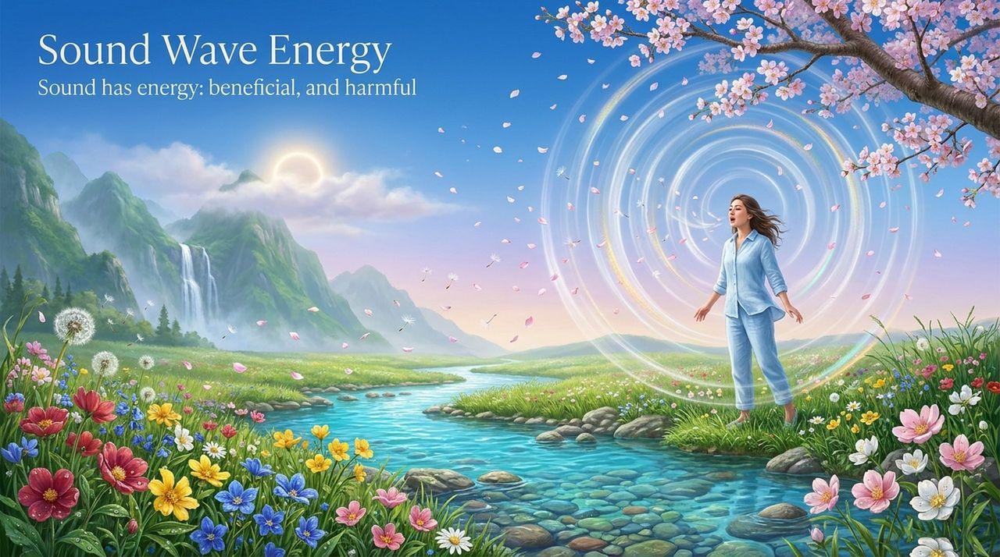
    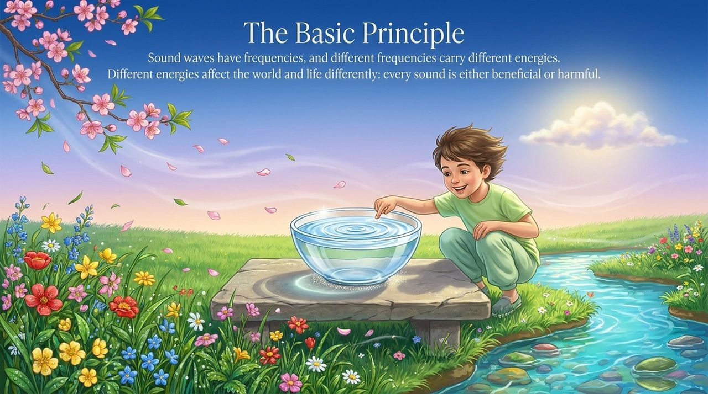
    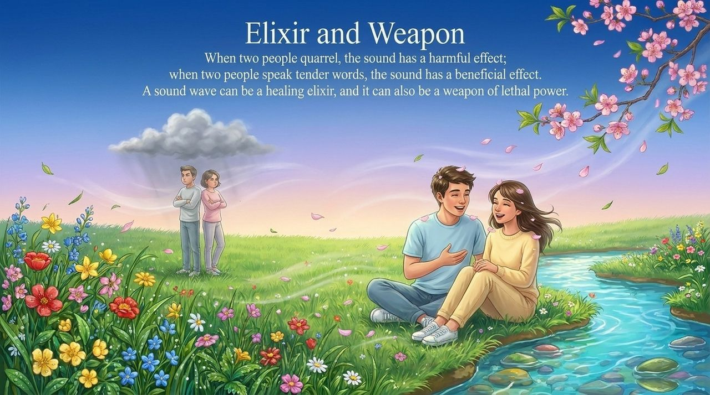
    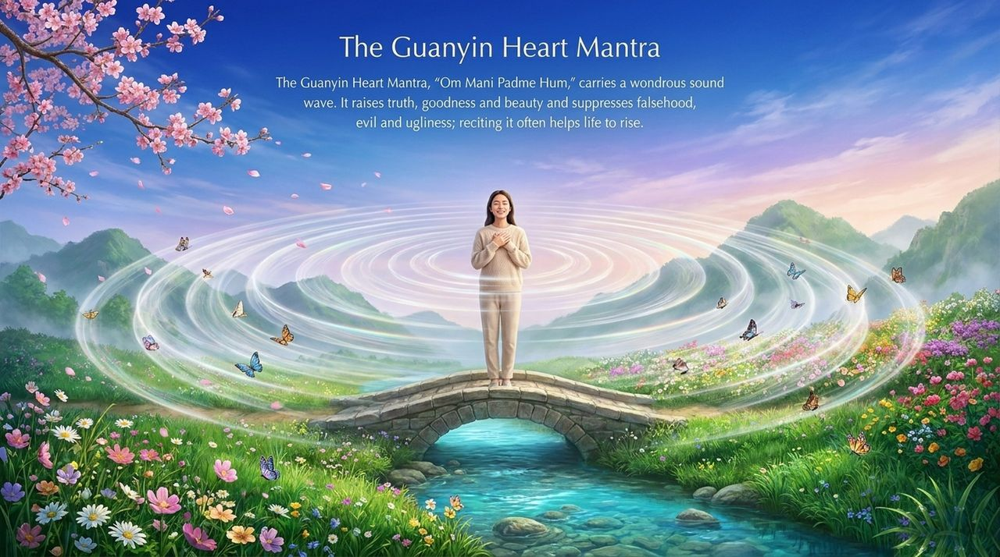
    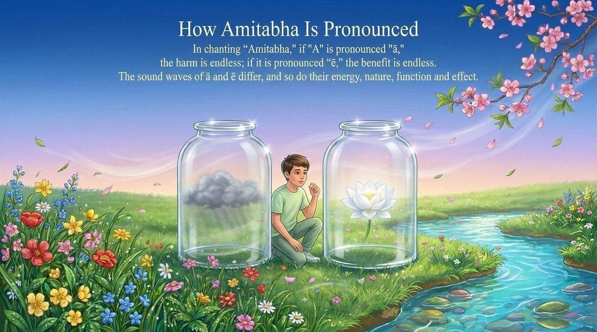
    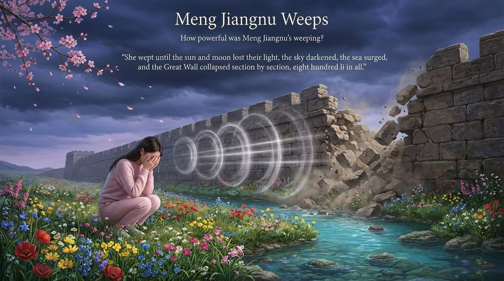
    
    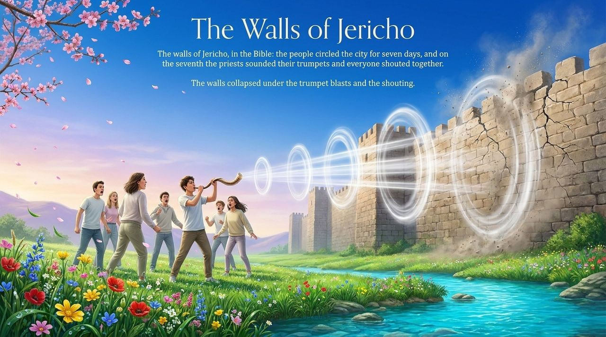
    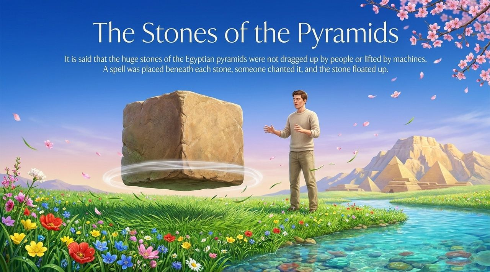
    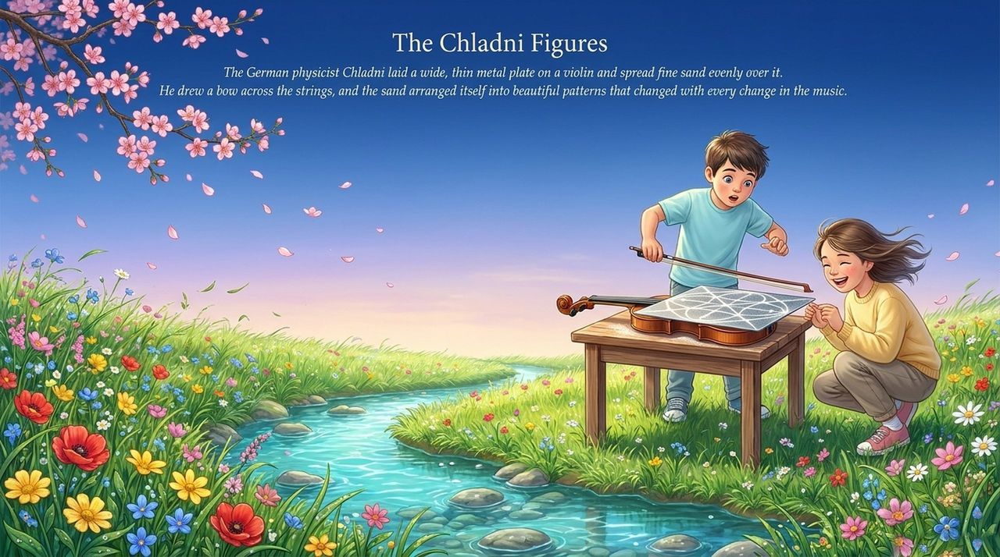
    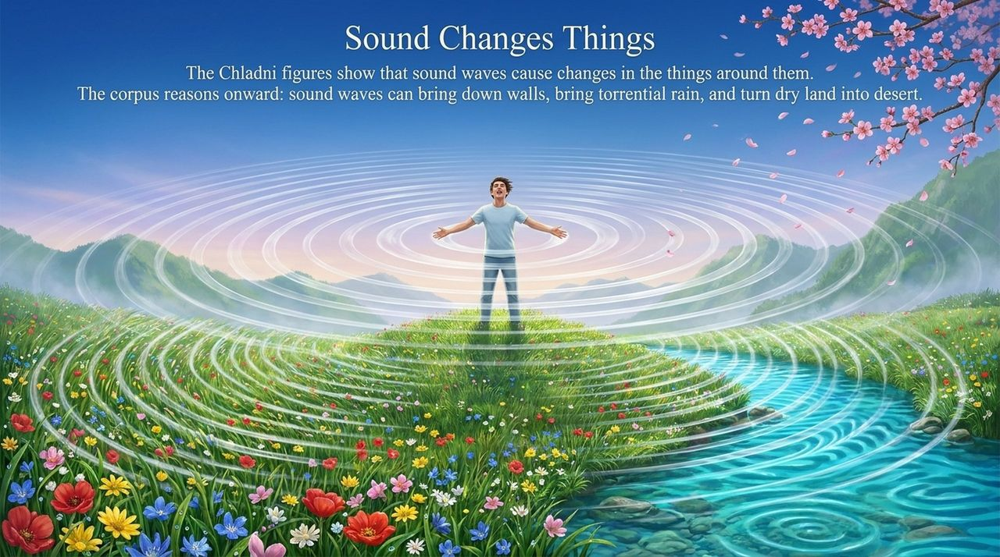
    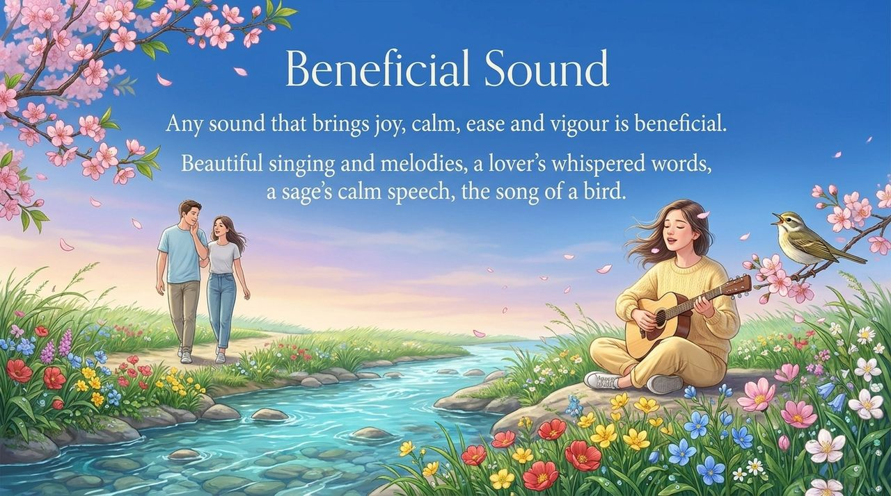
    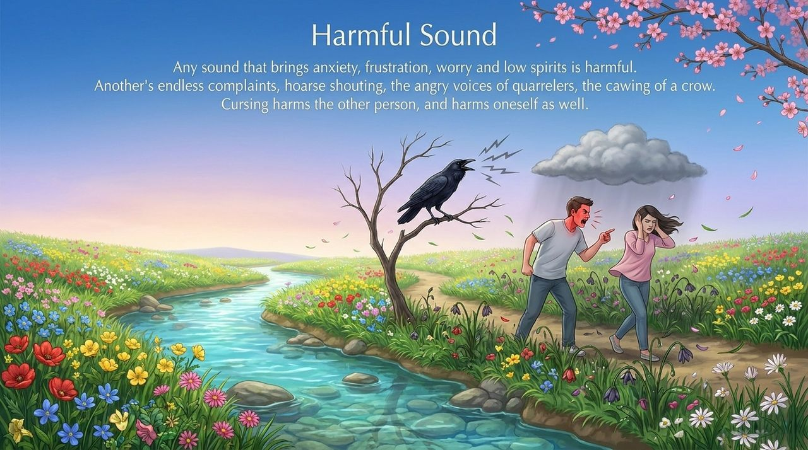
    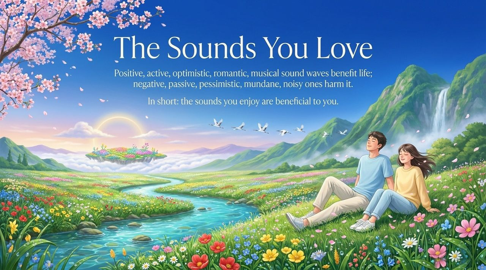

---

## Version Navigation

| Version | Best for | Focus |
|---------|----------|-------|
| [Friendly version](friendly.md) | First-time readers | How does sound affect LIFE? What sounds benefit you? |
| [Academic version](academic.md) | Researchers | The sound–energy framework, evidence typology, connections to Lifechanyuan's energy doctrine |
| [Internal reference](internal.md) | Deep study | Complete source quotation from the LIFE Chapter |

---

## Related Entries

[Energy](/en/energy/) · [Raise Vibrational Frequency](/en/raise-vibration-frequency/) · [Ethereal Sound · The Authentic Chan Melody](/en/ethereal-sound/) · [Sympathetic Resonance](/en/resonance/) · [Cosmic Holography](/en/cosmic-holography/) · [Consciousness](/en/consciousness/) · [Mysteries of LIFE](/en/life-mysteries/) · [Prayer](/en/prayer/) · [Antimatter Structure](/en/antimatter-structure/)
