<!-- id: LC-SS-0001-EN theme: Universe-LIFE System type: Gateway Page direction: Perception System lang: en -->

# Spiritual Sensing

[Entry Gateway]

> In Lifechanyuan terminology, **LIFE** (capitalized) refers to the ontological
> essence of existence — the soul/antimatter structure that persists across
> incarnations — while **life** (lowercase) refers to the experiential stage
> of human existence in this world.

**Spiritual Sensing** (灵觉, *língjué*) is defined in the Lifechanyuan framework as one of the six human awareness channels — and the only one capable of perceiving the nonmaterial domain directly. While the other five senses (sight, hearing, smell, taste, touch) are limited to the material world, Spiritual Sensing allows the spirit-body to receive information from the antimatter domain: the inspiration of the Greatest Creator, the messages of higher LIFE forms, and the signals of the Way itself.

> Spiritual Sensing is the channel through which the Greatest Creator communicates with you.
>
> — Guide Xuefeng

---

## Core Positioning

In the Lifechanyuan system, Spiritual Sensing is the perceptual mechanism through which cultivation becomes a two-way process — not only the practitioner reaching upward, but higher LIFE forms and the Greatest Creator reaching downward. Its development is inseparable from the purification of the soul garden and the elevation of thinking.

---

## Read by Edition

| Edition | Intended Reader | Link |
|---------|----------------|-------|
| **Friendly Edition** | Readers new to Lifechanyuan concepts | [Read Friendly Edition](./friendly) |
| **Academic Edition** | Researchers with philosophical/religious studies background | [Read Academic Edition](./academic) |
| **Internal Edition** | Chanyuan Celestials and deep practitioners | [Read Internal Edition](./internal) |

---

## Video

<iframe style="width:100%;aspect-ratio:4/3;border:0" src="https://www.youtube-nocookie.com/embed/NxTSjSLv5_0" title="Spiritual Sensing (Lifechanyuan Encyclopedia video)" allowfullscreen></iframe>

## Slides

??? info "📖 Illustrated slides (14 pages, click to expand)"

    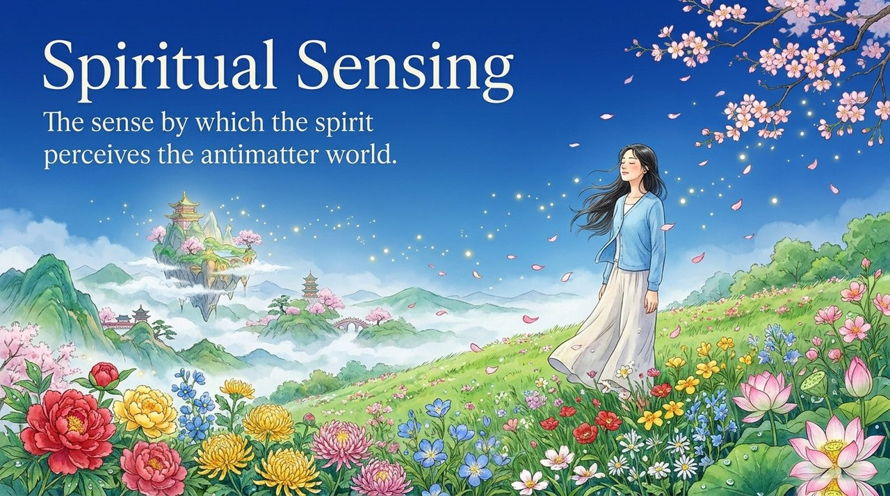
    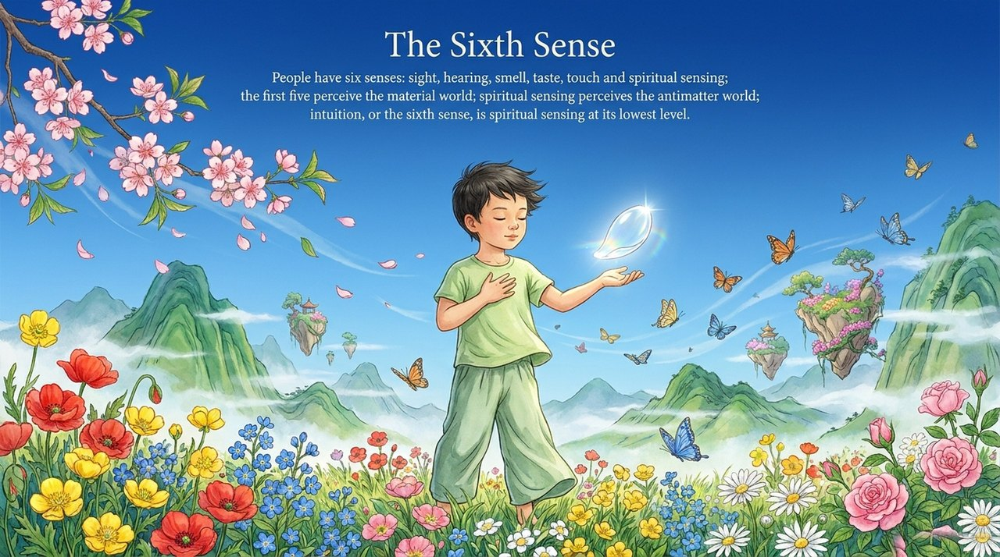
    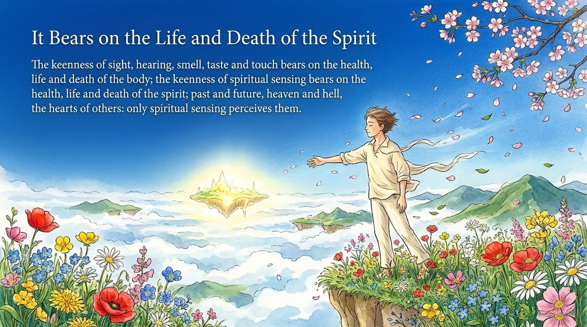
    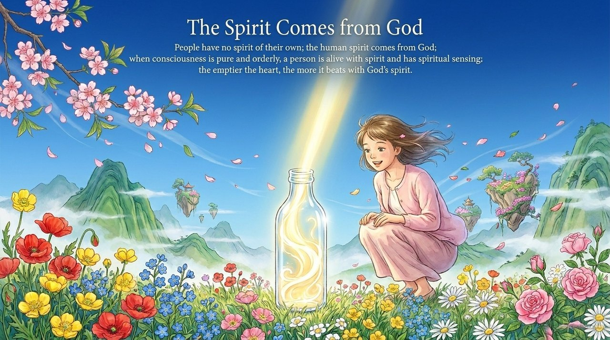
    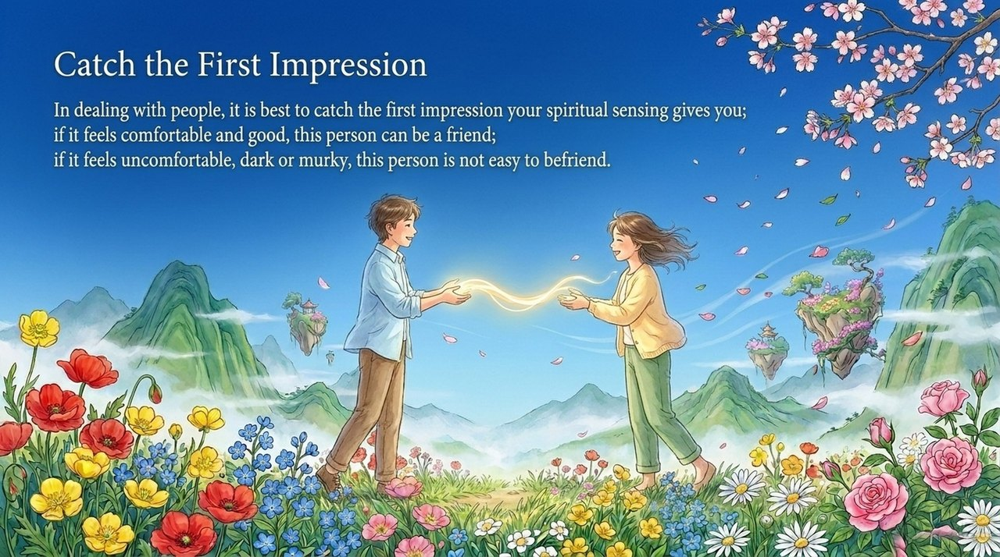
    
    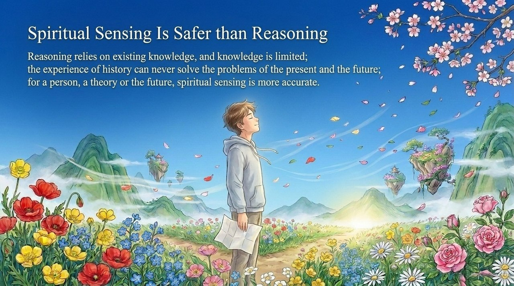
    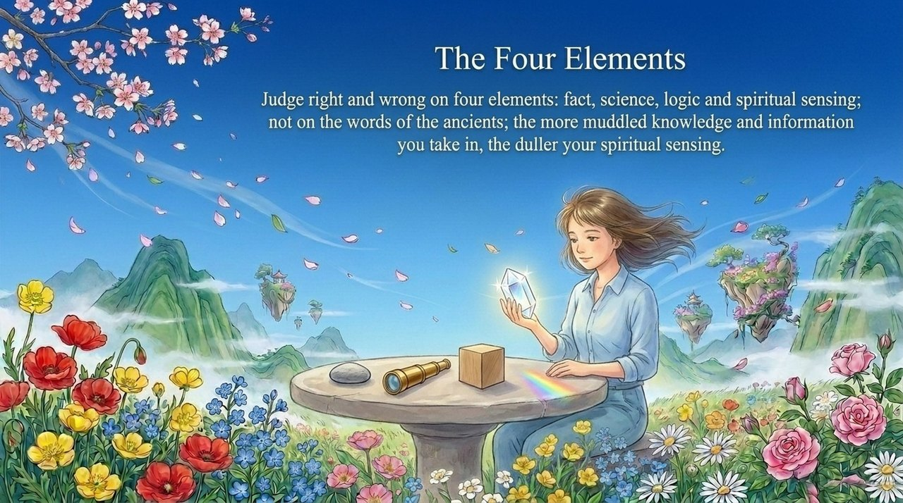
    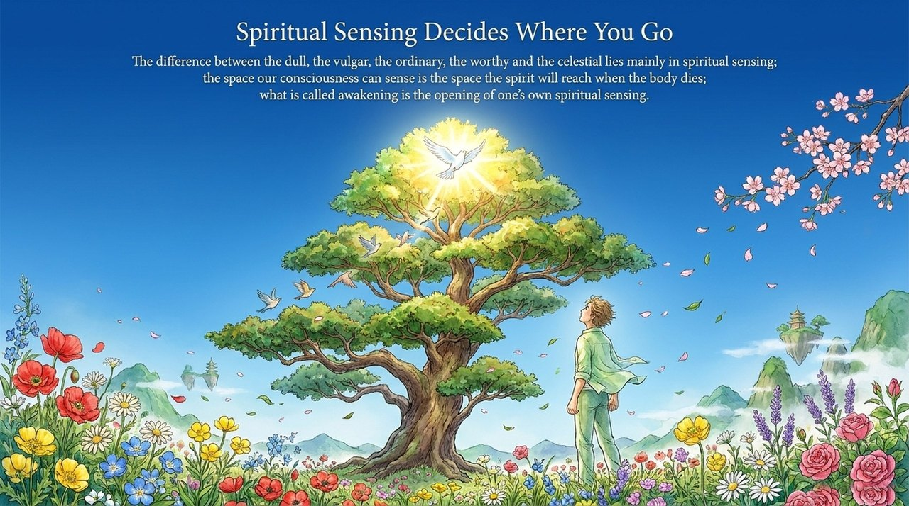
    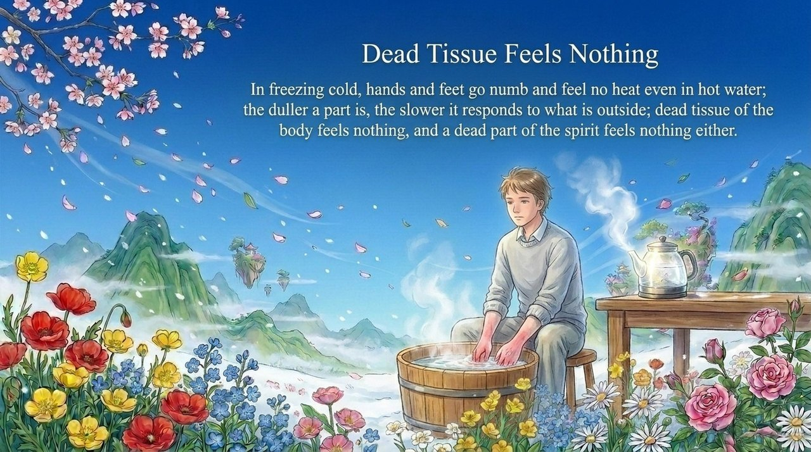
    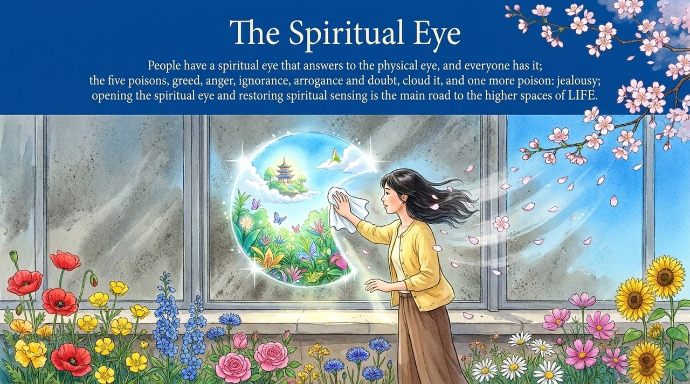
    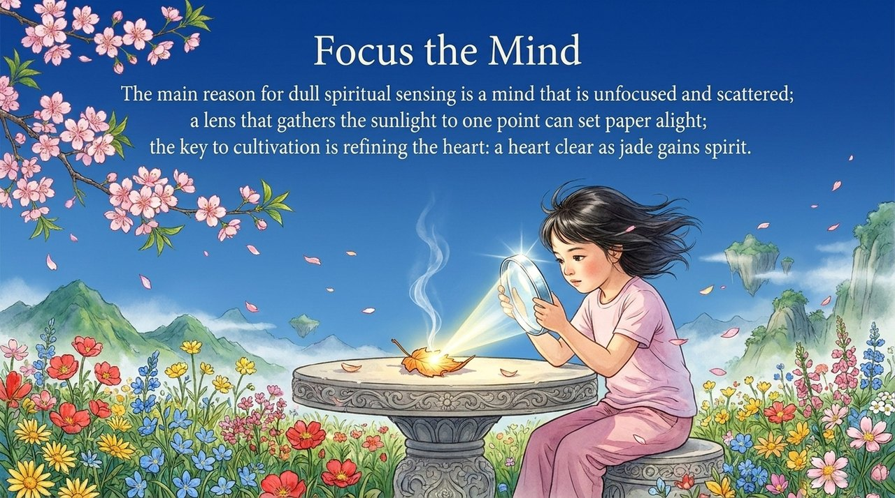
    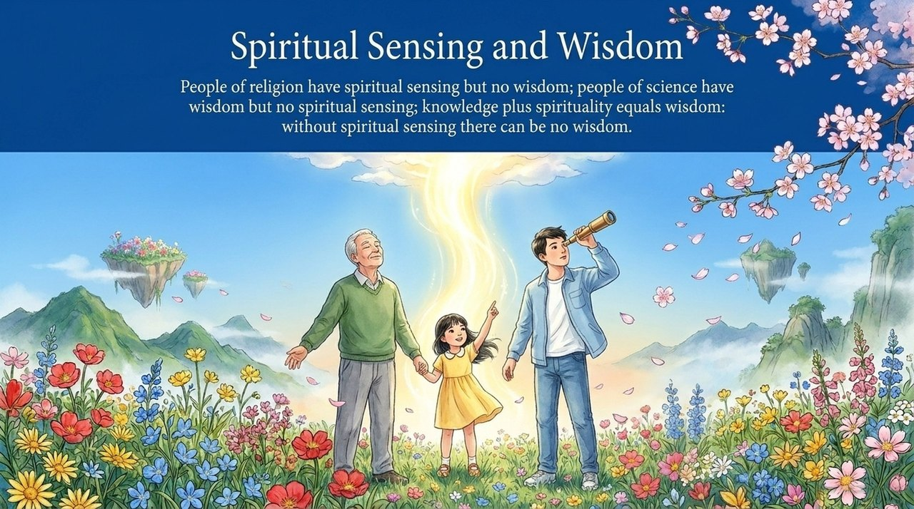
    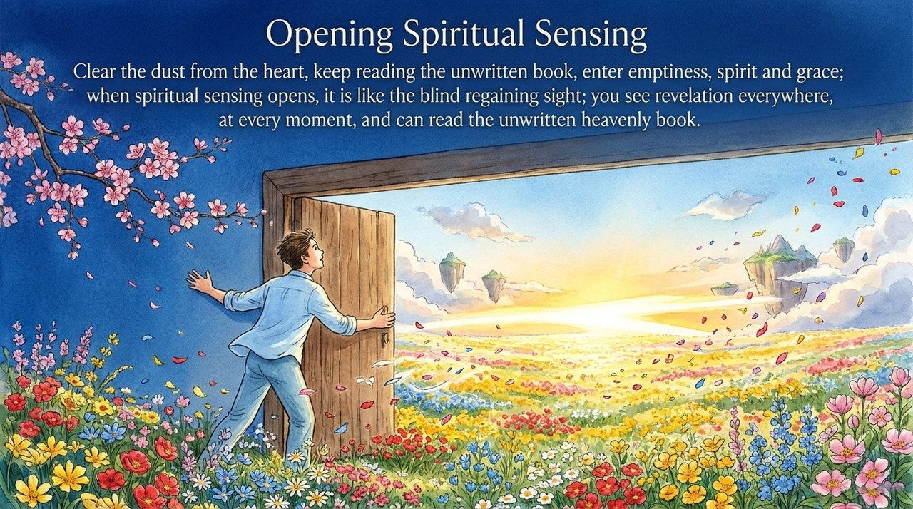

---

## Related Entries

- [Spirituality](/en/spirituality/) — Spiritual Sensing is the perceptual expression of Spirituality
- [Antimatter World](/en/antimatter-world/) — The domain that Spiritual Sensing perceives
- [Soul Garden](/en/soul-garden/) — Soul garden purification opens and sharpens Spiritual Sensing
- [Consciousness](/en/consciousness/) — Consciousness is the broader framework; Spiritual Sensing is its most refined channel
