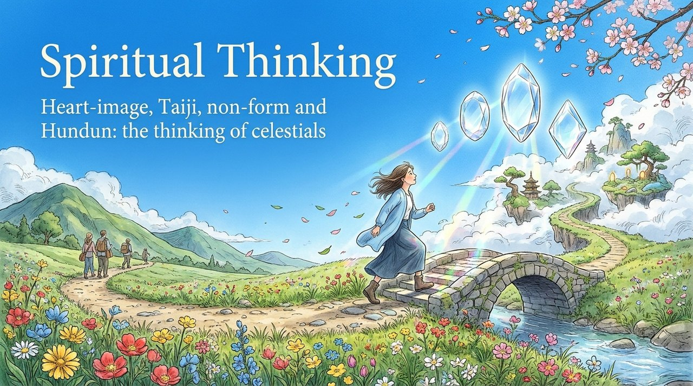
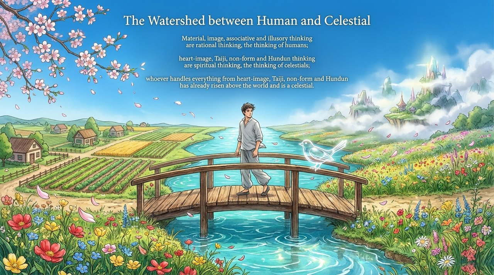
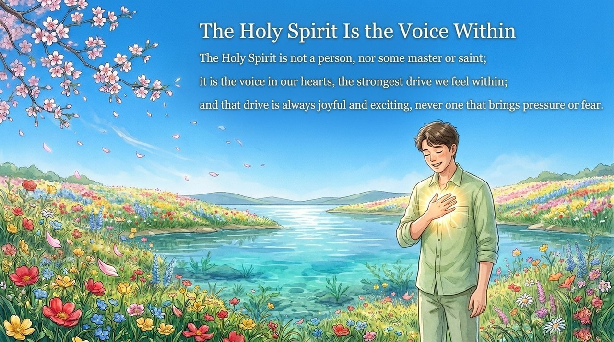
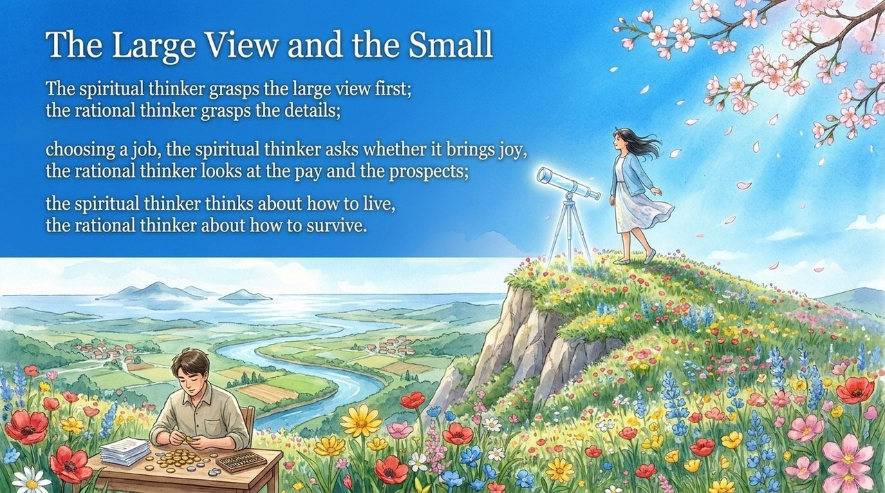
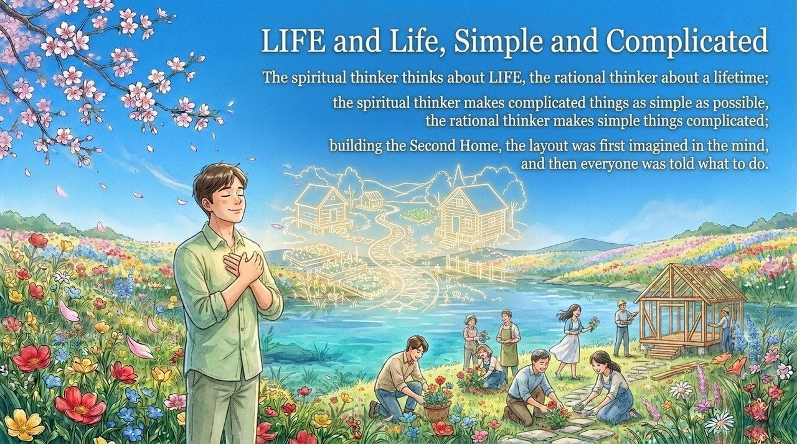
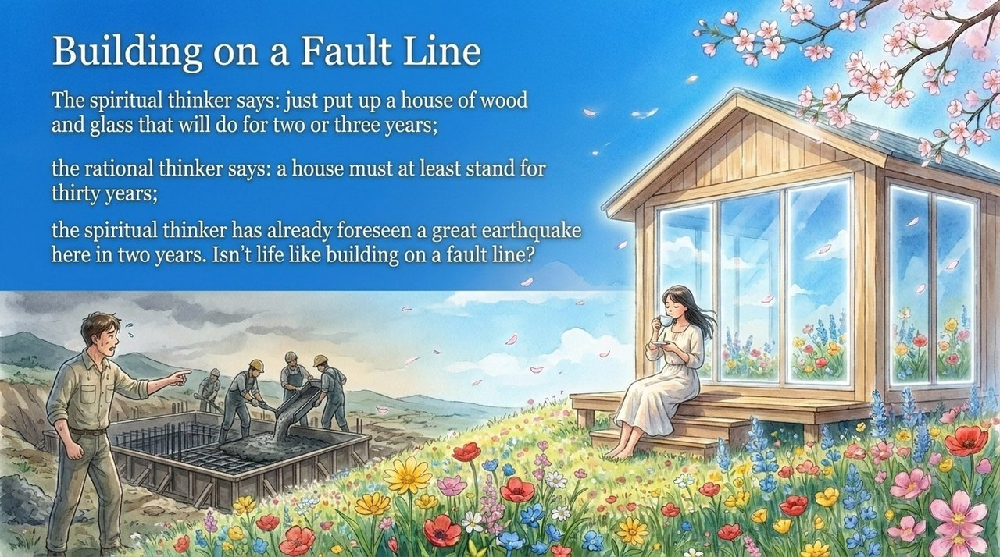
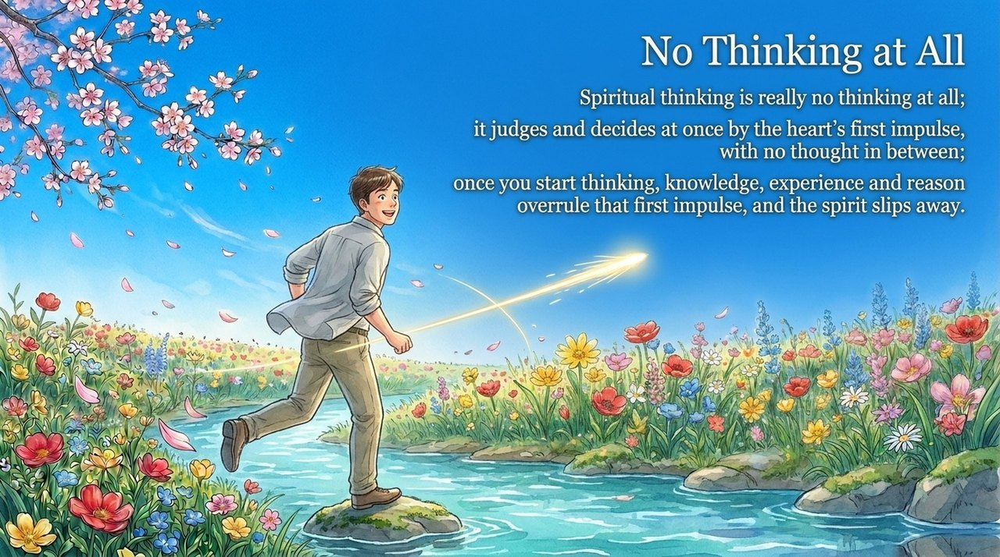
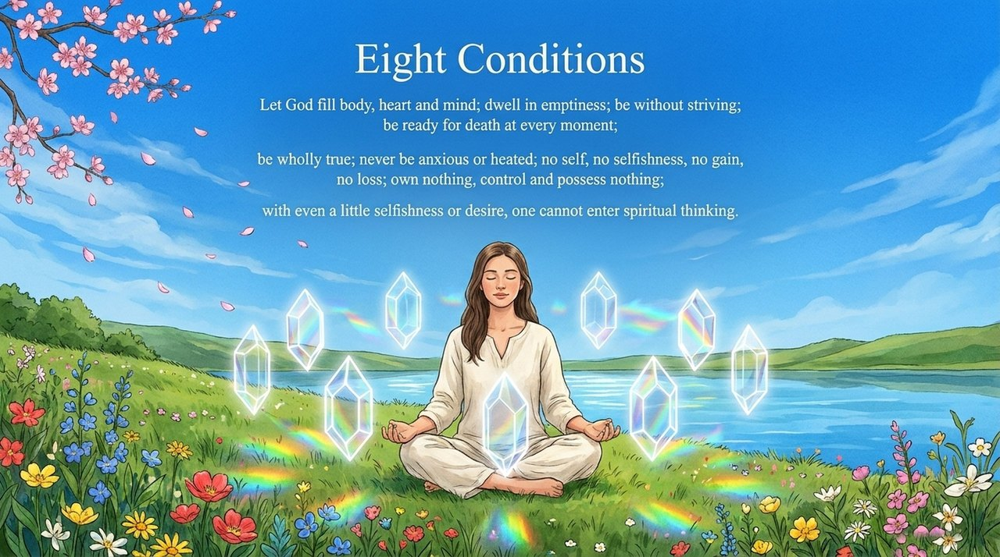
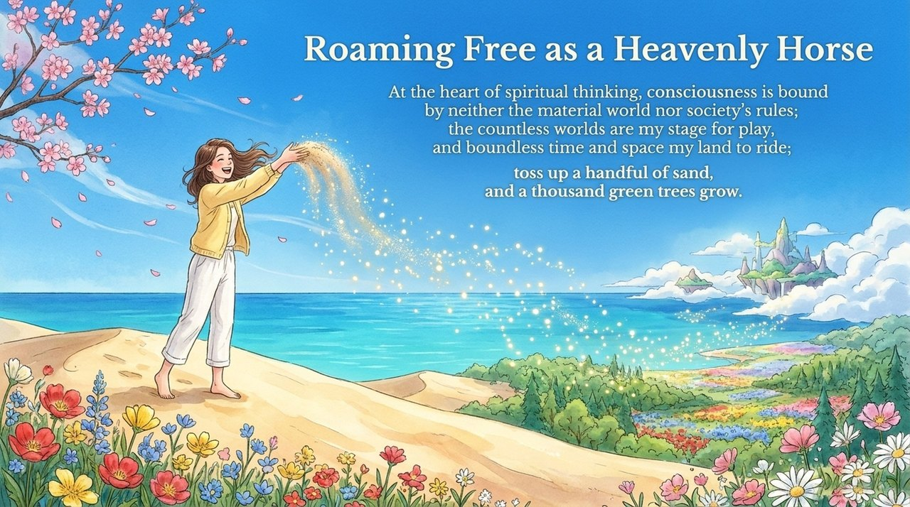

<!-- id: LC-SPT-0005 theme: Thinking Cultivation type: Entry Gateway direction: Consciousness Ascension Path lang: en slug: en version: index -->

> In Lifechanyuan terminology, **LIFE** (capitalized) refers to the ontological
> essence of existence — the soul/antimatter structure that persists across
> incarnations — while **life** (lowercase) refers to the experiential stage
> of human existence in this world.

# Spiritual Thinking

[Concept Portal]

**Spiritual Thinking** is the collective name for the **last four rungs** of Lifechanyuan's Eight Thinking Ladders — Heart-Image Thinking, Taiji Thinking, Non-Form Thinking, and Hundun Thinking. It is the precise designation for "celestial thinking," encompassing all thinking modes above the watershed between humans and celestial beings (*xian*, 仙).

> Rational Thinking and Spiritual Thinking are the watershed between humans and celestial beings. If your thinking is Rational Thinking, do not doubt it — you are definitely human.
>
> — *Chanyuan Corpus · Wisdom Chapter · The Way of Thinking and Doing of Spiritual Thinkers*

Spiritual Thinking's core is: taking the Greatest Creator's will as one's own wish, taking Dao's principles as one's code of conduct, acting with the naturalness and spontaneity of faith and intuition — without considering what benefit it brings to oneself. Spiritual Thinking is **the thinking of the Sage** (*shengren*, 圣人) — the hallmark of celestial beings, the root of joy, happiness, freedom, and bliss, the most direct path toward the Celestial Kingdom.

---

## Core Positioning

In Lifechanyuan's thinking system, Spiritual Thinking is the complete "subtraction phase" of all four rungs — it cannot be attained through intellectual learning and brain training; it must be advanced through the awakening of spiritual perception (*lingjue*, 灵觉), purification of the heart, and the release of ego-attachment. Its essence is "no thinking" — making judgments directly from the heart's first impulse, without any rational cognitive process.

---

## Reading Versions

| Version | Intended Readers | Link |
|---------|-----------------|------|
| **Friendly Edition** | First-time visitors to Lifechanyuan | [Read Friendly Edition](./friendly) |
| **Academic Edition** | Readers with philosophy/religious studies backgrounds | [Read Academic Edition](./academic) |
| **Internal Edition** | Chanyuan Celestials and deep practitioners | [Read Internal Edition](./internal) |

---

## Video

<iframe style="width:100%;aspect-ratio:4/3;border:0" src="https://www.youtube-nocookie.com/embed/ynIG4Gqd5a0" title="Spiritual Thinking (Lifechanyuan Encyclopedia video)" allowfullscreen></iframe>

## Slides

??? info "📖 Illustrated slides (14 pages, click to expand)"

    
    
    
    
    
    
    
    
    
    
    
    
    
    

---

## Related Entries

- [Eight Thinking Ladders](/en/eight-thinking-ladders/) — Spiritual Thinking's (last four rungs) coordinates in the complete system
- [Rational Thinking](/en/rational-thinking/) — The human thinking (Material / Imagery / Associative / Illusory) opposite to Spiritual Thinking
- [Heart-Image Thinking](/en/heart-image-thinking/) — Fifth rung; the first rung of Spiritual Thinking, the entrance crossing the human–celestial watershed
- [Hundun Thinking](/en/hundun-thinking/) — Eighth rung; the highest form of Spiritual Thinking — the thinking of the Greatest Creator
