# Steadfast Principles · Trust the Home

> Upholding the *800 New Era Concepts* without wavering under any circumstances, while shifting one's entire life support — from food and shelter to emotional needs — from human relationships onto the Second Home. These are the two foundational pillars of the Lifechanyuan path to the Celestial Islands Continent.

## Video

<iframe style="width:100%;aspect-ratio:4/3;border:0" src="https://www.youtube-nocookie.com/embed/KmUvAjAsGx0" title="Steadfast Principles · Trust the Home (Lifechanyuan Encyclopedia video)" allowfullscreen></iframe>

## Slides

??? info "📖 Illustrated slides (14 pages, click to expand)"

    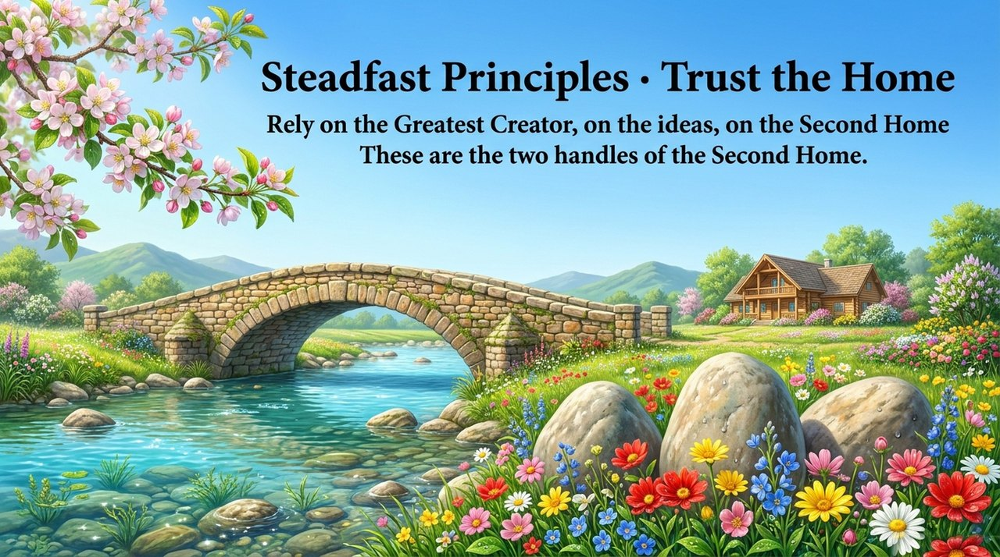
    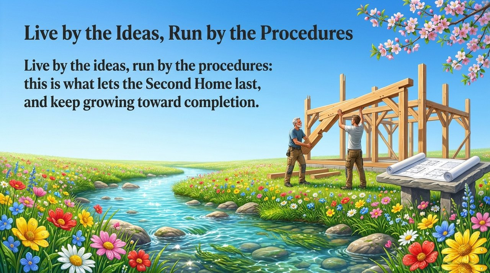
    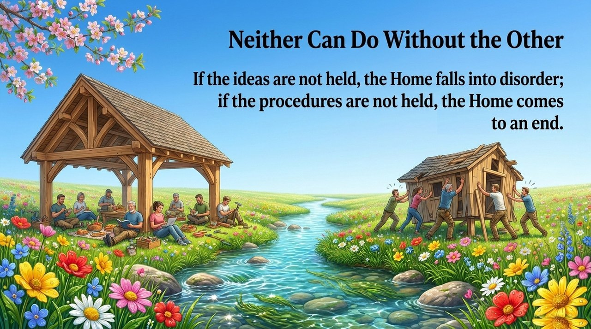
    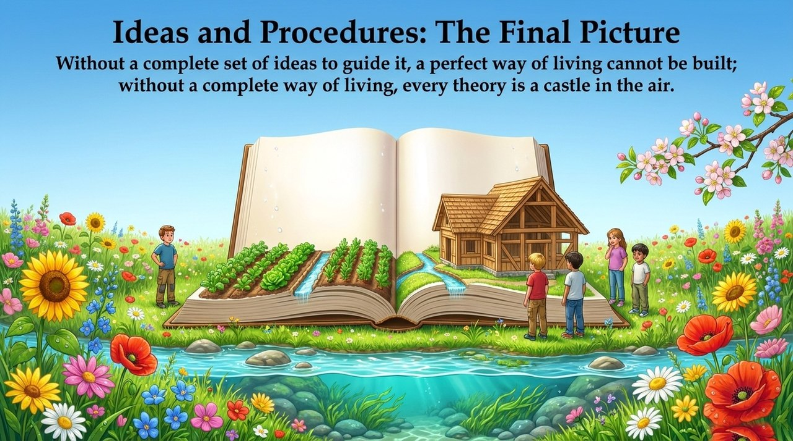
    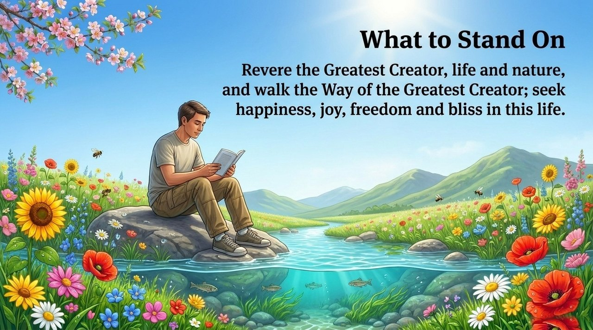
    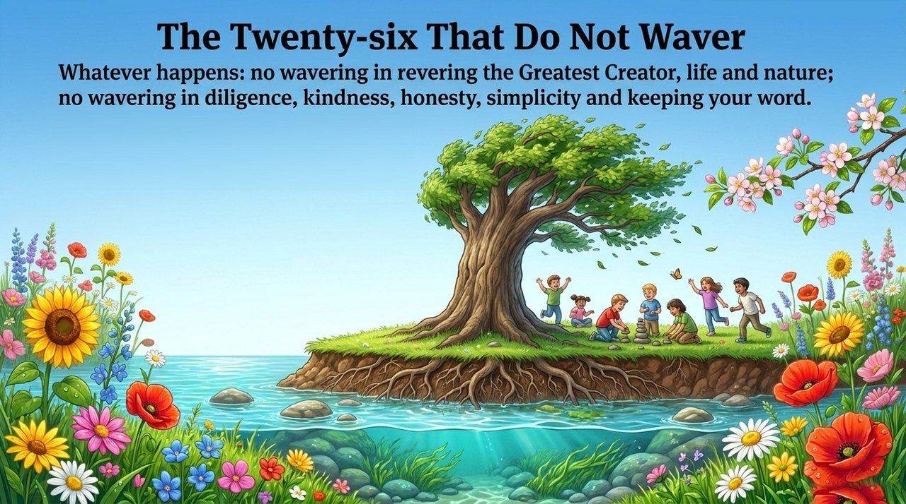
    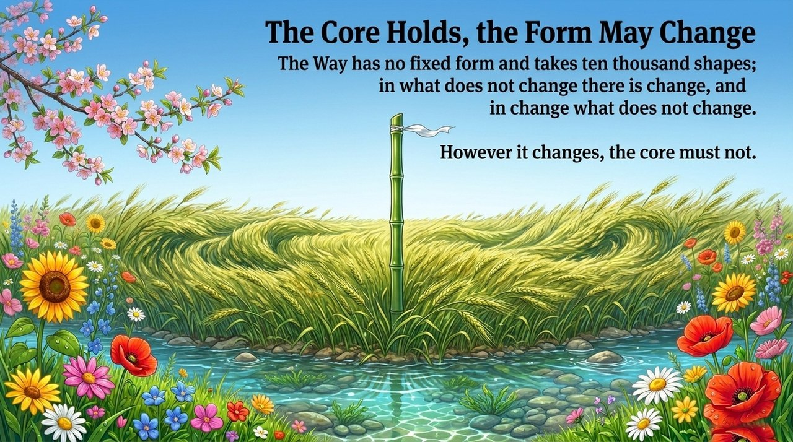
    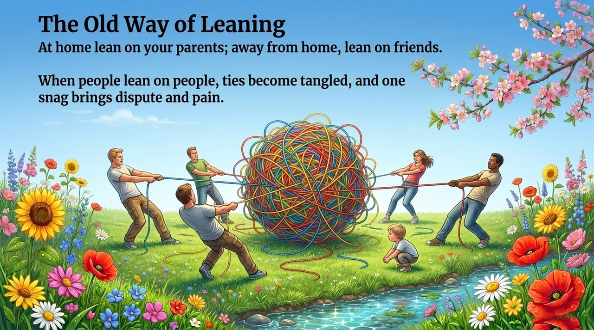
    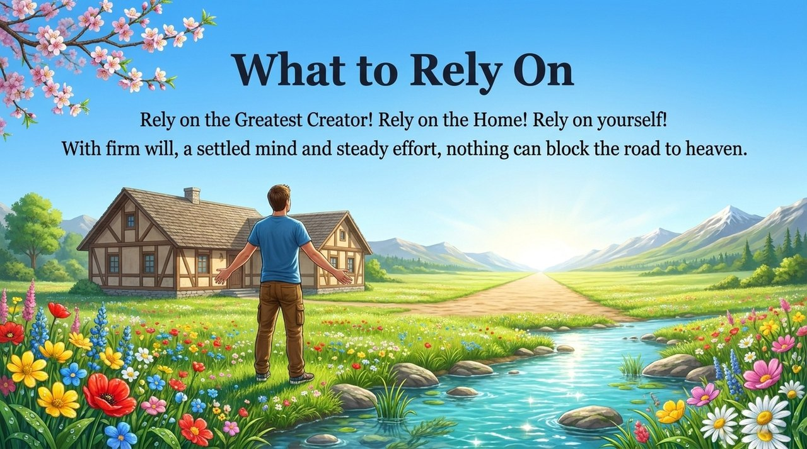
    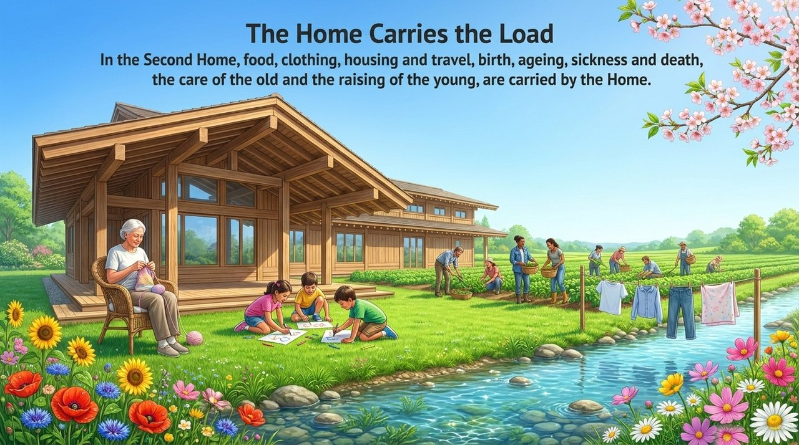
    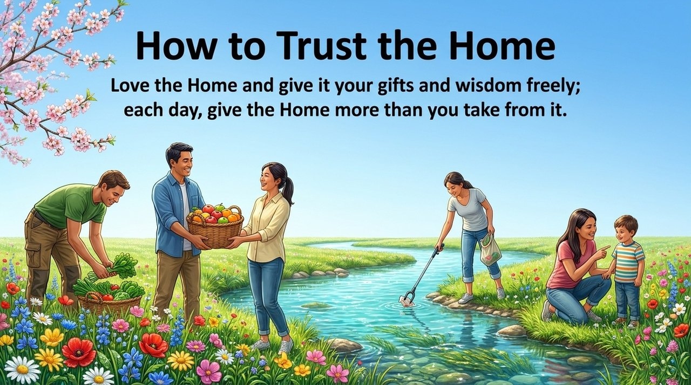
    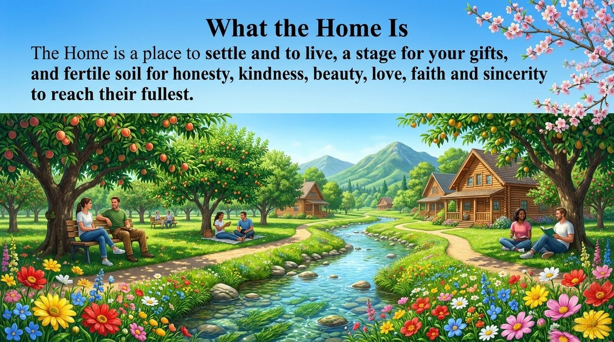
    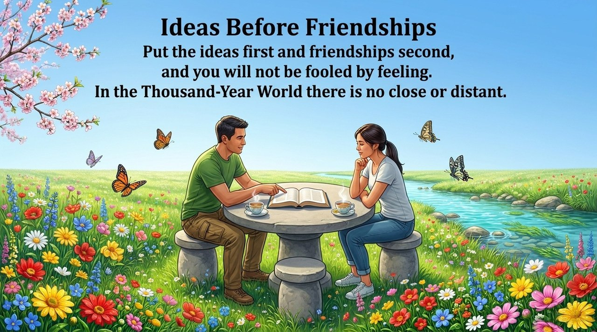
    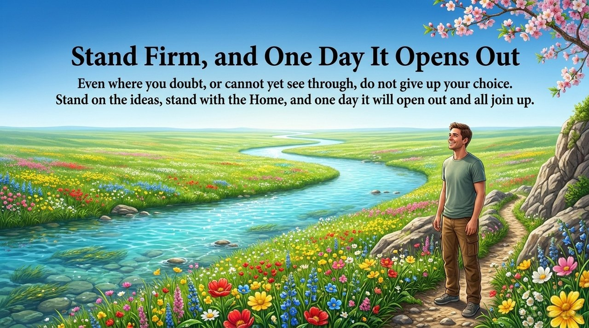

---

| Version | Best for | Focus |
|---------|----------|-------|
| [Friendly version](friendly.md) | First-time readers | Why to trust the Home instead of people |
| [Academic version](academic.md) | Researchers | Structural analysis of the dual-pillar framework |
| [Internal reference](internal.md) | Deep study | Complete primary-source compilation |

## Core Definitions

**Steadfast Principles**: Holding the *800 New Era Human Concepts* as the absolute standard for all speech and action — undisturbed by hardship, external pressure, or personal emotion.

**Trust the Home**: Building a culture of "trusting the Greatest Creator, trusting the Home, trusting oneself" — transferring one's life support from people and human relationships to the Second Home (Life Oasis), becoming a truly independent and free person.

---

## Related Entries

- [Chanyuan Values](/en/values/)
- [800 New Era Human Concepts](/en/new-era-human-800-concepts/)
- [Second Home](/en/second-home/)
- [Trust](/en/trust/)
- [Tour Guide Route Map](/en/tour-guide-route-map/)
- [Life Visa](/en/life-visa/)
- [Four Followings](/en/si-sui/)
