# Following Causes Freely · Roaming at Ease

**Following Causes Freely · Roaming at Ease** (随缘放旷·任运逍遥, *suí yuán fàng kuàng · rèn yùn xiāo yáo*) is the defining expression of the Celestial Path in the Lifechanyuan system — flowing with circumstances without attachment, living spontaneously without constraint, free from both suffering and rules, as carefree as an infant and as fluid as water. Guide Xuefeng identifies this as the essential quality that distinguishes the Celestial Path from Buddhism, Christianity, and ordinary human ethics, and marks it as the second milestone in the "Three-Step Path to Becoming a Celestial Being."

> If we find life exhausting, we are far from the Celestial Path. If we grow ever more joyful, free, and at ease, we are drawing near.
>
> — Chanyuan Corpus · Immortal Cultivation · "Following Causes Freely · Roaming at Ease"

## Video

<iframe style="width:100%;aspect-ratio:4/3;border:0" src="https://www.youtube-nocookie.com/embed/4YHmioEFdIM" title="Following Causes Freely · Roaming at Ease (Lifechanyuan Encyclopedia video)" allowfullscreen></iframe>

## Slides

??? info "📖 Illustrated slides (14 pages, click to expand)"

    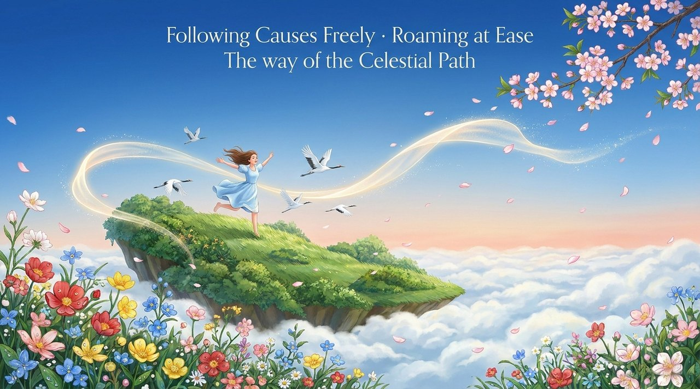
    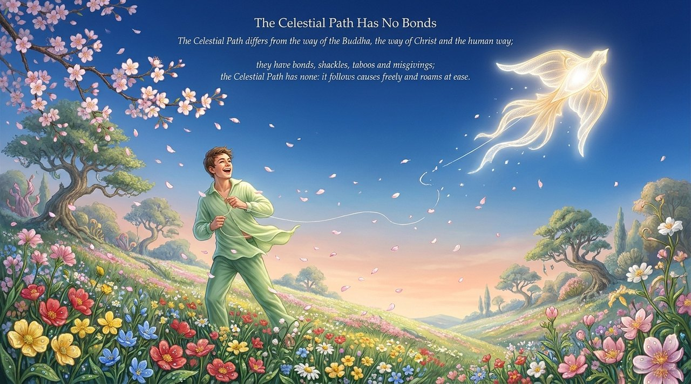
    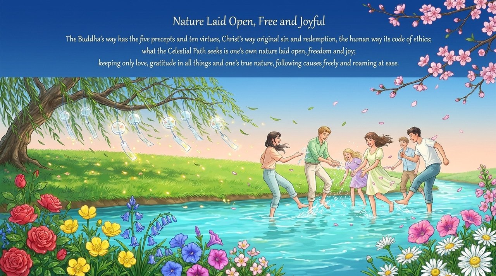
    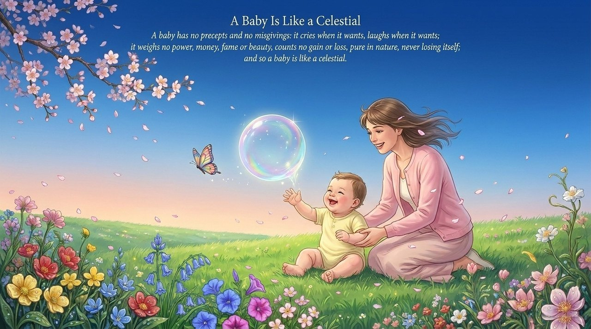
    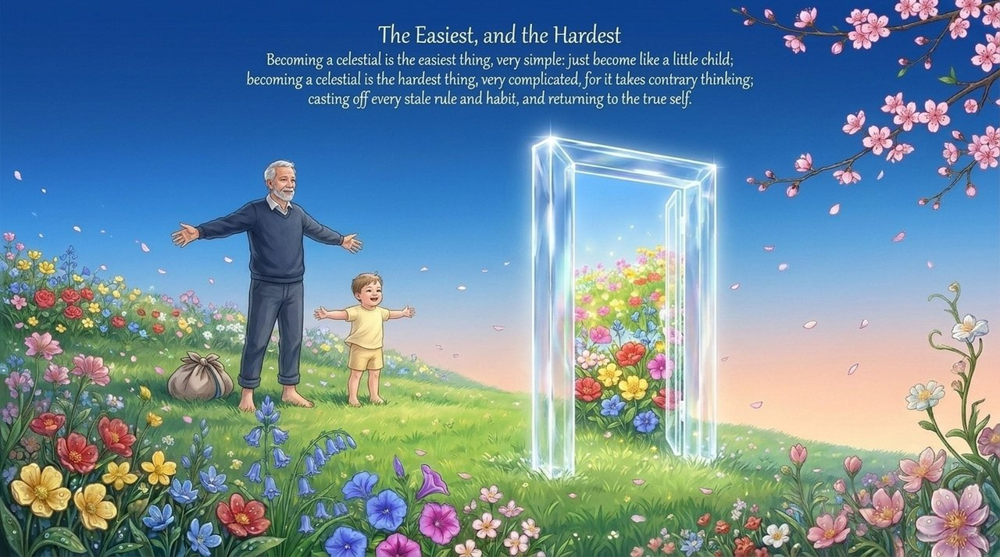
    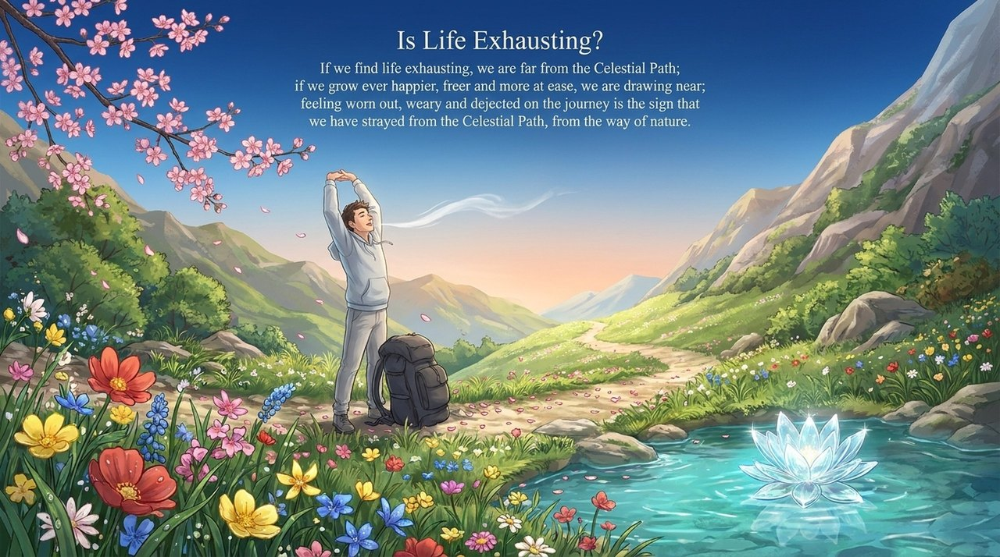
    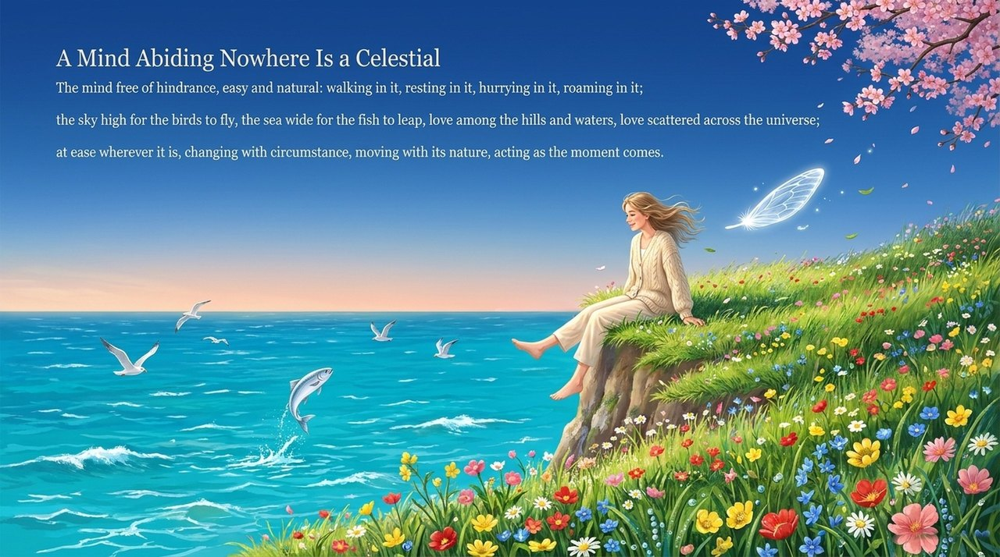
    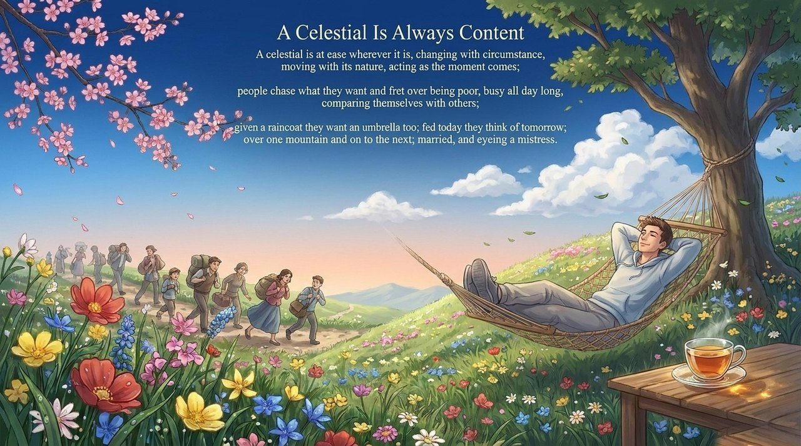
    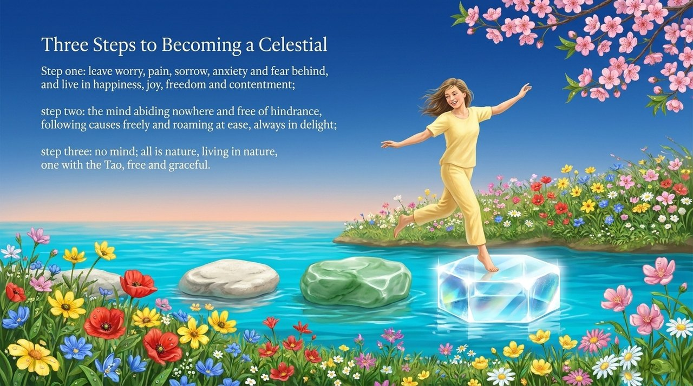
    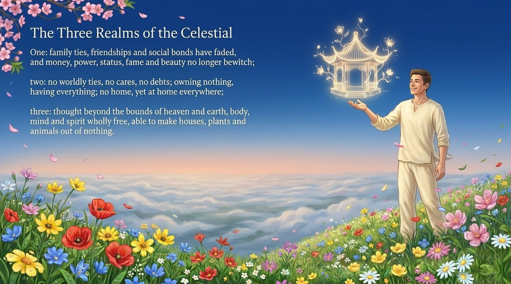
    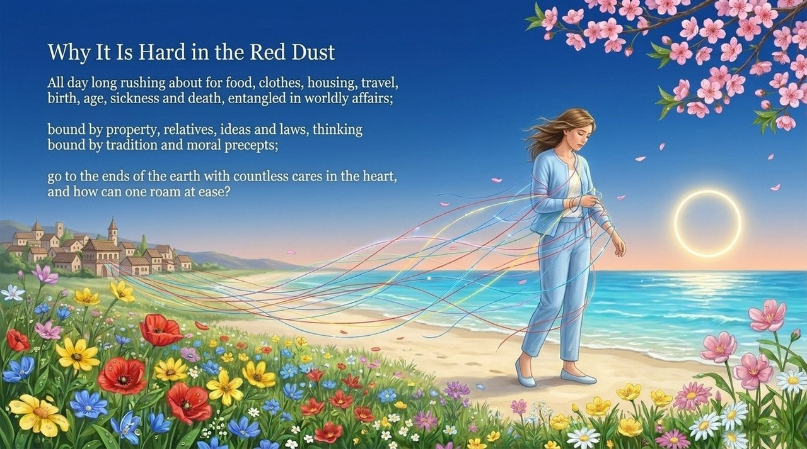
    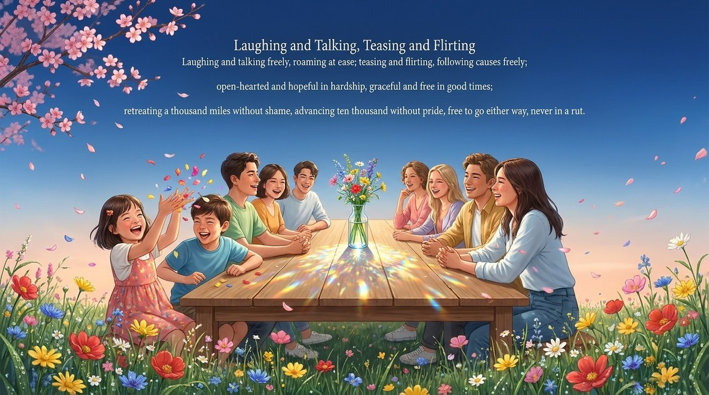
    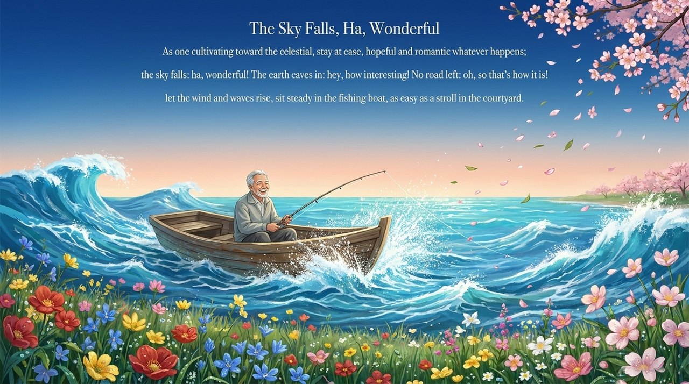
    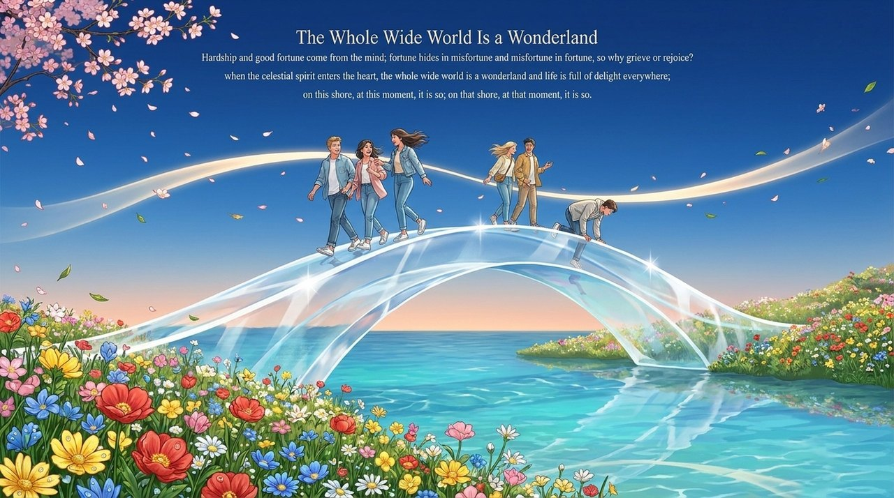

---

## Versions

| Version | Best for | Focus |
|---------|----------|-------|
| [Friendly version](friendly/) | First-time readers | Life experience and the feel of the Celestial Path |
| [Academic version](academic/) | Researchers | Systematic analysis and cross-cultural comparison |
| [Internal reference](internal/) | Deep study | Guide Xuefeng's original texts |

## Related entries

[The Four Adaptations (Sì Suí)](/en/si-sui/) · [Non-Action Yet All-Accomplished](/en/wu-wei/) · [No-Self, No-Form](/en/no-self-no-form/) · [Mind Without Abiding · Mind Without Hindrance](/en/xinwu-suozhu-guaai/) · [Self-Coherence](/en/self-coherence/) · [Celestial Nature (Xianxing)](/en/xianxing/) · [Becoming a Celestial Being](/en/becoming-celestial/) · [Childlike Nature](/en/childlike-nature/)
