# The Grand Void Illusion (Tai Xu Huan Jing)

The **Grand Void Illusion** (*Tai Xu Huan Jing* 太虚幻境) is, in the Lifechanyuan system, another name for the Antimatter World — the realm where all that appears illusory in physical reality is, in fact, genuinely real. Guide Xuefeng unlocks the hidden meaning of the famous Chapter 5 dreamscape in China's classic novel *Dream of the Red Chamber*: the "Grand Void Illusion" that Baoyu visits in his dream is not a literary fiction but a true glimpse of the antimatter world. His core teaching: *All illusions are the Antimatter World. Everything that seems unreal is a real existence.*

> Flowers that are not flowers, dreams that are not dreams — consciousness and structure reveal the original form. Through cycles of blossoming and awakening, one cultivates a grain of truth: the Grand Void Illusion is the realm of celestial beings.
>
> — Chanyuan Corpus · Antimatter World Chapter · *The Ancient Mystery of the Grand Void Illusion*

## Video

<iframe style="width:100%;aspect-ratio:4/3;border:0" src="https://www.youtube-nocookie.com/embed/L9iCb_tpCl0" title="The Grand Void Illusion (Lifechanyuan Encyclopedia video)" allowfullscreen></iframe>

## Slides

??? info "📖 Illustrated slides (14 pages, click to expand)"

    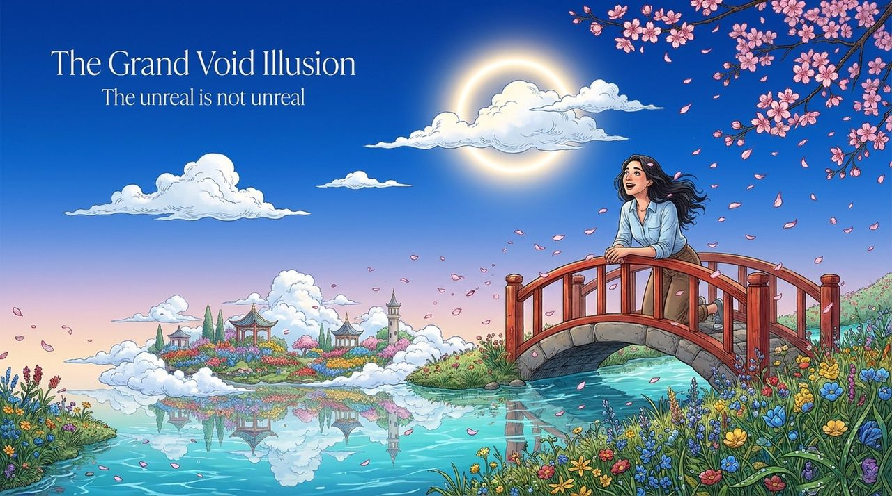
    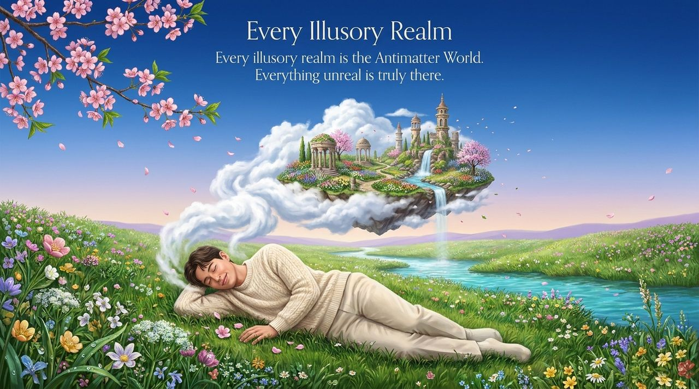
    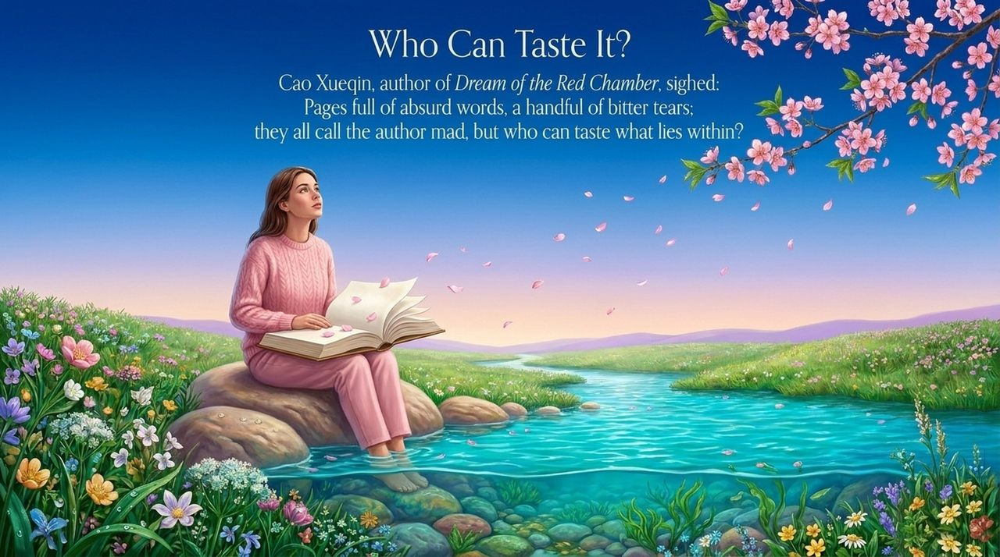
    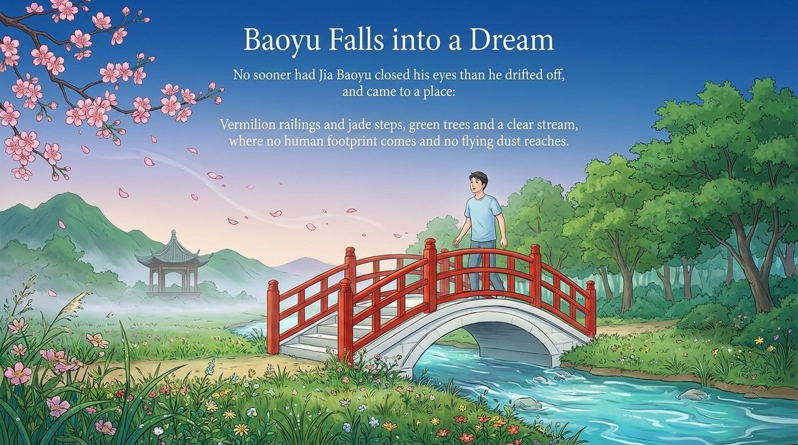
    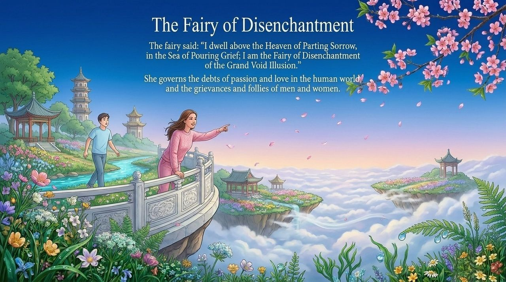
    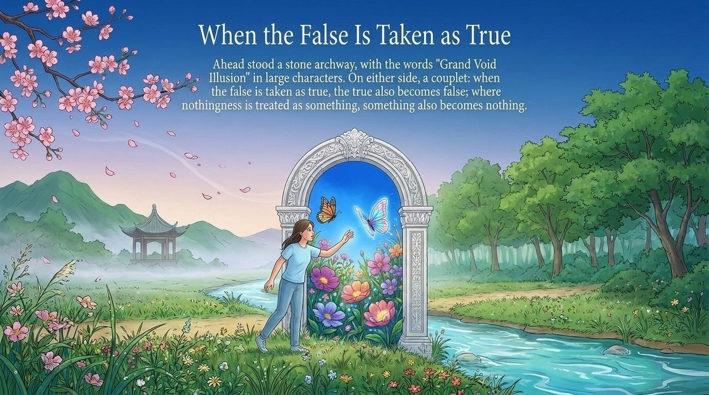
    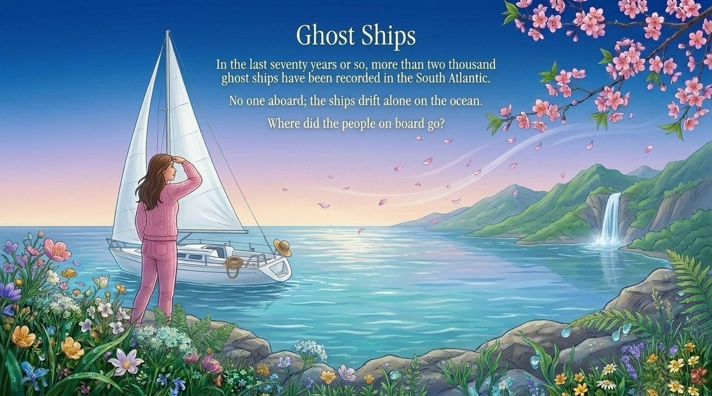
    
    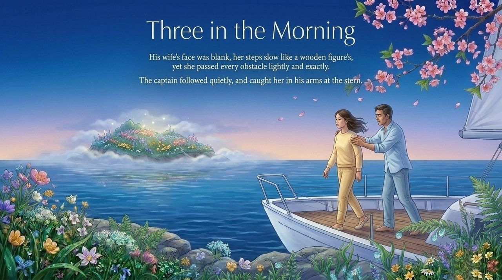
    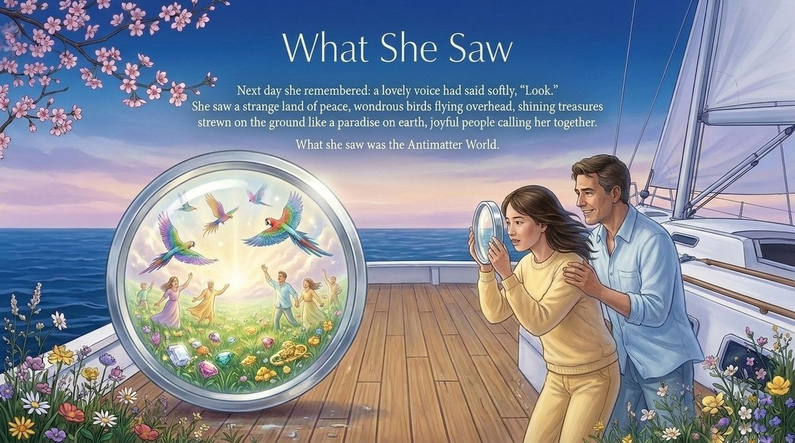
    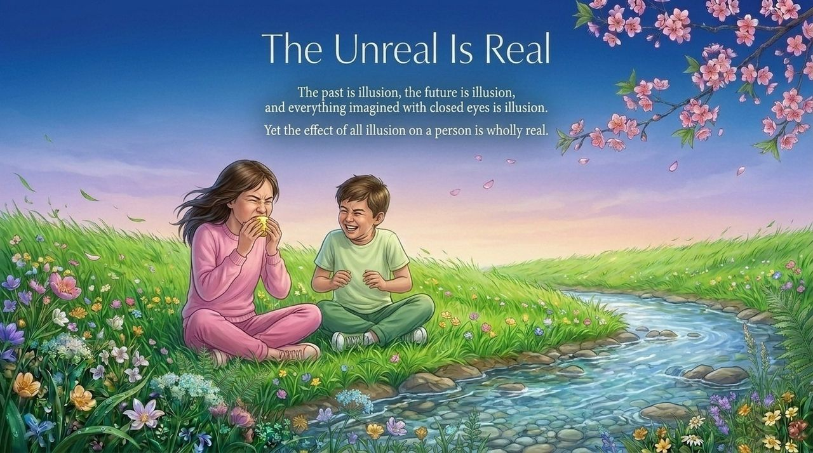
    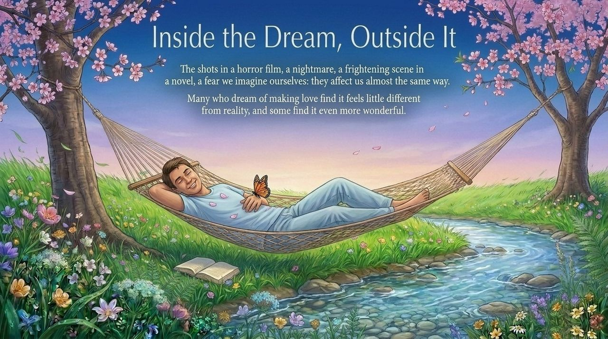
    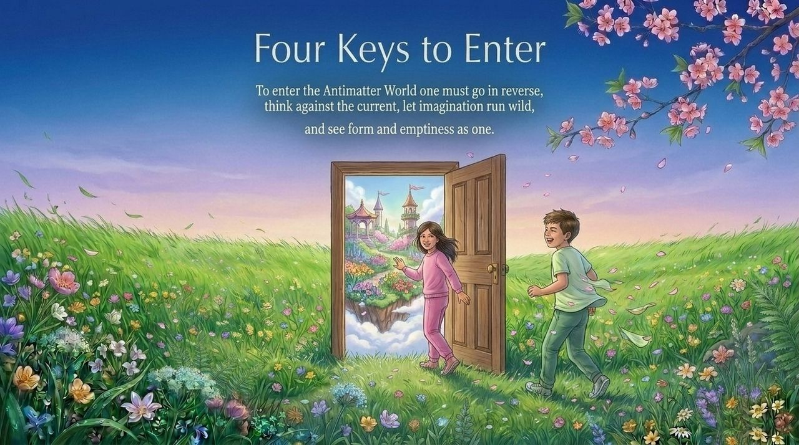
    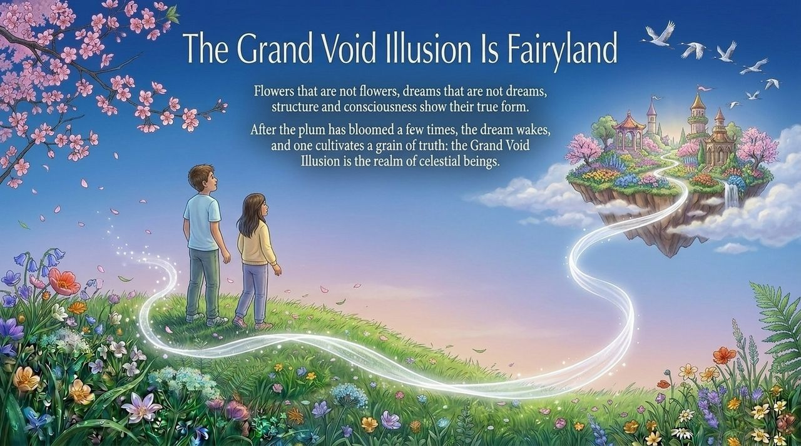

---

## Version Navigation

| Version | Best for | Focus |
|---------|----------|-------|
| [Friendly version](friendly/) | First-time readers | Red Chamber dreams and real-world anomalies |
| [Academic version](academic/) | Researchers | Philosophical and cosmological analysis |
| [Internal reference](internal/) | Deep study | Guide's original text · Source archive |

## Related Entries

[Antimatter World](/en/antimatter-world/) · [Dreams](/en/dream-state/) · [Hundun](/en/hundun/) · [Abnormal Thinking](/en/abnormal-thinking/) · [Inverted Thinking](/en/inverted-thinking/) · [Higher LIFE Spaces](/en/high-life-spaces/) · [Thousand-Year World](/en/thousand-year-world/) · [Non-Form Thinking](/en/non-form-thinking/)
