<!-- id: LC-TAJ-0005 theme: Thinking Cultivation type: Entry Gateway direction: Consciousness Ascension Path lang: en -->

> In Lifechanyuan terminology, **LIFE** (capitalized) refers to the ontological
> essence of existence — the soul/antimatter structure that persists across
> incarnations — while **life** (lowercase) refers to the experiential stage
> of human existence in this world.

# Taiji Thinking

【Entry Gateway】

**Taiji Thinking** is the **sixth rung** of the Eight Thinking Ladders — situated above Heart-Image Thinking and below Non-Form Thinking, it is the second step within the "subtraction phase" on the path toward higher spiritual realization. The essence of Taiji Thinking is: recognizing and skillfully applying the cosmic law of **Yin–Yang dialectical unity**. Laozi's thinking was Taiji Thinking, and the entire *Tao Te Ching* is its complete textual expression.

> Taiji Thinking: recognizing the dialectical unity of opposites, the principle of Yin–Yang symmetry — that is Taiji Thinking.
>
> — Xuefeng, *Xuefeng Corpus · Vol. X04 Friendship Chapter · Paying Tribute to Mr. Qingfeng Bi*

---

## Core Position

In Lifechanyuan's cultivation route map, Taiji Thinking is the second rung of the subtraction phase (Heart-Image → **Taiji** → Non-Form → Hundun). Those with Taiji Thinking perceive the orderly operation of the universe's positive and negative energies and the well-ordered development of all things; they rarely need to consciously "think" — Yin and Yang flow naturally within their consciousness. Taiji Thinking is the realm of sages; those who possess it were great masters and wise philosophers in their previous lives.

---

## Edition Navigator

| Edition | Best For | Link |
|---------|---------|------|
| **Friendly Edition** | Readers new to Lifechanyuan | [Read Friendly Edition](./friendly) |
| **Academic Edition** | Readers with philosophy / religious studies background | [Read Academic Edition](./academic) |
| **Internal Edition** | Chanyuan Celestials and deep practitioners | [Read Internal Edition](./internal) |

---

## Video

<iframe style="width:100%;aspect-ratio:4/3;border:0" src="https://www.youtube-nocookie.com/embed/nSlQVv3wXPg" title="Taiji Thinking (Lifechanyuan Encyclopedia video)" allowfullscreen></iframe>

## Slides

??? info "📖 Illustrated slides (14 pages, click to expand)"

    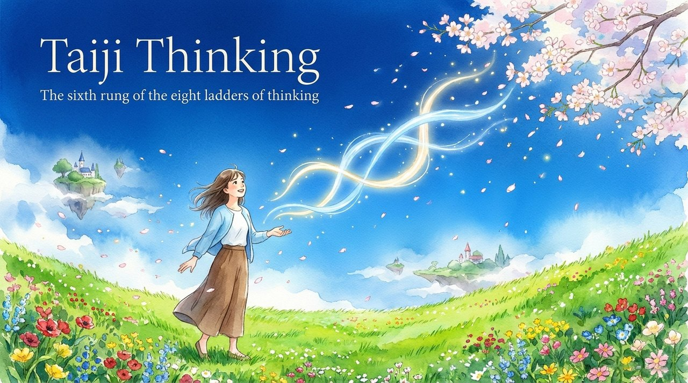
    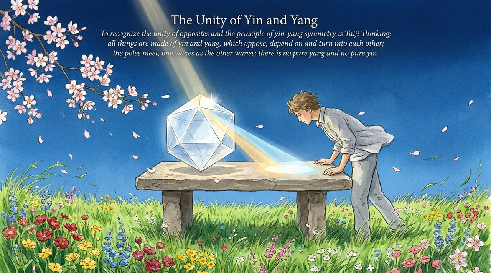
    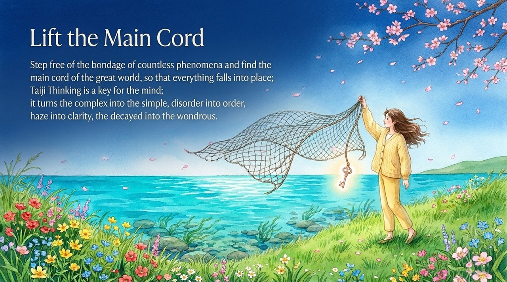
    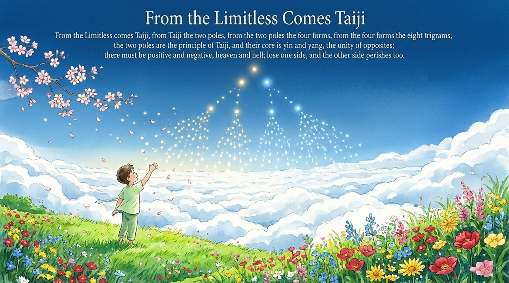
    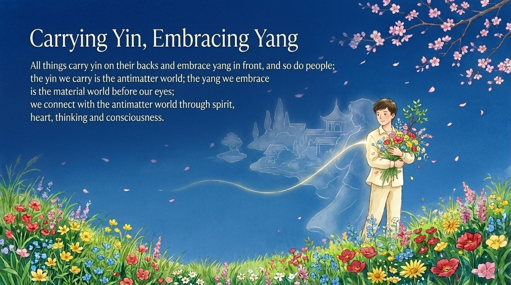
    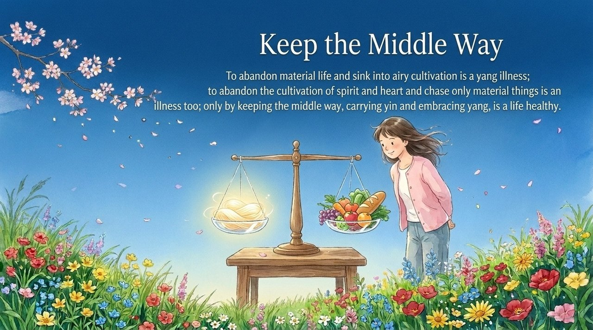
    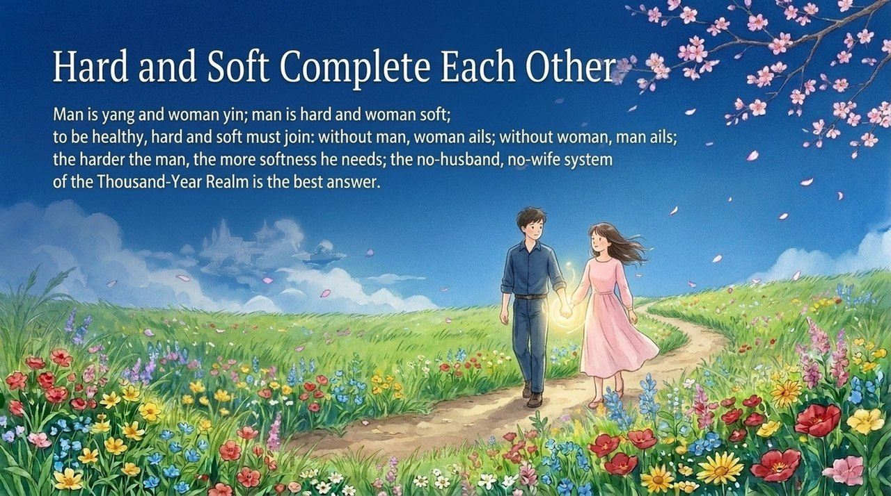
    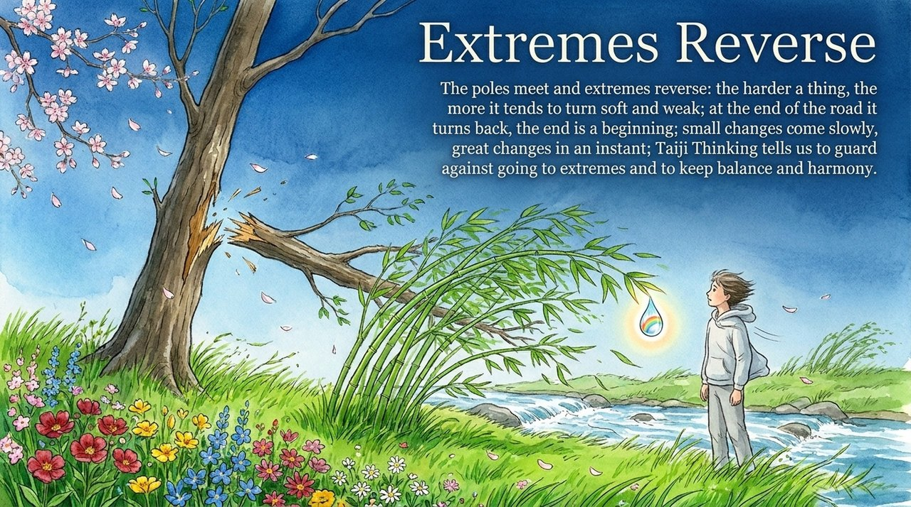
    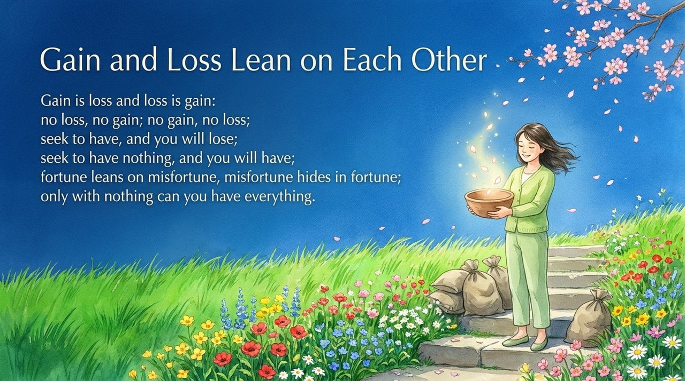
    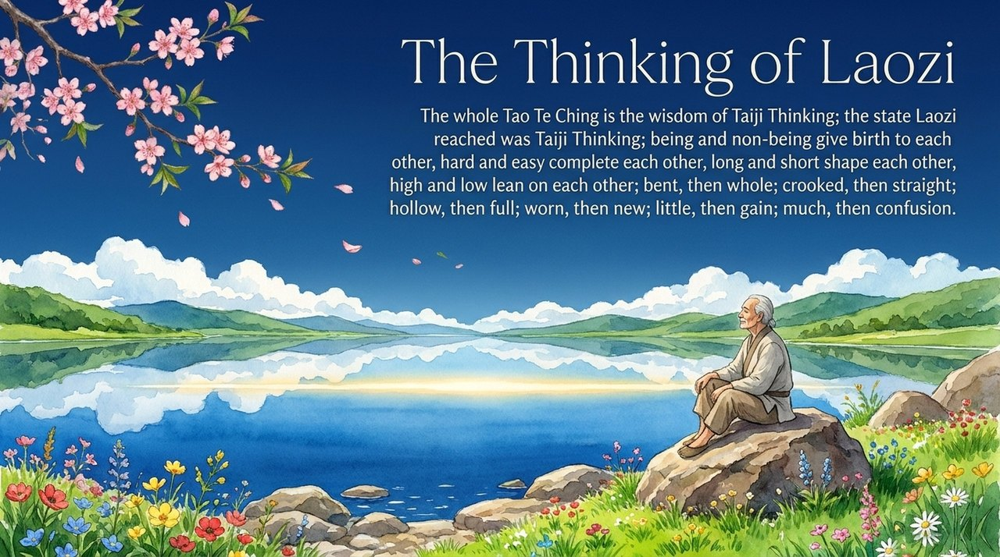
    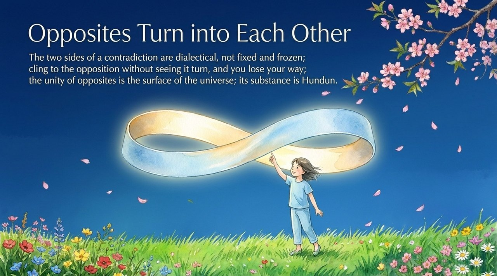
    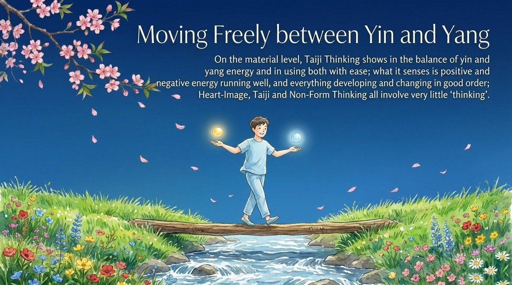
    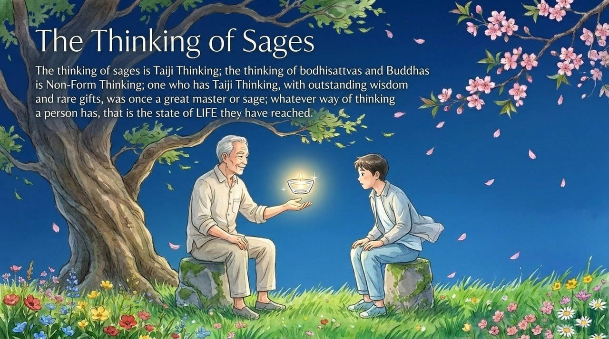
    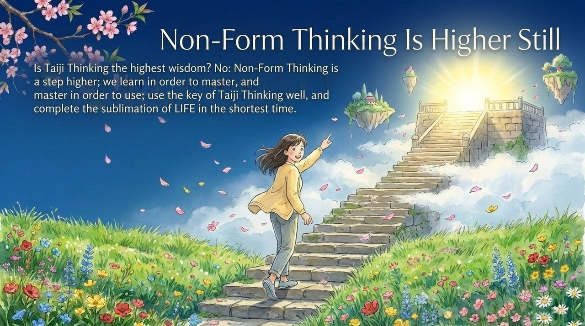

---

## Related Entries

- [Eight Thinking Ladders](/en/eight-thinking-ladders/) — Taiji Thinking's coordinates in the complete thinking ladder system
- [Heart-Image Thinking](/en/heart-image-thinking/) — Fifth rung; the step preceding Taiji Thinking
- [Taiji](/en/taiji/) — The cosmological definition of Taiji
- [Dao](/en/dao/) — Laozi, the *Tao Te Ching*, and their relationship with Taiji Thinking
