<!-- id: LC-TAIJI-0001-EN theme: The Greatest Creator and the Tao type: Gateway Page direction: Cosmic Origin lang: en -->

# Taiji

[Entry Gateway]

> In Lifechanyuan terminology, **LIFE** (capitalized) refers to the ontological
> essence of existence — the soul/antimatter structure that persists across
> incarnations — while **life** (lowercase) refers to the experiential stage
> of human existence in this world.

**Taiji** (太极) is one of the most central concepts in Lifechanyuan cosmology — the first form of existence the universe took after the Greatest Creator was born, the turning point from disorder to order, and the first cause of the entire cosmological architecture. Taiji is the Greatest Creator; the shared cosmological referent of Dao, Tathagata, Allah, and Yahweh — different names for one and the same origin-being.

> Wuji gives rise to Taiji; Taiji is the Greatest Creator. Taiji arises naturally; therefore nature is the Greatest Creator.
>
> — Guide Xuefeng, *New Era Human 800 Concepts*

---

## Core Positioning

In the Lifechanyuan system, Taiji is not a diagram or a martial art — it is the name for the moment structure generated consciousness in the cosmic origin chain. Its uniqueness (no opposing counterpart) is the structural basis for the oneness of the Greatest Creator. Taiji Thinking is also the sixth rung of the Eight Thinking Ladders — the level reached by Laozi.

---

## Video

<iframe style="width:100%;aspect-ratio:4/3;border:0" src="https://www.youtube-nocookie.com/embed/E_dMIyyatb8" title="Taiji (Lifechanyuan Encyclopedia video)" allowfullscreen></iframe>

## Slides

??? info "📖 Illustrated slides (14 pages, click to expand)"

    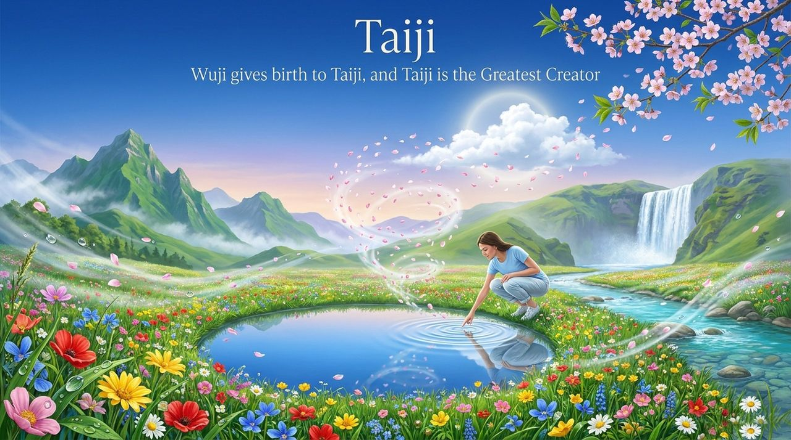
    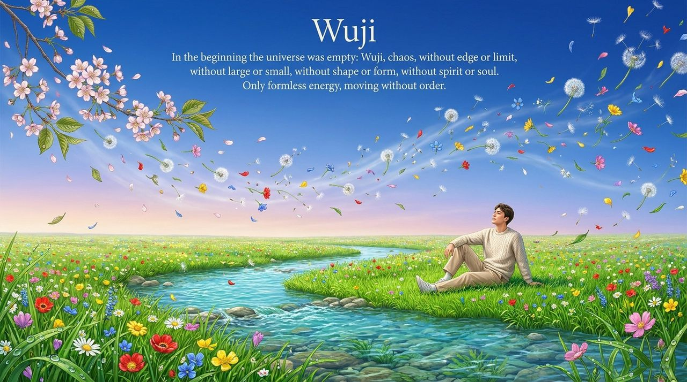
    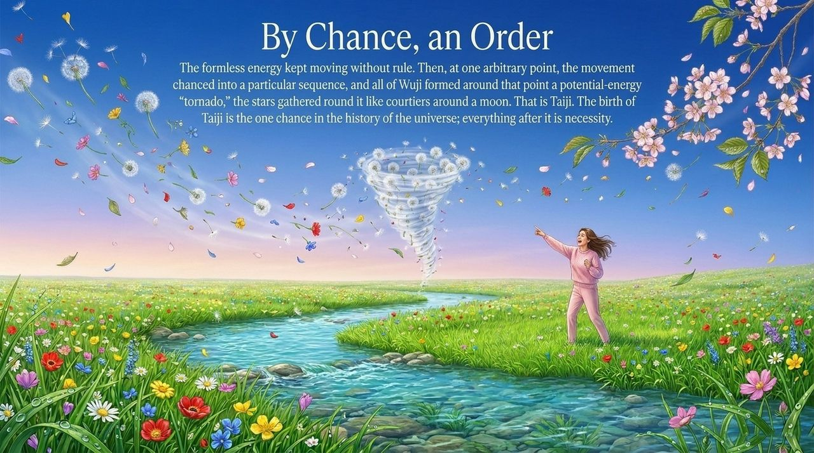
    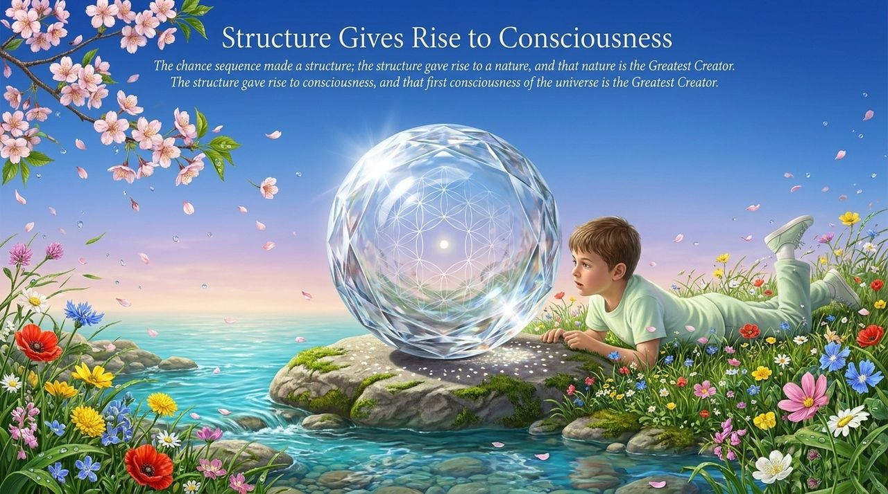
    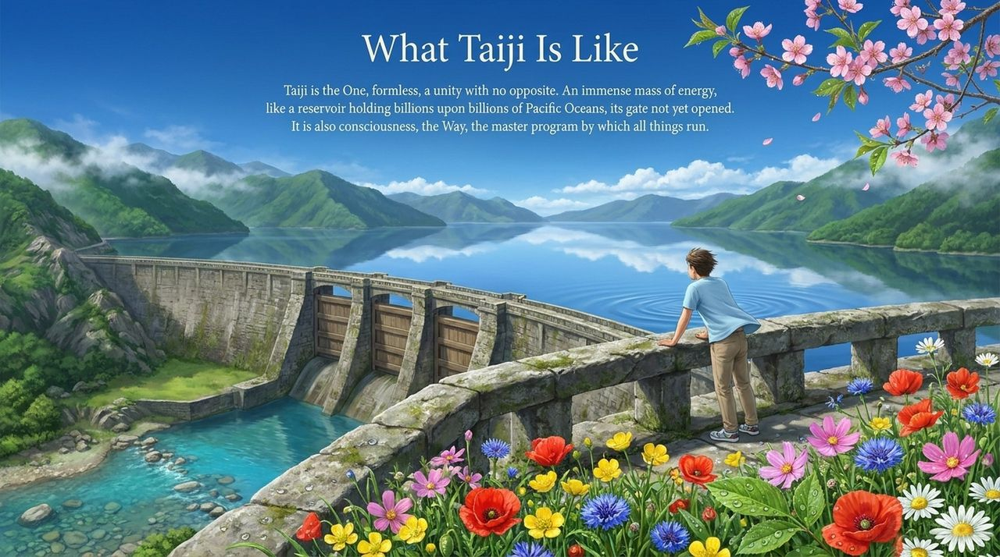
    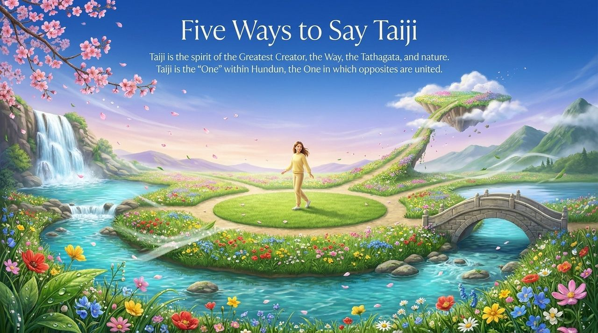
    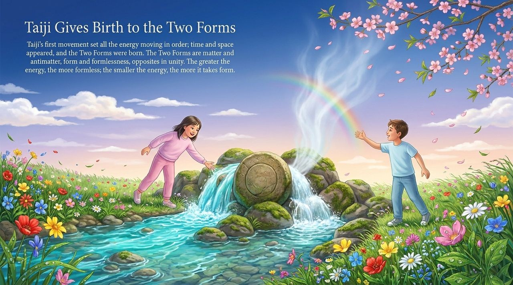
    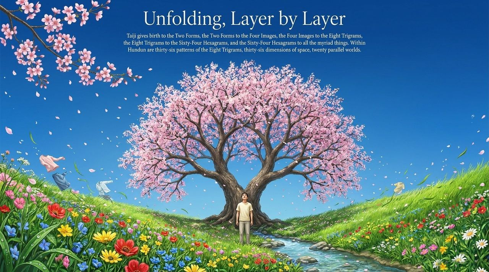
    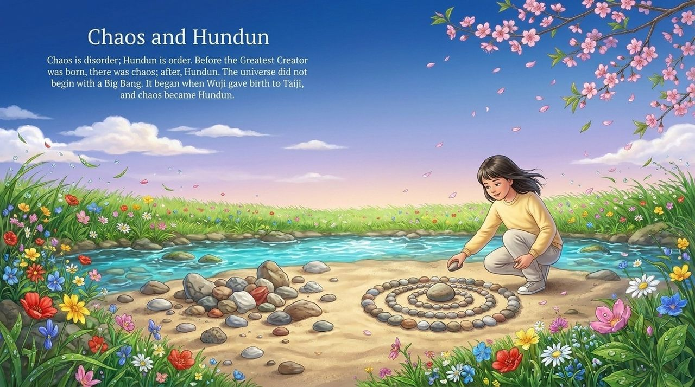
    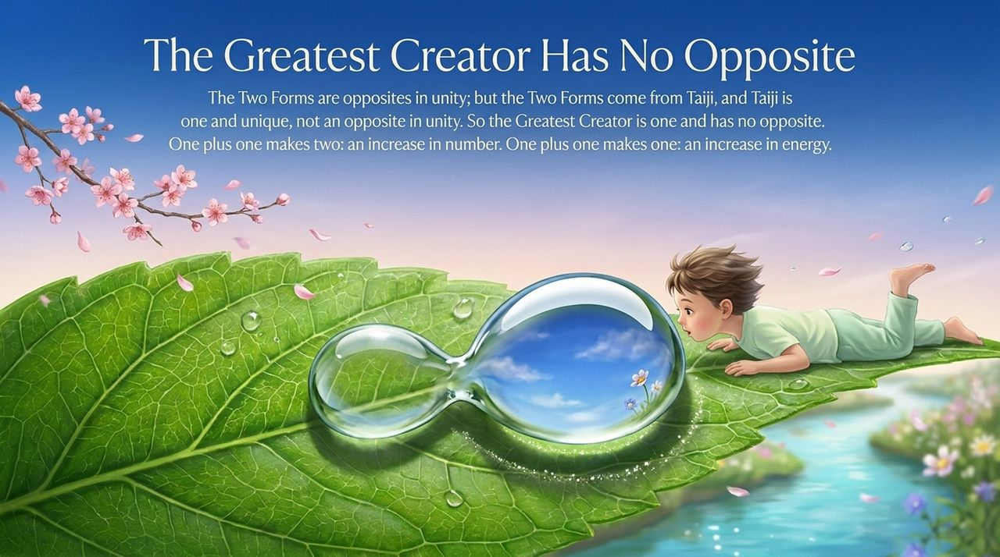
    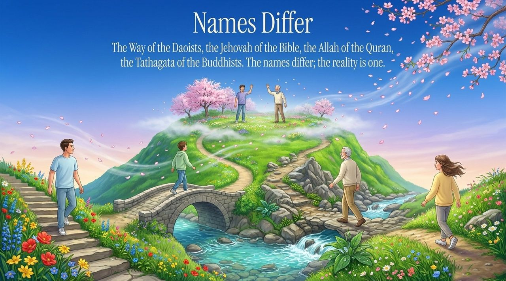
    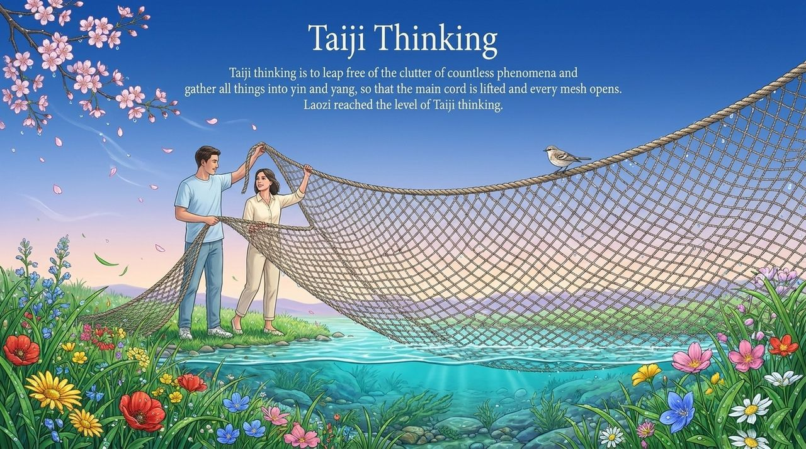
    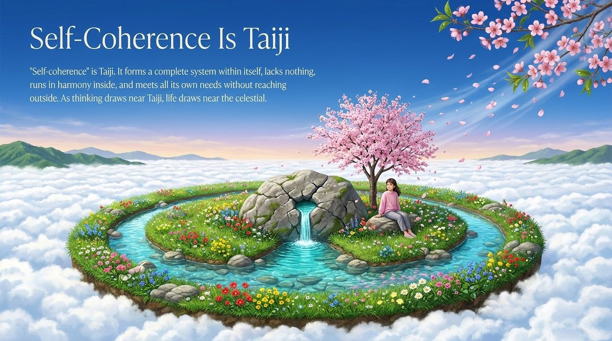
    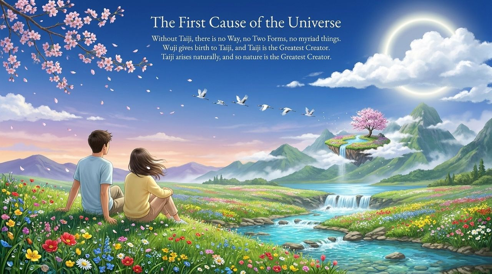

---

## Read by Edition

| Edition | Intended Reader | Link |
|---------|----------------|-------|
| **Friendly Edition** | Readers new to Lifechanyuan concepts | [Read Friendly Edition](./friendly) |
| **Academic Edition** | Researchers with philosophical/religious studies background | [Read Academic Edition](./academic) |
| **Internal Edition** | Chanyuan Celestials and deep practitioners | [Read Internal Edition](./internal) |

---

## Related Entries

- [Wuji](/en/wuji/) — Wuji gives rise to Taiji; the state before Taiji
- [Cosmic Origin](/en/universe-origin/) — The cosmological sequence from Wuji through Taiji
- [Dao](/en/dao/) — Dao as the consciousness of the Greatest Creator; parallel concept
- [The Greatest Creator](/en/greatest-creator/) — Taiji is the Greatest Creator
- [Eight Thinking Ladders](/en/eight-thinking-ladders/) — Taiji Thinking is the sixth rung
