<!-- id: LC-THK-0005 theme: Mystery of Thinking type: entry-index direction: life-ascension lang: en -->

# Thinking (Overview)

> Thinking is the core component of consciousness, and thinking can change consciousness. To change your way of life, to enter an ideal home, you must first change your mode and manner of thinking. Whatever mode of thinking you have, that is the form of existence your life will take.
>
> — "Building Our Ideal Home," Xuefeng's Writings

**Thinking** is the dimension and process of thought, contemplation, and reflection — and the core component of consciousness. In the Lifechanyuan system, thinking is divided into eight ascending ladders, from Material Thinking to Hundun Thinking. The higher the level of thinking, the deeper the life's dimension and the closer it is to the Greatest Creator. Transforming one's thinking is the fundamental path to changing the direction of life and entering higher realms of existence.

---

## Video

<iframe style="width:100%;aspect-ratio:4/3;border:0" src="https://www.youtube-nocookie.com/embed/s2RYIScurhs" title="Thinking (Overview) (Lifechanyuan Encyclopedia video)" allowfullscreen></iframe>

## Slides

??? info "📖 Illustrated slides (14 pages, click to expand)"

    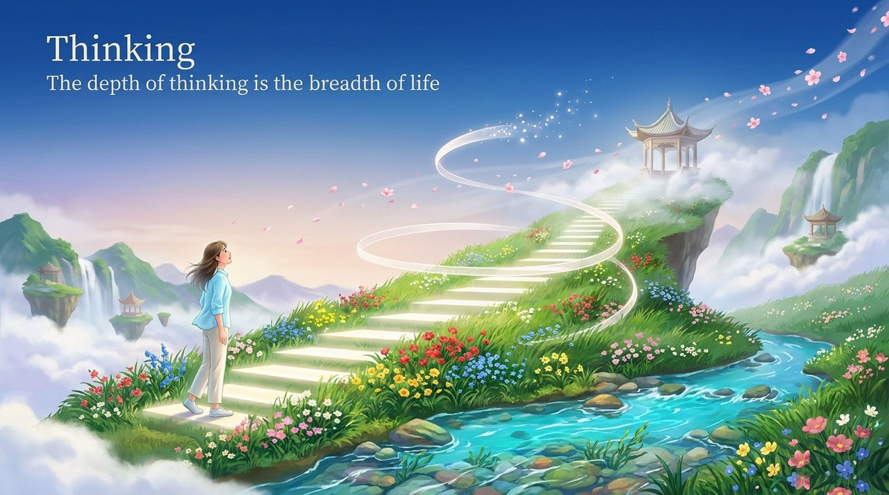
    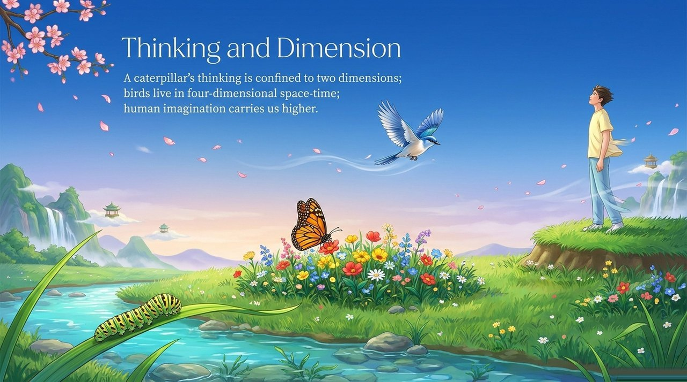
    
    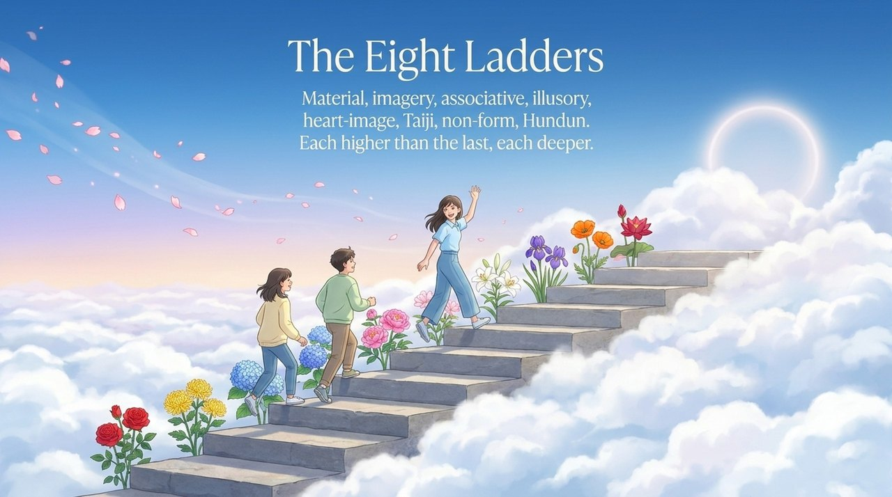
    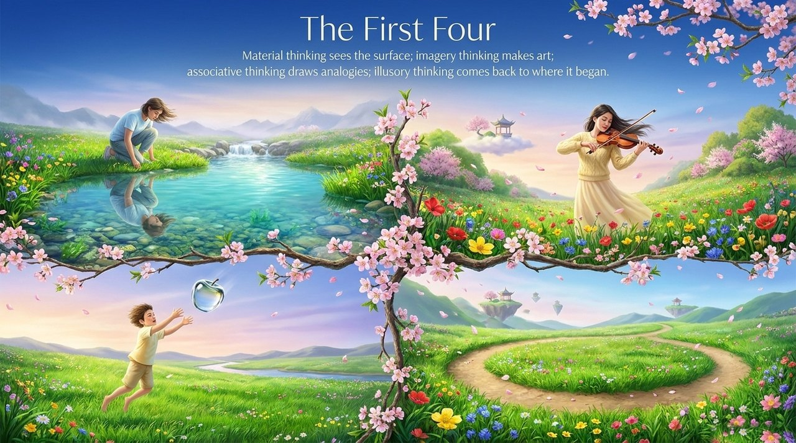
    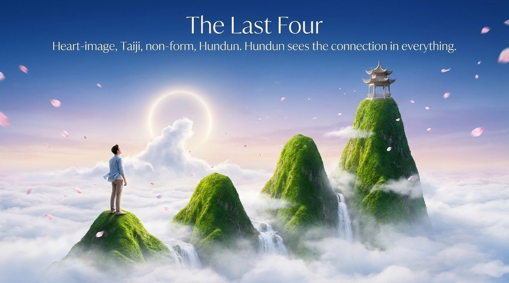
    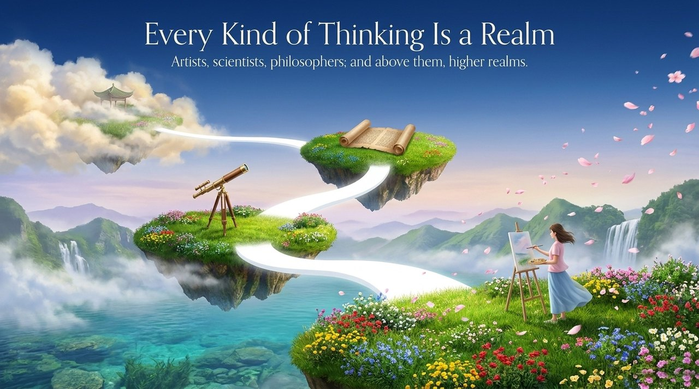
    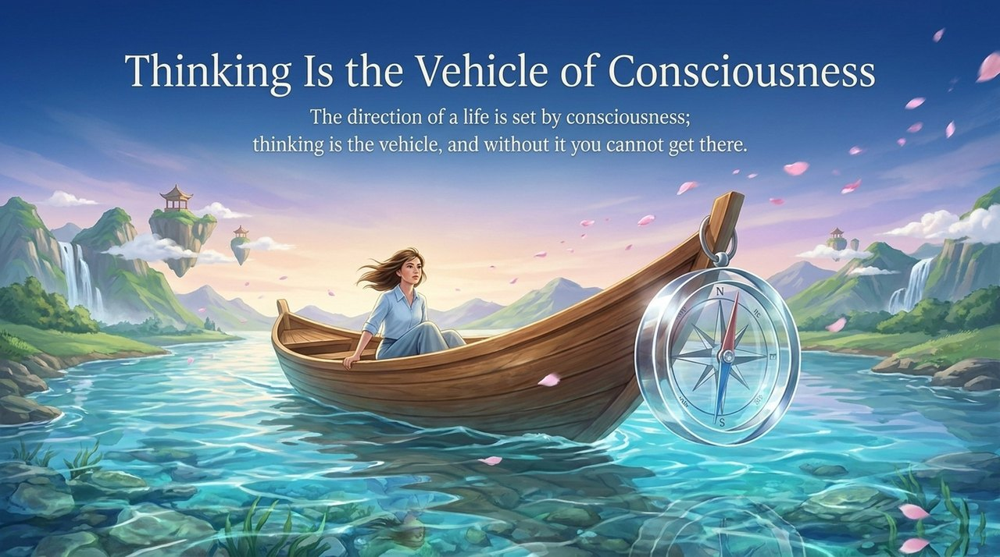
    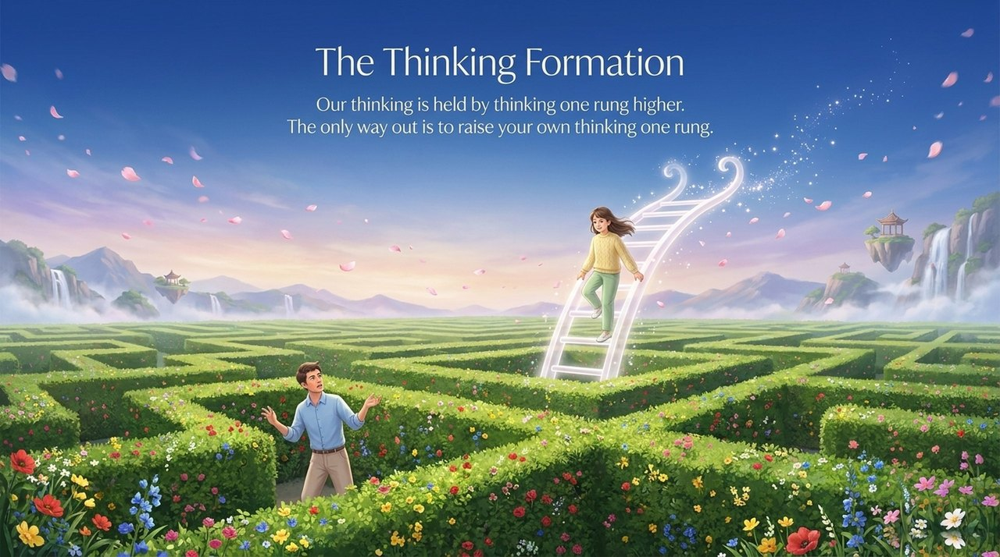
    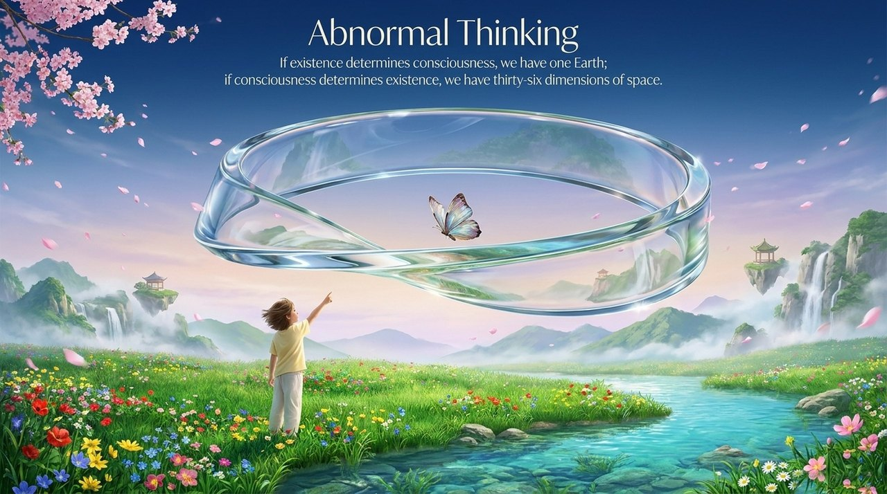
    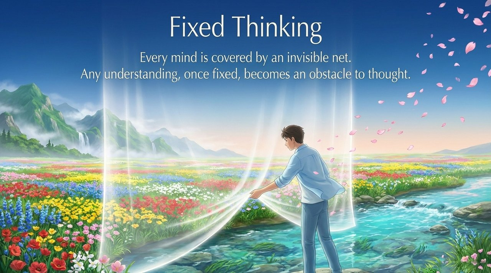
    
    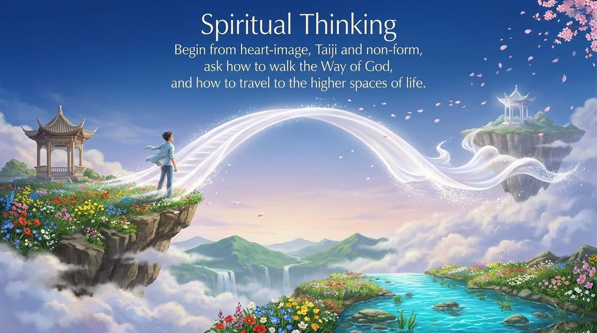
    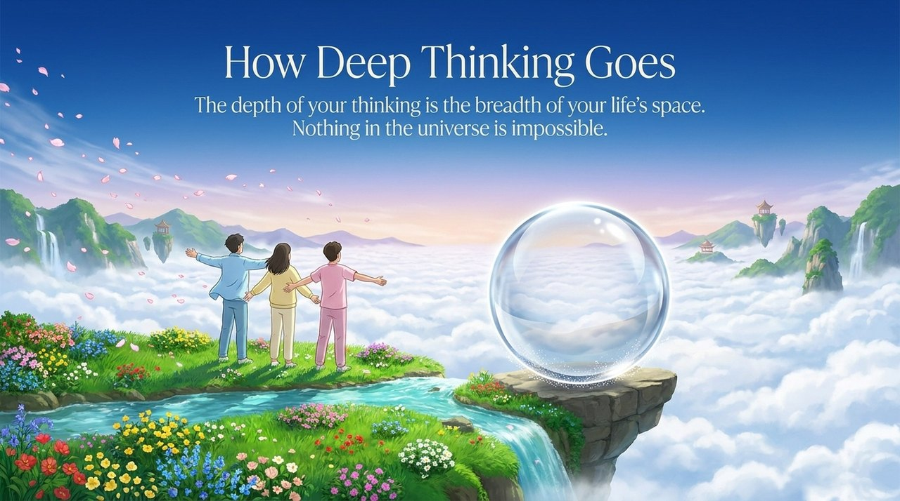

---

## Versions

| Version | For | Core Content |
|---------|-----|--------------|
| [Friendly Version](/en/thinking-overview/friendly/) | First-time readers | What is thinking? The eight ladders explained with everyday analogies |
| [Academic Version](/en/thinking-overview/academic/) | Researchers | Comparison with Western philosophy, cognitive science, and Eastern traditions |
| [Internal Version](/en/thinking-overview/internal/) | Chanyuan Celestials | Complete mother-version text, eleven chapters, verbatim |

---

## Related Entries

- [Eight Thinking Ladders](/en/eight-thinking-ladders/)
- [Hundun Thinking](/en/hundun-thinking/)
- [Non-Form Thinking](/en/non-form-thinking/)
- [Taiji Thinking](/en/taiji-thinking/)
- [Heart-Image Thinking](/en/heart-image-thinking/)
- [Abnormal Thinking](/en/abnormal-thinking/)
- [Spiritual Thinking](/en/spiritual-thinking/)
- [Fixed Mindset](/en/fixed-mindset/)
- [Consciousness](/en/consciousness/)
- [LIFE](/en/life/)
