# The Three Realms of Celestial Beings

> The three realms of a celestial being are: First, having dissolved attachments to kinship and friendship … freely wandering, at ease in all circumstances. Second, having no worldly bonds, no worries, no debts, no self, no selfishness, no clinging … owning nothing yet possessing everything. Third, having transcended the boundaries of heaven and earth … possessing infinite divine transformation, able to conjure any form from nothing … flowing freely, with no obstruction.
>
> — Chanyuan Corpus · Celestial Cultivation Chapter · "The Three Realms of Celestial Beings and the Three Steps to Becoming One"

**The Three Realms of Celestial Beings** is a systematic account by Guide Xuefeng (2025) describing the life-state of a *xian* (celestial being) across three ascending dimensions — freedom from attachment, dissolution of self, and boundless creative power — with three corresponding steps as the practical pathway. This entry is directed primarily at Chanyuan Celestials with innate celestial roots; others may read it as an expansion of their understanding of life's higher possibilities.

| Version | Best for | Focus |
|---------|----------|-------|
| [Friendly version](friendly.md) | First-time readers | What being celestial actually feels like |
| [Academic version](academic.md) | Researchers | Structural analysis of the three realms and cultivation path |
| [Internal reference](internal.md) | Deep study | Full original text |

---

## Video

<iframe style="width:100%;aspect-ratio:4/3;border:0" src="https://www.youtube-nocookie.com/embed/GJZEry1TheI" title="The Three Realms of Celestial Beings (Lifechanyuan Encyclopedia video)" allowfullscreen></iframe>

## Slides

??? info "📖 Illustrated slides (14 pages, click to expand)"

    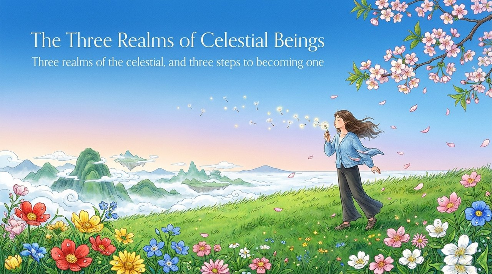
    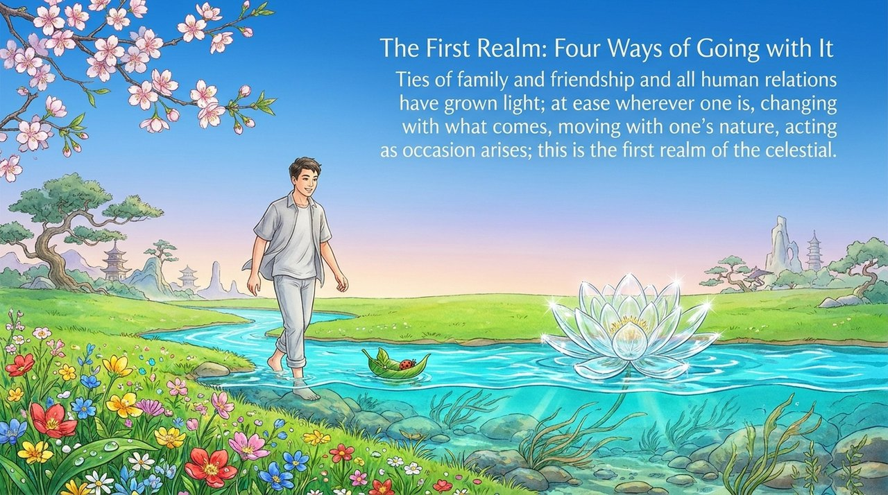
    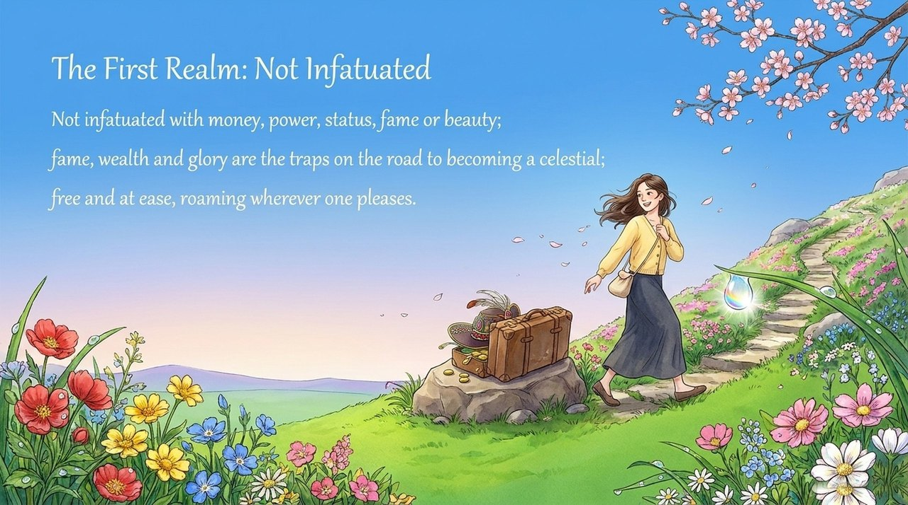
    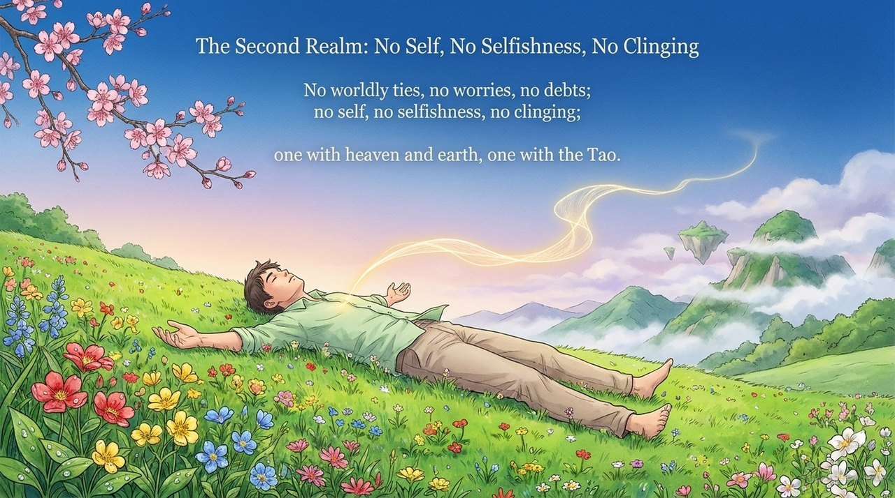
    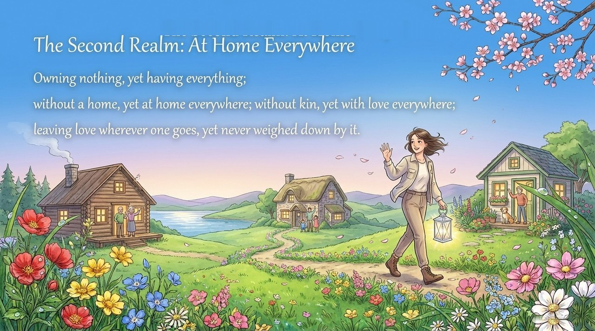
    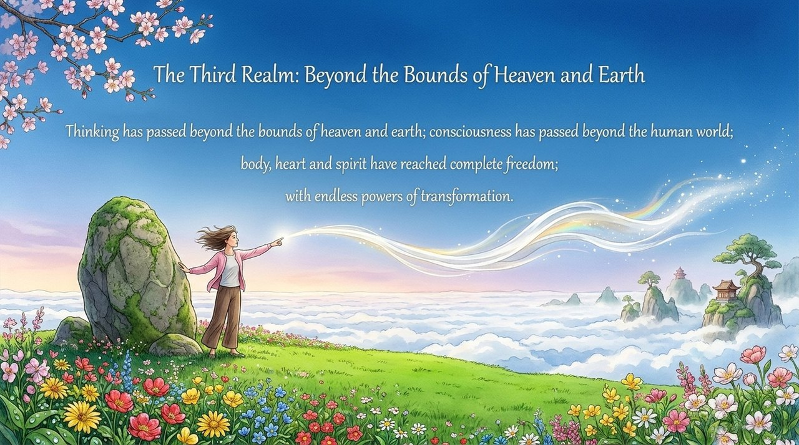
    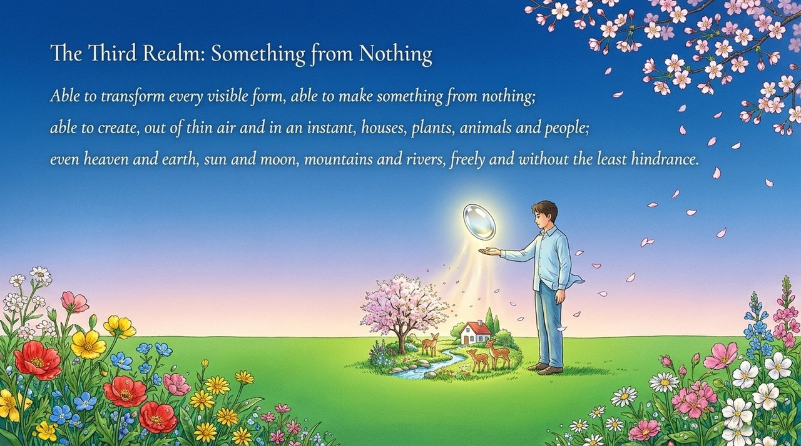
    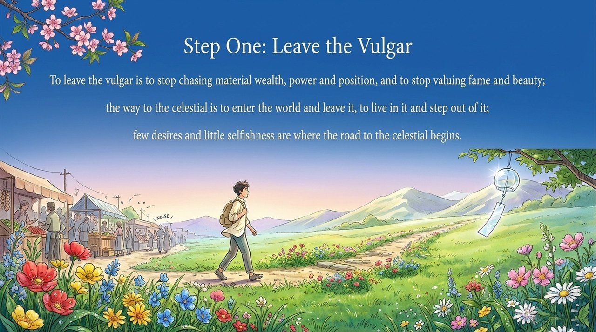
    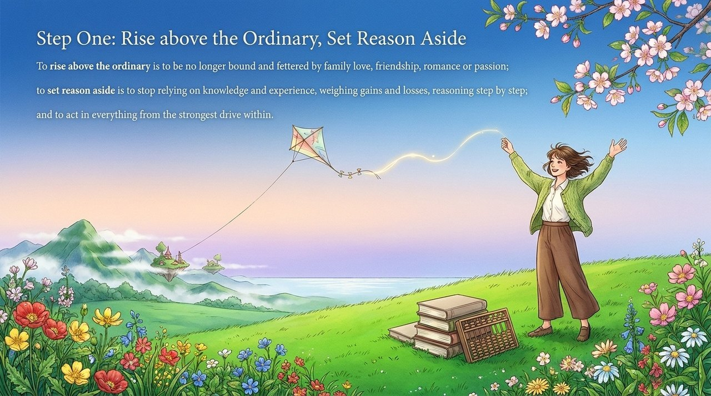
    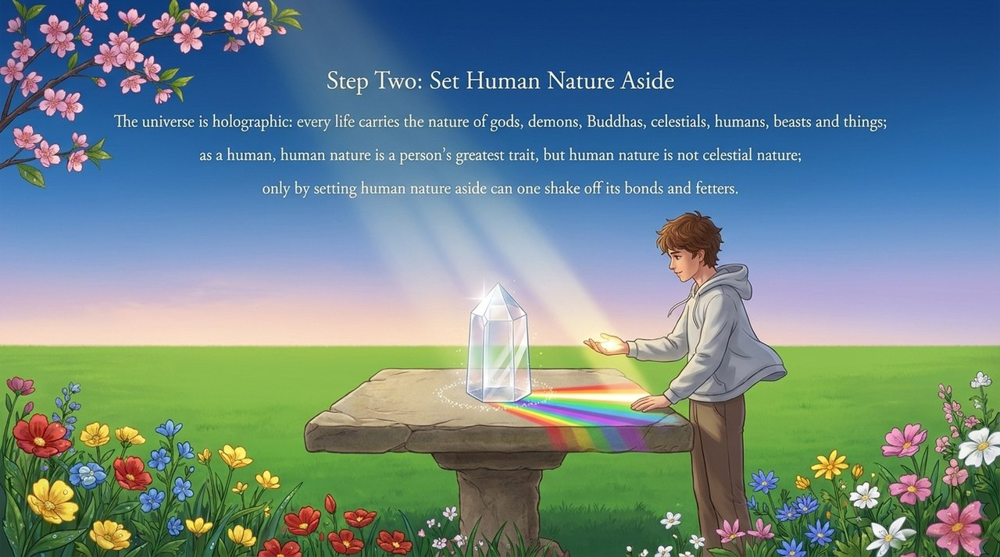
    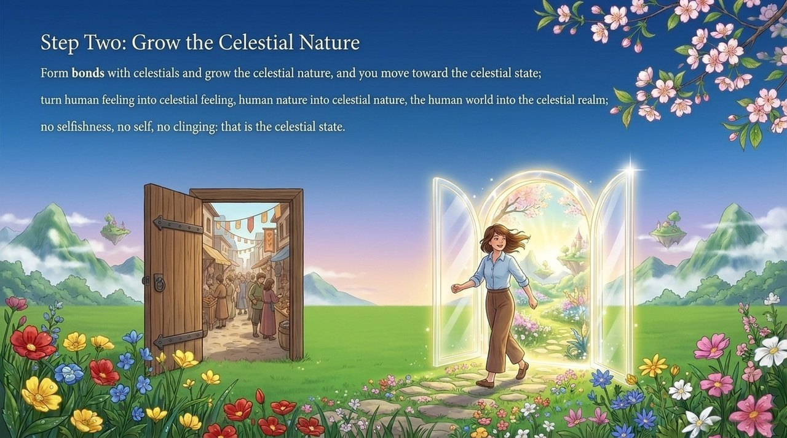
    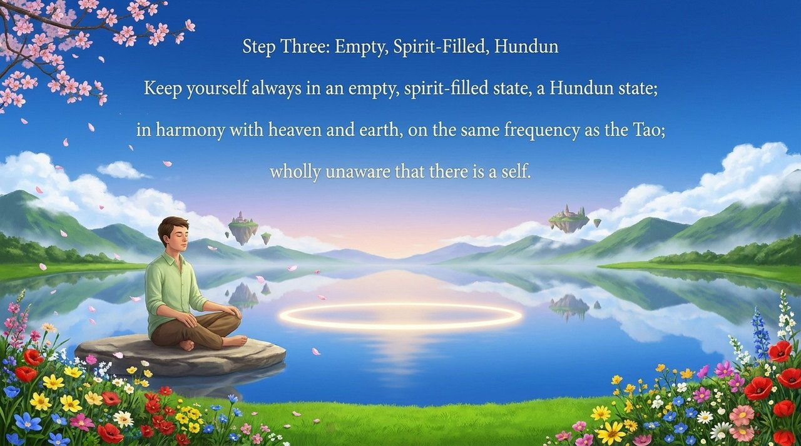
    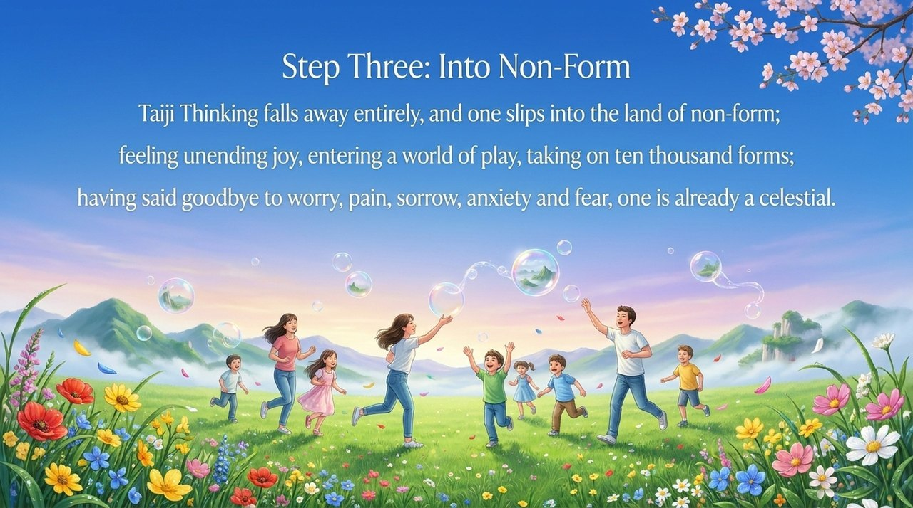
    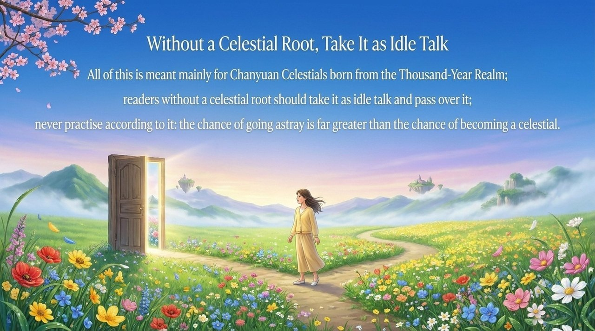

---

## Related Entries

[Becoming a Celestial Being](/en/becoming-celestial/) · [Celestial Nature (Xianxing)](/en/xianxing/) · [Transcending the Ordinary](/en/chaofantuosu/) · [Feathered Transformation](/en/yuhuachengxian/) · [Celestial Wind, Immortal Bones](/en/xianfengdaogu/) · [No-Self, No-Form](/en/no-self-no-form/) · [Own Nothing, Have Everything](/en/own-nothing-have-everything/) · [Celestials of the Thousand-Year World](/en/thousand-year-world-celestials/) · [Celestial Beings, Heavenly Celestials, and Buddhas](/en/xian-tian-xian-fo/)
