<!-- id: LC-TC-0001-EN theme: Cultivation Practice type: Entry Page direction: Cultivation Practice lang: en -->

# Genius (Tiancai)

**Genius is the manifestation in this lifetime of consciousness qualities accumulated across past lives — a latent possibility that the holographic universe has encoded into every being.** Given the right soil, environment, freedom, and timing — and with sustained focus on a single direction — anyone can become a genius. Four forces destroy it: miscellaneous duties, social obligations, broad interests, and lack of freedom. In the Lifechanyuan framework, anyone capable of becoming a Celestial Being or a Buddha is necessarily a genius; and the Second Home community model is the structural solution that allows genius to fully emerge.

---

## Version Navigation

| Version | For | Core Content |
|---------|-----|--------------|
| [Friendly Edition](friendly.md) | First-time readers | Why you are already a genius; the four destroyers; the generalist trap and the way out |
| [Academic Edition](academic.md) | Research reference | Holographic genius theory; structural barriers analysis; comparison with creativity research |
| [Internal Edition](internal.md) | Deep study | All seven sections with full source citations |

---

## Video

<iframe style="width:100%;aspect-ratio:4/3;border:0" src="https://www.youtube-nocookie.com/embed/E6PWKK1byfs" title="Genius (Tiancai) (Lifechanyuan Encyclopedia video)" allowfullscreen></iframe>

## Slides

??? info "📖 Illustrated slides (14 pages, click to expand)"

    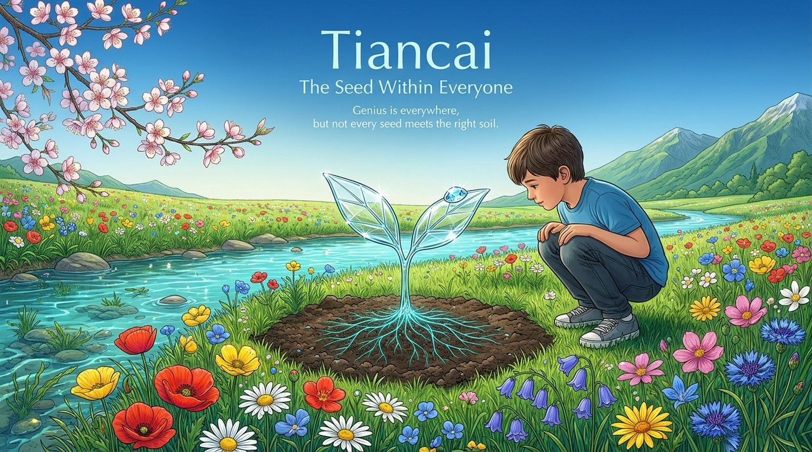
    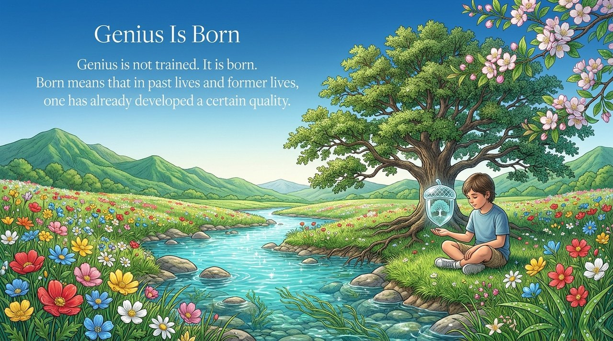
    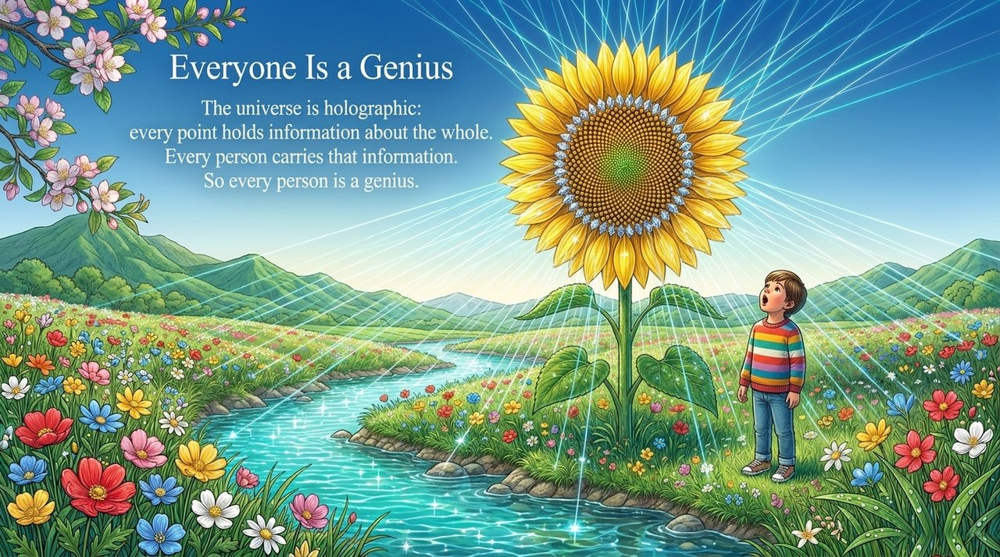
    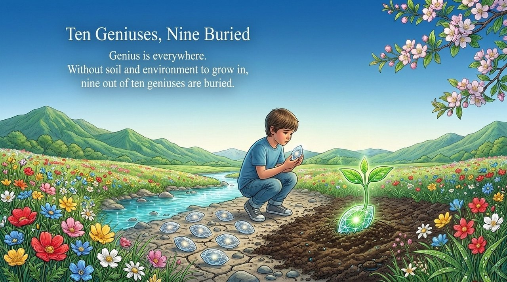
    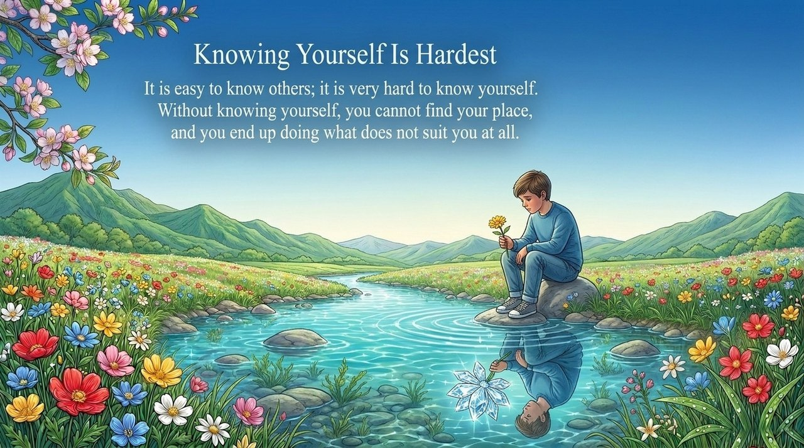
    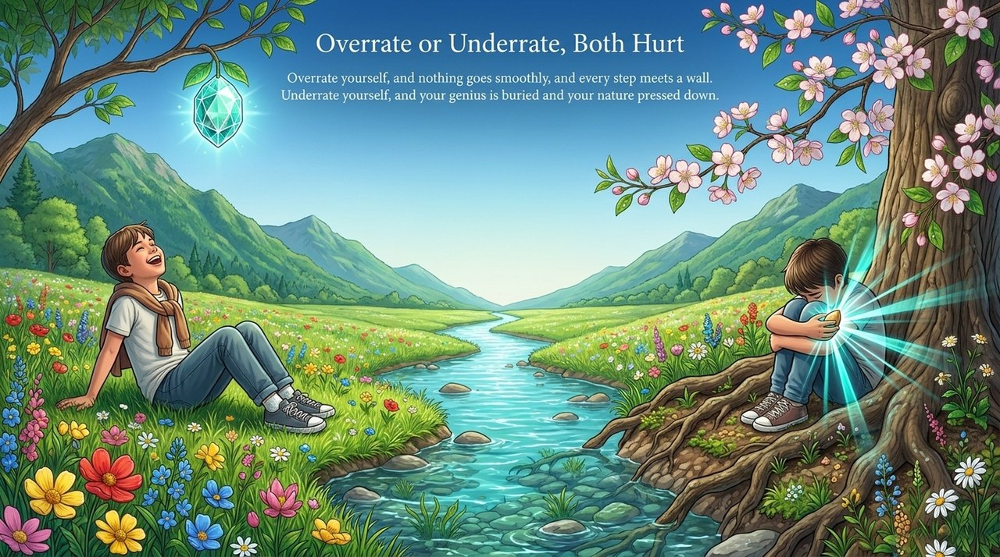
    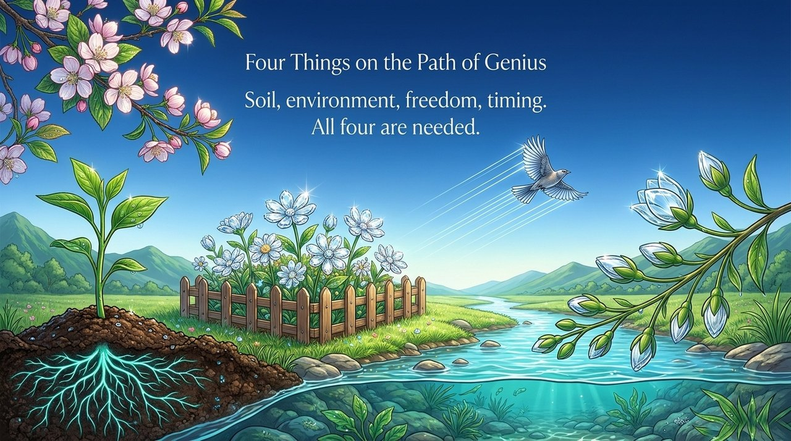
    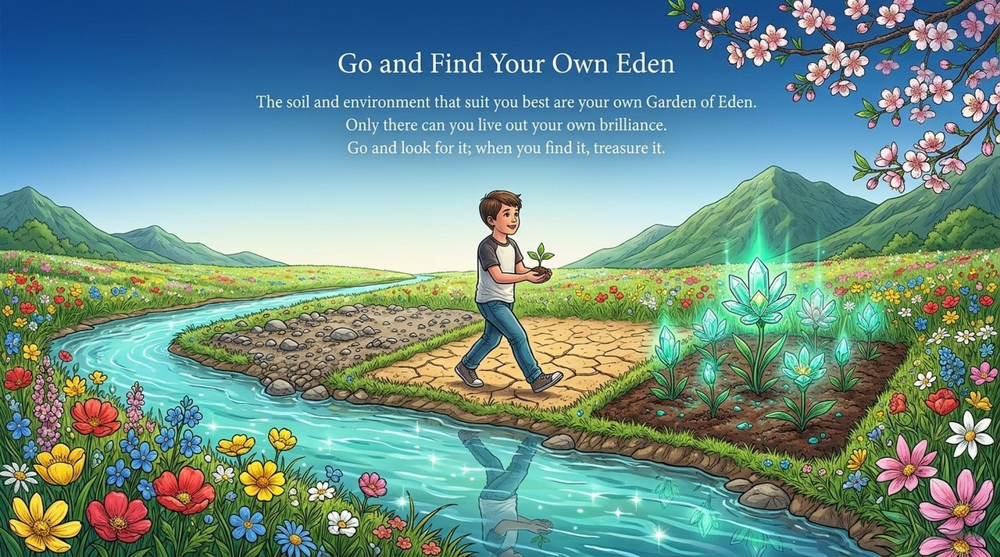
    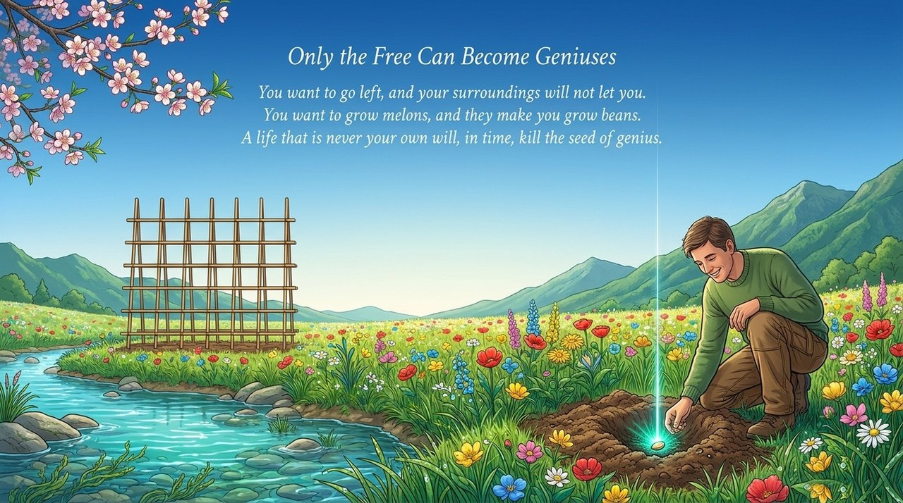
    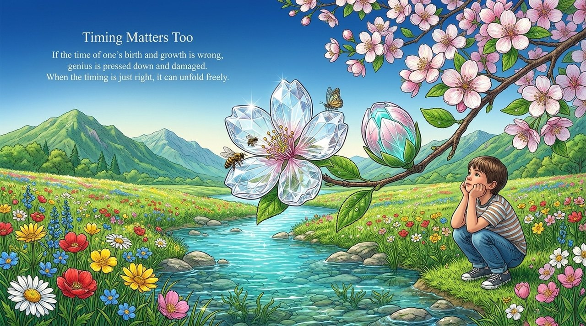
    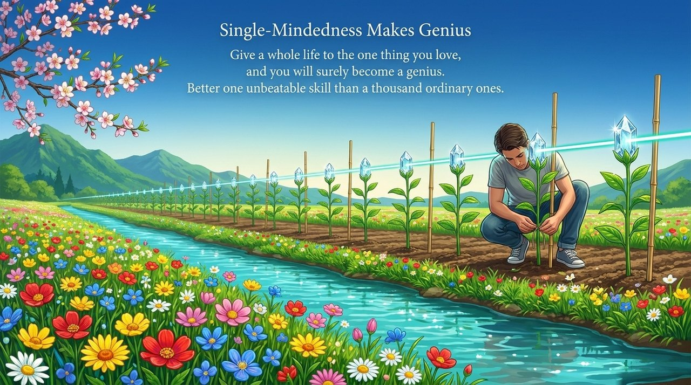
    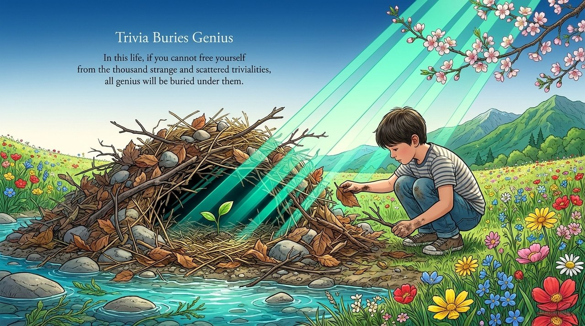
    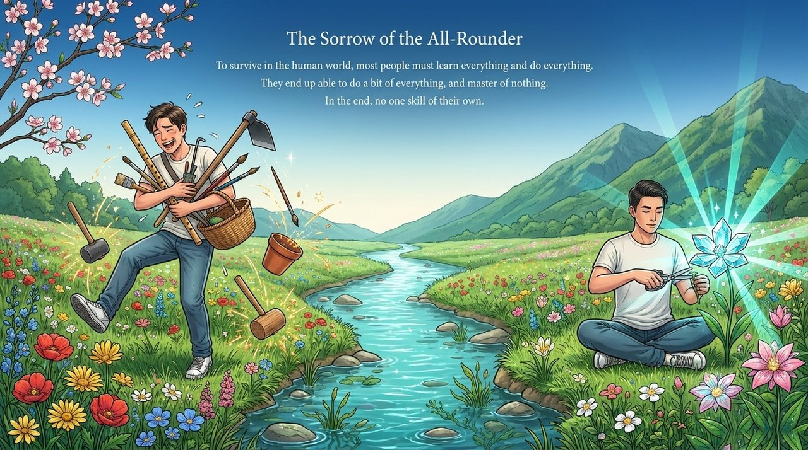
    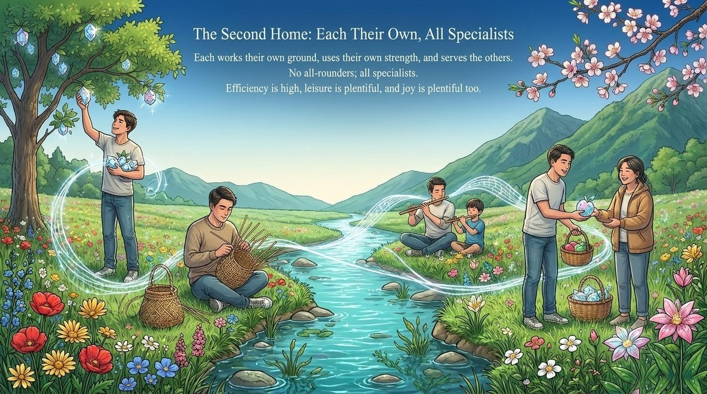

---

## Related Entries

[Natural Talent (Tianfu)](/en/tianfu/) · [Innate Nature (Tianxing)](/en/tianxing/) · [Tianming (Heavenly Mandate)](/en/tianming/) · [Second Home](/en/second-home/) · [Awakening](/en/awakening/) · [Celestial Beings, Heavenly Celestials, and Buddhas](/en/xian-tian-xian-fo/) · [Becoming a Celestial Being and a Buddha](/en/becoming-celestial-buddha/)
