<!-- id: LC-TF-0001-EN theme: Cultivation Practice type: Index direction: Cultivation Practice lang: en -->

# Tianfu (Natural Talent)

**In the Lifechanyuan system, "tianfu" (天赋, natural talent / innate endowment) encompasses two interrelated dimensions** — first, the innate talents and qualities Heaven has encoded into each life: genius is not cultivated after birth but inherited from the accumulated consciousness of past lives; second, the natural rights Heaven bestows upon every person: the right to think, to be free, and the other rights the Greatest Creator has given as inalienable gifts. The holographic principle implies that everyone is a genius — but mediocrity and clutter are the chief destroyers of genius. The path of genius requires four elements: suitable soil, environment, freedom, and the right timing. Those who attain the celestial realms must be geniuses, for no one without exceptional spirituality and perseverance can reach the heights of cultivation.

---

## Version Guide

| Version | Best for | Core content |
|---------|----------|-------------|
| [Friendly Edition](friendly.md) | First-time readers | Van Gogh / Jiang Ziya / Chen Jingrun case studies, the Eden Garden analogy, the four destroyers of genius |
| [Academic Edition](academic.md) | Researchers | Holographic genius theory, environment determinism, comparison with Rousseau's natural rights and Weberian vocation |
| [Internal Edition](internal.md) | In-depth study | Full citations across seven thematic sections |

---

## Video

<iframe style="width:100%;aspect-ratio:4/3;border:0" src="https://www.youtube-nocookie.com/embed/fS_pWIUtcu0" title="Natural Talent (Tianfu) (Lifechanyuan Encyclopedia video)" allowfullscreen></iframe>

## Slides

??? info "📖 Illustrated slides (14 pages, click to expand)"

    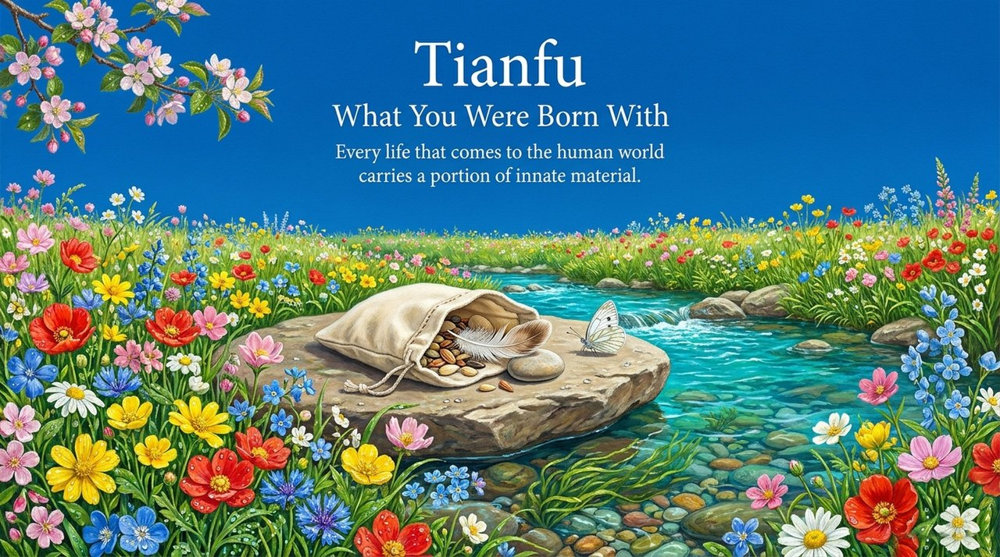
    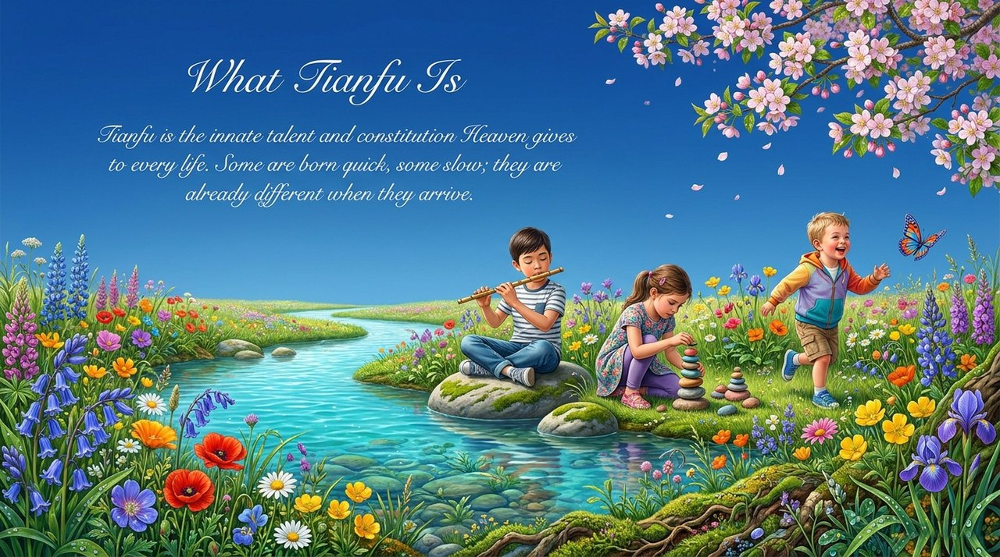
    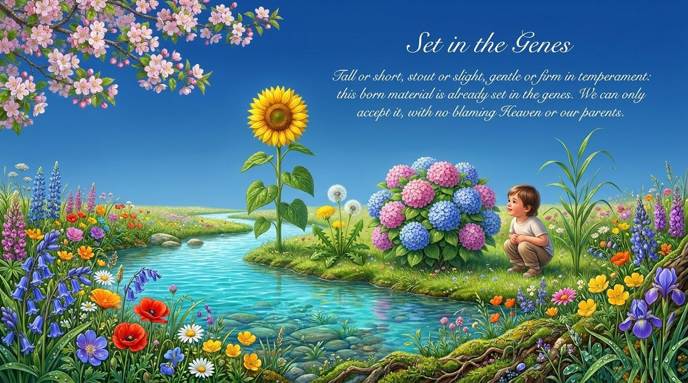
    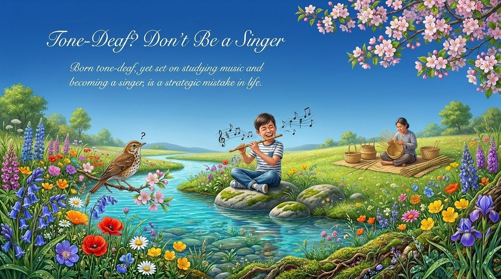
    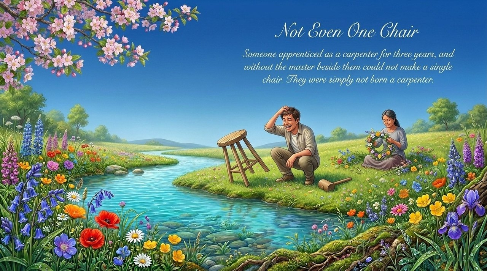
    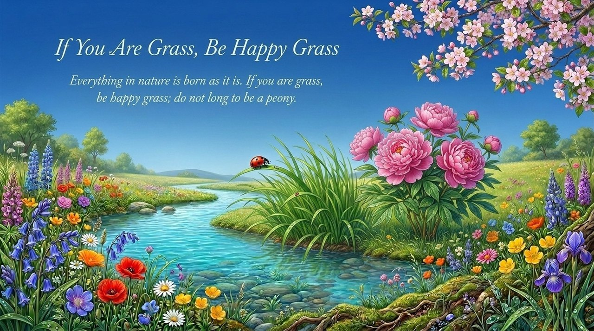
    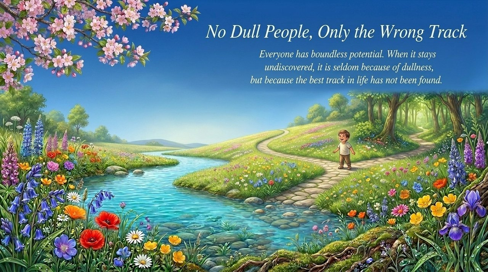
    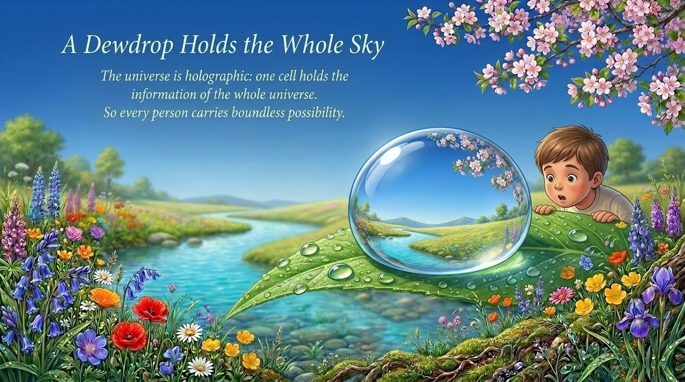
    
    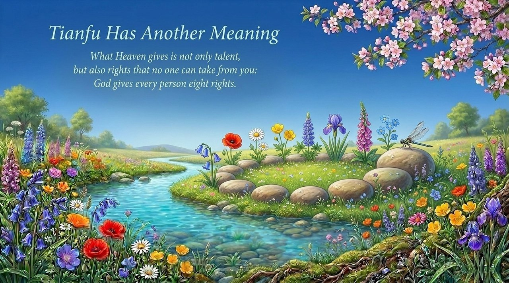
    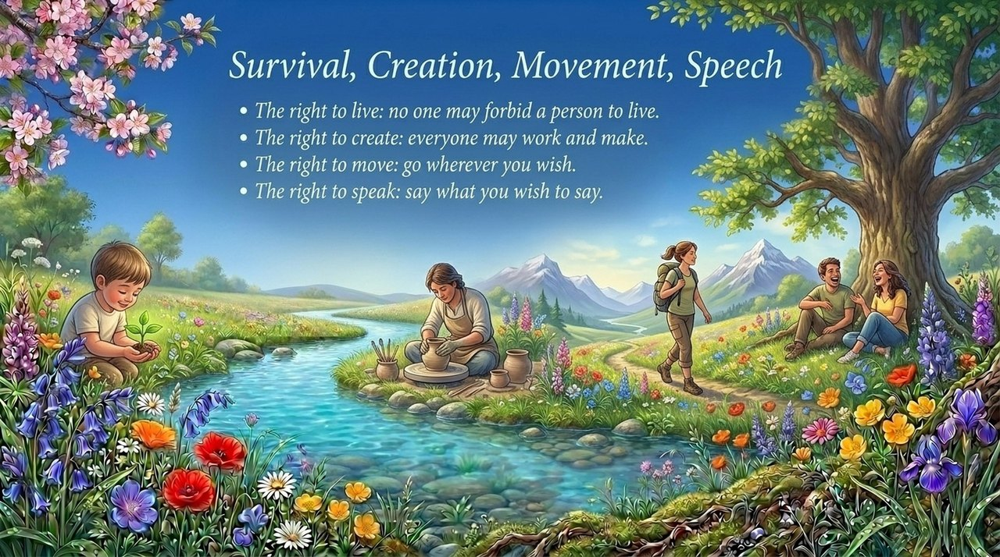
    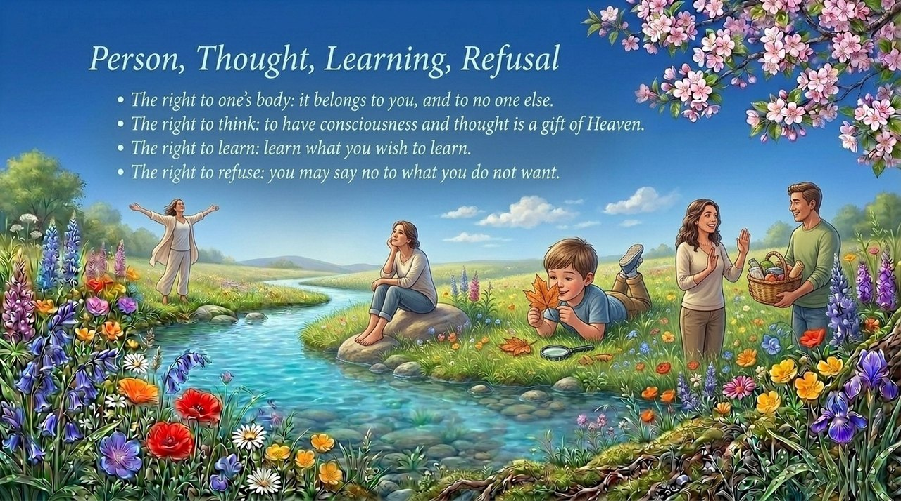
    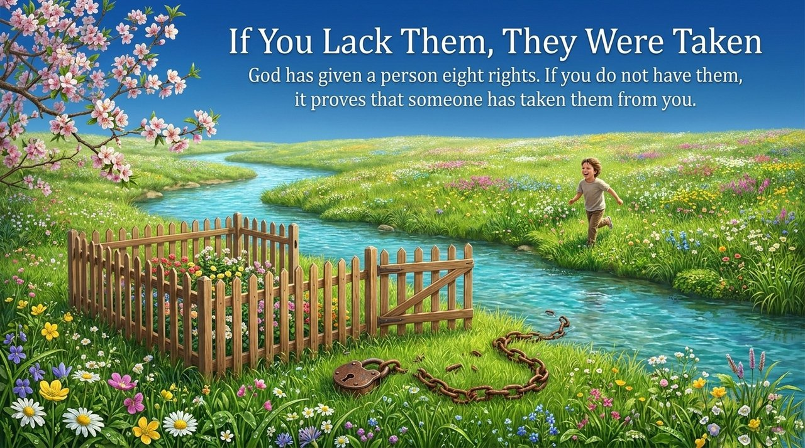
    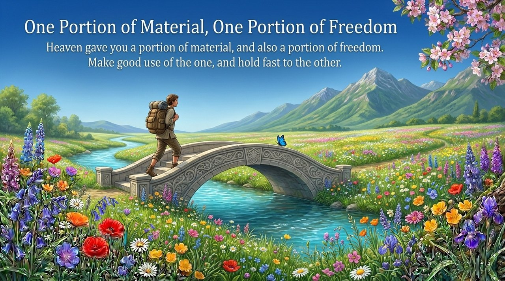

---

## Related Entries

[Tianming (Heavenly Mandate)](/en/tianming/) · [Innate Nature, Inherent Character, Habitual Disposition](/en/tianxing-bingxing-xixing/) · [Free Will](/en/free-will/) · [The Script of Human Life](/en/life-script/) · [Awakening](/en/awakening/) · [Spirituality](/en/spirituality/) · [Second Home](/en/second-home/) · [The Value, Meaning & Purpose of Life](/en/value-meaning-purpose-of-life/)
