<!-- id: LC-TM-0001-EN theme: Cultivation Practice type: Index direction: Cultivation Practice lang: en -->

# Tianming (Heavenly Mandate)

**In the Lifechanyuan system, "Tianming" (heavenly mandate) encompasses three interrelated levels** — first, the innate talents and mission Heaven endows each life with; second, the life trajectory and fate pre-arranged by the Dao (the cosmic program); and third, the inevitable law governing all things in the universe. "Knowing one's tianming" is an important stage in cultivation: recognizing what you are made of, being yourself, and following Heaven's arrangement. "Transcending fate," meanwhile, is the higher aspiration: 98% of people follow the fate-script, while the rare 1–2% of Chanyuan Celestials — through abnormal thinking and awakening spiritual sensing — move from the realm of necessity into the realm of freedom.

---

## Version Guide

| Version | Best for | Core content |
|---------|----------|-------------|
| [Friendly Edition](friendly.md) | First-time readers | Life-as-script analogy, historical figures who "knew their tianming," why violating fate leads to hardship |
| [Academic Edition](academic.md) | Researchers | Conceptual structure, fatalism framework, comparison with Confucian and Western traditions |
| [Internal Edition](internal.md) | In-depth study | Full citations across seven thematic sections |

---

## Video

<iframe style="width:100%;aspect-ratio:4/3;border:0" src="https://www.youtube-nocookie.com/embed/dn3jJy-bexw" title="Tianming (Heavenly Mandate) (Lifechanyuan Encyclopedia video)" allowfullscreen></iframe>

## Slides

??? info "📖 Illustrated slides (14 pages, click to expand)"

    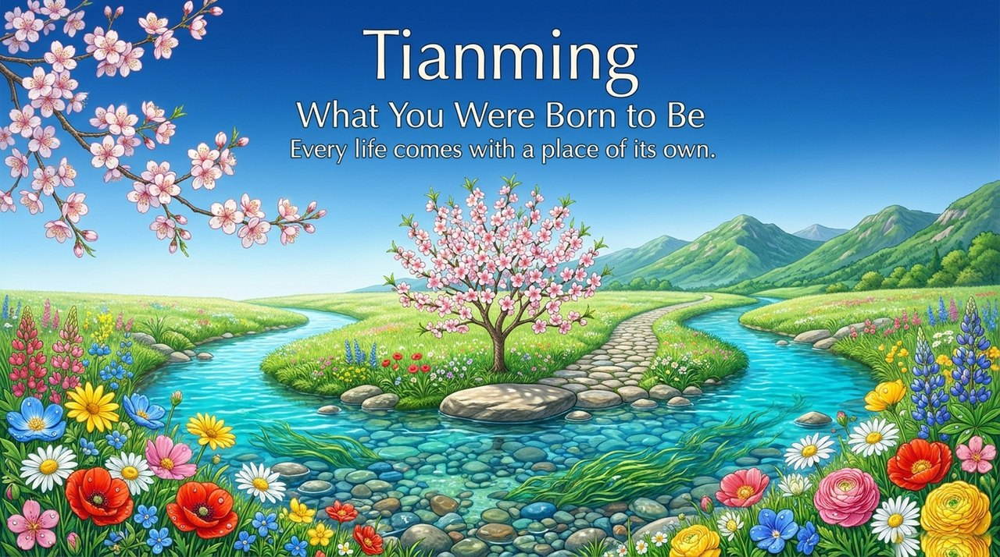
    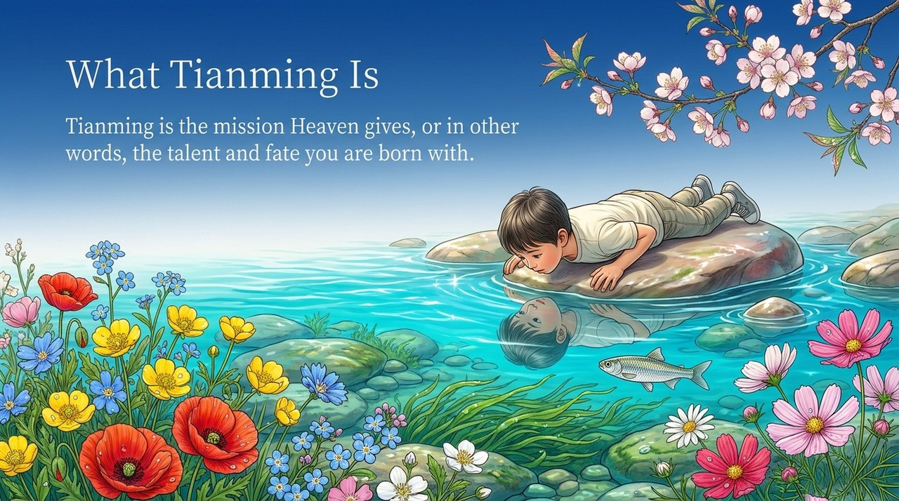
    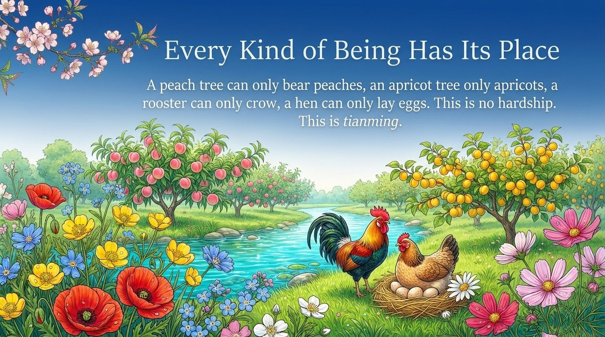
    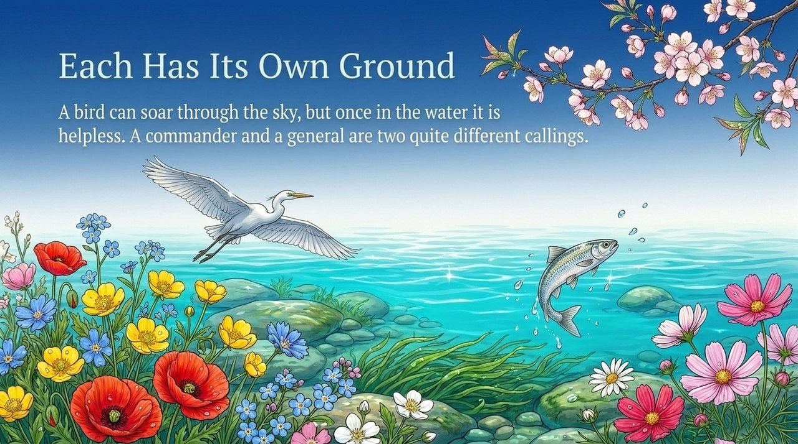
    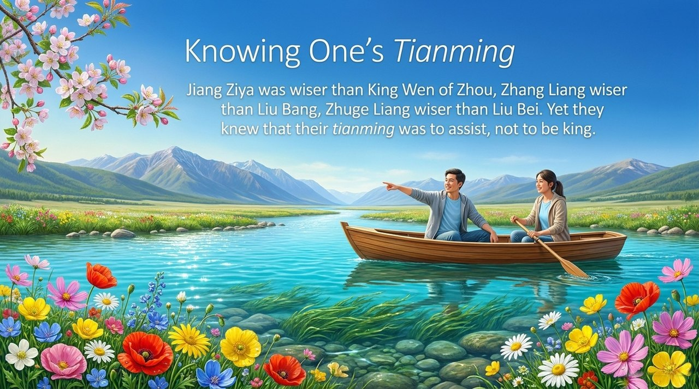
    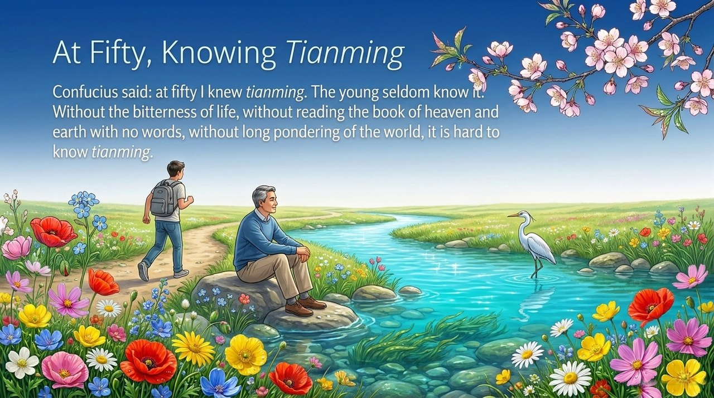
    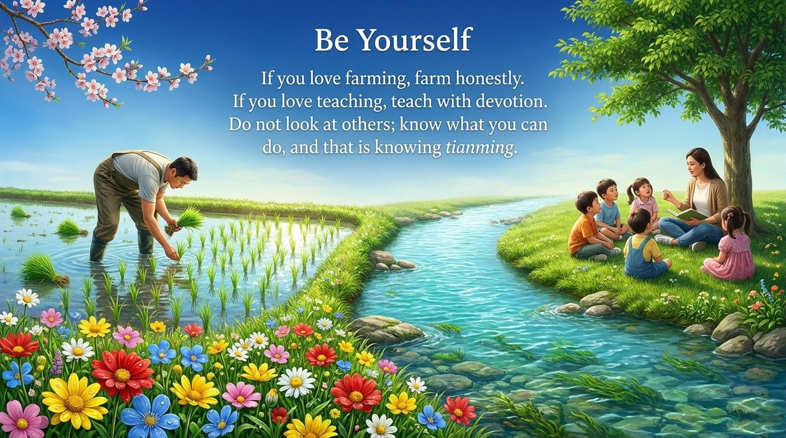
    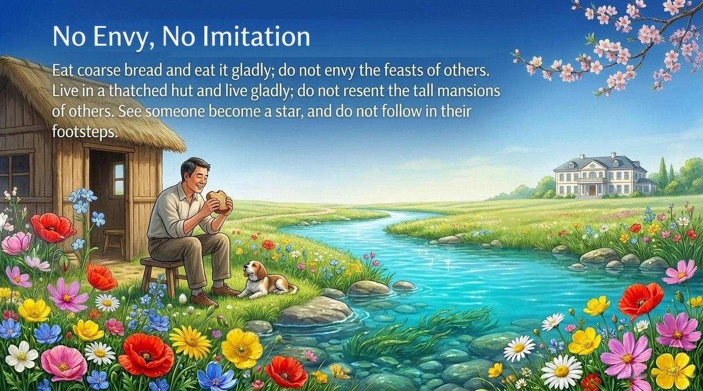
    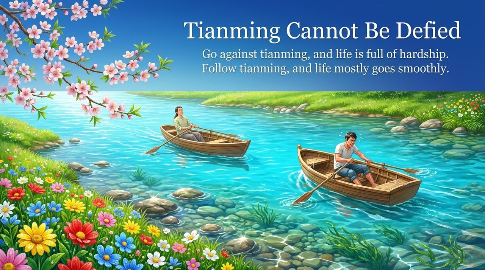
    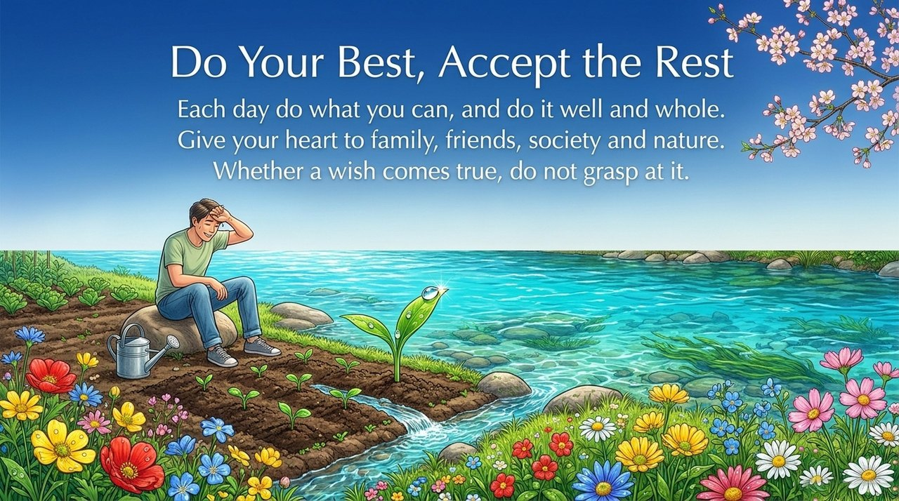
    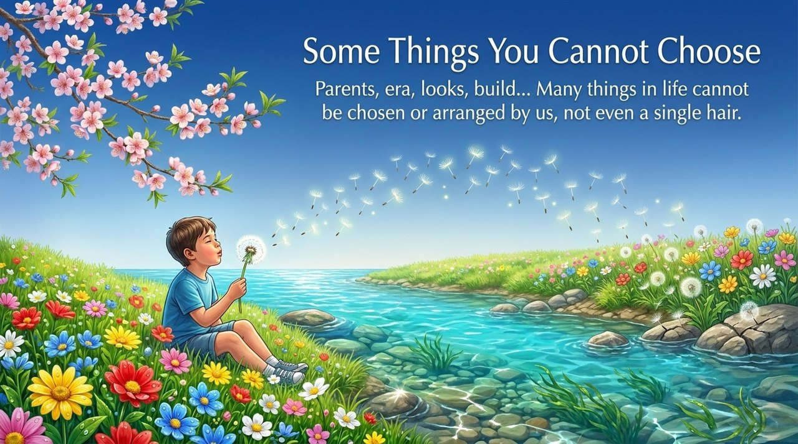
    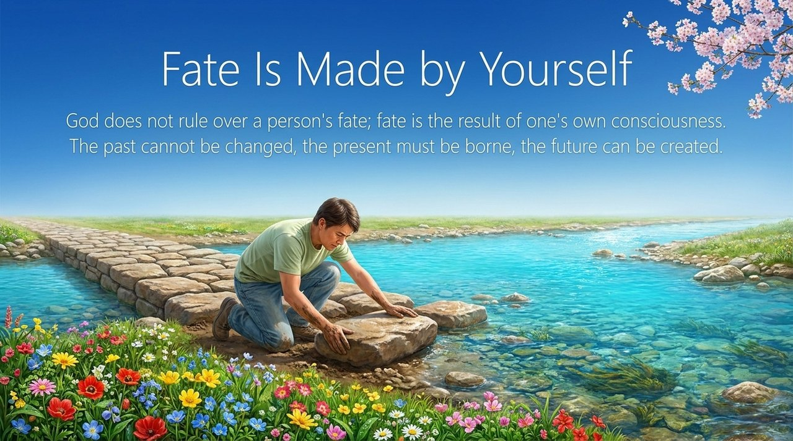
    
    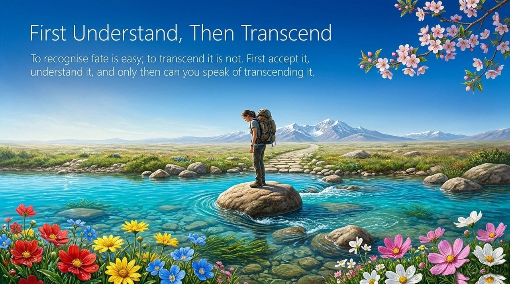

---

## Related Entries

[Karma, Retribution & Reincarnation](/en/karma-retribution-reincarnation/) · [Life Trajectory](/en/life-trajectory/) · [The Script of Human Life](/en/life-script/) · [Free Will](/en/free-will/) · [Awakening](/en/awakening/) · [Knowledge, Wisdom & Zhi](/en/knowledge-wisdom-zhi/) · [The Value, Meaning & Purpose of Life](/en/value-meaning-purpose-of-life/) · [Illuminate the Mind, See the Nature](/en/illuminate-mind-see-nature/)
