<!-- id: LC-TX-0001-EN theme: Cultivation Practice type: Index direction: Cultivation Practice lang: en -->

# Tianxing (Innate Nature)

**In the Lifechanyuan system, "tianxing" (天性, innate nature) is the original and essential character that the Creator has encoded into every being and thing** — pristine and luminous before birth, reflecting the qualities of the Greatest Creator and the celestial realm. Tianxing belongs to the universal dimension (the shared essence of all within a category), as distinct from the class-specific disposition (秉性, bingxing) and the individual habit (习性, xixing). To express one's tianxing — to act in accordance with it — is to act in accordance with the Dao itself. "Give full expression to your tianxing and follow Nature" is listed as the fourth of the eight core principles of the Way of the Greatest Creator.

---

## Version Guide

| Version | Best for | Core content |
|---------|----------|-------------|
| [Friendly Edition](friendly.md) | First-time readers | What innate nature is; five forces that suppress it; celestials as lives that freely follow their nature |
| [Academic Edition](academic.md) | Researchers | Three-nature system, comparison with Confucian/Daoist/Buddhist theories, cultivation implications |
| [Internal Edition](internal.md) | In-depth study | Full citations across seven thematic sections |

---

## Video

<iframe style="width:100%;aspect-ratio:4/3;border:0" src="https://www.youtube-nocookie.com/embed/FMNOHpyUViw" title="Innate Nature (Tianxing) (Lifechanyuan Encyclopedia video)" allowfullscreen></iframe>

## Slides

??? info "📖 Illustrated slides (14 pages, click to expand)"

    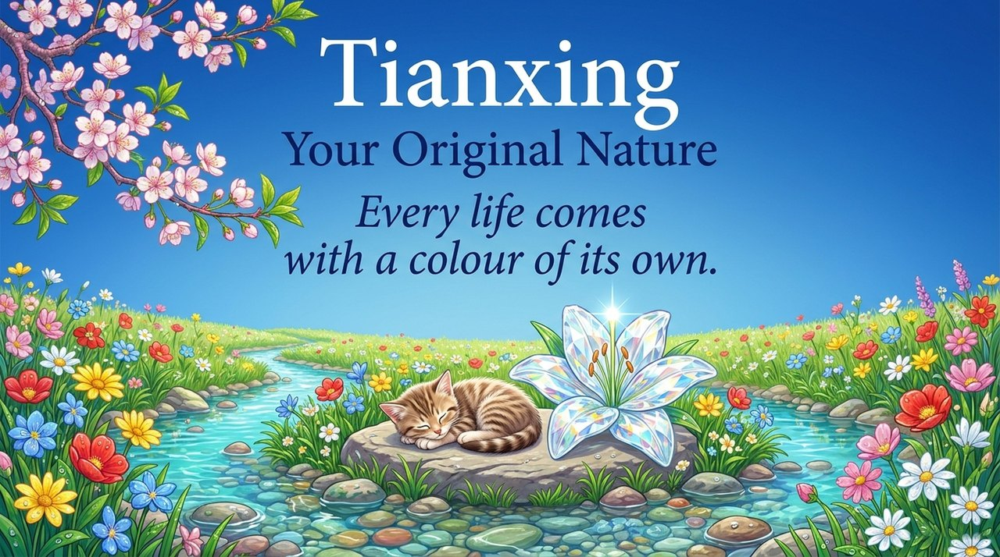
    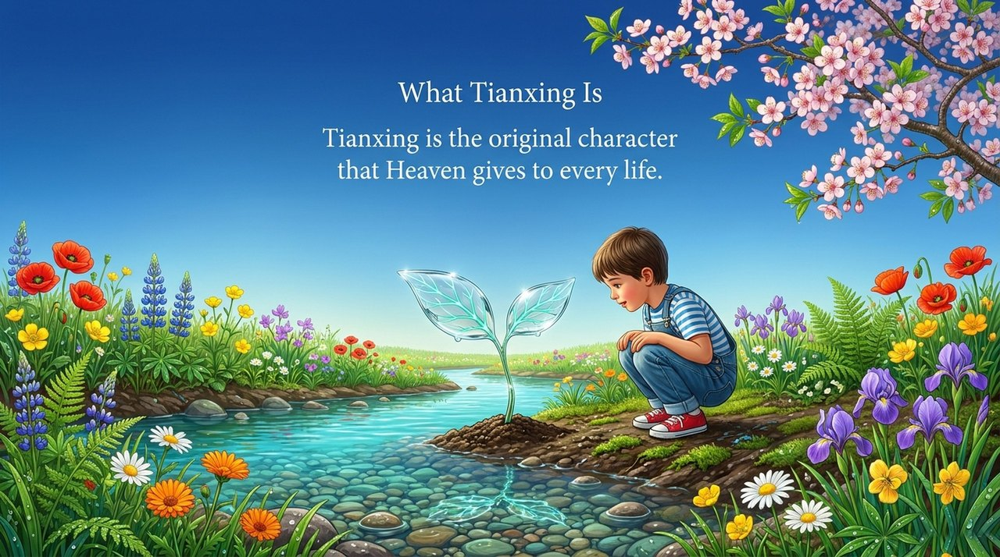
    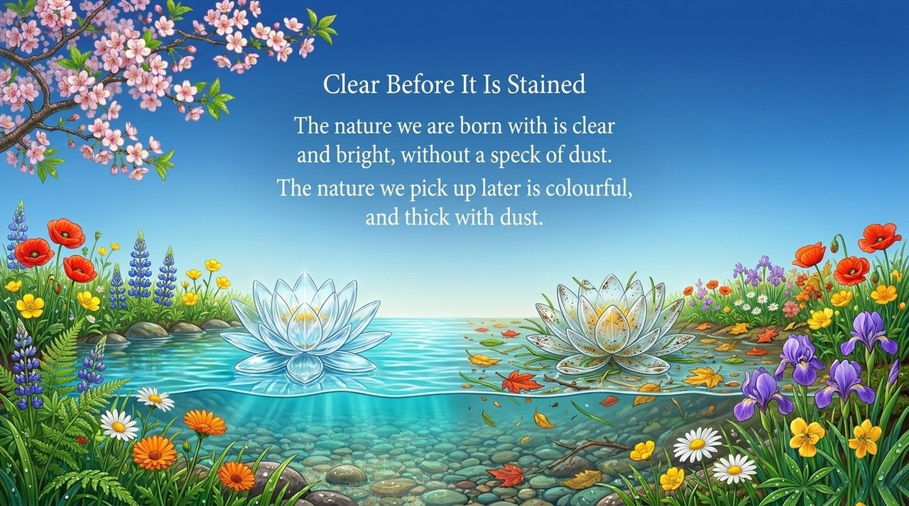
    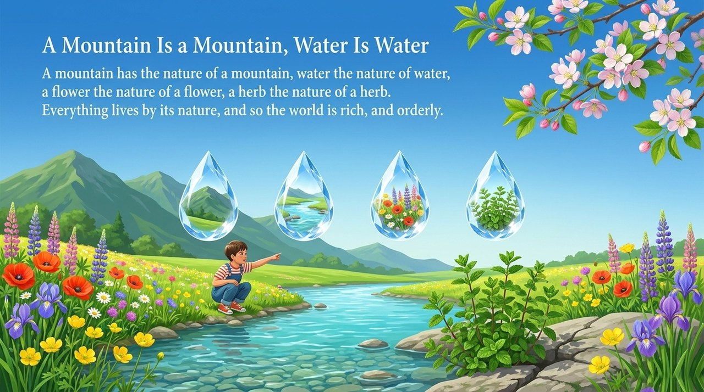
    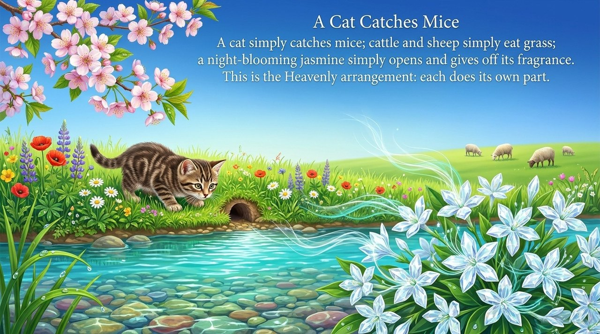
    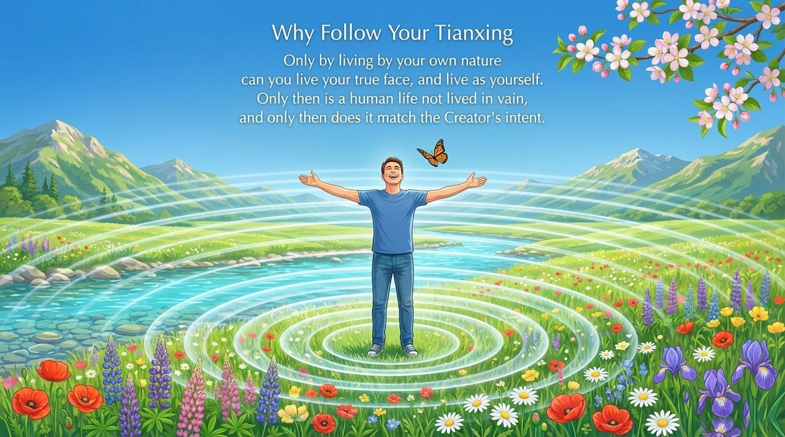
    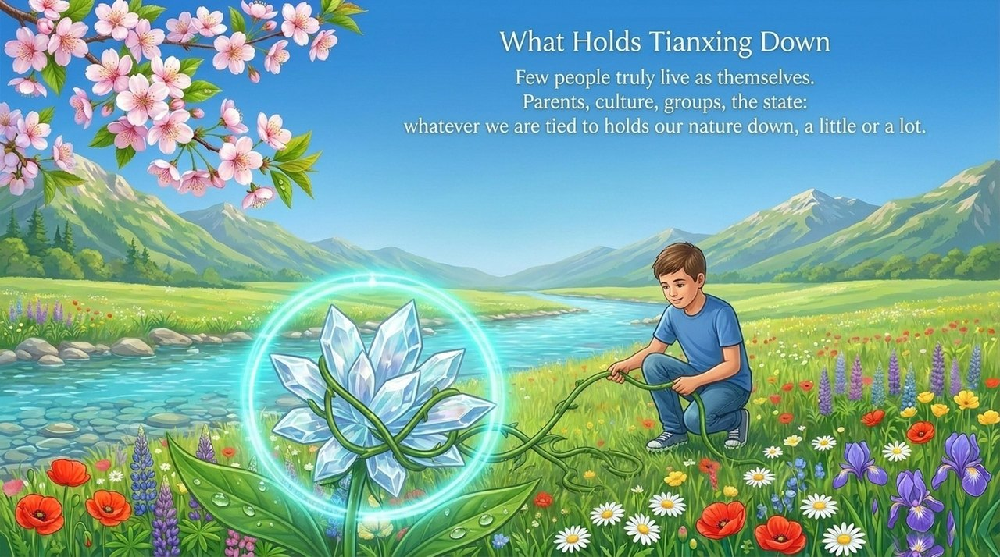
    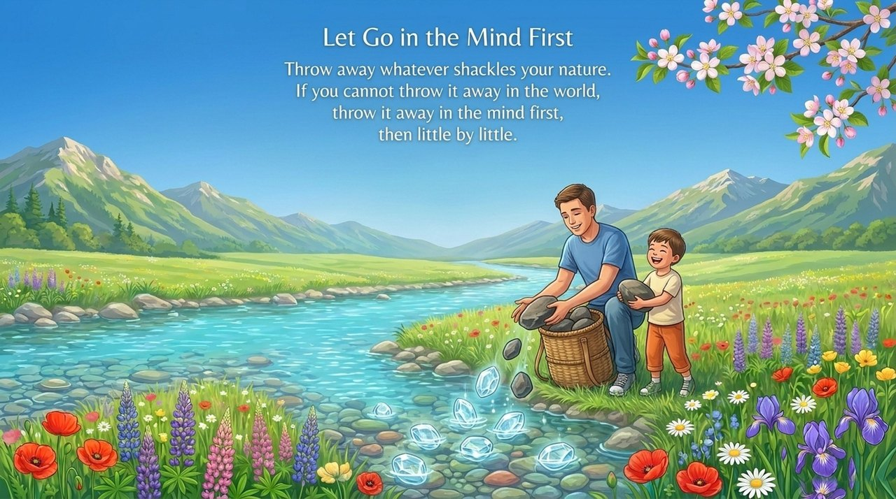
    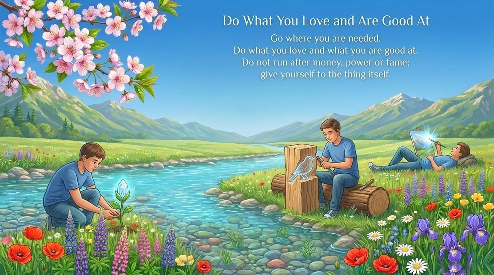
    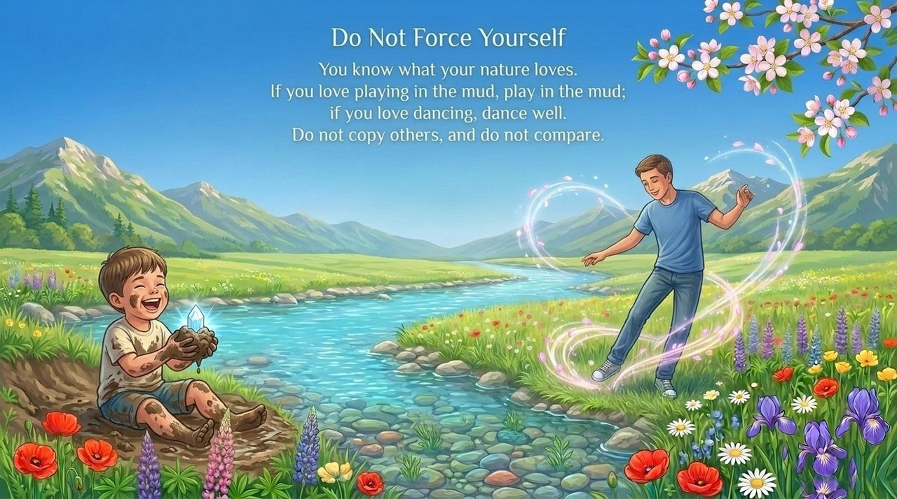
    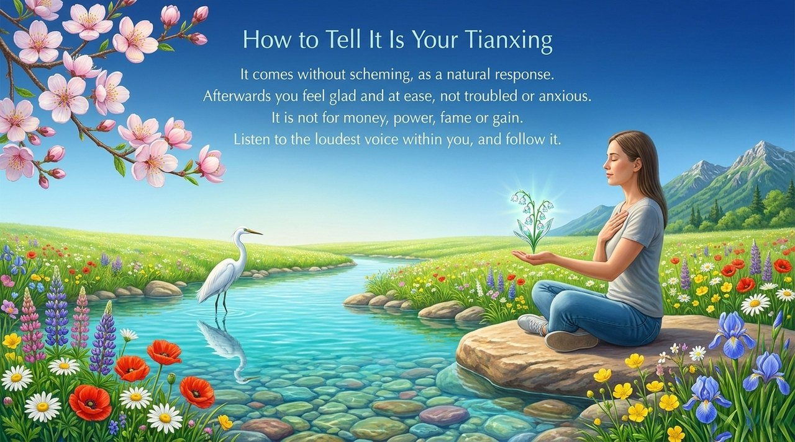
    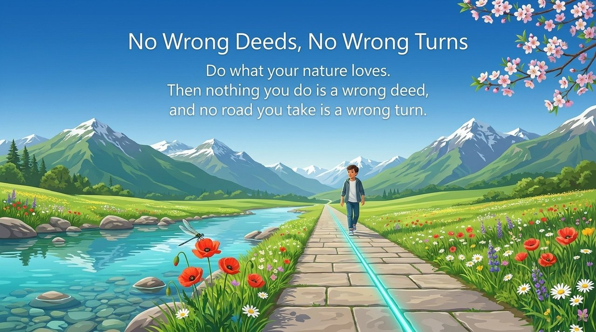
    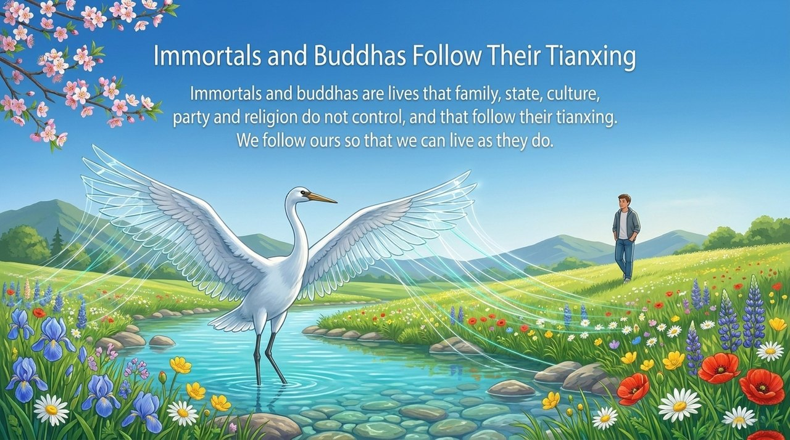
    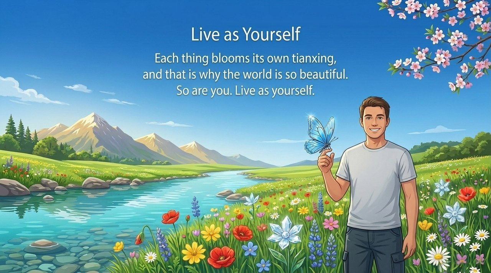

---

## Related Entries

[Innate Nature · Inherent Character · Habitual Disposition](/en/tianxing-bingxing-xixing/) · [Natural Talent (Tianfu)](/en/tianfu/) · [Tianming (Heavenly Mandate)](/en/tianming/) · [Self-Nature (Buddha-Nature)](/en/self-nature/) · [Dao](/en/dao/) · [Spirituality](/en/spirituality/) · [The Four Adaptations](/en/si-sui/) · [Awakening](/en/awakening/) · [Celestial Beings, Heavenly Celestials, and Buddhas](/en/xian-tian-xian-fo/)
